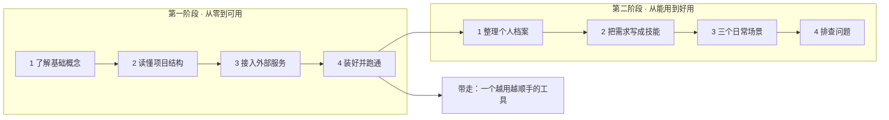
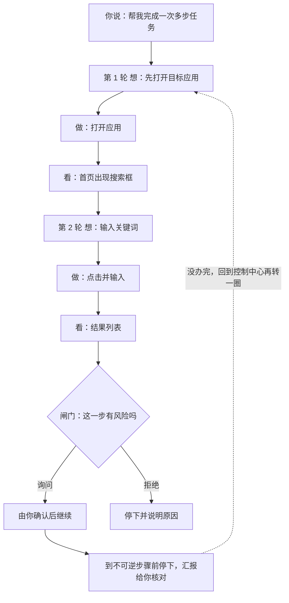
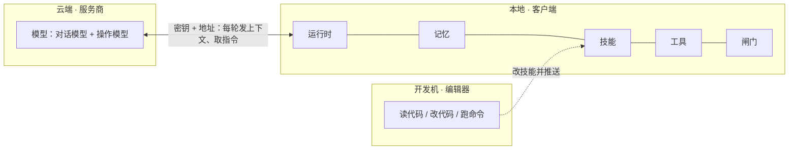
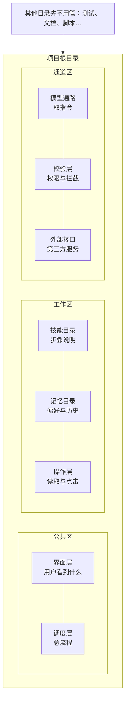
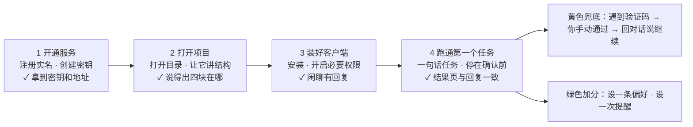
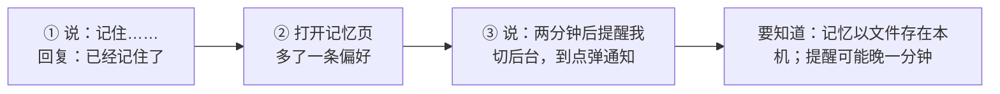

# 画板语法：三类图的元素清单与可复用骨架

> 本文件是 `howto-course-writing/SKILL.md` §4 的展开。Mermaid 只作结构示意，实际画板还需要吉祥物/截图/手绘排版。

## 通用视觉规则（10 条）

| # | 规则 | 说明 |
|---|---|---|
| 1 | 主标题写结论 | "两节课，从装好到改好" > "课程安排" |
| 2 | 副标题给视角 | 一行交代"这一轮在看什么" |
| 3 | 编号与正文同号 | 正文 1-7，图上也必须 1-7 |
| 4 | 同构卡片 | 可比较的步骤用同一模板：编号 + 标题 + 2 动作 + 1 ✓ |
| 5 | 颜色四语义 | 绿=主线 / 黄=提示 / 红=拦截 / 灰=本期不做 |
| 6 | 虚线三用途 | 循环、返回、范围外 |
| 7 | 一图一问 | 一张图只回答一个问题 |
| 8 | 每块卡片自带定义 | 房间/零件卡写"名字 + 功能标签 + 一句职责" |
| 9 | 范围收口写图内 | "其他先不用管：…" 用灰字放在图内 |
| 10 | 底部带走句 | 整图最下方一条结论横条 |

## 蓝图 1：地图图（路线）

**回答**：一共几步、我在哪。

**元素**：主标题（结论）+ 副标题（课程/产品名）+ 左右（或上中下）两组阶段 + 组内 4-5 条编号 + 中缝箭头 + 组底横条（作业/延伸）+ 整图底条（带走句）。

## 蓝图 2：解剖图·放射（以中心为轴）

**回答**：核心之外还需要哪几样、它们怎么协作。

**元素**：中心块（最窄的核心）+ 外围 5-8 个编号块（每块三行：名字/一句定义/2-4 条要点）+ 每块左上角范围标签 + 一个实例区（把结构落成一次真实任务）+ 全图唯一的红色例外格 + 底部闭环虚线。

**复用模板句**："{系统}是怎么干活的——它自己{做不了的三件事}，这些都靠四周。"

## 蓝图 3：解剖图·三列（以位置为轴）

**回答**：谁在云端、谁在本地、谁只在改代码时出现。

**元素**：三列 + 列顶一句定性 + 一条通路箭头 + 右下角一个用量或成本数字 + 一行隐私边界。

**复用模板句**："模型在云端，其余几样都在你的设备里；电脑只在你想改它的时候才用。"

## 蓝图 4：解剖图·空间隐喻（以项目结构为轴）

**回答**：我要改的东西在哪个文件夹。

**元素**：四个区块——① 户型图（8 个房间卡）② 走一遍（6 步流程 + 回流虚线）③ 改哪里（5 行诊断表 + 成本标签 快/最快/慢/看情况）④ 四步法（打开→提问→听讲→说得出 + 红框口诀）。

**复用模板句**："把{系统}当成一张户型图：{不需要懂的部分}不用懂，但得知道{必须知道的三个位置}。"

## 蓝图 5：操作图·同构卡片

**回答**：现在该做哪几步、怎么算做完。

**元素**：N 张同构卡片（编号圆点 / 标题 / 2 条动作条 / 1 条 `✓`）+ 底部两条横条（黄=兜底、绿=加分）。

**复用模板句**："一共 N 步，每一步都有一个看得见的成功标志。"

## 蓝图 6：操作图·三格实拍

**回答**：做对了的话，屏幕应该长什么样。

**元素**：3 格真机截图 + 每格一句动作 + 每格一句结果 + 底部"要知道"提示条（存储位置、精度、限制）。

## 生产流程（五步）

1. 写问题句：这块图独立回答什么？答不出就不画。
2. 定类型：导航→地图图，结构→解剖图，执行→操作图。
3. 列元素：主标题/副标题/编号块/范围标签/实例区/底部结论条，缺项就补。
4. 排版：先网格后颜色；同构内容用同构卡片。
5. 自检 10 问，不合格就删元素，不要加元素。

## 画板自检 10 问

- [ ] 能用一句问句概括它回答的问题？
- [ ] 主标题是结论句而非主题词？
- [ ] 副标题给了视角或范围？
- [ ] 每个块都有"名字 + 一句定义"？
- [ ] 编号与正文逐字一致？
- [ ] 颜色是否只有四种语义且全篇统一？
- [ ] 标了"本期不做"的部分？
- [ ] 有虚线表达循环/返回/范围外？
- [ ] 底部有一句可带走的结论？
- [ ] 缩到 50% 仍能看出主结构？
