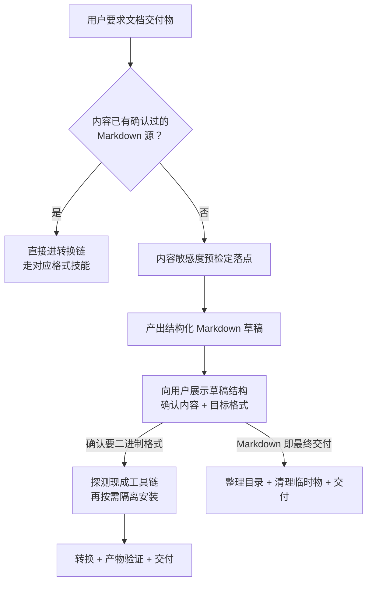

# Markdown 优先交付物起草

把对话中确认的方案整理成文档交付物时，**先用低成本 Markdown 草稿锁定内容与结构，经用户确认后再决定是否投入二进制格式工具链**。不要一上来就定位 Python 环境、隔离安装 docxtpl/python-docx、探测 Word COM——内容与格式未锁定前，这些准备随时会作废。

> **为什么？** 来源会话中，两个回合的 Word 生成均以写入失败告终，期间完成了大量环境准备；用户随后直接改口「别生成word了，直接生成文件夹，markdown组成的」，全部准备作废。而 Markdown 文件夹交付一次成功。二进制格式工具链的准备成本高、失败面大，且格式往往不是用户的真实刚需——内容才是。

## 1. 适用边界

适用：

- 用户要求把对话中的方案、清单、模板整理成 Word/PDF/文档交付物，内容尚未固化为 Markdown 源
- 多文件文档交付（索引 + 分文件），需要确定目录命名、frontmatter 与互链约定
- 用户中途改变目标格式（如 Word → Markdown 文件夹 → PDF）

不适用：

| 场景 | 交给他 |
|---|---|
| 已有确认过的 Markdown 源，只做格式转换 | 对应转换技能（docx-template-report、pdf 等） |
| 公开知识库文档、Sphinx 站点页面 | 仓库文档边界规范（docs/ 体系） |
| 私域敏感内容的落点判定本身 | 内容敏感度预检规则（AGENTS.md 启动协议步骤 2.3） |

## 2. 流程决策树



> **为什么把「确认目标格式」放在草稿之后？** 用户说「整理成 Word」时，真实诉求常是「要一份可留存、可分享的交付物」。看到 Markdown 草稿后，相当比例的用户会接受文件夹形态或改选 PDF。先出草稿把格式选择变成 informed decision，避免为猜测的格式预付工具链成本。

## 3. 落点决策（内容敏感度预检）

| 内容级别 | 落点 | 命名 |
|---|---|---|
| 私域（内部方案、咨询材料、含商业/个人信息） | `playground/reports/` | `{类型}-{主题}-{日期YYYYMMDD}/`，如 `plan-wecom-consulting-cards-20261024` |
| 公开（对外发布、开源文档） | 根 `docs/` 对应目录 | 按 docs 体系既有约定 |

判定依据与不确定时的默认（按私域处理）遵循 AGENTS.md 启动协议步骤 2.3。私域交付物**禁止**写入根 `docs/`，也禁止写入已废止的 `.agents/docs/`。

## 4. 多文件交付约定

已验证的目录形态（来源会话实测产物）：

```text
{类型}-{主题}-{日期}/
├── README.md      # 索引：文件清单、使用说明、边界声明
├── 01-<分件名>.md  # 编号前缀保证阅读顺序
├── 02-<分件名>.md
└── 03-<分件名>.md
```

每个文件必须携带 frontmatter：

```yaml
---
id: "<kebab-case-标识>"
title: "<人类可读标题>"
date: "<YYYY-MM-DD>"
type: "private"          # 私域交付物必标
security_level: "private"
source: "<内容来源溯源，如：本次对话确认的XX方案>"
---
```

互链一律用相对路径（README 指向分件、分件互引），禁止 `file:///` 绝对路径。私域交付物默认不提交 Git，除非用户明确要求。

## 5. 草稿确认门（写二进制前必过）

草稿完成后，向用户报告：

1. 目录位置与文件清单（相对链接）
2. 每个文件的结构要点（保留了哪些模板栏、话术、验收标准）
3. **询问目标格式**：Markdown 文件夹即最终形态，还是需要转换（Word/PDF）

未获确认前，不安装任何转换依赖、不加载二进制格式技能。

> **为什么限制「一次只进一条格式路线」？** 格式类技能（docx 与模板驱动 docx 报告类）往往互斥：同时加载会让执行路线反复横跳，且各自触发重型依赖准备。格式确认是单选题，就按单选执行。

## 6. 转换链探测顺序（获批后）

原则：**先探测本机现成能力，失败再降级，最后才隔离安装**。临时依赖装在交付目录内（如 `support/`），产物放 `generated/`，不动全局环境。

### PDF（中文 CJK）

| 顺序 | 方案 | 探测方式 | 已知坑 |
|---|---|---|---|
| 1 | 仓库现成转换脚本 | 查 `_tools/`、`.agents/scripts/` | 可能硬编码了特定封面/页眉，不适用要果断放弃 |
| 2 | weasyprint + markdown | `python -c "import weasyprint"` | 常缺 pango 原生库，import 成功不代表能渲染 |
| 3 | Playwright + `channel="msedge"` | 探测 Edge 是否安装 | Windows 自带 Edge（Chromium 内核），**免下载浏览器二进制**；页码走 footer 模板（Chromium 不支持 CSS @page 页码盒） |

### Word（DOCX）

走 docx-template-report 或 docx 技能（py314 环境），且仅在用户确认内容后启动；模板是唯一排版事实来源，禁止硬编码 Word 排版。

## 7. Gotchas（陷阱与反直觉行为）

1. **「用户说了 Word」≠「Word 是刚需」**：先出草稿再确认格式，来源会话里用户看到成本后主动改口。
2. **weasyprint import 成功不代表可用**：渲染时才暴露 pango 缺失，探测要用最小渲染样例而非仅 import。
3. **Playwright 不必下载 Chromium**：Windows 上 `channel="msedge"` 直接用系统 Edge，省掉数百 MB 下载。
4. **多文件交付的编号前缀不能省**：`01-`、`02-` 是文件系统层面的阅读顺序保证，README 索引不能替代。
5. **frontmatter 缺 `type: private` 是安全事故**：私域交付物一旦漏标，后续会话可能误判为可公开内容。
6. **临时依赖隔离在交付目录内**：装进全局环境会污染其他项目；来源会话的清理动作（删 `support/`、`generated/` 中 Word 方案的遗留）证明了隔离的价值。
7. **转换失败不要静默重试同一路线**：两次同路线失败即降级或回报用户，来源会话的 Word 路线连续两回合失败才被打断。

## 8. 安全检查清单（逐项确认）

- [ ] 已做内容敏感度预检，落点与级别匹配（私域入 `playground/reports/`，未写入 `docs/` 或 `.agents/docs/`）
- [ ] 幂等重入：写入前探测目标目录/同名文件是否已存在，已存在则先读取现状并向用户报告，不静默覆盖既有交付物
- [ ] 草稿阶段未安装任何二进制格式转换依赖
- [ ] 多文件交付：README 索引 + 每文件 frontmatter（含 `type` 与 `source`）+ 相对路径互链齐备
- [ ] 已向用户展示草稿结构并获确认目标格式，才进入转换链
- [ ] 转换依赖隔离在交付目录内（`support/`），产物在 `generated/`，全局环境未动
- [ ] 转换产物已实际打开验证（PDF 页数/中文渲染、DOCX 可编辑性），不以「命令退出 0」推定成功
- [ ] 交付后临时物已清理或明确保留原因
- [ ] 私域交付物默认未提交 Git

## 9. 变更记录

| 版本 | 日期 | 变更 |
|---|---|---|
| 1.0.0 | 2026-10-24 | 初始版本：markdown-first 决策树、私域多文件交付约定、草稿确认门、PDF/Word 转换链探测顺序 |
