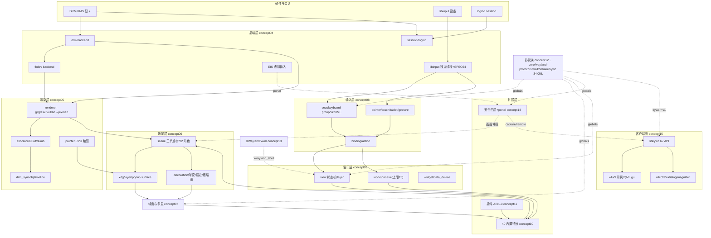

# I 阶段：架构洞察、知识地图与覆盖矩阵（工作底稿）

> 事实底座：facts/r1-build.md（162）、r2-graphics.md（178）、r3-input-view.md（176）、r4-effect-plugin.md（179）、r5-protocols-clients.md（156），合计 **851 条**编号事实 + 各簇疑点（D-R1-10/D-R2-15/D-R3-10/D-R4-11/D-R5-12）。
> 编号策略：F-Rx-NNN 簇前缀天然全局唯一，发布版不做全局重编号（避免转录失真），跨簇引用直接带簇前缀。

## 一、数量闭合裁决（G2 前置）

| 争议点 | 裁决 | 依据 |
|---|---|---|
| view 目录 C/H 数（基线 42 vs F-R3 口径 41，D-R3-01） | **42** | 递归实测：view/ 根 38 + tile/ 4（tile_assist.c、tile_linkage.c、tile_manager.c、tile_manager_p.h）；R3 底稿把 tile/ 记为 3 个 .c 漏 _p.h。发布版 facts 保留 D-R3-01 原文并加裁决注记 |
| src/ 合计 | **283**（15 子目录 281 + 根 main.c/server.c 2） | 2026-10-14 实测 |
| 全仓 C/H | **465**（行 138417） | 主会话基线，V 阶段换 python 口径复算 |
| protocols XML | **34**（77 interface）+ 仓内第 35 个 `src/plugin/security/security.xml`（不经 protocols/meson.build） | F-R5 脚本解析 |
| 内置特效 .c | **40**（无条件 36 + 条件编译 4：screenshot/watermark/slide/ukui_effect），加 effect_p.h 共 41 C/H | F-R4 逐一点名 |
| libkywc 公开 API | **67** 非 static 函数，与 libkywc.h 67 条声明对账一致；kywc.syms 为通配符版本脚本（非显式清单） | F-R5 |
| meson 选项 | **44**（boolean 37：true35/false2；feature3；string4） | F-R1 |
| i18n | 主 po/ 27 .po / LINGUAS 16 语言；portal/po 独立域 19 .po；.mo 编译期 embed 为 .h | F-R1/F-R5 |
| 环境变量 | ENV.md 21 条目；源码 getenv 24 去重名（KYWC_* 17 个本体）；KYWC_XWAYLAND/KYWC_EIS_SOCKET 源码有而文档无 | D-R1-04 |

## 二、五个架构洞察（四元组）

### I-1：协议面"XML 存在 ≠ 运行时 global 存在"——编译宏三层裁剪
- **陈述**：34 个协议 XML 全部经 wayland-scanner 生成代码，但服务端 wl_global 注册受三层开关控制：meson 44 选项 → 30+ 个 `HAVE_KDE_*/HAVE_UKUI_*/HAVE_WLR_*` 编译宏（meson.build:177-210）→ 各 *_shell/协议 .c 内 `#if HAVE_*` 门控；发行构建再由 debian/rules 固定一组默认值（强制 `-Dukui_theme=true` 等）。
- **证据**：F-R1（44 选项全表、HAVE_ 宏生成）、F-R5（注册点两类：手写 wl_global_create 如 ky_capture.c:614 / wlr 助手内部注册如 wlr_layer_shell.c:564；F-R5-148 linux-dmabuf 键重复、F-R5-145 kywc 节缺 stream 等矩阵缺陷）。
- **反常识**：读者直觉是"protocols/ 里有什么 XML，合成器就支持什么协议"；实际 tri-state 差异（XML 存在/编进二进制/运行时 bind 成功）层层收窄，PROTOCOLS.md 矩阵还与 XML、代码各有出入（12 条 D-R5 双源差异）。
- **行动**：写客户端前先查三态（meson_options 默认值 → HAVE 宏 → global_bind 函数），bind 必须处理 global 缺失；文档教程以"代码注册点"为最终事实层，PROTOCOLS.md 降级为项目自陈参考。

### I-2：钉死补丁化 wlroots——版本区间与发行后缀双重依赖
- **陈述**：meson 要求 `wlroots >=0.17.0,<0.18.0` 且全局 `-DWLR_USE_UNSTABLE`，并在 dependency() 里强压 default_options（static、renderers=vulkan、backends=x11、xwayland=disabled、session=disabled）；Debian Build-Depends 写的是 `libwlroots-dev >=0.17.4-ok19`——openKylin 自有打包后缀。
- **证据**：F-R1 依赖与版本约束、debian/control；F-R2 大量 wlr_0_17 接口调用点（page_flip_handler2、wlr_swapchain、wlr_output_state 等 0.17 形态）。
- **反常识**：拿到上游官方 wlroots 0.17 release 未必能构建——ok19 后缀暗示 openKylin 在 wlroots 上携带发行补丁；同时 kywc 用 subproject 静态链接 wlroots 的构建设计与发行动态链接包并存。
- **行动**：复现/开发环境以 openKylin 发行包为唯一受支持基线；升级 wlroots（0.18）意味着 unstable API 全量适配，教程不承诺跨版本。

### I-3：输入路径绕开 wlroots 单线程模型——独立 libinput 线程 + SPSC 队列
- **陈述**：kywc 不直接消费 wlr libinput backend 的设备事件，而是自起 libinput 线程（backend/libinput/backend.c），事件只入容量 64 的 SPSC 无锁链式队列（input_queue.h），经 eventfd 唤醒主循环，dispatch_input_events 在主线程转投 wlr 设备信号；键盘/指针各有一条完整函数链落到 view/workspace。
- **证据**：F-R3（backend.c:121/189、队列容量、F-R3-174 键盘链 handle_keyboard_key→…→function_manager_handle_key_binding、F-R3-175 指针链 scene_node_at→input_event_node_impl.click→seat_focus_surface）。
- **反常识**：wlroots 合成器主流写法是单线程事件循环 + wlr 信号直连；kywc 在最底层输入处引入线程边界，等于自担了事件重排与队列水位风险（64 满队行为是排查输入丢失/延迟的第一现场）。
- **行动**：调试输入问题先判定发生在线程前/队列中/主线程后；新增输入设备事件类型必须同时改生产端与队列消费端。

### I-4：扩展能力三层 ABI——内置静态、插件极薄、客户端库稳定
- **陈述**：①40 个特效 .c 全部 `wlcom_sources += files(...)` 静态编入主二进制，全树唯一 `shared_module` 是 security demo 插件；②外部插件 ABI 硬编码 1.0，规则比注释更严（major 相等且插件 minor ≤ 管理器 minor），插件只需导出 `<name>_plugin_data`，dlopen RTLD_NOW|RTLD_GLOBAL、单层扫 PLUGIN_DIR；③对外稳定面是 libkywc 的 67 个 `kywc_*` 函数（通配符版本脚本 ky wc_*； local: *），主程序另以 export_dynamic+wlcom.syms 暴露 kywc_* 供插件回调。
- **证据**：F-R4（meson 构建边界、interface 15 函数指针+2 数据+3 hooks、effect_interface 17 钩子）、F-R5（provider.h 7 能力静态表、67 符号对账、两份雷同版本脚本）。
- **反常识**：对外宣传的"插件/特效"可扩展性，实际动效扩展的现实路径是改源码静态编译；真正带 ABI 承诺的外部面只有 libkywc 客户端 API，插件 ABI 停在 1.0 且仓内唯一插件自认 "security demo"（install:false，部署链还有缺口）。
- **行动**：二开窗口动效→进 src/effect 照 40 个范例加静态 .c；写外部进程消费合成器能力→link libkywc；写 .so 插件前先评估 ABI 1.0 薄面与部署不确定性。

### I-5：正确性来自六级回退链——复杂性在 fallback 组合矩阵而非主路径
- **陈述**：图形栈每一层都是"理想路径 + 显式回退 + 环境变量开关"：后端 DRM→fbdev、提交 ATOMIC→LEGACY（KYWC_DRM_NO_ATOMIC）、渲染器 GL/GLES2/Vulkan→pixman（软件渲染默认被拒，KYWC_RENDERER_ALLOW_SOFTWARE 放行）、缓冲 GBM SCANOUT→GBM RENDERING→dumb/SHM、上屏 direct scanout→swapchain 合成（含 NONE/RENDER/COPY/RENDER_COPY 四模式多 GPU blit）、硬件色彩（connector/GAMMA_LUT/CTM）→GL blit；同步原语 drm_syncobj timeline 需 KYWC_ENABLE_TIMELINE 双向支持才建。
- **证据**：F-R2-013~099、148~171（page_flip_handler2 present flags、35 处 .drm_format、6 个色彩矩阵、configure_outputs 严格排序与模式 test 逐级回退）。
- **反常识**：读懂"正常一次上屏"只覆盖小半代码——真正的体量在 6 条回退路径与多 GPU/异形格式组合；环境变量不是调试彩蛋而是产品级配置面（ENV.md 21 项 vs 源码 24 名）。
- **行动**：排查黑屏/撕裂/色彩异常先定位命中了哪条路径（日志+环境变量地图）；静态读码教程必须把回退条件与主路径同等讲清。

## 三、知识地图（Mermaid）

## 四、concept/example × 事实簇覆盖矩阵

| 文档 | 主事实簇（每篇 ≥5 条） |
|---|---|
| concepts/00-overview | R1 元信息/依赖/44 选项；R2 主线 10 发现；规模基线（全表） |
| concepts/01-build-run | R1 全簇（选项/CLI/环境变量/日志/data/debian/tools 入口） |
| concepts/02-wayland-wlroots-basics | R1 依赖；R2 wlroots 调用点；R5 协议机制节（scanner/global） |
| concepts/03-startup-architecture | R1 main 启动序列/server_init；R2 backend_autocreate 接线 |
| concepts/04-backends | R2-1~56；R3 libinput 线程接入段 |
| concepts/05-rendering | R2-57~99、172~178；R5 PipeWire 之外的 buffer 事实 |
| concepts/06-scene-graph | R2-100~147；R3 指针命中链（scene_node_at） |
| concepts/07-output-management | R2-148~171；R5 kde/ukui/wlr 输出协议注册点 |
| concepts/08-input | R3 前半（seat/键盘/IME/指针/触摸/平板/手势/cursor/binding） |
| concepts/09-view-workspace | R3 中段（action/view/workspace/widget/data_device/theme/util 选用） |
| concepts/10-effects-framework | R4 框架/animator/transform/40 特效分组/14 shader/D-Bus |
| concepts/11-plugin-system | R4 插件契约/加载器/interface/config/构建边界/kywc 公共头 |
| concepts/12-protocols | R5 XML 全表/注册机制/矩阵对账；R1 HAVE_* 裁剪 |
| concepts/13-xwayland | R3 xwayland 两整节；R1 -Dnoxwayland/HAVE_XWAYLAND |
| concepts/14-security-portal | R4 security 三节；R5 portal/PipeWire/EI/wldialog |
| concepts/15-libkywc-clients | R5 libkywc/示例/gui/i18n；R1 tools 三子工具 |
| examples/01-effect-plugin-walkthrough | R4 插件契约；R5 simple_plugin/alpha_modifier/kde_keystate 事实 |
| examples/02-wlu-utilities | R5 wlu 四文件+monitor/output_doctor/virtual_desktop/pipewire |
| examples/03-libkywc-qml-thumbnail | R5 libkywc capture/thumbnail + gui/ 六 Qt 目标事实 |

**Q3 裁决**：维持 16 篇。14-security-portal 由 R4 安全三节 + R5 portal 整节共同支撑，密度充足不拆；15 客户端面虽跨 libkywc/examples/tools/i18n，但统一于"进程外交付面"单一主题，不拆。

## 五、G2 门自检

- 五个洞察四元组齐备（陈述/证据 F 编号/反常识/行动）✓
- 每篇 concept ≥5 条映射事实，F 前缀无冲突 ✓
- 数量争议全部裁决或留 V 阶段复算 ✓
- 疑点处理策略：D-Rx 全部随 facts 发布（保留原始发现），在相关 concept 以「上游缺陷线索/双源差异」小节呈现，不掩盖；不做运行时裁决（静态学习边界）。
