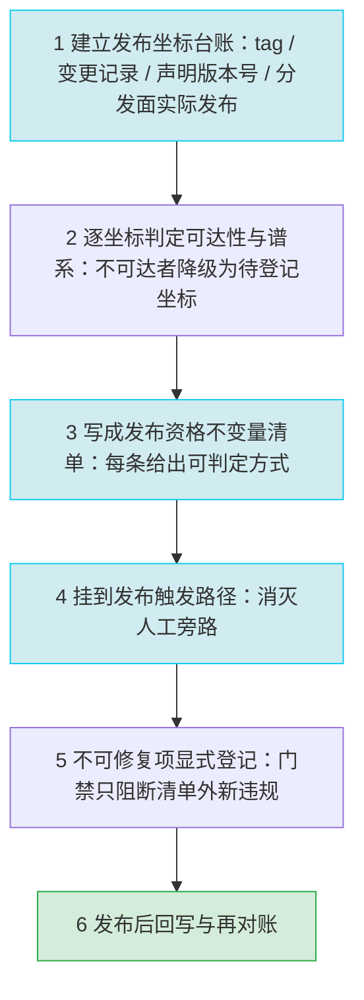

# mystx — E 阶段模式萃取与去重裁决

## 元信息块

| 项 | 值 |
|---|---|
| 输入来源 | [insights.md](./insights.md)（I 阶段 5 条洞察 I-1~I-5，含 10 条竞争假设与 9 条待补事实）；事实依据唯一来源为 [facts.md](./facts.md)（F-001~F-097） |
| 去重基线 | [方法论模式库主索引](../../../../docs/retrospective/patterns/methodology-patterns/index.md)（10 域、「模式清单」总表 49 行登记；口径为表体数据行数，不含表头与分隔行）；精读既有模式 20 个，逐条判定差异点是否超出既有覆盖 |
| 候选数 | 3（主模式 1 + 次级候选 1 + 不入库候选 1） |
| 裁决分布 | 新建 L1 ×2、不入库 ×1 |
| 只读边界 | 本阶段未对 `projects/xuanspace` 及其子模块 `projects/xuanspace/libs/mystx` 执行任何写入、修改、删除或 git 写操作；未在 `docs/` 下创建任何文件（模式入库由后续 Task 6 执行） |

---

## §1 候选模式概览

| 候选 | 核心主张 | 来源洞察 | 初步裁决 |
|---|---|---|---|
| **C1 发布资格不变量与发布路径对账** | 「什么可以被发布」必须被写成一份可判定的**发布资格不变量清单**，并挂在**发布触发路径**上；版本坐标（tag / 变更记录 / 声明版本号 / 分发面实际发布坐标）四者必须逐次发布对账；不可修复的历史断层必须**显式登记**而非静默保留 | I-1（发布可追溯性契约缺位）+ I-3（质量门禁与发布流程解耦） | **新建 L1**（主模式，id `release-eligibility-invariant-gate`） |
| **C2 声明面单一权威源与多载体事实对齐** | 同一事实被 N 个载体手工重复声明时，**冗余不是缺陷，缺少真源才是缺陷**：先显式指定权威源，其余载体降级为投影，由机器校验对齐，差异必须登记理由而非强制全等 | I-4（文档与实现无单一事实源）+ I-5（声明面冗余且无权威源） | **新建 L1**（id `single-authority-declaration-alignment`） |
| **C3 最小可安装单元验收** | 对外声明的契约面（依赖清单、入口点）必须在一个**只装声明依赖集**的环境里被验收一次；验证环境必须覆盖契约面而非只覆盖开发全集 | I-2（运行时依赖契约缺位） | **不入库**（方法核心已被既有模式族覆盖；「声明面权威源」半边归入 C2；根因受竞争假设 H2-B 挑战未裁决） |

**候选选取理由**：I-1~I-5 五条洞察的根因分属三个不同层面——**发布制度层**（I-1/I-3）、**声明治理层**（I-4/I-5）、**验证环境层**（I-2）。G3 门要求模式必须跨项目可复用，因此按「根因层面」而非按「洞察条数」切分候选：I-1 与 I-3 的根因在证据链上收敛于同一处（发布资格无可执行不变量、发布决策与质量关卡不相交），合并为一个模式才不重复；I-4 与 I-5 的根因是同一机制在「文档层」与「配置层」的两个投影（I-4 影响面自述为「I-4 文档漂移在配置层的同构表现」，见 insights.md I-5 影响段），合并后覆盖「跨载体声明面」这一完整类。I-2 根因独立，但见 §4.3 裁决。

---

## §2 主模式全文：发布资格不变量与发布路径对账

> **模式 id（建议）**：`release-eligibility-invariant-gate`
> **一句话主张**：把「什么可以被发布」写成可判定的发布资格不变量清单，挂在发布触发路径上，并对版本坐标四元组（tag / 变更记录 / 声明版本号 / 分发面实际发布坐标）逐次发布对账；不可修复项显式登记，登记量随版本单调不增。

### 2.1 触发场景

同时出现以下三类信号时启用本模式（任一单项不足以触发）：

1. **版本坐标彼此不闭合**：版本序列出现缺号（F-009：`v0.1.1`~`v0.3.8` 共 13 个 tag 中不存在 `v0.3.5` / `v0.3.6`）；变更记录只覆盖最后一版（F-071：`CHANGELOG.md` 仅 `## [v0.3.8] - 2026-10-15` 一个条目、无 Unreleased 段；F-072：13 个 tag 中 12 个在变更记录中无对应条目）；**分发面实际发布坐标与仓库坐标双向不闭合**（F-092：PyPI 实发 9 个版本、latest 为 0.3.7；F-093：`mystx==0.3.6` 在 PyPI 存在（HTTP 200）而仓库无 `v0.3.6` tag、`0.3.5` 与 `0.3.8` 均返回 HTTP 404；F-094：GitHub Releases 实测 11 条、无 v0.3.5 / v0.3.6 / v0.3.8；F-097：仓库最新 tag `v0.3.8` 未出现在任何分发面）。
2. **标签指向不可达历史且分属多条谱系**：部分 tag 指向的提交不在当前发布线的祖先集合内（F-010：13 个 tag 全为轻量 tag，不携带说明与签名；F-011：`v0.1.1`~`v0.3.4` 共 11 个 tag 均非 HEAD 祖先，其 creatordate 落在 2025-02-05~2025-11-17，仅 `v0.3.7` / `v0.3.8` 是 HEAD 祖先），且 13 个 tag 分属 6 条互相独立的谱系、每条谱系根提交 subject 均为「项目重置」（F-089），旧谱系仍为同一项目（F-090：`git show v0.3.4:pyproject.toml` → name = "mystx" / version = "0.3.4" / requires-python = ">=3.10"）；发布线已领先最近标签（F-012：HEAD 领先 `v0.3.8` 6 提交；F-014：父仓 submodule status 描述为 `v0.3.8-6-g45bd1e4`）。
3. **发布决策与质量关卡不相交**：发布由人工事件触发（F-058：`python-publish.yml` 触发条件为 `release: types: [published]`，且 `actions/checkout@main`、`actions/setup-python@main`、`pypa/gh-action-pypi-publish@unstable/v1` 均为浮动 ref），而 CI 侧只有 lint（F-055：`lint.yml` 仅 1 个 `ruff check` job）与产物存在性校验（F-056：`pages.yml` 校验 `doc/_build/html/index.html` 是否存在）、三个 workflow 无任何 pytest 执行（F-054、F-059：51 个测试仅以本地 pre-commit hook 形式存在，F-049）；唯一会因文档告警而失败的高标准关卡（F-060：`sphinx.fail_on_warning: true`）不在发布路径上（F-061：配置注释自述 RTD 是把 CI 侧不带 `-W` 的构建抬高到一致水平的额外关卡）。

**不适用场景**：无对外发布物的内部库；发布物由外部平台全权托管、仓库内不保留版本坐标的项目（此时无「发布资格」可判定）；已建立完整发布流水线且不变量集合已被机器执行、仅需局部参数调整的项目（本模式此时退化为维护不变量清单）。

### 2.2 核心步骤



**① 建立「发布坐标台账」，把四类载体并列成一张可重算的表**
- 列出全部版本标签及其指向提交（F-008：13 个 tag 全集）；标出版本序列缺号（F-009）。
- 列出变更记录覆盖的版本集合（F-071：仅 `v0.3.8` 一个条目，修复 2 条 / 测试 1 条，无 Unreleased 段；F-072：与 tag 集合的差集为 12 个）。
- 列出声明版本号的推导来源与 fallback 链（F-019：`metadata.version.provider = scikit_build_core.metadata.setuptools_scm`；F-042：`__version__` 三级 fallback，末级为字符串 `"0.0.0.dev0"`）。
- 列出**分发面实际发布坐标**：PyPI 的版本集合与 latest（F-092：实发 9 个版本、latest 为 0.3.7；F-093：`0.3.6` 返回 200、`0.3.5` 与 `0.3.8` 返回 404）、GitHub Releases 的 tag 集合与 prerelease / draft 标记（F-094：11 条、prerelease 7 条、draft 0 条）、以及「tag 有而分发面无」与「分发面有而 tag 无」两个方向的差集（F-097）。
- **可执行判据**：任何一次发布评审开始前，这张台账必须已存在，且可由脚本重算（不是人工誊抄的表格）。

**② 逐坐标判定「可达性 / 谱系」，把不可达坐标从「有效版本」降级为「待登记的历史坐标」**
- 逐个校验 tag 是否为发布分支 HEAD 的祖先（F-011：11 / 13 不满足），并区分「不可达」与「缺号」两类不同性质的缺口（F-009）。
- **建立谱系映射**：逐 tag 取谱系根提交（`git rev-list --max-parents=0 <tag>`）并记录其 subject 与日期，把全部 tag 归入谱系（F-089：13 个 tag 分属 6 条独立谱系、6 个根提交 subject 均为「项目重置」）；同时确认旧谱系仍是同一项目（F-090：`git show v0.3.4:pyproject.toml` → name = "mystx" / version = "0.3.4" / requires-python = ">=3.10"），以此区分「谱系分裂」与「同名不同物」。
- 量化当前发布线与最近标签的距离（F-012、F-014），确认发布坐标描述与实际指针一致。
- **可执行判据**：每一个不可达坐标都必须给出原因（历史重建 / 脱敏 / 历史替换 / 已被「项目重置」取代）与影响面；没有原因的不可达坐标本身即构成发布资格违规。

**③ 把「什么可以被发布」写成可判定的发布资格不变量清单**
最小不变量集（每条附判定方式与本案例依据）：

| # | 不变量 | 判定方式 | 本案例依据 |
|---|---|---|---|
| I-1 | 标签可达性 | 发布坐标必须是发布分支 HEAD 的祖先 | F-011 |
| I-2 | 版本序列连续性 | 相邻版本号不得跳号，例外须登记 | F-009 |
| I-3 | 变更记录存在性 | 每个 tag 有对应变更记录条目，且保留未发布段 | F-071、F-072 |
| I-4 | 声明版本一致 | 包元数据版本 == tag 版本号 == 变更记录条目版本 | F-019、F-042 |
| I-5 | 成熟度分类一致 | `Development Status` 与版本阶段匹配 | F-018（`3 - Alpha` 与仓库 tag 已达 v0.3.8 并存） |
| I-6 | 行为级关卡在发布路径上 | 发布触发链中存在测试执行步骤，失败即阻断 | F-049、F-054、F-059 |
| I-7 | 发布动作自身可复现 | 发布工作流的 action ref 必须钉版本 | F-058（`@main` / `@unstable/v1`） |
| I-8 | 最新 tag 在分发面可安装且可下载 | 最新 tag 的版本号在 PyPI JSON API 返回 HTTP 200 且 `info.version` 一致；GitHub Releases 侧存在同名 Release 条目 | F-092（latest = 0.3.7）、F-093（`0.3.8` 返回 HTTP 404）、F-094（Releases 无 v0.3.8）、F-097（仓库最新 tag v0.3.8 未出现在任何分发面） |

- **可执行判据**：不变量集合以可执行检查（脚本 / workflow job / 门禁）形式存在，而不是文档里的一串条目；每条不变量都能被一条命令判定通过或失败。

**④ 把不变量清单挂到发布触发路径上，消灭人工旁路**
- 发布资格校验与发布动作处于**同一条触发链**：发布触发由「人工点一次 Release」（F-058）改为「标签推送 + 不变量校验通过」。
- 质量关卡收敛为发布路径上的单一关卡序列（lint + 测试执行 + 覆盖率下限 + 产物校验 + 版本不变量），把唯一的高标准关卡降为附加关卡而非唯一关卡（F-055、F-056 为现状；F-060、F-061 为「唯一高标准关卡不在发布路径上」的证据）。
- **可执行判据**：存在一次「故意让某条不变量失败 → 发布被阻断」的验证证据；只测放行不测拦截的门禁等于不存在。

**⑤ 不可修复项显式登记（豁免清单），门禁只对清单外的新违规阻断**
- 豁免项须按**性质**分列，不同性质给不同对策，不可合并为「历史问题」一栏：
  - **已被「项目重置」取代的谱系**（F-089：13 个 tag 分属 6 条独立谱系，其中 4 条的根提交 subject 为「项目重置」）——对策：给出**谱系映射表**，声明每条旧谱系的根提交、覆盖的 tag 与「该谱系已被重置取代」的结论（F-090 佐证旧谱系仍是同一 mystx 项目）；此类项**不设到期条件**，因其在语义上已被新谱系取代，只要求声明存在且可查。
  - **真正不可修复的历史断链**（无「项目重置」根、无法以重置解释的祖先关系断裂）——对策：登记坐标、原因、影响面、**到期条件**与对齐方式（例如在文档中显式声明断点原因），到期即回到阻断态。
  - **版本缺号**（F-009）与**变更记录缺口**（F-072）——同样登记到期条件与对齐方式。
  - **两类方向相反的发布坐标缺口**须分列：① 「tag 有而分发面无」（F-097：仓库最新 tag v0.3.8 从未发布到 PyPI 与 GitHub Releases）——按可发布性违规处理，**不进豁免清单**；② 「分发面有而 tag 无」（F-093：PyPI 已发布 0.3.6 而仓库无 `v0.3.6` tag）——登记为「补 tag 或撤销发布」的显式决策项，带到期条件。
- 登记字段：坐标、原因、影响面、到期条件、对齐方式（例如在文档中显式声明断点与缺号原因）。
- **可执行判据**：豁免必须显式列出条目与到期条件；不得以「关闭检查」「调低阈值」实现豁免；登记量随版本推进**单调不增**。

**⑥ 发布后回写与再对账**
- 恢复「每次发布更新变更记录 + 保留未发布段」的仪式（F-071：当前无 Unreleased 段），发布后重新对账 tag 集合与变更记录集合（F-072）。
- 用消费侧坐标交叉验证：用父仓 submodule status 的版本描述与本地标签语义核对（F-014：`v0.3.8-6-g45bd1e4`），确认发布坐标在下游也一致。
- **可执行判据**：发布后重跑步骤 ① 的台账重算，差集必须为空（除已登记豁免项）。

### 2.3 反模式（看起来对，但会失败）

| # | 反模式 | 看起来对在哪 | 实际为什么会失败 | 依据 |
|---|---|---|---|---|
| 1 | **「有 tag 就算有可追溯版本」** | 13 个 tag 排列整齐、版本号语义清晰，检索得到 | 13 个 tag 分属 6 条独立谱系（F-089），其中 11 个不在 HEAD 祖先集合内（F-011），`git bisect` 在跨谱系历史上不可用（bisect 依赖单一祖先链），无法把 issue 定位到主线提交；版本差异本身仍可用 `git diff <tag> HEAD` 比对（F-088），轻量 tag（F-010）更不承载任何说明 | F-010、F-011、F-088、F-089 |
| 2 | **「变更记录写了最新一版就算有变更记录」** | 文件存在、格式规范、含最近一次发布的条目 | 12 个已打标签的版本在变更记录中无对应条目（F-072），用户无法判断升级到当前版会带来哪些行为变化 | F-071、F-072 |
| 3 | **「发布是人工动作，人工自然会记得」** | 发布由平台内置动作触发，天然带审计记录 | 人工点一次 Release（F-058）是**未校验旁路**，它绕过了全部不变量；配合浮动 ref（`@main` / `@unstable/v1`），发布内容本身不可复现 | F-058 |
| 4 | **「高标准关卡存在就有质量保证」** | 存在一个会把告警当失败的严格关卡，标准看起来不低 | 该关卡（RTD，F-060、F-061）不在发布路径上，不阻断包分发；而发布路径上的三 workflow 无任何 pytest（F-054、F-059），51 个测试对发布决策零约束（F-049） | F-049、F-054、F-059、F-060、F-061 |
| 5 | **「CI 里已有检查就等于发布资格检查」** | CI 每天在跑、每次都绿 | `ruff check`（F-055）与产物存在性校验（F-056）回答的是「代码风格是否合规 / 页面能否构建出来」，不是「这次发布是否满足契约」——发布资格被降级为构建可用性 | F-055、F-056 |
| 6 | **「版本号自动推导，所以不用对账」** | 版本来自 git 推导，天然与提交一致 | 非 git 推导环境会报出 `"0.0.0.dev0"`（F-042），与包索引上的版本并存且无告警；推导只保证「同一次构建内一致」，不保证「跨载体一致」 | F-019、F-042 |
| 7 | **「历史问题以后再说，先把新版本发出去」** | 断层与缺号是存量问题，与本次发布无关 | 缺口被下一轮发布继承并扩大（缺号 F-009、断层 F-011、缺条目 F-072 三类同时存在），且因无登记台账，任何一次发布都无法判定「还剩多少欠账」 | F-009、F-011、F-072 |

### 2.4 迁移验证（可判定的成功信号）

| # | 成功信号 | 判定方式 | mystx 当前状态（迁移前基线） |
|---|---|---|---|
| 1 | **坐标四元组零差集** | 一次发布动作后：变更记录条目集合 ⊇ tag 集合，且每个 tag 可达发布分支 HEAD，声明版本号 == tag 版本号，且最新 tag 在分发面可安装（PyPI JSON API 返回 200 且版本号一致、GitHub Releases 存在同名条目） | 变更记录 1 个条目 vs tag 13 个（F-071、F-072）；11 / 13 不可达（F-011）；最新 tag v0.3.8 在分发面不存在（F-093、F-094、F-097）；PyPI 有 0.3.6 而仓库无对应 tag（F-093、F-097） |
| 2 | **发布资格与发布动作同一触发链** | 任意一次发布若绕过不变量清单即失败；不存在人工旁路可跳过校验 | 发布由人工 Release 事件触发（F-058） |
| 3 | **行为级关卡在发布路径上** | 发布触发链中存在测试执行步骤，且该步骤失败会阻断发布 | 三 workflow 无 pytest（F-054、F-059） |
| 4 | **豁免登记量单调不增** | 已登记豁免项逐条可见、带到期条件；每次发布后重算，豁免总数不增加 | 三类缺口当前登记量为 0（F-009、F-011、F-072） |
| 5 | **跨生态可迁移（形式不变）** | 把同一不变量清单套到容器镜像标签 / 站点版本号 / 数据库迁移编号上，信号 1~4 的判定形式不变 | 尚未在第二生态验证，属 L1 升 L2 的前置条件 |

---

## §3 G3 门自检（模式可迁移性）

| 门 | 判据 | 本模式对照 | 结论 |
|---|---|---|---|
| G3-1 触发场景 | 是否描述「可复用的信号组合」而非「某项目的具体症状」 | 触发场景写成三条**信号组合**（坐标不闭合 / 标签不可达 / 决策与关卡不相交），每条均给 F 编号作为实例证据，但不点名 mystx 为唯一适用对象 | **通过** |
| G3-2 核心步骤 | 步骤是否可执行、是否含项目专有细节 | 6 个步骤全部为「建台账 → 判可达 → 写不变量 → 挂触发链 → 登记豁免 → 发布后对账」，不含任何 mystx 专有路径、命令或包名；不变量集以**判定方式**表述而非以 mystx 的具体数值表述 | **通过** |
| G3-3 反模式 | 是否为「看起来对但会失败」，而非明显错误 | 7 条反模式全部采用「看起来对在哪 → 实际为什么失败」结构，句式上均不是显然错误（如「有 tag 就算可追溯」「自动推导就不用对账」） | **通过** |
| G3-4 迁移验证 | 是否给出可判定信号而非主观评价 | 5 条信号全部给出判定方式，并以「迁移前基线」形式与当前事实对照，可被第三方重算 | **通过** |
| G3-5 领域中立性 | 是否可脱离 mystx / Python / Sphinx 场景成立 | 模式对象是「发布坐标 + 质量关卡 + 发布触发路径」三者的关系，与语言、包生态、文档系统无关；迁移示例覆盖容器镜像 / 站点版本号 | **通过** |

**G3 门结论**：主模式通过 G3 门，可作为 L1 候选入库（跨项目验证仍缺失，故不高于 L1）。

---

## §4 去重裁决

### 4.1 候选 C1（主模式）：**新建 L1**

**裁决**：新建 L1，id `release-eligibility-invariant-gate`。

**落盘口径**：模式正文 frontmatter 的 `maturity` 取 `L1`，主索引「模式清单」总表与脚本生成表（`CATEGORIES.md` / 域 `README.md`）中的成熟度列同样统一写 `L1`；`L1-draft` 仅记于 frontmatter 的 `maturity_level` 字段，表示「单案例待验证」的状态，不进入索引与脚本生成表的展示列。

**与最接近的既有模式的差异判定**（逐条判断是否超出既有覆盖范围）：

| 既有模式 | 覆盖范围 | 差异点 | 是否超出既有覆盖 |
|---|---|---|---|
| [ledger-stock-consistency-audit](../../../../docs/retrospective/patterns/methodology-patterns/governance-strategy/ledger-stock-consistency-audit.md)（L2-validated，3 次验证） | 台账（注册清单/索引）与磁盘存量的**存在性**双向差集（幽灵登记 / 影子资产）+ 失配率指标 | 本模式判定的不是「在不在」，而是「坐标是否**可达发布线**」并进一步判「是否**可发布**」；既有模式无谱系判定，也无发布阻断语义 | **超出**：既有模式止于存在性对账，不含可达性判定与发布资格裁决 |
| [cross-platform-gate-authority](../../../../docs/retrospective/patterns/methodology-patterns/governance-strategy/cross-platform-gate-authority.md)（L1） | 按「检查类型 × 平台语义匹配度」为每类门禁指定**唯一权威平台** | 权威对象是**平台**，不是**发布路径**；既有模式回答「同一套检查在哪里算数」，本模式回答「哪些检查必须出现在发布动作之前」 | **超出**：权威维度不同（平台 vs 路径），两者互补而非重合 |
| [preflight-integrity-gate](../../../../docs/retrospective/patterns/methodology-patterns/preflight-integrity-gate.md)（L1-draft） | CI **首道 gate 的顺序**（shift-left）+ gate 双向验证 + 历史基线复核 | 既有模式解决「检查放在哪个阶段」，且其对象是**编码/格式完整性**这一类具体检查；不涉及「发布资格」这一复合概念，也不涉及版本坐标对账 | **超出**：既有模式无「发布资格不变量集合」这一层，也无版本坐标三元组对账 |
| [spec-as-code-automated-gates](../../../../docs/retrospective/patterns/methodology-patterns/tools-automation/spec-as-code-automated-gates.md)（L1） | 「凡是能程序化检查的规范都写成脚本」+ 检查脚本四要素（量化评分/分级反馈/改进指引/多格式输出） | 既有模式是**通用手法**（怎么把规范变成脚本），不指定「哪些不变量属于发布资格」、不涉及发布触发链、不涉及坐标对账 | **超出**：既有模式回答「怎么自动化」，本模式回答「自动化什么、挂在哪、怎么对账」 |
| [shared-index-count-coupling](../../../../docs/retrospective/patterns/methodology-patterns/governance-strategy/shared-index-count-coupling.md)（L2-validated，3 次验证） | 目录树派生的共享索引计数在多位置重复时的**同批提交裁决** | 既有模式的地面真值是**目录树**，且冲突焦点是并行写入的提交范围；本模式的冲突焦点是**发布资格**（能否发）而非提交如何拆 | **超出**：既有模式不产生发布决策语义 |

**差异点合计 5 条，全部超出既有覆盖范围**，且互不重叠 → 判定为新建 L1。

**建议 mode id**：`release-eligibility-invariant-gate`（kebab-case 英文，与既有命名风格一致；已在既有模式库全量检索，零命中，见 §4.4）。

**域目录归属**：`governance-strategy`（既有域，不自造新域）。理由：本模式的对象是「门禁归属 + 权威 + 一致性裁决」，与该域既有 `cross-platform-gate-authority` / `ledger-stock-consistency-audit` / `shared-index-count-coupling` 属同一族；`tools-automation` 面向工具实现形态，`spec-workflow` 面向规格工作流，均不匹配。

**frontmatter 草案**：

```yaml
---
id: "release-eligibility-invariant-gate"
title: "发布资格不变量与发布路径对账"
type: "Pattern"
domain: "methodology"
layer: "governance-strategy"
maturity: "L1"
maturity_level: "L1-draft"
validation_count: 1
reuse_count: 0
documentation_level: "standard"
version: "1.0.0"
created_date: "2026-10-22"
last_updated: "2026-10-22"
source: "../../../../../.trae/specs/retrospectives-insights/mystx-comprehensive-retrospective-export/insights.md（I-1 + I-3 交集）"
x-toml-ref: "../../../../../.meta/toml/docs/retrospective/patterns/methodology-patterns/governance-strategy/release-eligibility-invariant-gate.toml"
tags: ["release-governance", "quality-gate", "traceability", "tag-changelog-reconciliation", "release-path"]
trigger_conditions:
  - "版本坐标四者（标签 / 变更记录 / 声明版本号 / 分发面实际发布坐标）彼此不闭合：版本序列跳号、变更记录只覆盖最后一版、tag 有而分发面无或分发面有而 tag 无"
  - "部分标签指向的提交不在当前发布线的祖先集合内（且分属多条谱系），无失效声明"
  - "发布决策与质量关卡不相交：唯一会失败的高标准关卡不在发布触发路径上"
  - "发布由人工事件触发，存在未校验旁路"
problem_solved: "「什么可以被发布」从未被写成可执行的不变量时，发布资格实际由「是否有人在平台上点了一次」决定；版本坐标四者之间的差集、以及质量关卡与发布路径的错位，都能在同一个公开发布物上长期并存且无人负责。本模式把发布资格显式化为可判定的不变量清单，挂到发布触发路径上，并对版本坐标逐次对账；不可修复的历史断层改为显式登记，登记量随版本单调不增。"
related_patterns:
  - "ledger-stock-consistency-audit"
  - "cross-platform-gate-authority"
  - "preflight-integrity-gate"
  - "spec-as-code-automated-gates"
  - "shared-index-count-coupling"
---
```

**伴生 TOML 落点路径**：
`.meta/toml/docs/retrospective/patterns/methodology-patterns/governance-strategy/release-eligibility-invariant-gate.toml`

字段结构对齐既有样例 [ledger-stock-consistency-audit.toml](../../../../.meta/toml/docs/retrospective/patterns/methodology-patterns/governance-strategy/ledger-stock-consistency-audit.toml)（`id` / `domain` / `layer` / `maturity` / `validation_count` / `reuse_count` / `documentation_level` / `source` + `[bindings]` 的 `rules` / `references` / `skills`）。

**toctree 插入位置**：`docs/retrospective/patterns/methodology-patterns/governance-strategy/index.md` 的隐藏 toctree 内，字母序落在
`reference-as-trigger` → **`release-eligibility-invariant-gate`** → `responsibility-transfer-governance`
（`ref` < `rel` < `res`）。

**主索引「模式清单」登记行草案**（追加于 `docs/retrospective/patterns/methodology-patterns/index.md` 表格末行）：

```markdown
| release-eligibility-invariant-gate | [发布资格不变量与发布路径对账](governance-strategy/release-eligibility-invariant-gate.md) | L1-draft | 1 | 0 | 版本坐标四者（标签/变更记录/声明版本号/分发面实际发布）不闭合、或唯一高标准关卡不在发布触发路径上、且发布由人工事件触发时：先建坐标台账→判可达与谱系→写成可判定的发布资格不变量清单→挂到发布触发路径并消灭人工旁路→不可修复项显式登记→发布后回写再对账。案例：mystx 13 个 tag 分属 6 条谱系且 11 个非 HEAD 祖先、12 个无变更记录条目、最新 tag v0.3.8 未发布到任何分发面、三 workflow 无 pytest 且唯一会失败的 RTD 关卡不在发布路径上（F-008~F-012、F-049、F-054、F-058~F-061、F-071、F-072、F-089、F-092~F-094、F-097） |
```

### 4.2 候选 C2：**新建 L1**

**裁决**：新建 L1，id `single-authority-declaration-alignment`。

**落盘口径**：与 C1 一致——模式正文 frontmatter 的 `maturity` 取 `L1`，主索引「模式清单」总表与脚本生成表（`CATEGORIES.md` / 域 `README.md`）中的成熟度列同样统一写 `L1`；`L1-draft` 仅记于 frontmatter 的 `maturity_level` 字段，不进入索引与脚本生成表的展示列。

**与最接近的既有模式的差异判定**：

| 既有模式 | 覆盖范围 | 差异点 | 是否超出既有覆盖 |
|---|---|---|---|
| [version-ripple-grep-sweep](../../../../docs/retrospective/patterns/methodology-patterns/governance-strategy/version-ripple-grep-sweep.md)（L2，2 次验证） | 单点更新后的**事后**多点同步（Grep 清扫四步法 + 内容四分类） | 既有模式**不指定真源**，默认「改动的那一处是源」，其余必须全部改到一致；本模式的核心动作恰恰是**先显式指定权威源**，并允许其余载体保留**登记过理由的差异** | **超出**：既有模式是反应式清扫（变更发生后），本模式是设计式定源（变更前），且允许「有理由的差异」而非强制全等 |
| [dual-track-metadata-consistency](../../../../docs/retrospective/patterns/methodology-patterns/governance-strategy/dual-track-metadata-consistency.md)（L1） | frontmatter / 正文 / 外部 TOML 三类**文档元数据**轨道的漂移与 9 必填字段 + 12 项门禁 | 轨道集合被固定为「文档元数据三轨」；本模式的对象是**异构声明面**（构建清单 / pre-commit / README / CHANGELOG / CONTRIBUTING / 环境定义 / 运行时元数据），跨类型跨格式，且真源可能不在文档侧 | **超出**：既有模式固定三轨且隐含 frontmatter 为权威，不覆盖跨类型声明面 |
| [ledger-stock-consistency-audit](../../../../docs/retrospective/patterns/methodology-patterns/governance-strategy/ledger-stock-consistency-audit.md)（L2-validated） | 登记台账与磁盘存量的**存在性**双向差集 | 既有模式判「在不在」；本模式判「**值是否一致**」与「谁是权威」 | **超出**：存在性 ≠ 值一致性 |
| [shared-index-count-coupling](../../../../docs/retrospective/patterns/methodology-patterns/governance-strategy/shared-index-count-coupling.md)（L2-validated） | 目录树派生的**计数**在共享索引多位置重复时的提交裁决 | 真源被既有模式固定为「目录树」，且冲突焦点是提交范围；本模式真源可落在任一载体（通常是构建清单），冲突焦点是**副本值分叉** | **超出**：真源可迁移性 + 值一致性维度未被覆盖 |
| [spec-triple-sync](../../../../docs/retrospective/patterns/methodology-patterns/governance-strategy/spec-triple-sync.md)（无成熟度字段） | 新规范落地时的三个同步动作（总览引用 / 入口更新 / 存量迁移示范） | 既有模式是**规范发布后**的一次性落地动作清单，不含真源指定、不含机器校验、不含差异登记 | **超出**：本模式含「校验自动化」与「差异登记」两项 |

**差异点合计 5 条，全部超出既有覆盖范围** → 判定为新建 L1。

- **建议 mode id**：`single-authority-declaration-alignment`（全量检索零命中，见 §4.4）。
- **域目录归属**：`governance-strategy`（与 C1 同域；该域已承载 `version-ripple-grep-sweep` / `dual-track-metadata-consistency` / `shared-index-count-coupling` 这一「一致性治理」族）。
- **frontmatter 草案**：`id: "single-authority-declaration-alignment"`；`title: "单一权威源与多载体声明面对齐"`；`domain: "methodology"`；`layer: "governance-strategy"`；`maturity: "L1"` / `maturity_level: "L1-draft"`；`validation_count: 1`；`reuse_count: 0`；`documentation_level: "standard"`；`version: "1.0.0"`；`created_date` / `last_updated: "2026-10-22"`；`source: ".../mystx-comprehensive-retrospective-export/insights.md（I-4 + I-5 交集）"`；`x-toml-ref: "../../../../../.meta/toml/docs/retrospective/patterns/methodology-patterns/governance-strategy/single-authority-declaration-alignment.toml"`；`tags: ["single-source-of-truth", "declaration-surface", "drift", "machine-check", "governance"]`；`trigger_conditions` 3 条（同一约束在 ≥2 个载体被声明且无真源声明 / 载体间数值已分叉 / 门禁集合不覆盖载体间一致性）；`problem_solved` 一段；`related_patterns: ["version-ripple-grep-sweep", "dual-track-metadata-consistency", "shared-index-count-coupling", "ledger-stock-consistency-audit", "spec-triple-sync", "cross-domain-semantic-drift"]`。
- **伴生 TOML 落点路径**：`.meta/toml/docs/retrospective/patterns/methodology-patterns/governance-strategy/single-authority-declaration-alignment.toml`（字段结构同上）。
- **toctree 插入位置**：`governance-strategy/index.md` 隐藏 toctree 内，字母序落在
`simple-task-high-risk` → **`single-authority-declaration-alignment`** → `snapshot-parity-migration`
（`si` + `m` < `si` + `n` < `sn`）。
- **主索引「模式清单」登记行草案**：

```markdown
| single-authority-declaration-alignment | [单一权威源与多载体声明面对齐](governance-strategy/single-authority-declaration-alignment.md) | L1-draft | 1 | 0 | 同一事实被 ≥2 个载体手工声明且未指定权威源时：先显式定源，其余载体降级为投影并由机器校验对齐，差异须登记理由而非强制全等，冗余本身不算缺陷。案例：mystx 的 PEP 621 extras 与 PEP 735 groups 双轨 dev 组 21 项 vs 11 项分叉、README「核心依赖」5 项与空 dependencies 矛盾、flake8 行长 100 vs ruff/black 120（F-025~F-028、F-031、F-033、F-063、F-064、F-066、F-067） |
```

### 4.3 候选 C3：**不入库**

**裁决**：不入库（既不新建 L1，也不并入既有单一模式）。理由三条，按权重排列：

1. **方法核心已被既有模式族覆盖**，不必另立模式。
   - `hermetic-isolated-verification`（L2-validated）的核心主张是「把验证范围收到**最小可判定集**，并显式声明未覆盖的部分」（其第 1 步即要求把「构建配置依赖」逐项列全）；I-2 的「最小可安装单元」正是同一原则在**依赖契约维度**上的实例化——把「声明的依赖集」纳入被测边界即可，无需新方法。
   - `docker-canonical-build-environment`（L2-validated）已提供「受控环境验证受控契约」的环境层做法；I-2 所需的「最小安装档位」是该环境分档的一个实例。
2. **I-2 的另一半已被候选 C2 覆盖**：「`dependencies = []` 与 README『核心依赖』5 项矛盾」（F-024、F-066）、「版本下界写法不一致」（F-067）、「extras 与 groups 双轨且 dev 组分叉」（F-027、F-028、F-085、F-086）本质是**声明面无权威源**，属 C2 的适用范围，不构成独立模式。
3. **根因尚未裁决，事实依据不足以支撑独立 L1**：竞争假设 H2-B（`dependencies = []` 是有意的零依赖设计，依赖由 Sphinx 宿主环境提供）未被排除：F-095 实测 PyPI 0.3.7 的 `requires_dist` 中 runtime 侧（无 `extra` 标记）计数确为 0，说明「零运行时依赖」在分发产物中成立；但同一事实同时证明 docs extra 不含 `invoke`，即「宿主环境提供依赖」这一子命题尚无任何证据，区分判据「裸安装可在无 invoke 环境成功 import」仍未取证。H2-A（单点疏漏）同样开放。在根因未裁决前立独立 L1，等于把一个可能仅需单点修正的问题（I-2 建议第 1 条：入口不 eager import tasks）上升为方法论模式。

**若后续取得裁决证据**，I-2 应拆为两个动作项处理：入口解耦（单点修复，属 C 阶段行动项）与最小安装验收 job（并入 C1 的不变量 I-6「行为级关卡在发布路径上」与 C2 的真源指定），而不新立模式。

### 4.4 去重检索记录（id 不重复验证）

| 检索 | 范围 | 结果 |
|---|---|---|
| 模式 id 关键词检索 | `docs/retrospective/patterns/methodology-patterns/` 全目录，模式 `release-eligibility\|single-authority\|declaration-surface\|release-traceability\|publish-invariant\|release-path\|release-gate` | **No matches found** |
| 主索引「模式清单」总表逐行核对 | `methodology-patterns/index.md`（49 行登记；口径为表体数据行数，不含表头与分隔行） | 无 `release-eligibility-invariant-gate` / `single-authority-declaration-alignment` |
| 域 toctree 逐行核对 | `methodology-patterns/governance-strategy/index.md`（10 个域 toctree 之一，170 个 kebab-case 模式名条目；另有 2 个非模式条目） | 同上，零命中 |
| 既有模式文件名单核对 | 10 个域目录全部 `.md` 文件名（全库共 552 个模式 `.md`） | 同上，零命中 |
| 伴生 TOML 落点核对 | `.meta/toml/docs/retrospective/patterns/methodology-patterns/governance-strategy/`（146 个 `.toml`） | 同上，零命中 |

**结论**：两个建议 id 在**全库 552 个模式文件名**与**主索引 49 条登记**中均无重复，可安全用于后续 Task 6 入库。

---

## §5 模式与洞察对应关系

### 5.1 主模式 C1 要素 → 洞察 / 事实

| 模式要素 | 来源洞察 | 来源 F 编号 |
|---|---|---|
| 触发场景信号 1：版本坐标彼此不闭合（含分发面实际发布坐标） | I-1 | F-008、F-009、F-071、F-072、F-092、F-093、F-094、F-097 |
| 触发场景信号 2：标签指向不可达历史且分属多条谱系 | I-1 | F-010、F-011、F-012、F-014、F-089、F-090 |
| 触发场景信号 3：发布决策与质量关卡不相交 | I-3 | F-049、F-054、F-055、F-056、F-058、F-059、F-060、F-061 |
| 步骤 ① 发布坐标台账（四类载体） | I-1 | F-008、F-009、F-019、F-042、F-071、F-072、F-092、F-093、F-094、F-097 |
| 步骤 ② 可达性与谱系判定 | I-1 | F-002、F-011、F-012、F-014、F-088、F-089、F-090 |
| 步骤 ③ 发布资格不变量清单（含 I-8 分发面可达） | I-1 + I-3 | F-009、F-011、F-018、F-019、F-042、F-049、F-054、F-058、F-059、F-071、F-072、F-092、F-093、F-094、F-097 |
| 步骤 ④ 挂到发布触发路径、消灭人工旁路 | I-1 + I-3 | F-055、F-056、F-058、F-060、F-061 |
| 步骤 ⑤ 不可修复项显式登记（按性质分列） | I-1 | F-009、F-010、F-011、F-072、F-089、F-093、F-097 |
| 步骤 ⑥ 发布后回写与再对账 | I-1 | F-012、F-014、F-071、F-072 |
| 反模式 1「有 tag 就算可追溯」 | I-1 | F-010、F-011、F-088、F-089 |
| 反模式 2「写了最新一版就算有变更记录」 | I-1 | F-071、F-072 |
| 反模式 3「人工发布自然会记得」 | I-1 | F-058 |
| 反模式 4「高标准关卡存在就有质量保证」 | I-3 | F-049、F-054、F-059、F-060、F-061 |
| 反模式 5「CI 已有检查即发布资格检查」 | I-3 | F-055、F-056 |
| 反模式 6「版本自动推导不用对账」 | I-1 | F-019、F-042 |
| 反模式 7「历史问题以后再说」 | I-1 | F-009、F-011、F-072 |
| 迁移验证信号 1~5 | I-1 + I-3 | F-009、F-011、F-012、F-014、F-049、F-054、F-058、F-059、F-071、F-072、F-088、F-092、F-093、F-094、F-097 |

### 5.2 候选 C2 要素 → 洞察 / 事实（供 Task 6 入库时直接引用）

| 模式要素 | 来源洞察 | 来源 F 编号 |
|---|---|---|
| 触发场景：同一事实跨载体重复声明 | I-5 | F-025、F-026、F-027、F-028、F-021、F-022、F-039、F-052 |
| 触发场景：载体间数值已分叉 | I-3 + I-5 | F-031、F-033、F-063、F-064、F-017 |
| 触发场景：文档声明与实现不符 | I-4 | F-066、F-067、F-069、F-073、F-082 |
| 核心主张「冗余不是缺陷，缺真源才是」 | I-5 | F-027、F-028、F-085、F-086、F-087 |
| 与既有 `version-ripple-grep-sweep` 的边界 | I-4 + I-5 | F-066、F-069、F-071（F-071 反映「仪式被跳过」的历史累积形态，非单点更新后的涟漪） |

### 5.3 候选 C3 要素 → 洞察 / 事实（不入库，仅备查）

| 模式要素 | 来源洞察 | 来源 F 编号 |
|---|---|---|
| 最小可安装单元从未被验证（实测：docs 组 25 项不含 `invoke` / `invocations`） | I-2 | F-024、F-041、F-054、F-055、F-056、F-059、F-060、F-084、F-095 |
| 声明面与验证环境耦合 | I-2 | F-023、F-025、F-030、F-056、F-060、F-065、F-068 |
| 双轨依赖声明与 dev 组分叉 | I-2 + I-5 | F-027、F-028、F-085、F-086、F-087 |
| 根因未裁决的竞争假设 | I-2 | H2-A、H2-B（insights.md §2），对应 §5 待补事实 #1、#4、#6 |

---

## §6 局限与失效条件

### 6.1 模式的局限

1. **不可修复项登记不是免责**：登记机制只保证「欠账可见且有到期条件」，不保证欠账被偿还。若豁免清单无强制到期机制，本模式退化为一份新的登记表——失效条件与 [exemption-mechanism-legalization](../../../../docs/retrospective/patterns/methodology-patterns/governance-strategy/exemption-mechanism-legalization.md) 所述一致。
2. **不覆盖「发布物本身正确性」**：本模式只保证「发布资格可判定、坐标可对账」，不保证被发布物功能正确。后者属行为级关卡（测试/覆盖率）范畴，需与 C1 步骤 ③ 的 I-6 一并落地。
3. **发布坐标台账的维护成本随发布频次增长**：单次发布频次极高的项目，台账需自动化重算，否则本模式自身变成新的手工重复声明面（与 C2 冲突）。
4. **对「有意保留不可达历史」的项目不适用**：若旧版本因脱敏/重建确实无法追溯（对应竞争假设 H1-A、H4-B），正确做法是发布显式声明而非补齐不变量；本模式的步骤 ⑤ 提供该出口，但不应被误读为「所有缺口都要修」。

### 6.2 失效条件

| 前提 | 若不成立 | 后果 |
|---|---|---|
| 仓库内保留版本坐标（tag / 变更记录 / 声明版本号） | 无坐标可对账 | 模式退化为「无发布物的内部库」，应停用 |
| 发布动作可在仓库内被触发或被门禁观察 | 人工旁路不可消除 | 步骤 ④ 失效，模式只剩登记价值 |
| 存在可重算的坐标来源（git / 清单文件） | 台账只能人工誊抄 | 步骤 ① 与步骤 ⑥ 退化为手工仪式，重新产生漂移 |
| 发布频次低到台账可人工维护 | — | 步骤 ① 可暂不自动化；但步骤 ④ 仍应执行 |
| 项目已有等效的发布流水线 | — | 模式转为**审计已有流水线**（核对不变量是否齐备），不新建 job |

### 6.3 证据与适用面局限

- 主模式目前仅有 mystx 一个案例（validation_count = 1），成熟度按 L1-draft 记；升 L2 需第二个**非同谱系**案例（例如容器镜像发布或站点版本发布）。
- C2 的差异化判定基于 5 个既有模式的覆盖范围阅读，均为 L1~L2 级单/双案例模式；随着既有模式升级，C2 的差异点可能收敛，届时应重新评估。
- C3 不入库的判断依赖竞争假设 H2-B 未裁决；若后续取证推翻该假设（证明确有裸安装可用环境），C3 的裁决应重开。F-095 已部分佐证「零运行时依赖声明在分发产物中成立」（runtime 侧计数 = 0），但未证明「宿主环境提供 invoke」，故不改变当前裁决。

---

## §7 限定说明

1. **自报数据降级为规模量级参考**：本文件引用的两处「自报口径」数值——变更记录条目计数（`CHANGELOG.md` 1 条 / 13 个 tag 中 12 个无条目，F-071、F-072）与覆盖率相关表述——前者为本次实读文件实体，仅作**规模量级**参考，不作为质量结论；后者因仓库内不存在 `[tool.coverage]` 段、`fail_under` 与 `--cov`（F-034、F-035、F-036）而无任何可复现数值，因此本文件**不对覆盖率作任何量化陈述**，只引用「不可复现」这一事实本身。
2. **竞争假设未穷尽**：insights.md §2 已列 10 条竞争假设，其中 6 条需 facts.md 之外的新证据方可裁决（H1-B、H2-B、H3-B、H4-B、H5-A、H5-B）。本文件的模式化处理继承这一开放状态：C1 的步骤 ② 显式保留「重建 / 脱敏 / 历史替换」三类原因出口以容纳 H1-A / H4-B；C3 判为不入库的核心理由即 H2-B 未裁决；C1 步骤 ④ 的「人工旁路不可消除」前提以 H1-B（外部自动化代劳发布）未被排除为条件。存在本文件未列举的其他解释，若后续证据推翻某一采纳解释，相应洞察的根因表述须随之修订，而非在附录中追加限定。
3. **工作区时点**：全部事实引自 facts.md，采集基线为 mystx HEAD `45bd1e4`（2026-10-15），采集时点 2026-10-22；mystx 与 xuanspace 两级工作区在采集时点均无未提交变更（F-013）。若复核时点存在并行会话的在途改动，则 F-013 一类工作区事实不再成立，本文件的事实引用须按双时点标注重新解读。**版本坐标类事实（F-008~F-012、F-014）具有时效性最强**：任何一次新发布或新打标签都会改变其真值，本文件的触发场景判定须以复核时点重新取证。
4. **模式名称与 id 为建议值**：§4.1 / §4.2 的 id、域归属、toctree 位置与登记行草案均为 E 阶段产出建议，最终入库以 Task 6 执行结果为准；本阶段未在 `docs/` 下创建任何文件。

---

> **只读边界声明**：本阶段全程未对 `projects/xuanspace` 及其子模块 `projects/xuanspace/libs/mystx` 执行任何写入、修改、删除或 git 写操作；未在 `docs/` 下创建或修改任何文件；唯一写入为本文件 `e-stage-pattern.md`（位于 `.trae/specs/retrospectives-insights/mystx-comprehensive-retrospective-export/`）。
