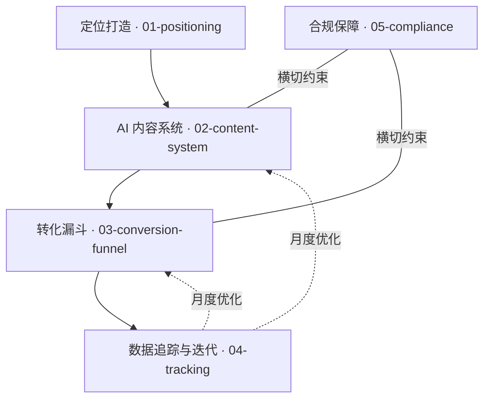

# 方案总览与落地路线图

> 本文件是 [../README.md](../README.md) 的详版：讲清五大模块如何咬合，以及 90 天怎么落地。
> 相关：定位 [01-positioning.md](01-positioning.md) · 内容 [02-content-system.md](02-content-system.md) · 转化 [03-conversion-funnel.md](03-conversion-funnel.md) · 度量 [04-tracking.md](04-tracking.md) · 合规 [05-compliance.md](05-compliance.md)

## 1. 五大模块关系



- **定位**（源头）：决定"写给谁、说什么、什么调性"；
- **内容**（引擎）：把定位翻译成五品类内容，AI 提效；
- **转化**（路径）：把曝光导流到私域并成交；
- **度量**（反馈）：用数据驱动内容与路径的月度迭代；
- **合规**（约束）：横切一切产出，是发布的前置门槛。

## 2. 90 天落地路线图

### 第 1-2 周：定位 + 内容系统上线

- 完成 [01-positioning.md](01-positioning.md) 的 IP 定位与三类客群画像；
- 搭建素材库（[02-content-system.md](02-content-system.md) §3），先收集 10 条可用素材；
- 配置 AI 提示词（[../prompts/00-system.md](../prompts/00-system.md)），用 [../templates/copy-templates.md](../templates/copy-templates.md) 产出 5 品类各 1 条样例；
- 完成第一版合规自查（[05-compliance.md](05-compliance.md)），建立见证授权台账。

### 第 3-8 周：跑通漏斗与数据

- 按 [../templates/content-calendar.md](../templates/content-calendar.md) 稳定发布（每日 2-3 条）；
- 逐日记录 [../templates/tracking-sheet.md](../templates/tracking-sheet.md)；
- 打通"互动 → 私域 → 咨询"，每周 1 次轻触达意向客户；
- 跑通首单万元私教成交（或至少完成 3 次咨询）。

### 第 9-12 周：迭代与规模化

- 执行首个完整月度迭代 SOP（[04-tracking.md](04-tracking.md) §3）；
- 依据数据调整品类配比、时段与话术；
- 建立可持续节奏，进入"连续 3 个月每月 ≥2 单"的验证期（目标，非承诺）。

## 3. 每日最小行动闭环

```
选当日档位（content-calendar）
   → 取素材 + 贴品类提示词 → AI 生成
   → 人工事实校验 → 合规自查
   → 按黄金时段发布 → 记录追踪表
```

## 4. 关键成功因素

1. **定位聚焦**：不服务所有人，服务画像内的那一类人；
2. **发布稳定**：每日 2-3 条不断档，比偶尔爆款更重要；
3. **合规优先**：见证必授权、不承诺、不用极限词；
4. **数据说话**：每月用数据改 1-2 个变量，不凭感觉；
5. **人机分工**：AI 生成 + 人校验/决策/发布。

## 5. 常见误区提醒

- ❌ 把朋友圈当广告位天天硬卖 → ✅ 信任场 + 配比受控的成交场景；
- ❌ AI 生成即发布 → ✅ 必过事实校验与合规自查；
- ❌ 只看成交量不看漏斗 → ✅ 找到流失最大的环节再优化；
- ❌ 一个月改十个变量 → ✅ 单变量迭代，留住基线。
