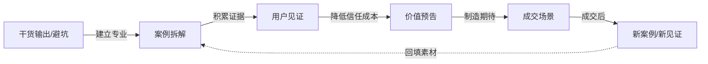
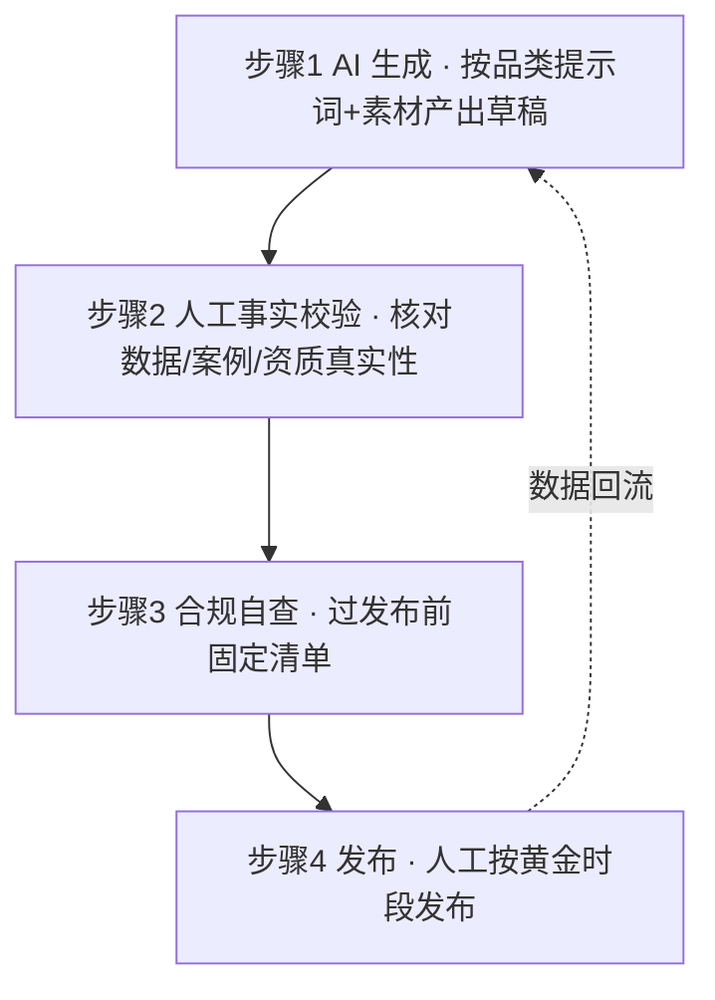

# AI 内容系统：选题框架 · 五大品类 · 素材库 · 生成闭环

> 目标：让 AI 稳定产出**兼具专业度、感染力与引流属性**的朋友圈内容，且完全可复用、可迭代。
> 依赖：人设与客群设定见 [01-positioning.md](01-positioning.md)；提示词见 [../prompts/00-system.md](../prompts/00-system.md)；模板见 [../templates/copy-templates.md](../templates/copy-templates.md)。

## 1. 选题框架（五大母题）

朋友圈选题从"母题 → 切入角度"一级级展开，避免"今天写什么"的空转。

| 母题 | 说明 | 切入角度示例（每母题 ≥2） |
|---|---|---|
| 认知颠覆 | 打破目标客群的一个固有认知 | ① 反常识结论 + 依据；② "你以为的 X 其实是 Y" |
| 案例实证 | 用真实（脱敏/授权）案例说话 | ① 客户前后对比；② 关键转折点复盘 |
| 方法工具 | 给出可迁移的方法/框架 | ① 一个模型/清单；② 一个高频问题的解法 |
| 避坑清单 | 指出常见错误与代价 | ① 3 个致命误区；② "别再做 X 了" |
| 成长叙事 | 教练本人的真实故事与思考 | ① 一次失败/转折；② 一个反直觉的坚持 |

选题三原则：**与定位自洽**（服务谁）、**与客群痛点相关**（他们关心什么）、**能落到一个行动钩子**（引向私域）。

## 2. 五大核心品类

| 品类 | 目标 | 建议占比 | 主要母题来源 | 行动钩子强度 |
|---|---|---|---|---|
| **案例拆解** | 用证据建立专业信任 | ~30% | 案例实证 | 中（引流到"想了解怎么做"） |
| **干货输出** | 展示专业深度、提供即时价值 | ~30% | 方法工具 / 避坑清单 | 中（引流到"领取完整清单"） |
| **用户见证** | 用他人之口降低信任成本 | ~15% | 案例实证（他人视角） | 中高（引流到"看看他们怎么做到的"） |
| **价值预告** | 制造期待、预告成交场景 | ~15% | 认知颠覆 / 成长叙事 | 高（引流到"私信了解"） |
| **成交场景** | 明确给出成交入口 | ~10% | 方法工具 + 价值主张 | 最高（直接引导咨询/报名） |

> 配比为建议值，按 [04-tracking.md](04-tracking.md) 的数据月度调整。**成交场景占比受控**（≤1 条/日），且须有前序内容铺垫，避免硬广。

### 品类协同关系

## 3. 素材库结构

素材库是内容的"弹药"，建议用一张表格（Excel/Notion/飞书表格均可）维护。字段定义：

| 字段 | 说明 | 示例 |
|---|---|---|
| 编号 | 唯一标识 | CASE-001 |
| 类型 | 案例/数据/金句/方法论/见证 | 案例 |
| 摘要 | 一句话核心 | 某制造企业创始人从救火到脱身的 90 天 |
| 可用细节 | 可公开的（脱敏）事实点 | 团队从 12 人扩到 30 人、周会从 4 小时到 1 小时 |
| 授权状态 | 已授权/需授权/不可用 | 已授权 |
| 适配品类 | 适合写的品类 | 案例拆解 / 用户见证 |
| 使用记录 | 已用于哪些内容 | 2026-10-15 案例拆解 |

素材类型建议收集：**客户案例**（脱敏授权）、**数据/结果**、**金句/洞察**、**方法论框架**、**见证素材**、**个人经历**。

### 素材库登记表（可复制使用）

| 编号 | 类型 | 摘要 | 可用细节 | 授权状态 | 适配品类 | 使用记录 |
|---|---|---|---|---|---|---|
| CASE-001 | 案例 | 某制造企业创始人 90 天脱身 | 团队 12→30 人、周会 4h→1h | 需授权 | 案例拆解 | |
| DISC-001 | 金句 | "忙碌≠在推进" | — | 无需授权 | 干货输出 | |
| TOOL-001 | 方法论 | 脱身三问 | — | 无需授权 | 干货输出 | |
| ... | | | | | | |

## 4. AI 生成闭环（四步，缺一不可）

1. **AI 生成**：填入 [../prompts/01-five-categories.md](../prompts/01-five-categories.md) 对应品类提示词 + 素材库条目 + 当日目标（引流/信任/成交）；
2. **人工事实校验**：逐条核对——数据是否真实？案例是否脱敏且授权？资质表述是否准确？**任何拿不准的细节，删掉，不要编**；
3. **合规自查**：过 [05-compliance.md](05-compliance.md) §1 清单；
4. **发布**：按 [03-conversion-funnel.md](03-conversion-funnel.md) 的节奏与时段发布，并记录数据。

## 5. 内容质量三问（发布前自问）

1. **专业度**：这条是否让目标客群感到"这个人真懂"？
2. **感染力**：这条是否让人愿意读完、有情绪或认知触动？
3. **引流属性**：这条是否有一个**清晰、低门槛**的下一步行动？

> 三问任一为否，回炉重写。这是 [../prompts/00-system.md](../prompts/00-system.md) 中自评环节的依据。

## 6. 术语表（新人必读）

| 术语 | 含义 |
|---|---|
| 钩子 | 内容开头抓注意力的第一句 / 引导语 |
| 私域 | 可反复触达的自有流量（微信好友 / 社群） |
| 加微 | 引导对方添加微信好友 |
| 公域 | 非自有的公开流量平台（如抖音 / 小红书 / 公众号公域） |
| 固定门 | 发布前必过的一道固定检查（如合规自查清单） |
| 代理指标 | 无法精确测量时使用的替代性可观测指标（如曝光用"点赞 + 评论"代理） |
| 分层 | 按客户与你的关系深浅 / 意向高低分组运营 |
