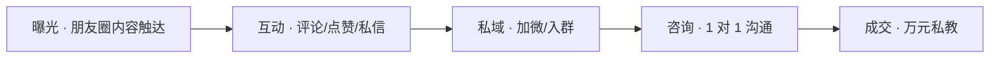
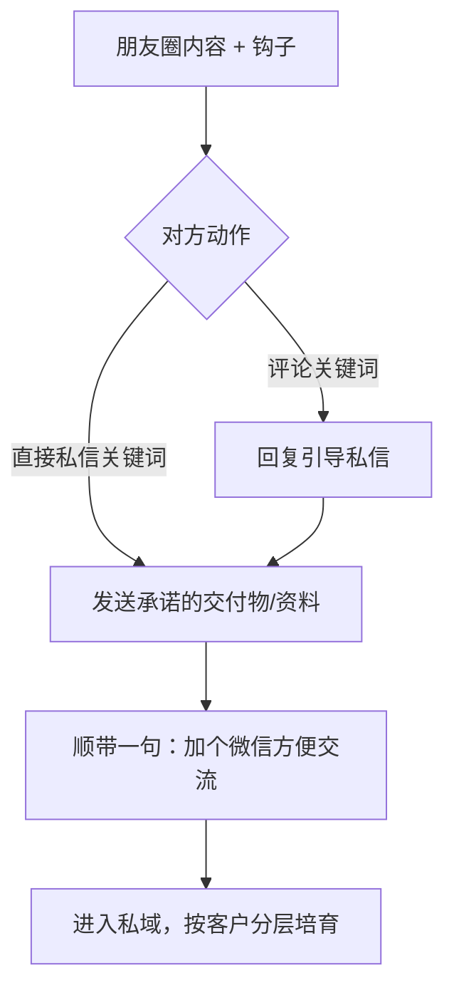

# 转化漏斗：节奏 · 互动 · 导流 · 话术 · 客户分层

> 目标：把"朋友圈曝光"到"万元私教成交"的路径显式化，让每个环节都有明确动作与信号。
> 上游：内容系统见 [02-content-system.md](02-content-system.md)；度量见 [04-tracking.md](04-tracking.md)。

## 1. 转化漏斗（五阶段）

| 阶段 | 核心动作 | 转化信号 | 关键指标 |
|---|---|---|---|
| 曝光 | 发布足够专业/有吸引力的内容 | 有人看到（阅读/点赞） | 曝光量、互动率 |
| 互动 | 用钩子引导评论/私信 | 评论、点赞、私信咨询 | 互动率、引流转化率 |
| 私域 | 引导加微/入群 | 成为微信好友/群成员 | 引流转化率 |
| 咨询 | 1 对 1 诊断沟通 | 表达明确购买意向 | 私域咨询量 |
| 成交 | 报价 → 异议处理 → 临门 | 付费成交 | 成交率 |

## 2. 发布节奏（每日 2-3 条 + 三黄金时段）

### 2.1 黄金时段（建议）

| 时段 | 时间 | 适配品类 | 依据（经验性） |
|---|---|---|---|
| 早档 | 07:30-08:30 | 干货输出 / 案例拆解 | 通勤/晨间刷手机高峰，看"有用"内容 |
| 午档 | 12:00-13:00 | 案例拆解 / 用户见证 | 午休碎片时间，接受"故事/证据" |
| 晚档 | 20:00-22:00 | 价值预告 / 成交场景 | 晚间深度阅读，成交决策更易发生 |

> 时段为通用经验值，实际以 [04-tracking.md](04-tracking.md) 的自身数据校准。

### 2.2 每日结构（给出可执行的两档与三档方案）

- **基准版（2 条/日）**：早档（干货/案例）+ 晚档（预告/成交）；
- **加量版（3 条/日）**：早档 + 午档（见证/案例）+ 晚档。

30 天具体排布见 [../templates/content-calendar.md](../templates/content-calendar.md)。

## 3. 互动引导机制

1. **评论钩子**：内容结尾抛一个**低门槛、有代入感**的问题（"你更想先解决哪一个？"）；
2. **点赞/围观**：对每一条评论**当天回复**，形成"这里有人认真回应"的观感；
3. **私信关键词**：设置固定关键词（如"清单""案例""陪跑"），便于统计与自动化筛选；
4. **不诱导分享**：不用"集赞/转发领奖"（合规红线，见 [05-compliance.md](05-compliance.md)）。

## 4. 私域导流流程

要点：

- **先给价值，再加微信**：先兑现内容里承诺的资料/清单，再自然引导加微，降低戒备；
- **合规**：加微引导不得以虚假福利诱导，不得群发骚扰；
- **入群（可选）**：对同意者拉入轻量社群，用于持续培育。

## 5. 成交转化话术（结构化）

> 用于 1 对 1 咨询。原则：**先诊断，后方案；先匹配，后报价**。避免一上来推销。

### 5.1 开场（建立同频）

> "谢谢你愿意聊。在给建议之前，我想先了解下你现在最想解决的那个问题——可以多说说吗？"

### 5.2 需求诊断（用你的方法提问）

> "如果这个问题解决了，对你最直接的影响是什么？"
> "你之前试过哪些方式？为什么没成？"

### 5.3 方案呈现（对症）

> "基于你说的，我看到的真正卡点是 {{诊断}}。我通常的做法是 {{你的方法/框架}}，分 {{N}} 步……"

### 5.4 报价（先价值后价格）

> "这件事我做的是 1 对 1 陪跑，{{服务描述}}。费用是 {{价格}}。我不承诺结果，但我会把我 {{年限}} 年的方法都用在你这。"

### 5.5 异议处理

| 异议 | 回应思路 |
|---|---|
| "有点贵" | 先确认价值预期，再谈"如果不解决的代价"；不降价贬低自己 |
| "我再想想" | 给一个**低风险下一步**（先做一次诊断），约定回访时间 |
| "能保证效果吗" | 诚实：不承诺结果；说明你会提供的确定性（方法/陪跑/复盘） |
| "没时间" | 说明时间投入的真相与你的陪跑如何省时间 |

### 5.6 成交临门一问

> "你希望我们从什么时候开始？本周还是下周一？"

## 6. 客户分层运营策略

| 分层 | 定义（信号） | 触达频率 | 内容匹配 | 成交动作 | 升级信号 |
|---|---|---|---|---|---|
| **认知期** | 点赞/偶尔评论，未加微或刚加微 | 通过朋友圈就行，不打扰 | 干货、案例 | 无（先培育） | 主动评论/私信关键词 |
| **意向期** | 已加微、有互动、问过问题 | 每周 1 次轻触达 | 见证、价值预告 | 引导一次诊断邀约 | 主动问价格/服务 |
| **高意向期** | 明确问过报价/服务/时间 | 2-3 天内跟进 | 成交场景 + 一对一 | 报价 → 异议处理 → 临门 | 预约/付款 |

> 分层边界随互动动态流动；降层（如长期无互动）可减少触达，避免骚扰。

## 7. 漏斗健康度自检（每月）

- 曝光→互动：互动率是否明显偏低？（内容钩子问题）
- 互动→私域：引流转化率低？（钩子/导流话术问题）
- 私域→咨询：咨询量低？（价值预告/信任积累不足）
- 咨询→成交：成交率低？（话术/报价/匹配度问题）

> 归因与迭代方法见 [04-tracking.md](04-tracking.md)。
