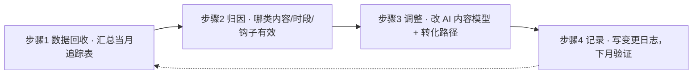

# 数据追踪与月度迭代

> 目标：让"内容是否有效"可测量、可归因，驱动 AI 内容模型与转化路径的月度优化。
> 目标声明：下文"连续 3 个月每月 ≥2 单万元私教"为**运营目标**，非承诺。

## 1. 指标定义（五项）

> 口径必须固定，否则数据无法纵向比较。分子/分母定义如下。

| 指标 | 口径（分子 / 分母） | 记录方式 | 健康参考方向 |
|---|---|---|---|
| 曝光量 | 单条内容的阅读/可见人次 | 逐条记录；无精确值时**统一用「点赞数 + 评论数」作代理**并标注「代理」 | 越高越好 |
| 互动率 | (评论数 + 私信数) / 曝光量 | 逐条计算 | 关注趋势，非绝对值 |
| 引流转化率 | 加微/入群人数 / 互动人数 | 每日汇总 | 反映导流话术效果 |
| 私域咨询量 | 发生 1 对 1 咨询的人数 | 每日/每周汇总 | 反映内容—信任转化 |
| 成交率 | 成交人数 / 咨询人数 | 每月汇总 | 反映话术与匹配度 |

> 曝光量在朋友圈无官方精确口径：**固定采用单一代理口径「点赞数 + 评论数」**，并在表中标注「代理」（切勿混用多种估算法，否则跨月不可比）。

## 2. 追踪表

逐条记录模板见 [../templates/tracking-sheet.md](../templates/tracking-sheet.md)。核心字段：日期 / 时段 / 品类 / 曝光 / 互动（赞评私）/ 引流 / 备注。

## 3. 月度迭代 SOP（四步）

### 步骤 1：数据回收

- 汇总当月 [tracking-sheet](../templates/tracking-sheet.md)：各品类互动率、各时段表现、引流关键词效果、咨询与成交数；
- 对照上月，标出上升/下降的指标。

### 步骤 2：归因

- **内容维度**：哪一品类的互动率/引流转化率最高？哪类钩子（清单/案例/预约）最有效？
- **时段维度**：早/午/晚哪档效果最好？是否需调整发布时段？
- **漏斗维度**：哪个环节流失最大（曝光→互动 / 互动→私域 / 私域→咨询 / 咨询→成交）？对照 [03-conversion-funnel.md](03-conversion-funnel.md) §7。

### 步骤 3：调整

- 更新 [02-content-system.md](02-content-system.md) 的品类配比与 [../prompts/00-system.md](../prompts/00-system.md) 提示词（如强化高效果品类）；
- 更新 [03-conversion-funnel.md](03-conversion-funnel.md) 的时段、钩子与话术；
- 每次只改 1-2 个变量，便于下月归因（避免多变量同时改动导致无法判断）。

### 步骤 4：记录

- 在下方"月度迭代日志"登记：改了什么、依据什么数据、预期改善什么。

## 4. 目标与复盘节奏

| 层级 | 节奏 | 内容 |
|---|---|---|
| 日 | 每日 | 记录追踪表（5 分钟内） |
| 周 | 每周日 | 周核对：互动/引流/咨询汇总，微调下周选题 |
| 月 | 每月末 | 月度迭代 SOP（四步）+ 迭代日志 |
| 季 | 每季度 | 复核定位/合规/漏斗结构是否需要大改 |

**运营目标（非承诺）**：连续 3 个月实现每月 ≥2 单万元私教成交。

**里程碑检查**（第 1/2/3 个月末）：

- [ ] 月成交 ≥2 单？（若否，进入归因：是咨询量不足还是成交率过低）
- [ ] 私域咨询量是否稳定？（咨询量是成交的前置）
- [ ] 内容产出是否可持续（每日 2-3 条不断档）？

## 5. 月度迭代日志

| 月份 | 关键数据（互动率/引流率/咨询/成交） | 主要归因 | 本月调整 | 预期效果 |
|---|---|---|---|---|
| 2026-10 | | | 初始基线建立 | — |
| 2026-11 | | | | |
| 2026-12 | | | | |

## 6. 迭代原则（防止乱改）

1. **单变量**：每月只改 1-2 个变量；
2. **有基线**：任何改动前先有 ≥2 周基线数据；
3. **留痕**：改动写入日志，下月验证；
4. **不追短期噪声**：单条爆款不代表规律，看趋势。
