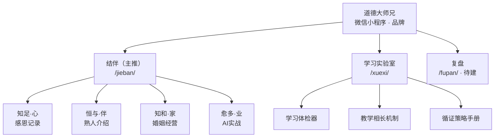
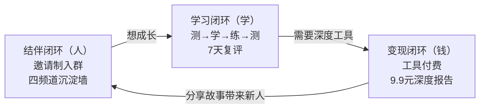
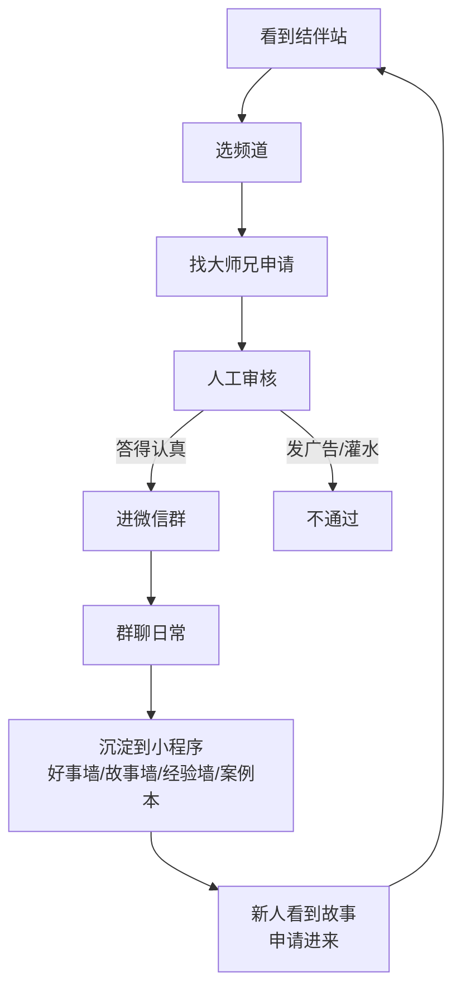
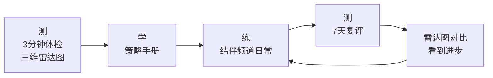
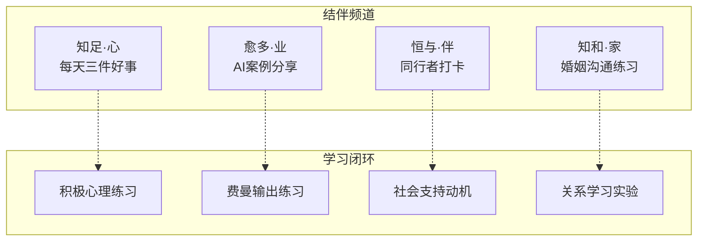
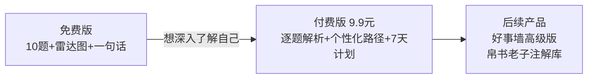
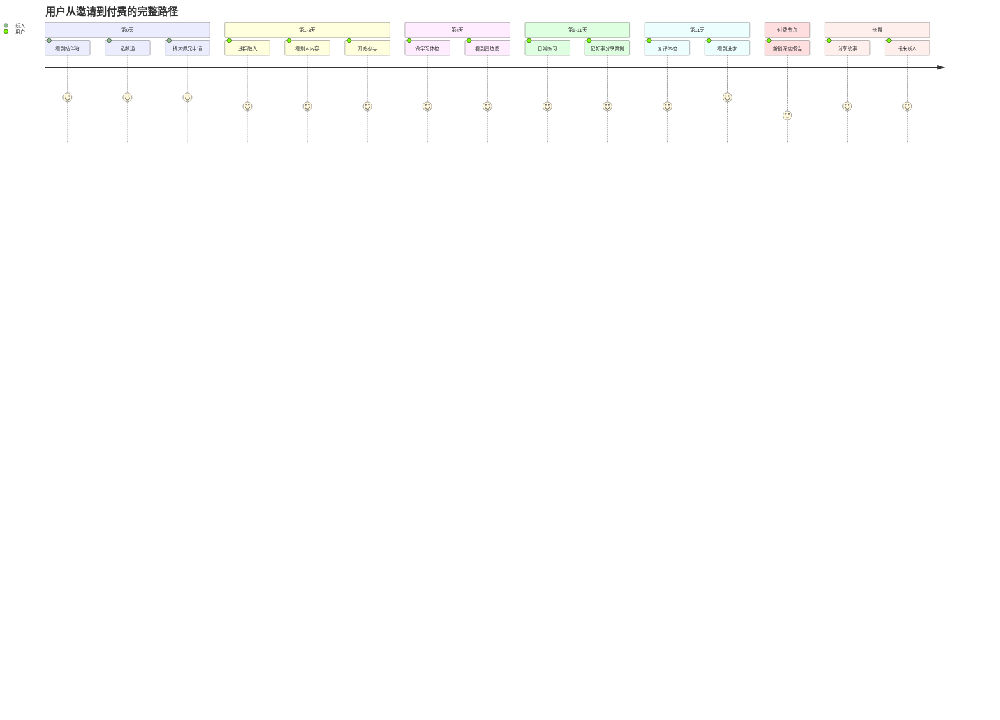
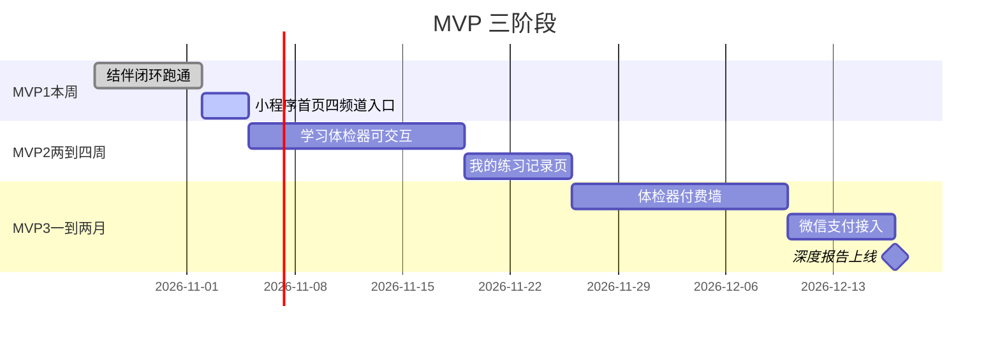
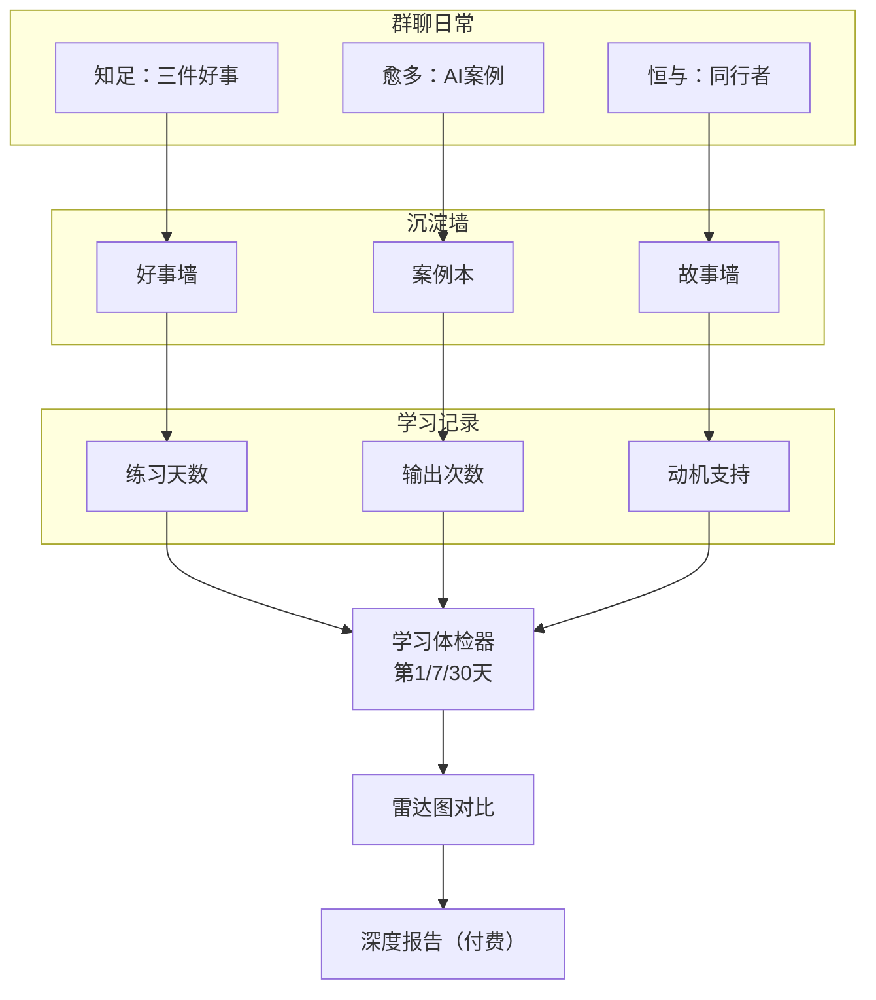

# 品牌蓝图总览

## 品牌层级

## 三环闭环

### 环一：结伴闭环（人）

### 环二：学习闭环（学）

### 学习闭环与结伴频道咬合

### 环三：变现闭环（钱）

## 用户完整旅程

## MVP路径

## 数据流

## 核心红线

- 不催婚、不打分、不围观
- 零收费导流、反杀猪盘
- 不设表单、不收集个人信息
- 不卖课、不做训练营
- 邀请制是筛选，不是限制
