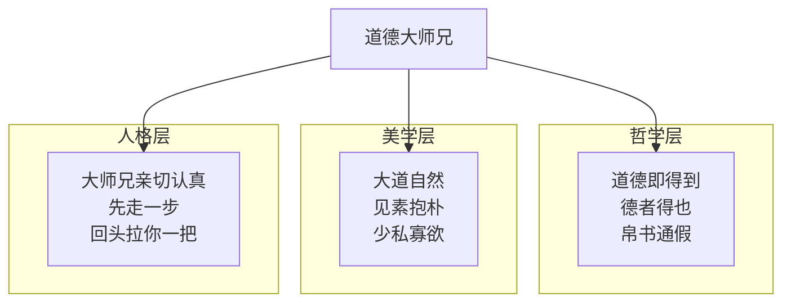
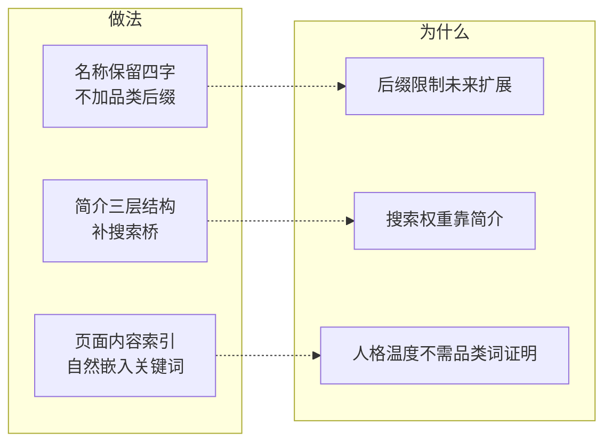
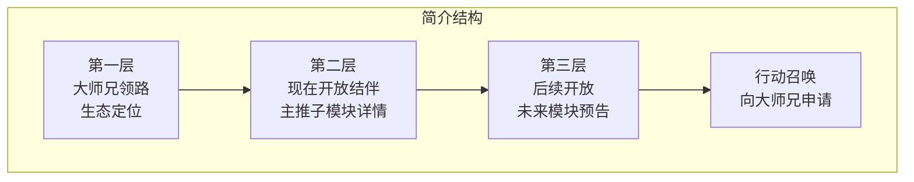
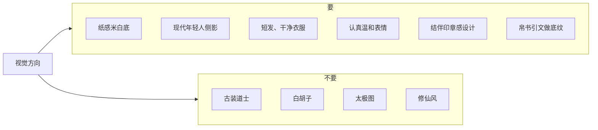
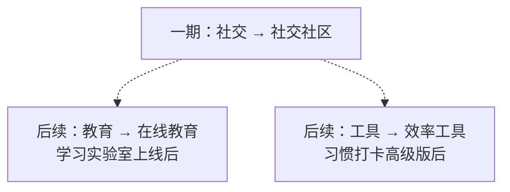

# 品牌定位

## 命名哲学



## 名称策略

**名称不动：道德大师兄。**



## 简介三层结构

```
大师兄领路，道法自然的生活与工具生态。

现在开放「结伴」：好好生活的人终会相逢。
感恩记录安顿内心，熟人介绍找同行者，婚姻经营互助陪伴，
AI实战拒绝割韭菜。反杀猪盘、反收费导流、不催婚不打分。

后续开放：方法论复盘、AI学习实验室。
微信端向大师兄申请邀请入群。
```



## 视觉方向



## 服务类目


