# 三环闭环设计

## 总览

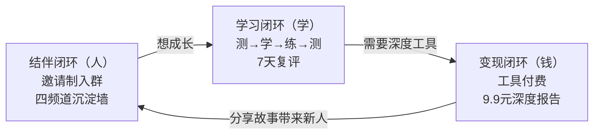

---

## 环一：结伴闭环（人）

### 入口机制

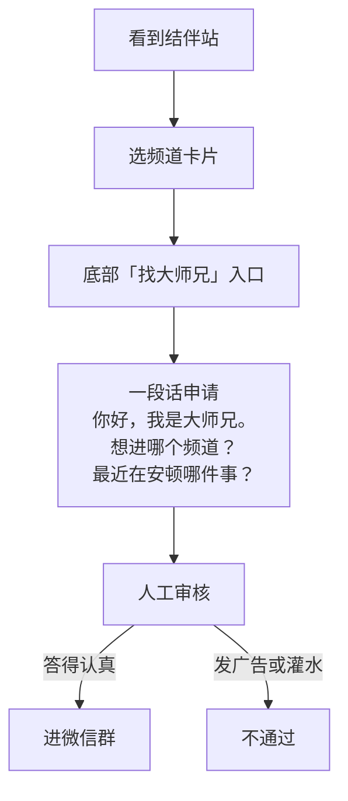

### 四个沉淀墙

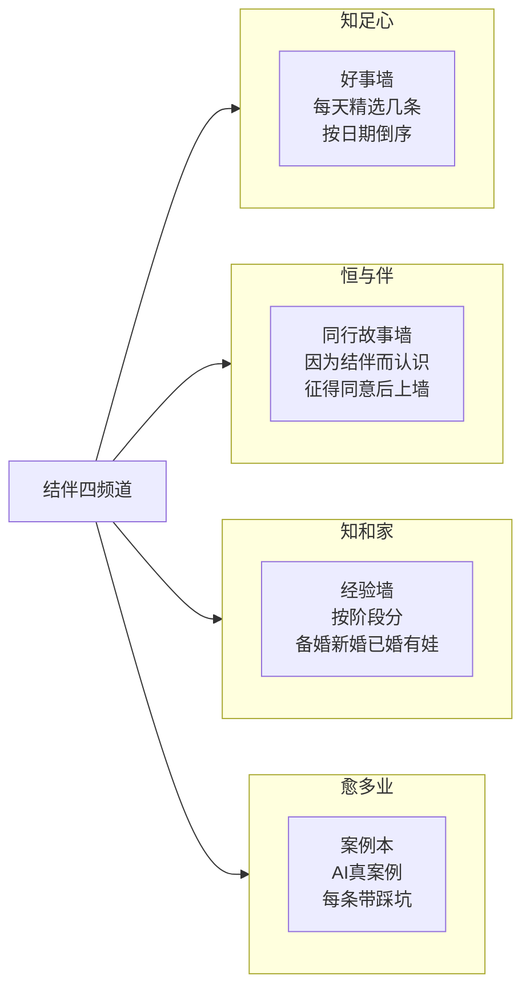

### 设计原则

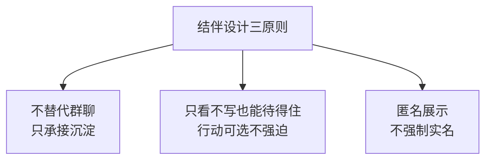

---

## 环二：学习闭环（学）

### 完整循环

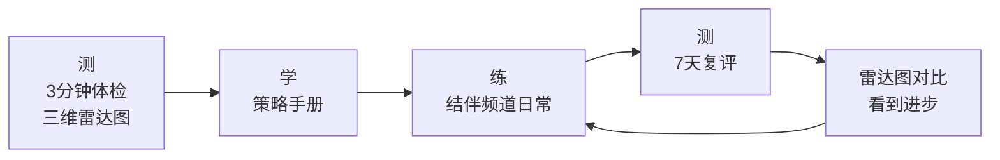

### 三维雷达图

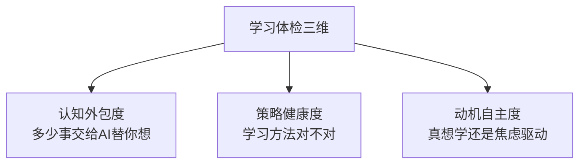

### 和结伴频道咬合

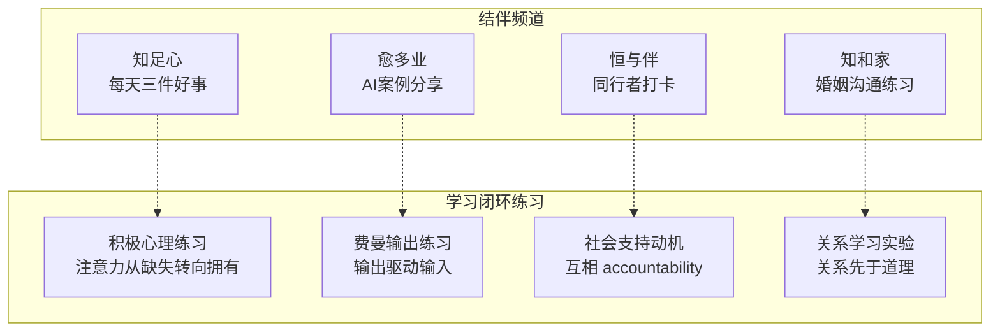

### 学习记录

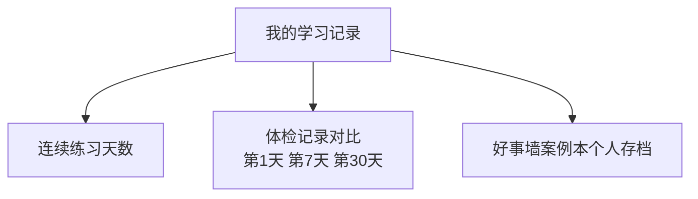

---

## 环三：变现闭环（钱）

### 第一个付费产品

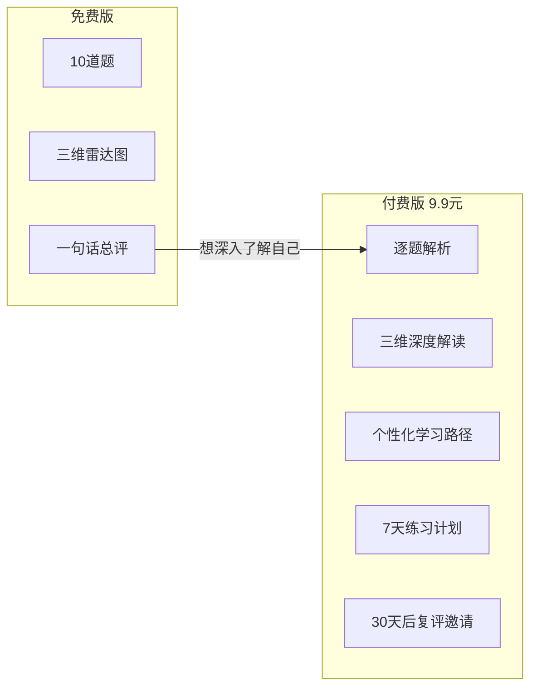

### 后续产品路线

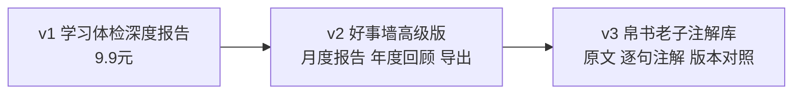

### 红线

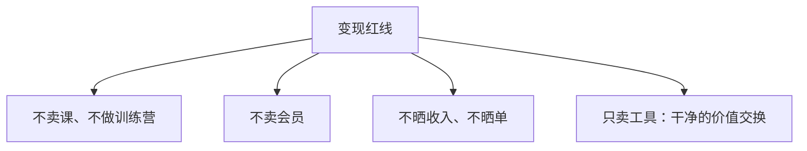

---

## 用户完整旅程

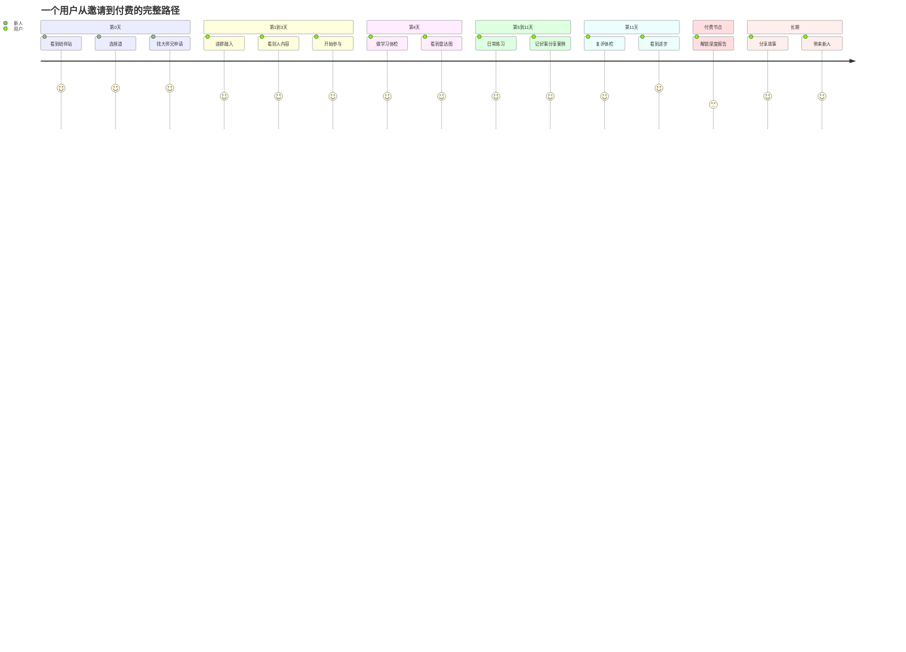

## 数据流

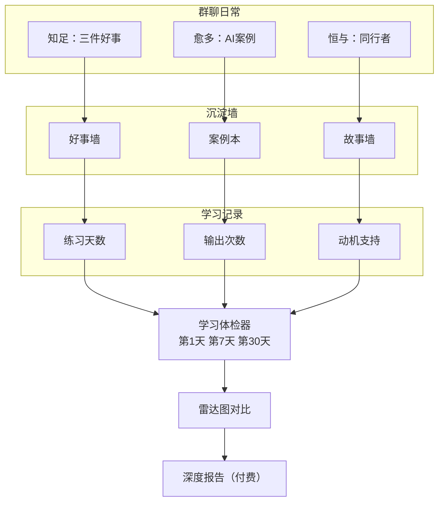
