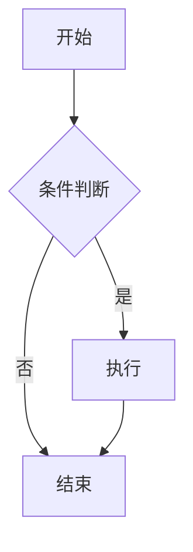
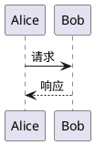

# Doocs MD 全功能综合对拍文档

> 本文档用于 TR-7.2 渲染等价性黄金对拍，覆盖 T6/T7 全部扩展的交互场景。

## 目录

[TOC]

## 一、基础排版与标记语法

这一段落包含 **加粗**、*斜体*、~~删除线~~、==高亮标记==、++下划线++、~波浪线~ 与 ^上标^，
以及行内代码 `const x = 42` 和[普通链接](https://github.com/doocs/md "标题")。
自动链接 https://md.doocs.org 与表情短码 :+1: :smile: :heart: :tada: 混合出现。

软换行后紧跟公式（#1743）：
取
$y_1 = y_2 = \cdots = y_n = -y$，就退化为二元的情形。
金额守卫 20$ 不应当作公式，而 $E=mc^2$ 是行内公式，$$\sum_{i=1}^{n} i$$ 是块公式。

LaTeX 行内 \(a^2+b^2=c^2\) 与块级：
\[
\int_0^\infty e^{-x^2}\,dx=\frac{\sqrt{\pi}}{2}
\]

分隔线三种：

---

***

___

## 二、列表、引用与表格

### 无序列表

- 第一项，含行内公式 $x+y$
- 第二项，含脚注引用[^first]
  - 嵌套项 A
  - 嵌套项 B，含 `code`
- 第三项，回到顶层

### 有序列表

1. 步骤一：读取配置
2. 步骤二：初始化渲染器
3. 步骤三：输出 HTML[^second]

### 引用块

> 这是一段引用，包含 **强调** 与 [链接](https://doocs.github.io/md)。
>
> 第二段引用，嵌套行内公式 $\alpha+\beta$。

### GFM 表格

| 名称 | 版本 | 状态 | 占比 |
| :-- | :-: | --: | :-: |
| Vue | 3.x | 稳定 | 80% |
| Vite | 8.x | 稳定 | 95% |
| pnpm | 10.x | 稳定 | 70% |

## 三、提示框全集

> [!NOTE]
> 这是 GFM 笔记提示，含 **加粗** 文本。

> [!TIP]
> 这是小贴士。

> [!IMPORTANT]
> 这是重要信息。

> [!WARNING]
> 这是警告，含公式 $p<0.05$。

> [!CAUTION]
> 这是注意事项。

> [!ABSTRACT]
> Obsidian 风格摘要，支持折叠。

> [!FAQ]- 自定义标题
> 折叠的常见问题解答内容，这里有多行文本，
> 还包含换行情景与行内代码 `npm run dev`。

> [!THEOREM]
> 学术定理提示：费马大定理，$n>2$ 时 $x^n+y^n=z^n$ 无正整数解。

## 四、图表占位





```infographic
{
  "title": "信息图表示例",
  "items": [{"label": "用户", "value": "100万"}]
}
```

## 五、注音与表情贴纸

基础注音 [漢字]{かんじ}，帽注 [拼音]^(pīn-yīn)，
分隔拆分 [上海]{shàng・hǎi} 与多字 [甲乙丙丁]{a-b}，
行内表情贴纸：

<Emoji id="liulei" alt="流泪" />

横向滑动图组：

<,>

## 六、自定义组件

<QRCodeBlock url="https://md.doocs.org" text="扫码访问" size="120" />

<AuthorBlock name="yanglbme" avatar="https://avatars.githubusercontent.com/u/21008209?v=4" bio="Creator of Doocs" />

<MpProfile mpId="MzIxNjA5ODQ0OQ==" nickname="Doocs" headimg="https://cdn-doocs.oss-cn-shenzhen.aliyuncs.com/gh/doocs/md/images/mp-logo.png" signature="GitHub 开源组织" serviceType="1" verifyStatus="1" />

<TipBlock type="success" title="完成" content="全部扩展渲染正常。" />

<TableBlock headers='["模块","状态","用例数"]' rows='[["markup","完成","18"],["emoji","完成","86"],["alert","完成","60"],["component","完成","31"]]' striped="true" caption="T6/T7 进度表" />

<InfoGrid items='[{"label":"语言","value":"Python 3.14"},{"label":"解析器","value":"markdown-it-py"},{"label":"净化","value":"nh3"},{"label":"协议","value":"WTFPL"}]' cols="2" />

<BadgeGroup tags='["Vue 3","TypeScript","FastAPI","SQLite","markdown-it"]' color="#07c160" />

<UnknownBlock foo="bar" />

## 七、脚注与收尾

脚注定义集中在此：
重复引用[^first]同一条脚注，再引用[^third]。

[^first]: 第一条脚注，包含 [链接](https://example.com) 与 $x^2$。
[^second]: 第二条脚注，包含行内代码 `code`。
[^third]: 第三条脚注，中文编号语义按定义顺序。

这是文档的最后一段，包含 :fire: 表情、==标记== 与 [漢字]{かんじ} 注音，
用于验证扩展并存时的段落收尾行为。
