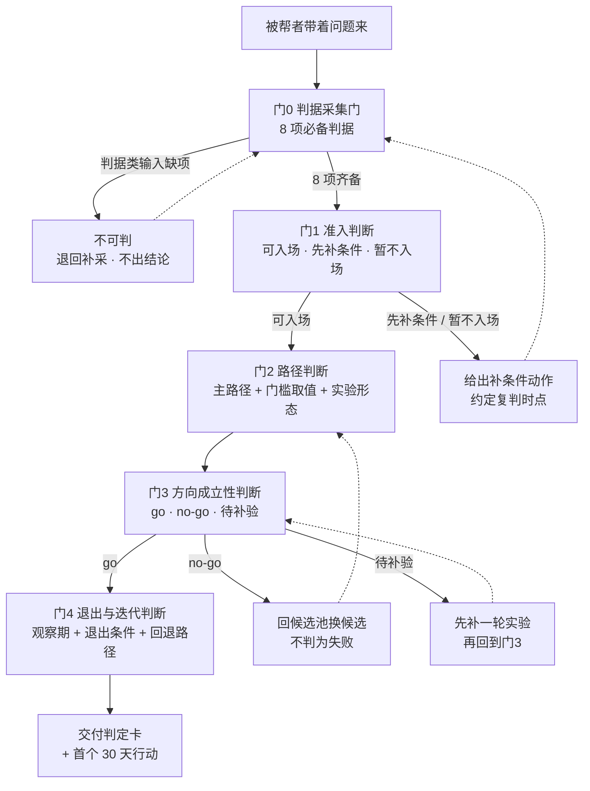

# 00 · 判断模型总览

> 回到 [知识包首页](../index.md)
>
> **总边界声明（先读这一段）**：本模型是**方法设计**，未经实证检验；它不预测任何结果，不提供任何收益、成功率或规模预期。模型中一切阈值与门槛均为**方法参数**〔参数〕，可在实践中调整。测评类工具属**非决定论**，只能进「线索栏」，不得进「判据栏」。

## 1. 这个模型解决什么问题

源知识包 [《个人变现方向发现：从「我是谁」到市场愿意付费的方向》](../../../../projects/awesome-okf-xs/doc/bundles/sheke/industry/monetization-direction/index.md) 回答的是**当事人自己该怎么做**（四步法：自我盘点 → 候选方向生成 → 需求验证 → 决策启动，F-004）。

本模型回答的是另一个问题：**当一个人要帮另一个人判断时，该按什么顺序判、依据什么判、什么时候必须不判。**

两者的关系是「同一套事实，两个视角」：源包提供事实与方法，本包把方法**重排成判断者侧的判断顺序**，并补上源包未展开的三件事——

1. **判据归属**：哪些东西能作为判定依据，哪些只能作为反思线索（F-046〔参数〕）；
2. **拒绝判断档**：判据不全时，模型的合法输出是「不可判」（F-047〔参数〕）；
3. **判断者角色边界**：判断者只做判据审核与信号分级，不做方向背书（F-044、I-2）。

## 2. 五门链总图

**门间关系是硬前置**（F-045〔参数〕）：前门未过不得进入后门。四道判断门与一道采集门的分工如下：

| 门 | 回答的问题 | 输入 | 输出档 | 详解 |
|---|---|---|---|---|
| 门 0 | 判断前必须拿到什么？ | 被帮者交付的判据 | 判据齐备 / **不可判** | [01](01-judgment-inputs.md) |
| 门 1 | 此人是否、何时适合做方向选择？ | 门 0 的判据 | 可入场 / 先补条件 / 暂不入场 | [02](02-readiness-judgment.md) |
| 门 2 | 此人该走哪条路径？ | 起点 + 资源约束 | 主路径 + 门槛取值 + 实验形态 | [03](03-path-judgment.md) |
| 门 3 | 这个候选方向是否成立？ | 候选卡 + 验证信号 | go / no-go / 待补验 | [04](04-direction-judgment.md) |
| 门 4 | 何时退出、何时迭代？ | 观察期 + 信号趋势 | 继续 / 迭代 / 退出并回候选池 | [05](05-exit-judgment.md) |

## 3. 与源知识包四步法的对照

| 源知识包（当事人视角） | 本模型（判断者视角） | 关系 |
|---|---|---|
| 步骤 1 自我盘点（F-006、F-007） | 门 0 判据采集 + 门 1 准入判断 | 把「盘点出的东西」分成判据类与线索类，并加一道准入前置 |
| 步骤 2 候选方向生成（F-008、F-009） | 门 2 路径判断 | 路径判定用于**缩小候选搜索范围**（起点 × 资源约束），不产出候选、也不替代候选生成；候选卡随 P7 在门 3 被审查 |
| 步骤 3 需求验证（F-010、F-011） | 门 3 方向成立性判断 | 沿用源包手段，另加四条加重规则（阈值登记时点、样本来源、无效信号列、依据逐行引用） |
| 步骤 4 决策与启动（F-012~F-014） | 门 3 输出档 + 门 4 退出/迭代判断 | 沿用源包三档阈值；退出判断由本包补全为独立门 |

> **注意方向**：本模型**不替代**源知识包的四步法。被帮者仍须按四步法完成盘点、生成、验证与决策；本模型只是在旁边回答「判断者此刻能不能判、该判什么、不该判什么」。

## 4. 两条使用路径

### 4.1 判断者路径（你帮别人判断）

按序读 [01 判据采集门](01-judgment-inputs.md) → [02](02-readiness-judgment.md) → [03](03-path-judgment.md) → [04](04-direction-judgment.md) → [05](05-exit-judgment.md)，用 [07 提问脚本](07-interview-scripts.md) 采集，出结论前逐条过 [06 误判红线](06-misjudgment-redlines.md)。

### 4.2 被帮者路径（对方自填）

把 [08 自填工具](08-self-assessment-tools.md) 的表格交给对方填写，填完的表格即门 0 的判据交付物；对方若需要完整四步法模板，转交源知识包 `examples/` 下的四份工具（自评盘点表 / 候选方向工作坊 / 验证实验模板 / 决策清单），本包不复制其内容。

## 5. 一页速记（判断者随身版）

| 要判 | 看什么 | 不能看的 | 输出 |
|---|---|---|---|
| 能不能判（门 0） | 8 项判据是否齐备 | 印象、对方的态度、你自己的经验 | 齐备 / 不可判 |
| 准不准入（门 1） | 资源硬约束、亲历问题 ≥3、动机不全低谷、起点可判定 | 测评类型、对方的热情 | 可入场 / 先补条件 / 暂不入场 |
| 走哪条（门 2） | 起点 × 资源约束 | 方向好不好 | 主路径 + 门槛 + 实验形态 |
| 成不成立（门 3） | 已发生行为 + 样本来源 + 阈值登记时点 | 点赞、好评、口头意向、熟人应承 | go / no-go / 待补验 |
| 何时退出（门 4） | 观察期登记值 + 信号趋势 | 事后感受 | 继续 / 迭代 / 退出 |

## 6. 本篇要点小结

1. 本模型只回答判断者侧的问题：**能不能判、判什么、不能判什么**；不替代源知识包的四步法。
2. 五门链为**硬前置**关系；门 0 未过时的合法输出是「不可判」，不是倾向性建议。
3. 判据分**判据类**与**线索类**两栏；测评、自评、心流清单一律进线索栏。
4. 判断者的最大价值是**信号分级与判据审核**，不是方向背书；方向成立性只能由被帮者自己的已发生行为承担。
5. 全部阈值均为方法参数〔参数〕，可调整，须留痕；本模型未经实证检验。

---

## 相关文档

- [01 判据采集门](01-judgment-inputs.md) · [02 准入判断](02-readiness-judgment.md) · [03 路径判断](03-path-judgment.md) · [04 方向成立性判断](04-direction-judgment.md) · [05 退出/迭代判断](05-exit-judgment.md)
- [06 误判红线](06-misjudgment-redlines.md) · [07 判断者提问脚本](07-interview-scripts.md) · [08 被帮者自填工具](08-self-assessment-tools.md) · [09 边界与效力](09-boundaries-and-limits.md)
- 源知识包：[个人变现方向发现](../../../../projects/awesome-okf-xs/doc/bundles/sheke/industry/monetization-direction/index.md)
