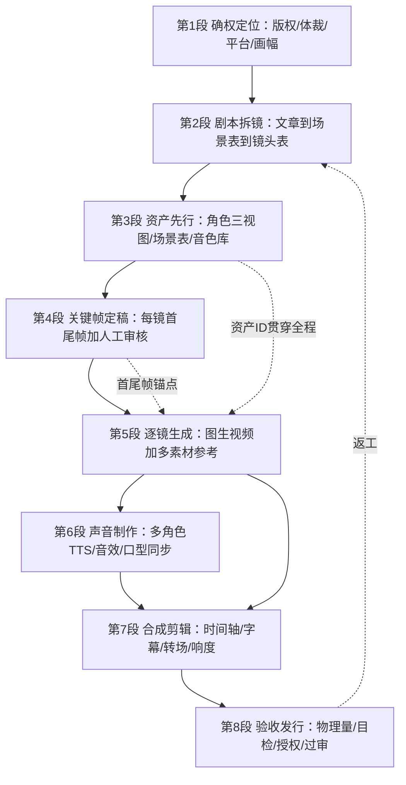

# 01 · 八段制片管线全景与术语词典

[返回知识包首页](../index.md)

## 1. 一张图看懂管线

关键结构特征：

- **唯一回路**：第 8 段验收不通过，回到第 2 段（镜头表）修，而不是在剪辑器里硬救——上游 1 行表的错误，下游要花 10 倍时间。
- **两条贯穿线**：资产 ID（第 3 段→第 5 段）保证跨镜一致；首尾帧（第 4 段→第 5 段）保证镜头间可衔接。
- **声音分叉**：旁白/独白可直接进合成；正面对白必须绕经口型同步再进合成。

## 2. 八段输入/输出与关键决策

| 段 | 输入 | 产出物（可验收） | 关键决策 |
|---|---|---|---|
| 1 确权定位 | 原始文章 + 授权情况 | 《项目卡》：体裁、平台、画幅、时长、受众、版权来源 | 漫剧 / 真人短剧 / 解说三选一；有 IP 走闭环平台还是 API 自建（见 [04](../concepts/04-recipes-and-pitfalls.md)） |
| 2 剧本拆镜 | 文章 | 场景表 + **镜头表（CSV/JSON）** | 每镜 8–15 秒；先节拍（钩子/冲突/反转）后镜头 |
| 3 资产先行 | 镜头表中出现的角色/场景 | 角色三视图、角色卡、场景关键图、音色样本，统一编号 | LoRA 自训 / 平台主体库 / 参考图三档一致性方案 |
| 4 关键帧定稿 | 资产库 + 镜头表 | 每镜首帧（+尾帧）图片，人工审核签字 | 跨镜同角色并排比对不过不进下一段 |
| 5 逐镜生成 | 关键帧 + 参考素材 + 镜头 prompt | 每镜 5–15 秒视频片段 | 图生视频而非文生视频；批量 ≤10、重试上限 4 |
| 6 声音制作 | 旁白/对白文本 | 配音音轨、BGM/音效、对白镜头口型视频 | 多角色分段 TTS；正面对白单独口型同步 |
| 7 合成剪辑 | 全部片段 + 音轨 + 镜头表 | 成片（含字幕/转场/响度规范） | 文字只进字幕层；竖屏安全区；响度统一 |
| 8 验收发行 | 成片 + 授权台账 | 发行包 + 素材来源台账 | 物理量核对 + 目检清单 + 违禁词检测 + 水印/C2PA |

## 3. 镜头表（管线的核心中间产物）

镜头表是整条管线唯一的结构化事实源，所有工具围绕它填写。最小 schema：

| 字段 | 说明 | 示例 |
|---|---|---|
| shot_id | 镜号，全局唯一 | S01C03（第 1 场第 3 镜） |
| duration_s | 时长（秒），8–15 | 10 |
| shot_size | 景别 | 特写 / 近景 / 中景 / 全景 / 远景 |
| camera | 运镜 | 推 / 拉 / 横移 / 跟拍 / 固定 |
| visual_prompt | 画面描述（主体+动作+环境+光线+风格锚点） | "少女站在稻田边，风掀起衣摆，黄昏逆光，吉卜力水彩风" |
| char_ids | 出场角色资产 ID（尽量 1 个） | CHAR_01 |
| scene_id | 场景资产 ID | SCENE_07 |
| frame_in / frame_out | 首尾帧图片路径或 URL | frames/S01C03_in.png |
| narration | 旁白（可空） | "那年夏天，她第一次离开家" |
| dialogue | 对白（角色:台词）（可空） | "CHAR_02: 等等我！" |
| vo_id | 配音音轨 ID | VO_S01C03_02 |
| model | 本镜使用的生成模型/档位 | seedance-1.5 / 720p |
| status | 状态 | 待出帧 / 已出帧 / 已生成 / 通过 / 返工 |

> 纪律：第 5 段生成的 prompt 由 `visual_prompt + 资产 + 风格锚点` 组装，**不允许在生成工具里临时改写剧情**——剧情修改必须回到镜头表，保证可复现。

## 4. 术语小词典（新人向）

| 术语 | 含义 |
|---|---|
| 漫剧 | 漫画/动漫风格的竖屏短剧，2025-11 字节红果漫剧带火的体裁；单集通常 1–3 分钟 |
| AI 真人短剧 | AI 生成写实人物演绎的竖屏短剧；出海产品（DramaWave/ReelShort/NetShort）为主力市场 |
| 小说推文视频 | 把小说片段配画面 + 配音做成引流视频，挂小程序/小说平台分销，需投流过审 |
| 文生视频 / 图生视频（T2V / I2V） | 从文本直接生成 / 从参考图（通常首帧）生成视频；本管线强制使用后者 |
| 首尾帧 | 一个镜头的起始画面与结束画面；两镜首尾帧呼应即可做出无缝衔接 |
| 关键帧 | 决定镜头构图/角色站位的定稿图，先于视频生成并经人工审核 |
| 分镜 / Storyboard | 把剧本拆成逐个镜头的画面脚本；本教程里其机器可读形态即"镜头表" |
| 角色圣经 / Character Bible | 长篇连载中锁定全部角色外观、服装、关系、口吻的设定文档 |
| 主体参考 / 元素库 | 可灵/即梦等平台保存角色形象（有的含音色）并在生成时注入的资产库 |
| LoRA / IP-Adapter | 自托管生图生态的一致性技术：LoRA 训练角色小模型，IP-Adapter 生成时注入参考图 |
| 三视图 | 角色正面/侧面/背面定妆图，是跨镜一致性的最重要资产 |
| 口型同步 / Lip-sync | 让画面中人物嘴型与配音对齐的后处理（sync.so / Hedra / HeyGen / LatentSync） |
| TTS | 文本转语音；多角色 TTS 指一次脚本按角色分派不同音色 |
| 数字人 | 真人/虚拟形象驱动的播报视频（腾讯智影、闪剪、HeyGen 等），适合口播不适合剧情剧 |
| C2PA / SynthID | AI 内容的显式/隐式来源凭证与水印，出海发行平台日益强制 |
| 无限画布 | SkyProduction/LibTV/剪映 Hub 的多轨道空间化剪辑界面形态 |
| 出片 | 产出一条可发布视频；"一次出片率"是衡量管线成熟度的核心指标 |

## 5. 为什么是这八段（与行业事实的对应）

- 第 2/3/4 段的独立存在，直接对应头部平台 2026 年的产品形态：火山剧创"剧本→设定→分镜→视频"四步 Agent（F-027）、SkyProduction 导演 Agent + 资产/无限画布（F-025）、扣子"剧本→角色参考图→分镜提示词→视频"教程（F-028）。
- 第 3/4 段先于第 5 段，对应模型厂商的迭代方向——H3 12 文件参考、Seedance 2.5 30 图参考、可灵元素库 3.0（F-012/F-018/F-040）：一致性靠注入，不靠运气。
- 第 8 段独立于剪辑，对应合规现实：人脸留存条款、声音克隆授权、推文违禁词检测（F-041/F-051）。

下一页：[02 · 五层工具选型图谱](02-tool-map.md)
