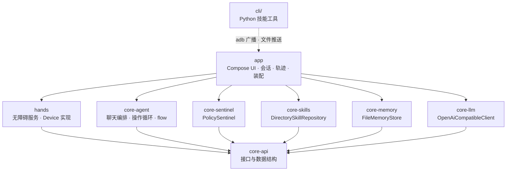

# 分层与依赖：8 个模块如何拼成一个手机助手

PhonePal 的架构可以一句话概括：**把「会思考的部分」和「会碰 Android 的部分」彻底分开**。前者是 5 个纯 JVM 模块，后者是 `hands` 与 `app` 两层；`cli` 是仓库里唯一用 Python 写的部分，服务于技能作者而不是运行时。

## 1. 模块清单

| 模块 | 类型 | 职责 | 关键文件 |
|---|---|---|---|
| `core-api` | Kotlin/JVM | 所有接口与数据结构：`Action`、`Device`、`LlmClient`、`MemoryStore`、`Sentinel`、`Skill` | `api/Agent.kt`、`api/Device.kt`、`api/Llm.kt`、`api/Memory.kt`、`api/Sentinel.kt`、`api/Skills.kt` |
| `core-llm` | Kotlin/JVM | `OpenAiCompatibleClient`：对话、图片输入、工具调用、JSON 模式、重试 | `llm/OpenAiCompatibleClient.kt` |
| `core-memory` | Kotlin/JVM | `FileMemoryStore` + `MemoryIndex`：Basic Memory Markdown + 中文 BM25 | `memory/*.kt` |
| `core-skills` | Kotlin/JVM | `DirectorySkillRepository` + 解析器：`SKILL.md` / `flow.yaml` | `skills/*.kt` |
| `core-sentinel` | Kotlin/JVM | `PolicySentinel`：allow/ask/deny、任务级授权、审计 | `sentinel/*.kt` |
| `core-agent` | Kotlin/JVM | `PhonePalAgent`：聊天编排、操作循环、flow、经验沉淀 | `agent/*.kt` |
| `hands` | Android 库 | 无障碍服务、设备实现、节点压缩、状态悬浮窗 | `AccessibilityDevice.kt`、`NodeCompactor.kt`、`PhonePalAccessibilityService.kt` |
| `app` | Android 应用 | Compose 界面、设置、会话、通知、轨迹、调试桥、依赖装配 | `AppGraph.kt`、`session/AgentSession.kt`、`trace/*.kt` |
| `cli/` | Python 3（仅标准库） | 技能 lint / push / run / logs / traces | `phonepal_cli/*.py` |

8 个 Gradle 模块来自 `settings.gradle.kts` 的 `include` 列表 [F-001]；`cli/` 不在 Gradle 内，但同样随仓库分发 [F-006]。

## 2. 依赖方向



规则只有一条：**除 `app` 外，没有任何模块依赖具体实现**。`core-agent` 的构造参数全是接口（chat、operator、device、memory、skills、sentinel、users）[F-021]，它不知道 Android、OkHttp 或文件系统的存在。

## 3. 为什么 `core-*` 能做成纯 JVM

三个证据：

1. 5 个 `core-*` 的构建脚本只应用 `kotlin.jvm` 与 `kotlin.serialization`，没有 Android 插件；对 `core-*/**/*.kt` 搜索 `^import android\.` 无任何匹配 [F-077]。
2. 第三方运行时依赖只有 OkHttp（`core-llm`）与 snakeyaml-engine（`core-memory`、`core-skills`）；`core-api`、`core-sentinel`、`core-agent` 没有第三方运行时依赖 [F-078]。
3. 结果是 162 个 Kotlin `@Test` 方法可以完全脱离设备运行，测试里用 `ScriptedLlm` 按脚本返回模型回复 [F-075]。

这不是「为了分层而分层」。把 Android 隔离在 `hands` 之后，`NodeCompactor` 才能用普通对象测试节点保留规则，`Coordinates` 才能单独验证 0..1000 的换算 [F-064/F-066]。

## 4. 装配：`AppGraph` 手写依赖容器

`app/AppGraph.kt` 没有用 Hilt/Koin，而是一个懒加载的手写容器：

```kotlin
val memory by lazy { FileMemoryStore(memoryDir) }
val skills by lazy { DirectorySkillRepository(listOf(bundledSkillsDir, skillsDir)) }
val accessibilityDevice by lazy { AccessibilityDevice({ PhonePalAccessibilityService.instance.value }, app) }
private val device by lazy { RecordingDevice(accessibilityDevice, traces::saveScreenshot) }
val sentinel by lazy { PolicySentinel(approvals = session, audit = traces, selfPackage = app.packageName) }
```

几个容易忽略的装配细节：

- **技能根顺序是「内置, 用户」**：后加载的用户技能按名字覆盖内置技能；用户技能损坏时同名内置技能仍然生效 [F-053/F-067]。
- **设备被 `RecordingDevice` 包了一层**：每个动作后的截图写进 `traces/<run>/step-<n>.png`，这是轨迹能复现的关键 [F-071]。
- **Agent 随设置变化重建**：`agent()` 比较当前 `AppSettings`，变了才重建；两个模型没配齐时返回 null，界面提示「还没有配置模型」[F-068]。
- **Sentinel 的 `approvals` 就是 `AgentSession`**：审批卡的往返与聊天界面共用同一个会话对象 [F-069]。

## 5. 运行时目录

所有用户可见数据都在外部文件根下，卸载 App 时随之删除：

| 目录 | 内容 | 谁写 |
|---|---|---|
| `memory/` | Basic Memory 格式的 `.md` 笔记（可拷进 Obsidian） | Agent 工具、用户手动 |
| `skills/` | 用户技能 `<name>/SKILL.md` + 可选 `flow.yaml` | CLI push、用户手动 |
| `traces/` | `<run_id>/trace.jsonl`、`audit.jsonl`、`step-<n>.png` | `TraceWriter` |
| `filesDir/bundled-skills/` | 从 APK assets 解压的示例技能 | `BundledSkills.extract` |

内置技能的打包方式是构建期任务：`BundleSkillsTask` 把仓库根 `skills/examples/` 同步到 APK 的 `assets/skills/`，排除隐藏文件 [F-004]。首次启动或 App 版本变化时，`BundledSkills.extract` 用 `.version` 标记（版本号 + 安装时间）判断是否重新解压 [F-072]。

## 6. 前台与生命周期

- `AgentService` 是 `specialUse` 类型的前台服务，作用是在 Agent 运行时保持进程存活；任务可由通知或悬浮窗的 Stop 停止。
- `AgentSession` 用 `AtomicBoolean` 保证同一时刻只有一个聊天轮或手机任务；聊天列表最多 500 条 [F-069]。
- 每个任务在轨迹里必须有一次终止事件；启动失败、忙、崩溃或取消时，会话自己补发 `Failed` + `PhoneTaskFinished` [F-070]。这条约束让「CLI 等终止事件」不会永久挂起。

## 7. 扩展时该改哪一层

| 你想做的事 | 改哪里 | 不要改哪里 |
|---|---|---|
| 支持新 App 场景 | 新增一个技能文件夹 | 不要改 `core-agent` |
| 支持新的动作类型 | `core-api` 的 `Action` + `hands` 的 `execute` + Sentinel 的规则 + 解析器 | 不要只改解析器就上线 |
| 换模型供应商 | 只改设置里的 Base URL；协议不兼容时改 `core-llm` | 不要改 Agent |
| 接一台新设备/新平台 | 实现 `Device` 三个方法 [F-013] | 不要改操作循环 |
| 加一条安全规则 | `PolicySentinel` 的 `deny`/`ask` + 测试 | 不要写进 system prompt |
| 加一个聊天工具 | `AgentTools.specs` + `ChatTools.execute` | 不要绕过工具直接调模型 |

## 相关概念

- [PhonePal 全景](00-overview.md)
- [一轮聊天：系统提示词与 6 个工具](02-chat-and-tools.md)
- [操作循环](03-operator-loop.md)
- [安全闸门](04-sentinel.md)
- [信源登记](../references/00-source-inventory.md)
