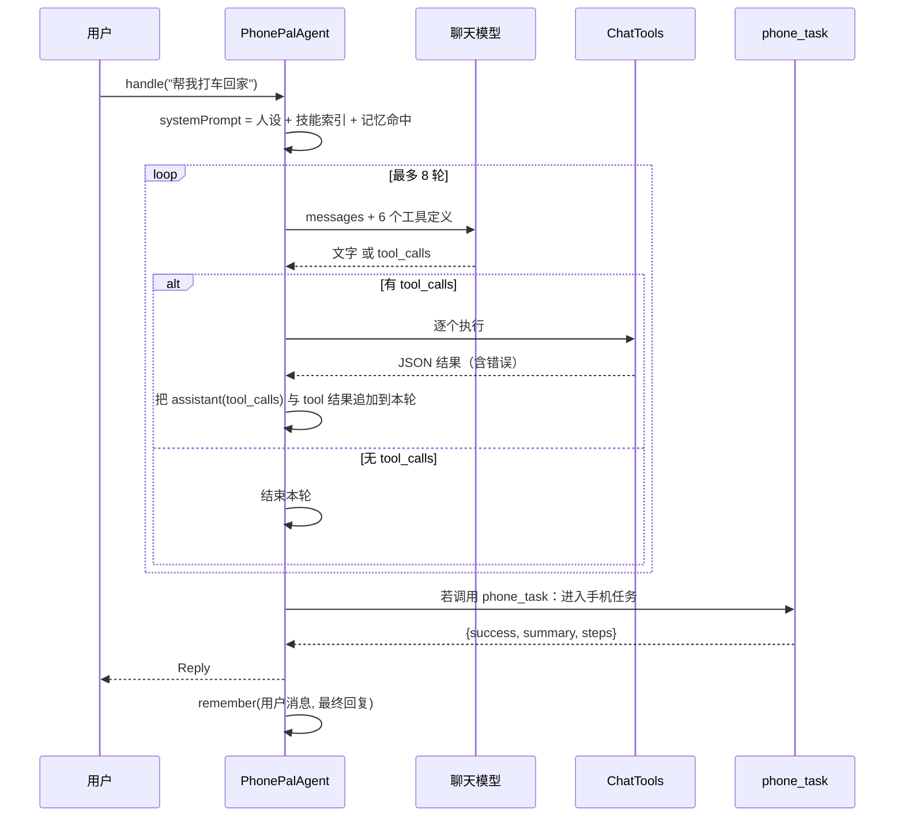

# 一轮聊天：系统提示词、6 个工具与工具循环

聊天层看起来只是「把用户的话发给模型」，但 PhonePal 在这里做了三件影响体验的事：把技能和记忆**预先塞进系统提示词**、把手机操作变成一个**普通工具**、把工具错误**翻译成模型能读懂的 JSON**。

## 1. 一次 `handle` 的完整流程



关键上限：`MAX_TOOL_ROUNDS = 8`、`HISTORY_LIMIT = 20`、`MEMORY_HITS = 5` [F-021]。历史窗口还有一条容易忽略的规则：**窗口不得以 assistant 消息开头**，否则某些 OpenAI 兼容服务会拒绝请求 [F-021]。

## 2. 系统提示词只有三段

`systemPrompt` 不做语义检索之外的猜测，只拼三块 [F-022]：

```text
<人设：PhonePal 是住在手机里的私人助手，简洁友好，使用中文>

## 可用技能（phone_task 的 skill 参数）
- taxi-home: 用高德地图打车回家（读取记忆里的家庭住址，呼叫前需用户确认）
- open-settings-wifi: 打开系统设置的 WLAN 页面，读出当前连接的网络

## 可能相关的记忆
- 家 (places/家): 北京市海淀区某某路 1 号
```

三个设计点值得借鉴：

1. **技能只暴露 `name: description`**。正文说明（`SKILL.md` 的 Markdown 部分）不进入聊天模型，只在操作模型那一层出现 [F-019/F-029]。这避免把几十个技能的详细步骤塞进聊天上下文。
2. **记忆命中是「摘要 + permalink」**，不是全文。模型需要全文时再调 `memory_read` [F-030]。
3. **人设是常量**（`Prompts.DEFAULT_PERSONA`），所有面向模型的中文文本集中在 `Prompts` 一个文件里，调提示词不用翻循环代码 [F-037]。

## 3. 6 个工具

| 工具 | 必填参数 | 作用 | 失败时的返回 |
|---|---|---|---|
| `memory_search` | `query` | 全文搜索（支持中文），`limit` 默认 5、上限 20 | `{"error": "..."}` |
| `memory_read` | `identifier`（permalink 或标题） | 读取笔记全文、观察、关系 | `{"found": false}` |
| `memory_write` | `title`、`observations` | 新建或合并笔记；观察按 `(category, content)` 去重 | `{"error": "..."}` |
| `memory_forget` | `identifier` | 真正删除文件 | `{"deleted": false}` |
| `list_skills` | 无 | 列出技能名、描述、apps、是否有 flow | 正常 JSON |
| `phone_task` | `goal` | 进入手机任务；可选 `skill` | `{"success": false, "summary": ...}` |

工具定义在 `AgentTools.specs`，用 Kotlin 的 `buildJsonObject` 构造 JSON Schema [F-030]。执行在 `ChatTools.execute`，用 `when (call.name)` 分发 [F-031]。

## 4. 工具错误的处理方式

`ChatTools` 把所有异常分成三类，全部转成 `{"error": ...}` 字符串作为 tool 结果返回，**不抛回聊天循环** [F-031]：

| 异常 | 返回给模型的内容 |
|---|---|
| `ToolArgumentException`（参数不是 JSON 对象、缺必填字段） | `{"error": "参数错误：缺少 query"}` |
| 其他 `Exception` | `{"error": "工具执行失败：<消息或类名>"}` |
| `CancellationException` | 原样抛出（停止任务时不能被吞掉） |

这样做的好处是模型能看到「我哪里写错了」并自我修正；如果直接抛异常，一轮聊天就结束了，用户只看到 `Failed`。

## 5. `memory_write` 的合并语义

`memory_write` 不是简单覆盖。它先按 `permalink` 或标题读旧笔记，然后 [F-032]：

- 观察：旧观察 + 新观察，按 `(category, content)` 去重；
- 关系：旧关系 + 新关系，按 `(type, target)` 去重；
- 保留：旧 `tags`、旧 `extraFrontmatter`、旧正文的前言（`NoteText.preamble`）；
- 重写：正文由 `NoteText.body` 统一渲染，保证 `## Observations` / `## Relations` 格式一致。

这解释了为什么「记住我家在 A」说两次不会产生两条重复观察，也解释了为什么用户在 Obsidian 里手写的前言不会被工具抹掉 [F-046]。

## 6. 一轮结束后的记忆

`handle` 在结束时调用 `remember(userMessage, reply)` [F-021]：

- 只把用户消息和最终 assistant 文本写入滑动窗口，**不写工具调用与工具结果**；
- 窗口超过 20 条时从头部丢弃；
- 丢弃到窗口以 assistant 开头时继续丢，直到以 user 开头或为空。

这意味着聊天历史是「对话记忆」，而任务细节留在轨迹与 `howto` 笔记里，不占用聊天上下文。

## 7. 想加一个聊天工具时

按顺序改两处：

1. `AgentTools`：加常量与 `ToolSpec`（名称、描述、JSON Schema）；
2. `ChatTools.execute`：加 `when` 分支与实现，参数错误抛 `ToolArgumentException`，运行错误让它自然抛出（外层会转成 JSON）。

测试建议参考 `core-agent` 的 `ChatTurnTest`：用 `ScriptedLlm` 先返回 `tools(...)`，再返回文本，断言模型收到的 `ChatRequest` 里包含工具定义与 tool 结果 [F-075]。

## 相关概念

- [分层与依赖](01-architecture.md)
- [操作循环：`phone_task` 之后发生什么](03-operator-loop.md)
- [记忆：笔记格式与中文检索](05-memory.md)
- [关键类型与签名索引](../references/01-api-map.md)
