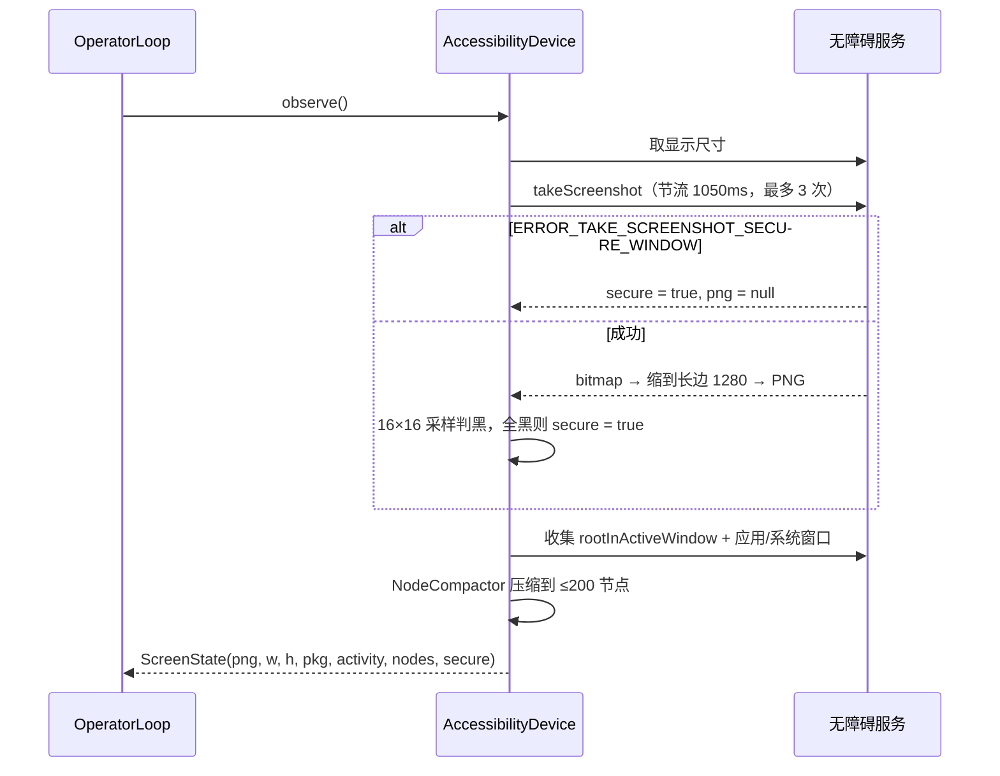

# 无障碍手眼：截屏、节点压缩与手势执行

`hands` 是唯一直接面对 Android 的模块。它的职责可以拆成四个动作：**看**（截屏 + 读节点树）、**压缩**（把树变成模型能吃的列表）、**算**（像素与归一化坐标互转）、**做**（手势、输入、启动、深链）。

## 1. 服务连接与前台应用

`PhonePalAccessibilityService` 本身很薄 [F-062]：

- 在系统设置里由用户手动开启；
- `onServiceConnected` 把实例写进 `StateFlow`，`AccessibilityDevice` 通过 `instance.value` 取用；
- 监听 `TYPE_WINDOW_STATE_CHANGED`，维护 `ForegroundApp(packageName, activityName)`；对无法解析的窗口，只在 `rootInActiveWindow` 的包名确实等于事件包名时才切换，避免 Toast/输入法误报。

未开启服务时，`observe()` 抛 `ServiceNotConnectedException`，消息是「无障碍服务未开启」，最终变成聊天里的 `Failed` 事件 [F-062]。

## 2. 观察：一次 `observe()` 做什么



关键参数 [F-062/F-063/F-066]：

| 参数 | 值 | 原因 |
|---|---|---|
| 截屏最小间隔 | 1050 ms | Android 限制每个服务每秒一次 |
| 截屏尝试次数 | 3 | 间隔不足时等下一次窗口 |
| 长边缩放 | 1280 px | 控制图片 token 与上传体积，不放大 |
| 动作后稳定等待 | 600 ms | 给 UI 反应时间 |
| 节点上限 | 200 | 压缩器上限；提示词层还会再截到 120 |
| 文本上限 | 200 字符 | 单节点文本长度 |

## 3. 受保护页面：两个判据

PhonePal 不依赖模型「看出这是支付页」，而是用两个系统级信号 [F-063]：

1. **错误码**：`takeScreenshot` 返回 `ERROR_TAKE_SCREENSHOT_SECURE_WINDOW`；
2. **黑帧采样**：Android 11–13 对 FLAG_SECURE 窗口不报错，而是返回全黑图；`looksAllBlack` 在 16×16 网格上采样，全部为不透明纯黑则判定受保护。

一旦 `secure = true`，操作循环不会发任何设备动作，直接请用户接管 [F-025]。即使循环漏判，Sentinel 的 deny 规则也会兜底 [F-039]。

## 4. 节点压缩：只把「有用」的节点给模型

`NodeCompactor` 不返回整棵树，而是先序遍历并保留满足任一条件的可见节点 [F-064]：

- 有 `text` 或 `description`；
- `clickable` 或 `longClickable`；
- `editable`；
- `scrollable`。

同时：

- **bounds 归一化**到 0..1000，完全在屏幕外或裁剪后无面积的节点丢弃；
- **id 就是列表下标**，模型用 `nodeId` 引用；
- **密码字段的 `text` 被置空**，只保留 `password = true` 标记——这是「密码不进模型上下文」的第一道防线；
- 不可见容器仍会继续下钻，因为裁剪滚动内容可能挂在不可见父节点下；
- 最多 200 个节点、深度 64。

输出格式（`ScreenText.nodeLine`）是压缩过的单行 [F-038]：

```text
[12] EditText "目的地" res=search_input (40,180,960,240) clickable editable focused
```

## 5. 坐标：0..1000 的唯一真源

模型只输出归一化坐标，像素换算集中在 `Coordinates` [F-066]：

```kotlin
fun normalize(px: Int, extentPx: Int): Int =
    (px.toLong() * NORM / extentPx).toInt().coerceIn(0, NORM)

fun denormalize(point: Point, widthPx: Int, heightPx: Int): Pair<Float, Float> =
    (point.x.toFloat() * widthPx / NORM).coerceIn(0f, max(0, widthPx - 1).toFloat()) to ...
```

好处是模型不需要知道设备分辨率；换一台 1080p 或 2K 手机，同一个 `(500, 300)` 仍然落在屏幕中央附近。

## 6. 执行动作的细节

| 动作 | 实现 | 兜底 |
|---|---|---|
| `tap` / `long_press` | 优先对节点 `ACTION_CLICK` / `ACTION_LONG_CLICK`；不可点击、节点失效或被拒时，对节点中心做手势按压 | 节点不存在则要求 `point` |
| `swipe` | `GestureDescription` 从 `from` 到 `to`，时长 clamp 50..5000 ms | — |
| `type` | `ACTION_SET_TEXT`；`submit` 时再发 `ACTION_IME_ENTER` | 未聚焦时先点一次字段，等 400 ms |
| `back` / `home` | `performGlobalAction` | — |
| `launch` | `getLaunchIntentForPackage` + `FLAG_ACTIVITY_NEW_TASK` | 未安装时返回失败消息 |
| `deeplink` | `Intent.ACTION_VIEW`，可指定 package | scheme 为空时失败 |
| `wait` | `delay(ms)`，最长 30000 ms | — |

按压与滑动的时长都有上下限（长按 400..5000 ms，滑动 50..5000 ms），防止模型给出 `durationMs = 0` 或「按 10 分钟」这类值 [F-066]。

## 7. 为什么点击要「先节点、后坐标」

节点点击走的是无障碍语义（`ACTION_CLICK`），系统会正确处理可点击父容器、焦点、滚动位置；坐标点击是模拟手指，遇到悬浮窗、动画、坐标偏移就可能点错。所以 `press` 的顺序是 [F-065]：

1. 节点存在 → `refresh()` → 可点击就 `performAction`；
2. 不可点击（文字在可点击父容器里）→ 取节点中心做手势；
3. 节点已失效 → 用缓存 bounds 的中心做手势；
4. 只有 `point` → 直接手势。

这也解释了为什么模型被要求「节点列表里有目标元素时优先用 nodeId」[F-037]。

## 8. 这一层的已知限制

| 限制 | 影响 | 现状 |
|---|---|---|
| 每秒只能截一张 | 快速连续动作会等下一次窗口 | 1050 ms 节流 + 3 次尝试 |
| 部分自绘/游戏界面没有无障碍节点 | 只能靠截图与坐标 | 模型可用 `point` |
| FLAG_SECURE 页面不可见 | 无法自动操作 | 识别为 `secure` 并请用户接管 |
| 系统权限弹窗的节点可能不可读 | 复杂授权流程易卡住 | 只有 `back/home/swipe` 放行 |
| 系统 UI 不豁免 `apps` 边界 | 技能声明 apps 时无法点系统弹窗 | 需要把流程留给用户 |

## 相关概念

- [操作循环：`observe()` 的结果怎么用](03-operator-loop.md)
- [安全闸门：受保护屏幕与密码字段的规则](04-sentinel.md)
- [工程模式：平台能力如何被隔离](10-engineering-patterns.md)
- [关键类型与签名索引](../references/01-api-map.md)
