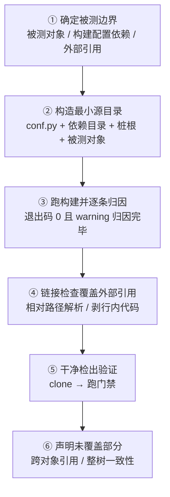

# 隔离验证法：大树里的局部变更如何只验自己

## 模式类型

方法论模式（L2 领域通用）。适用于「单体大树 + 并行会话 + 局部变更」的三元组合。

## 成熟度

**L2-validated**——2 个独立案例（XERJ 束 31 文件、对比束 14 文件），另完成 1 例跨领域迁移验证（monorepo 单 crate 隔离测试）。验证次数 2，复用次数 2。

## 问题背景

大仓里改一小块东西之后，「跑一遍整仓验证」听起来最稳妥，实际有三个致命问题：

1. **慢到被跳过**：案例 A 的整树 Sphinx 构建超过 10 分钟仍未跑完。慢到不可行的验证，事实上的结局是**不验证**——而「没验证」披着「跑过了」的外衣最危险。
2. **被无关并发写入打断**：多人/多会话同时写同一仓库时，整树构建可能读到写了一半的共享文件。案例 A 的第二次整树构建以 `exit=2` 失败，原因是另一会话改写共享索引时的瞬时竞态。
3. **结论不归因**：整树红了，你无法区分「我的改动有问题」与「树里别人的问题有问题」——而这两种情况的正确动作完全相反。

## 适用场景

- 当你要验证的是大树里的一小块（本会话新增的一个知识包 / 一个 crate / 一组文档），而整树验证慢到事实上会被跳过时，使用这个模式。
- 适用于：
  - 整树构建分钟级以上（案例 A：1.2 万文件的 Sphinx 树）；
  - 存在并行会话对共享文件的写入（整树构建可能读到写了一半的文件）；
  - 需要区分「我这部分的问题」与「树里别人的问题」。
- **不适用于**：
  - 变更横跨整树（如升级全局配置、重命名顶层目录）；
  - 验证目标本身就是整树（发布前门禁、CI 主分支门禁）；
  - 存在树内全局状态（扩展之间通过路径耦合）导致隔离后语义不等价——此时隔离会漏问题。

## 核心做法（操作流程）



### 1. 确定被测边界

先问清三件事：

- **被测对象**：本次变更的产物集合（本例：一个知识包目录的全部 `.md`）。
- **构建配置依赖**：构建配置（`conf.py`）会读哪些路径？扩展目录、静态资源、模板目录、插件模块——**一个都不能少**。
- **外部引用**：被测对象里有哪些指向被测边界之外的链接/路径/资源？这些**隔离构建查不出来**，需要单独覆盖。

> **为什么？** 第 3 条最容易漏。案例中隔离构建对 31 个文件报 0 warning，但同一批文件里有 25 处**跨束相对路径层级算错**（`../../` 应为 `../../../`）——隔离构建看不见这些，因为隔离源里根本没有那些目标。**它们由独立的链接检查抓到**。

### 2. 构造最小源目录

```
<tmp>/doc/
├── conf.py            ← 复制构建配置
├── _ext/              ← 复制扩展/插件目录（若有）
├── _static/           ← 复制静态资源（若有）
├── _templates/        ← 复制模板目录（若有）
├── index.md           ← 桩根文档：只 toctree 到被测对象
└── <被测对象目录>/    ← 只放被测对象
```

**只复制构建配置真正需要的目录**——多复制一个目录就多一份无关耦合，少复制一个则构建会以「扩展加载失败」结束，而这种失败容易被误判成「被测对象有问题」。

### 3. 跑构建并逐条归因

```sh
sphinx-build -b dummy -E <tmp>/doc <tmp>/out
```

- **退出码 0 且 0 warning** → 被测对象本身干净。
- 有 warning → **逐条归因**：属于被测对象（要修）还是属于桩根/配置（忽略，但要确认不是被测对象诱发的）。
- 桩根的 toctree 必须指向 `<被测对象>/index`（而不是目录名），否则会出现「nonexisting document」与「isn't included in any toctree」两条噪声 warning，把真信号淹没。

### 4. 用链接检查覆盖外部引用

对被测对象里的**所有**相对链接做解析：从被测文件所在目录出发，解析目标是否存在。规则：

- 绝对路径（以 `/` 开头）→ 按被测根解析；
- 相对路径 → 按被测文件的目录解析；
- `http(s)://` → 跳过（外部可达性是另一件事）；
- **行内代码里的 `](...)` 要先剥掉**——代码片段里的方括号括号会被朴素正则误判为链接。

### 5. 补一层「干净检出」验证

隔离构建只证明「被测对象能构建」。**它不证明提交后的 HEAD 是绿的**。最后一步：把仓库克隆到临时目录（或用 `git worktree`），在**干净检出**上跑一次门禁，验证目录树与共享索引的计数一致、所有 toctree 引用可解析、提交内容确实落在 HEAD 上。

> **为什么？** 这一步是案例 A 的教训来源：整树构建在**工作树**上跑，工作树是绿的，但 HEAD 可能因为共享文件的竞态而缺一环。**干净检出才是 CI 看到的真相**。

### 6. 划清「未覆盖」的声明

报告里必须显式写出：跨对象引用（由链接检查覆盖）、整树一致性（由干净检出门禁覆盖）、以及**两者都不覆盖**的部分（如外部 URL 可达性、跨束语义一致性）。

## 实施检查清单

- [ ] 隔离源里**只有**被测对象 + 构建配置依赖（多一个无关目录就多一份耦合）
- [ ] 构建配置读取的每个路径都已复制（扩展/静态/模板/插件目录一个不漏）
- [ ] 构建退出码 0，且**每条 warning 都已归因**（属于被测对象 vs 属于桩根/配置）
- [ ] 桩根 toctree 指向 `<被测对象>/index`，未产生「nonexisting document」类噪声
- [ ] 被测对象的**每一条**相对链接都解析成功（外部链接另行标注为「未覆盖」）
- [ ] 链接检查前**已剥除行内代码**，避免把代码片段误判为链接
- [ ] **干净检出**上的门禁已跑过（不是只跑工作树）
- [ ] 报告里显式声明了**未覆盖的部分**

## 正例与反例对照

| 维度 | 正例 | 反例 |
|---|---|---|
| 验证范围 | 被测对象 + 构建配置依赖，秒级完成 | 每次改一点就跑 1.2 万文件的整树构建 |
| 并发安全 | 隔离源不含任何共享文件，结论确定 | 整树构建读到半写的共享索引而 exit=2 |
| 失败归因 | 缺件报「环境缺件」 | 缺扩展目录 → 编译/加载错误看起来像代码错误，排查跑偏 |
| 外部引用 | 链接检查单独覆盖（抓到 25 处跨束路径层级错） | 隔离通过就宣布验证通过，跨对象错误全漏 |
| 提交后状态 | 干净检出门禁全绿 | 工作树绿就交付，CI 在干净检出上红 |
| 未覆盖声明 | 明确写出 | 沉默，读者以为全绿 |

## 反例警示（反模式）

| # | 反模式 | 表现 | 后果 | 正确做法 |
|---|---|---|---|---|
| 1 | **改一点就跑整树构建** | 每次改动后跑 1.2 万文件的构建 | 慢到事实上被跳过——**这是最常见的失败路径**，且它伪装成「没时间验证」 | 隔离构建秒级；整树留给 CI 与发布前 |
| 2 | **只跑整树构建** | 唯一的验证手段 | 被无关并发写入打断，结论不可信 | 隔离构建作为日常验证；整树作为最终确认 |
| 3 | **隔离时漏拷配置依赖** | 只复制 `conf.py` | 构建以扩展加载失败结束，**被误判成被测对象有问题** | 构造时逐项列出配置依赖；失败先看是不是环境缺件 |
| 4 | **把隔离通过当作整树通过** | 隔离 0 warning 就宣布「验证通过」 | 跨对象引用错误完全漏检 | 隔离构建 + 链接检查 + 干净检出门禁，三者缺一不可 |
| 5 | **桩根噪声淹没真信号** | 桩根 toctree 指向目录名而非 `index` | 每次两条 warning，久了习惯性忽略全部 warning | 桩根指向 `<被测对象>/index`；归因时剔掉桩根 warning |
| 6 | **只在工作树上验证就交付** | 验证用的是工作树 | 工作树绿、HEAD 红，CI 拦截而本地无感 | 交付前做一次干净检出门禁验证 |

## 迁移验证

**跨领域场景**：把本模式用到**非文档**的大仓局部验证上。

**验证案例**：在一个大型 monorepo 里只验证**新增的一个 crate**。整仓 `cargo test --workspace` 需十几分钟且会拉起全套集成测试；隔离验证改为：只用该 crate 的 `Cargo.toml` + 一个只含它的 workspace stub + 指向路径依赖的本地目录，跑 `cargo test -p <crate>`。

同样碰到四类问题，且与文档场景同构：

1. 整仓跑太慢 → 事实上被跳过（→ 同反模式 1）；
2. 并行会话改了 workspace 根 `Cargo.toml` → 整仓构建读到半写的清单而失败（→ 同反模式 2）；
3. 隔离时漏拷路径依赖的目录 → 编译错误看起来像代码错误，实际是环境缺件（→ 同反模式 3）；
4. 隔离测试通过但**跨 crate 的引用**（本 crate 依赖的另一 crate 的某个符号改了名）查不出来（→ 同反模式 4，由整仓构建或跨 crate 的显式检查补上）。

**结论**：本模式的核心不是「Sphinx 技巧」，而是**「把验证范围收到最小可判定集，并显式声明未覆盖的部分」**——这条原则与工具无关。

## 案例与验证记录

| 案例 | 场景 | 结果 |
|---|---|---|
| 案例 A | XERJ 束第一轮：整树 Sphinx dummy 构建 | 超过 10 分钟仍未跑完；第二轮整树构建以 `exit=2` 失败——原因是并行会话改写共享索引时的瞬时竞态（其 toctree 短暂引用了不存在的 `bundles-knowledge-system`） |
| 案例 B | 改用隔离构建验证 XERJ 束第二轮增量（31 个文件） | **build succeeded，0 warning / 0 error**，数十秒；且不受共享树变动影响 |
| 案例 C | 隔离构建验证对比束（14 个文件） | **build succeeded，0 warning / 0 error**；同一手法复用于「干净检出 HEAD」的门禁对账（656 束 / 63 组五面一致、toctree 全可达、UTF-8 全通过） |

## 失败案例

| 失败 | 现象 | 根因 | 教训 |
|---|---|---|---|
| 整树构建当作唯一验证 | 改了 3 个文件，等 15 分钟的构建，期间什么都做不了 | 没有更小的判定集 | 慢到不可行的验证**等于没有验证** |
| 整树构建被并发写入打断 | `exit=2`，报错指向一个自己没碰过的文件 | 构建读到写了一半的共享索引 | 结论必须**只依赖被测对象** |
| 隔离时漏拷扩展目录 | 构建报「扩展加载失败」，排查半天以为是自己的文件写坏了 | 最小源目录的依赖没列全 | **缺件错误会伪装成内容错误** |
| 把隔离通过当整树通过 | 隔离 0 warning 就交付，25 处跨束路径层级错误一直到 CI 才暴露 | 隔离源里没有那些目标，天然查不出 | 隔离 + 链接检查 + 干净检出，**三者缺一不可** |
| 桩根 toctree 指向目录名 | 每次两条 warning，久了开始忽略全部 warning | 桩根写法错误 | 噪声会**训练你忽略警告** |

## 反目标用户与场景

| 反目标 | 为什么不适用 |
|---|---|
| **变更横跨整树**（改全局配置、重命名顶层目录） | 隔离不成立，整树才是被测对象 |
| **发布前门禁 / CI 主分支门禁** | 需要全量视图，隔离会漏系统性缺陷 |
| **存在树内全局状态、隔离后语义不等价** | 隔离出的「绿」不代表真实构建的绿 |
| **只改一两个字符的文案修正** | 隔离的搭建成本高于收益 |
| **需要证明「整仓健康」的场景** | 隔离只对自己那部分负责 |

## 早期预警信号

出现以下任一**预警信号**，说明你正在用整树构建当日常验证：

1. **红旗**——一条改动后的反馈延迟超过 5 分钟；
2. **红旗**——构建报错指向**自己没改过的文件**；
3. **红旗**——已经开始习惯性地跳过构建步骤；
4. **红旗**——整树红了，第一反应是「先查是不是别人的问题」而不是「先隔离自己」；
5. **红旗**——构建日志长到需要 grep 才能找到自己的文件；
6. **红旗**——为「快点看到结果」而跳过某些验证步骤。

## 边界条件

| 前提 | 若不成立 |
|---|---|
| 构建配置不硬编码树内绝对路径 | 隔离后会去找不存在的路径 |
| 扩展/插件可随目录复制携带 | 隔离会引入环境差异，结论不可比 |
| 外部引用可被链接检查覆盖 | 非 Markdown 形式的外部引用（配置路径、脚本引用）需另加检查 |
| 被测对象内部自洽 | 隔离构建以「被测对象的 toctree 完整」为前提 |
| 能拿到干净检出 | 无法验证「提交后 HEAD 是绿的」 |

## 与现有模式的关系

- [文件存在性验证门](./file-existence-verification-gate.md)——最轻量的一档：只查文件在不在
- [编辑与验证分离](./edit-verify-separation.md)——为什么验证必须独立于编辑动作
- [前置完整性门](../preflight-integrity-gate.md)——动手前的门，与本模式的「动手后验证」互补
- [破坏性探针门](../destructive-probe-gate.md)——验证脚本自身要能证伪
- [提交质量门与暂存检查](../governance-strategy/commit-quality-gate-staging-inspection.md)——提交阶段的暂存集核验
- [monorepo CI 盲区检测](../../process-patterns/monorepo-ci-blindspot-detection.md)——整仓 CI 看不见的局部缺陷，与本模式互补
