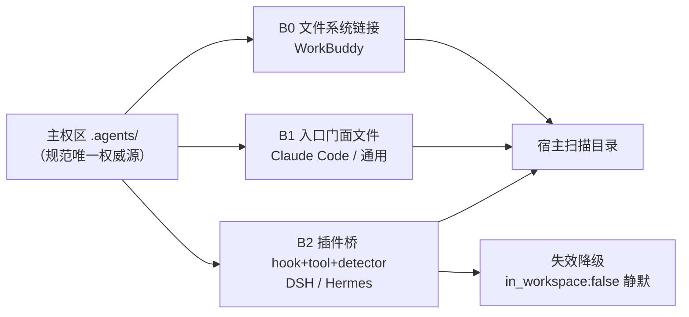

> **来源**：WorkBuddy / DeepSeek Harness / Hermes / Claude Code 四个宿主的 SpecWeave 接入实践
> **验证次数**：4 次（4 个独立宿主，其中 2 个为插件级桥）

# 规范主权桥接模式

## 模式类型
方法论模式（AI 工具生态适配 / 规范资产集成）

## 成熟度
L2 多案例验证（4 个宿主：WorkBuddy、DeepSeek Harness、Hermes、Claude Code；Trae 镜像技能为旁证）

## 问题

一套规范资产（如 SpecWeave 的 `AGENTS.md` + `.agents/`，含 160 个技能）需要被多个 AI 宿主识别，而每个宿主的**扫描路径与能力模型各不相同**：WorkBuddy 只扫 `{workspace}/.workbuddy/skills/`，DeepSeek Harness 走 Cordis 插件注册，Hermes 靠 hook + tool，Claude Code 读根目录 `CLAUDE.md`。

两种直觉做法都会出问题：

- **搬家式**：把技能复制到宿主要求的目录 → 同一份规范出现两个副本，改一处忘一处，双源分叉
- **改造式**：为迎合宿主改写 `.agents/` 自身结构 → 主权区被宿主方言污染，换一个宿主就要再改一次

## 解决方案

**主权区单源 + 每宿主一桥（Bridge-per-Tool）**：规范定义权留在主权区，识别适配权交给宿主侧的一个薄桥。桥按宿主能力分三级，能用轻的就不用重的。

### 三级桥选型表

| 级别 | 形态 | 适用宿主 | 成本 | 可分发性 | 实例 |
|:---:|------|---------|:---:|:---:|------|
| **B0** | 文件系统链接（Junction / Symlink） | 宿主只按固定目录扫描，无插件机制 | 一条命令，0 字节 | ❌ 本机级，克隆需重建 | `.workbuddy/skills → .agents/skills` |
| **B1** | 入口门面文件 | 宿主自动读取仓库根固定文件名 | 一个 Markdown | ✅ 随仓库 | 根目录 `CLAUDE.md`、`AGENTS.md` |
| **B2** | 插件桥（hook / tool / command + detector） | 宿主支持插件或工具注册，需注入协议 | 一个插件包 | ✅ 随仓库 | `specweave-dsh-bridge/`、`specweave-bridge-skeleton/` |

> **链接形态脚注**：同盘、目标为目录、无管理员权限 → 用 **Junction**（`New-Item -ItemType Junction`）；跨盘或需链接单文件 → 用 **符号链接**（`mklink /D`，需开发者模式或管理员权限）。



### 三层权威（避免"单一权威源"绝对化）

| 层 | 位置 | 约束 |
|---|---|---|
| 来源层 | 外部上游（如 Trae builtin） | 只做镜像，不编辑 |
| 本地权威层 | `.agents/` | 镜像内容必须带 `source` 字段声明来源 |
| 适配层 | 各宿主的桥 | 不存放任何权威内容，失效可丢弃重建 |

## 核心做法（5 步）

1. **定主权**：明确规范唯一权威目录（如 `.agents/`），写入仓库约定；镜像来的内容带 `source` 声明
2. **探宿主**：查清宿主的扫描路径 / 插件机制 / 入口文件名，判断它属于 B0 / B1 / B2 哪一档
3. **建最轻的桥**：能用 B0 链接就不写插件；需要注入协议或工作区检测时才升到 B2
4. **配降级与重建**：桥内必须写明①失效时的兜底行为（如 detector 双信号、`in_workspace:false` 静默）②一条命令的重建步骤，落进 `README.md` / `ACCESS.md`
5. **设写防护**：桥指向主权区时，提交前用 `git status` 检查主权区是否被宿主反向写入；宿主特有文件一律不落在主权区

### 主权区四不原则

- 不**复制**主权区内容到宿主目录
- 不**改写**主权区结构迎合宿主
- 不在桥内**存放**权威内容（桥丢了必须能重建）
- 不让宿主**直接写**主权区

## 反模式

| # | 反模式 | 表现 | 后果 | 正确做法 |
|:---:|------|---------|---------|---------|
| 1 | **搬家式接入** | 把技能目录复制到宿主扫描目录 | 双源分叉，改一处忘一处 | 用 B0 链接，0 字节接入 |
| 2 | **主权区方言化** | 为适配宿主改 `.agents/` 目录名或结构 | 换宿主再改一次，规范失去独立性 | 主权区保持宿主中立，差异全部收在桥里 |
| 3 | **无防线的可写桥** | 联接建好即完事，宿主安装新技能直接写进主权区 | 主权区混入宿主特有文件，长期腐化 | 设写防护 + 提交前 `git status` 检查 |
| 4 | **桥不留重建说明** | 联接/链接失效后无人知道怎么恢复 | 克隆机器或重装后静默失效 | 桥内附一条命令的重建步骤 |
| 5 | **一律上插件** | 只需扫目录的宿主也写 hook + tool | 维护成本线性增长，每个宿主一套代码 | 先试 B0，宿主能力不足再升 B2 |
| 6 | **无失效降级** | 不在工作区时插件报错或无输出 | 宿主行为不可预期 | 显式返回 `in_workspace:false` 并静默 |

## 失败案例

| # | 案例 | 经过 | 代价 | 后续防线 |
|:---:|------|------|------|---------|
| 1 | **镜像副本漂移成孤儿** | 160 个技能中 125 个声明"镜像自"外部来源；`TRAE-spec-mode/SKILL.md` frontmatter 记录"源镜像已清理，本文件为独立适配版，以本地为准"——上游清理后，镜像副本失去可回溯来源 | 出处不明、无法 diff 上游改动，只能就地升格为权威 | 三层权威划分：镜像内容必须带 `source` 字段并声明"以本地为准" |
| 2 | **跨盘用 Junction 断链** | 用户级 `~/.workbuddy/skills/seven-concepts-cmd` 需跨盘（用户目录 → 仓库盘）挂载，Junction 在 `..` 词法解析下断链 | 技能静默不可见，排查耗时 | 跨盘/单文件改用 `mklink /D` 符号链接；选型表加链接形态脚注 |
| 3 | **B0 桥换机即失效**（近失，已兜底） | `.workbuddy/skills` 为 0 字节本机级联接，仓库克隆后不存在 | 若无人记录重建方式，新机器上宿主完全看不到技能且不报错 | 桥内必须写明一条命令的重建步骤；失效时显式降级而非静默 |

## 反目标用户/场景（不适用的情况）

| # | 反目标场景 | 为何不适用 | 替代方案 |
|:---:|------|------|------|
| 1 | **单一宿主且长期不变** | 桥的维护成本高于收益，规范直接放宿主原生目录更简单 | 直接放原生目录，不建桥 |
| 2 | **无管理员/开发者模式且需跨盘挂载** | B0 符号链接建不起来，Junction 跨盘不可靠（见失败案例 2） | 改同盘布局，或改用 CI 同步式桥 |
| 3 | **规范资产结构高频变动**（周更目录名/格式） | 桥会放大抖动，每次结构变更都要同步所有宿主 | 先冻结结构并版本化，再建桥 |
| 4 | **资产体量极小**（<10 文件、无交叉引用） | 复制成本低于桥的维护成本 | 直接复制，附一份同步说明 |
| 5 | **宿主要求私有格式**（非 Markdown 描述、二进制 schema） | 纯链接桥不生效，宿主读不懂主权区格式 | 改用"生成式桥"：CI 从主权区生成宿主格式产物 + 校验断链 |
| 6 | **只是一次性临时试用** | 桥需要长期维护，试完不拆就是债务 | 用完即拆，或明确标注为临时桥并设清理期限 |

## 检验标准（做完怎么知道做对了）

**验收三查**（B0 桥可直接执行）：

```bash
# 1. 路径可见：宿主目录下能看到主权区条目
ls {宿主扫描目录} | wc -l
# 2. 内容可读：随机抽一个 SKILL.md 能读到 frontmatter
head -5 {宿主扫描目录}/{某技能}/SKILL.md
# 3. 来源一致：两侧同一文件比对结果为空
diff {宿主扫描目录}/{某技能}/SKILL.md {主权区}/skills/{某技能}/SKILL.md && echo OK
```

| 检查项 | 通过标准 |
|--------|---------|
| 主权区零改动 | 建桥后 `git status` 主权区无新增/修改 |
| 桥零字节（B0） | 链接占用为 0，未复制文件 |
| 单向可追溯 | 桥目录内每个条目都能在 `.agents/` 找到同源 |
| 可重建 | 存在一条命令可重建桥，且该命令已写入文档 |
| 失效可降级 | 脱离工作区时宿主侧无报错、有明确降级输出 |
| 桥成本上限 | 同一宿主只保留一个桥；同类宿主≥2 个时抽成 skeleton 模板 |

## 跨领域迁移示例

| 领域 | 主权区 | 桥 | 说明 |
|------|--------|-----|------|
| 前端组件库 | `packages/ui-core` | 各应用 `src/ui → packages/ui-core` 的 workspace 链接 | 同一"单源 + 薄桥"结构，宿主换成应用 |
| 团队知识库 | 唯一 wiki 仓库 | 各业务仓 `docs/wiki` 子模块或 CI 同步 | 避免各处复制 wiki 造成版本漂移 |
| 配置治理 | 中心配置仓库 | 各服务本地 `.env` 软链 + 启动检测 | 配置改一处生效，缺失时启动降级告警 |
| 数据契约 | schema registry | 各语言客户端代码生成目录 | 契约权威在 registry，生成的客户端可丢弃重建 |

## 案例索引

| 宿主 | 桥级别 | 实现 | 关键事实 |
|------|:---:|------|---------|
| WorkBuddy | B0 | `.workbuddy/skills` Junction → `.agents/skills` | 0 字节，160→169 技能自动跟随增长 |
| WorkBuddy（用户级） | B0 | `~/.workbuddy/skills/seven-concepts-cmd` 符号链接 | 跨盘单技能装载，链接为该目录唯一条目 |
| DeepSeek Harness | B2 | `specweave-dsh-bridge/`（Cordis 插件） | 4 工具 + `/specweave` 命令 + `pre-step` 注入；工作区外静默 |
| Hermes | B2 | `specweave-bridge-skeleton/` | `detector.py` 双信号识别，主信号/兼容信号分流 |
| Claude Code | B1 | 根目录 `CLAUDE.md` | 根入口门面，内容为主权区规范的投影 |

## 参考

- 工作区发现协议：[../../../../.agents/protocols/workspace-discovery.md](../../../../.agents/protocols/workspace-discovery.md)（五步发现、双信号判定）
- DSH 桥：[../../../../specweave-dsh-bridge/README.md](../../../../specweave-dsh-bridge/README.md)
- Hermes 桥骨架：[../../../../specweave-bridge-skeleton/README.md](../../../../specweave-bridge-skeleton/README.md)
- 本地桥说明：[../../../../.workbuddy/README.md](../../../../.workbuddy/README.md)
