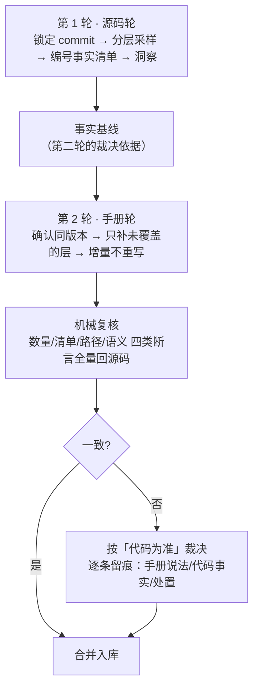

# 双轮信源·漂移检出法（源码轮 + 官方手册轮）

## 模式类型

方法论模式（L2 领域通用）。适用于「源码 + 官方手册」双信源齐备的开源系统深度教程生产。

## 成熟度

**L2-validated**——2 个独立案例（XERJ 源码轮+手册轮、XERJ×DeepSeek 对比束），另完成 1 例跨领域迁移验证（政务/金融接口手册复核）。验证次数 2，复用次数 1。

## 问题背景

一个系统只有一份材料时，最自然的选择是「全都用它」。但当材料有两种性质完全不同的来源时，单信源会同时产生两种失败：

1. **覆盖不足**：源码回答「它是什么、边界在哪」，但答不了「配置键有哪些默认值、备份怎么做、升级会不会断链」；手册答得了运维，却答不了「这个功能真实存在吗、默认值到底是多少」。
2. **整体过期**：手册的人读层会漂移。而**漂移的方向不是随机的**——数量、默认值这类「抄起来省事」的信息容易更新，能力清单、语义描述这类「要读懂才写得出来」的信息容易滞后。

把手册当唯一事实源时，第 2 类失败会直接变成读者的错误操作：照手册配一个**根本不存在**的功能，或者对**语义被写反**的默认值形成错误预期。

## 适用场景

- 当你要为**一个既有开源系统**产出可溯源的中文教程，而它**既有源码又有官方手册**时，使用这个模式。
- 适用于：源码量大到无法一次通读（>10 万行 / 核心模块 >50 个）；官方手册覆盖运维细节但人读层可能过期；有「数字看着对、能力清单却缺项」的风险。
- **不适用于**：
  - 只有官方手册、没有源码的系统（无法机械复核，退回 `external-content-fact-verification`）；
  - 只有源码、没有任何手册的系统（单轮即可，不必分两轮）；
  - 需要「按手册原样复述」的场景（如合规引用、逐字翻译）——本模式会改写手册的表述。

## 核心做法（操作流程）

### 第 1 轮：源码轮——建立事实基线

1. **锁定信源**：固定到具体 commit 哈希（不是分支名、不是 tag 名），记录远程地址与工作树状态。
2. **分层采样**：体量大的工程不逐文件读，按「产品面 → 架构面 → 源码面 → 专项」四层取样。
3. **建编号事实清单**：每条事实标注仓库相对路径与行号；**数量类事实必须脚本计数**，人工枚举不可作为唯一来源。
4. **产出洞察**：3～6 条四元组洞察，并给出「事实覆盖分配表」。

> **为什么？** 第一轮的产物是**第二轮的裁决基线**——只有先有它，第二轮才发现手册说错时，才知道谁对。没有基线的复核只是「我又读了一遍」。

### 第 2 轮：手册轮——补齐运维与参考层

1. **确认手册与源码同版本**：比对页脚/版本标识、workspace 版本、`git describe`。版本不一致先解决版本问题。
2. **只采信同版本落地快照**：若手册站点由源码仓库直接部署（常见），以仓库内落地快照为事实源，在线站点为呈现面对照——这样引用路径稳定、可被 commit 锚定。
3. **按层取信，不按页取信**：把 40～60 页手册归入「参考层 / 数据模型层 / 引擎层 / 运维层」，只为**第一轮没覆盖**的层写文档。
4. **增量扩展而非重写**：新文档编号续接既有最大序号；既有文档只追加事实不重写结论；每轮新增一份独立信源登记。

### 两轮之间：机械复核（本模式的关键动作）

**不是抽样复核，是全量机械复核。** 对手册里的每一类断言逐条回源码：

| 手册断言类型 | 复核手段 |
|---|---|
| 数量（"N 种查询"、"N 个工具"） | 脚本数常量/数组/结构体，**不看文档里的数字** |
| 能力清单（"内置分析器有 A/B/C"） | 在源码里找**注册项**逐个对照；清单里不存在的名字要去全树 grep |
| 端点路径 / 配置键 / 默认值 | grep 路由表、配置结构体、默认配置文件 |
| 语义描述（"X 会做 Y"） | 读实现处注释；文档与实现的**方向相反**是常见形态 |

> **为什么？** 数量对不上是「抄错了」，读者能自己看出来；**语义写反是「照着做会错」**，读者看不出来。案例 A 的手册写「`standard` 分析器含英文停用词」，而代码为了对齐上游**刻意去掉**了停用词与词干——照手册理解的人会以为 "GET" 这类词被丢掉了，实际不会。

**复核记录要单独成节**，逐条写：手册说法 / 代码事实 / 处置（以代码为准、记录冲突、说明差异来源）。

### 收尾：漂移裁决与留痕

1. 手册与代码冲突 → **以代码为准**，并在新文档里显式标注差异（「文档说 X，代码是 Y」）。
2. 手册版本差异（同一发布版内两页说法不同）→ 记录差异来源（快照时点不同），不要替上游裁决。
3. 手册覆盖面缺口（键表不是全键面、清单漏项）→ 单独成节「覆盖面缺口」，与「错误」分开记。
4. 把**手册自己声明的权威规则**写进新文档（如「If the docs and the code disagree, the code is right」）——它让读者知道该信谁。

## 实施检查清单

- [ ] 第一轮的信源已固定到**具体 commit 哈希**（不是分支名、不是仅 tag 名），且记录了远程地址与工作树状态
- [ ] 事实清单里每条都带**仓库相对路径 + 行号**；数量类事实全部由脚本计数
- [ ] 第二轮已确认手册与源码**同版本**（页脚/workspace 版本/git describe 三方对齐）
- [ ] 第二轮**只补第一轮未覆盖的层**，既有文档未被重写、编号未重排
- [ ] 手册里的每个**能力名/端点/配置键**都已 grep 到源码注册项；grep 不到的名字已判定为「文档虚构」
- [ ] 存在**独立的漂移复核记录**，逐条写明手册说法 / 代码事实 / 处置
- [ ] 所有冲突处已按「以代码为准」裁决，并在新文档正文中显式标注差异
- [ ] 「覆盖面缺口」与「事实错误」已分成两节记录，未混为一谈

## 正例与反例对照

| 维度 | 正例 | 反例 |
|---|---|---|
| 信源关系 | 手册只作「意图与边界的线索」，能力清单以源码注册项为准 | 直接照手册写教程，读者照配一个不存在的 `simple` 分析器 |
| 两轮结构 | 严格分轮，第二轮复核明确引用第一轮事实编号 | 边读源码边读手册混着写，无法区分「手册错」与「我读错」 |
| 复核范围 | 数量 + 清单 + 路径 + 语义四类全量复核 | 只核数字，漏掉清单缺项与语义写反 |
| 二手材料 | 仓库内既有束只作导航，事实回一手源逐条复核 | 直接采信二手转述，继承其口径偏差且偏差不可见 |
| 漂移处置 | 逐条留痕（手册说法/代码事实/处置）并在新文档正文标注 | 记一句「文档有误」就放过，读者仍会按错文档操作 |
| 覆盖面 | 以代码注册项为准 | 手册列了 13 个端点就当只有 13 个（实际 31 个） |

## 反例警示（反模式）

| # | 反模式 | 表现 | 后果 | 正确做法 |
|---|---|---|---|---|
| 1 | **手册即事实源** | 直接照手册写教程，不回源码验证 | 手册的能力清单错误变成读者的错误操作 | 手册只能当线索；能力清单必须 grep 注册项 |
| 2 | **两轮混在一轮** | 边读源码边读手册，混着写 | 无法区分「手册错」与「我读错」；失去裁决基线 | 严格分轮；第二轮复核引用第一轮事实编号 |
| 3 | **只核对数字不核对清单与语义** | 「N 种查询」对上了就认为手册可信 | 数字对得上但清单缺项、语义写反——最影响读者操作 | 清单逐个 grep；语义读实现处注释 |
| 4 | **复用二手转述不回一手源** | 直接采信知识库里另一束的转述 | 继承其口径偏差，且偏差不可见 | 二手束只作导航；事实回一手源逐条复核 |
| 5 | **把漂移记录成「文档瑕疵」就放过** | 只写一句「文档有误」 | 读者仍会按错误文档操作；下一轮没人知道该信哪边 | 逐条写「手册说法 / 代码事实 / 处置」 |
| 6 | **用手册的覆盖面冒充覆盖面** | 手册列了 13 个端点就当作只有 13 个 | 遗漏的端点永远发现不了 | 覆盖面以代码注册项为准 |

## 迁移验证

**跨领域场景**：把本模式应用到**非代码类**的「有权威手册 + 有可核对的一手数据」的系统上。

**验证案例**：对一个政务/金融业务系统的接口手册做同样的两轮复核——第一轮从后台数据库 schema 与接口实现代码建立事实基线（表结构、字段类型、默认值、枚举值），第二轮从对外发布的接口手册补运维层（鉴权、限流、错误码、灰度策略），复核时对每个字段默认值与错误码枚举回 schema 与实现 grep。

复核同样检出三类漂移：手册把两个枚举值合并成一个；手册写的默认值是旧版本遗留（代码已改）；手册漏列了一个错误码（该码在实现里存在且被真实调用）。

**这与代码场景的三类漂移同构**（清单缺项/合并、版本遗留、遗漏），说明本模式的复核清单可脱离「源码」这一具体形态，直接迁移到「一手数据 + 二手手册」的一般形态。

## 案例与验证记录

| 案例 | 对象 | 第一轮信源 | 第二轮信源 | 复核产出 |
|---|---|---|---|---|
| 案例 A | XERJ 搜索引擎 | 源码 18 crate / 552 文件 / 52.2 万行（固定 commit `51ff2192`）+ README/AGENTS/ARCHITECTURE/llms.txt | 官方文档站 46 页（v1.0.0-rc.97，落地快照 `landing/docs/`） | **6 处漂移**：1 处数量（32 vs 50）、1 处配置路径（无 `./xerj.toml` 回退）、1 处用例总数（发布说明差异）、1 处端点路径（两处文档都错，代码是 `POST /v1/indices/:name/explain-plan`）、**1 处实质错误（分析器清单：手册 4 个含不存在的 `simple`，代码注册 11 个；且 `standard` 语义写反）**、1 处覆盖面缺口（原生 API 手册 13 个 vs 路由 31 个） |
| 案例 B | XERJ × DeepSeek Search/Fetch 对比束 | 跨束引用案例 A 的编号事实（不重复采集） | DeepSeek **在线官方文档**逐条复核 13 项 | 1 处口径修正（404 成因是五种而非六种，与仓库内既有束一致）；并把推论性结论显式标注为「对照推论」与「架构建议」，非任一方官方立场 |

## 失败案例

| 失败 | 现象 | 根因 | 教训 |
|---|---|---|---|
| 手册清单被直接当成能力边界 | 教程里写「内置 4 个分析器」，读者照配 `simple` 报错 | 清单类断言未回源码 grep 注册项，只核对了数量 | **清单必须逐个 grep**——数量对上不代表清单对 |
| 语义描述被写反 | 教程说 `standard` 会去掉英文停用词，读者以为 "GET" 搜不到 | 只读了手册的散文描述，没读实现处注释 | 语义类断言的唯一解是读代码注释 |
| 端点路径照抄两处都不对 | 文档写的 explain 端点两页给出两个不同路径，都不存在 | 没去路由表里 grep | 路径是**可 grep 的**事实，不要从散文推断 |
| 版本错位 | 手册是新版、源码是旧 commit，复核发现「代码缺这个功能」 | 没先对齐版本就开读 | **版本对齐是复核的前置**，不是可选项 |

## 反目标用户与场景

| 反目标 | 为什么不适用 |
|---|---|
| **需要逐字复述手册的合规/翻译场景** | 本模式会以源码为准改写表述，与「原文为准」冲突 |
| **只有手册、没有源码的系统** | 无从机械复核，退回 `external-content-fact-verification` |
| **手册与源码信息量等同的小项目** | 分轮没有收益，单轮读完更省 |
| **代码不是权威源的项目**（如「代码只是实现细节，规格才是真相」） | 本模式的核心公理是「代码为准」，前提不成立 |

## 早期预警信号

出现以下任一**预警信号**，说明两轮策略正在退化成「读手册」：

1. **红旗**——复核清单里全是数字，没有一条是**能力名/端点/键名**的 grep；
2. **红旗**——写文档时引用的行号都来自手册而没有一条来自源码；
3. **红旗**——第二轮的复核「没有发现任何不一致」：在体量大的手册上这几乎不可能，**零发现是复核没做，不是文档完美**；
4. **红旗**——复核时需要「解释为什么文档和代码不一样」却拿不出代码侧的证据；
5. **红旗**——事实清单里的条目开始出现「文档称」「官方表示」而没有路径行号；
6. **红旗**——第二轮开始重写第一轮已验证的段落（说明没分轮）；

## 边界条件

| 前提 | 若不成立 |
|---|---|
| 源码可获取且可锚定到具体 commit | 事实不可复现，整个模式失效 |
| 手册有可与源码对齐的版本标识 | 无法判断「漂移」是过期还是本来就不同 |
| 手册与源码存在**覆盖差异** | 分轮无收益，退回单轮 |
| 产出物允许「以代码为准」的改写 | 与逐字复述类任务冲突 |
| 复核者能读懂实现代码 | 只能复核数量类断言，语义类仍会漏 |

## 与现有模式的关系

- [源码学习→OKF Wiki 生成工作流](./source-code-to-okf-wiki-workflow.md)——本模式的上游工作流（单轮版）；本模式是它在「有官方手册」场景下的两轮扩展
- [信源稳定性门](./source-stability-gate.md)——第 1 轮「锁定信源」这一步的完整规程
- [外部内容事实核验](./external-content-fact-verification.md)——只有一手源、没有源码时的替代路径
- [多仓库生态型 OKF 知识包生成](./multi-repo-ecosystem-okf-bundle-generation.md)——多仓库场景下第 1 轮的取信差异
- [版本差异仲裁](../../documentation-patterns/version-discrepancy-arbitration.md)——手册内部两页说法不一致时的裁决
- [缺口双轮核验法](../research-knowledge/gap-two-round-verification.md)——同名不同义：那是「追未知」，本模式是「补层次 + 裁漂移」