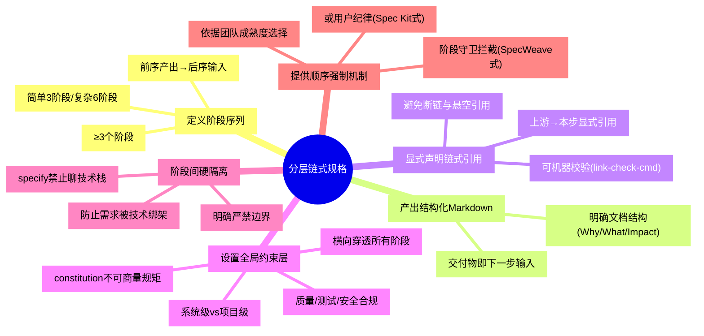

# 分层链式规格模式（Layered Chained Spec Pattern）

## 模式概述

在 AI 编程与多代理协作场景中，通过**分层约束（constitution 层 + 需求层 + 技术层 + 任务层）**与**链式 Markdown 产物传递**，将"凭感觉写提示词"的 vibe coding 转化为"按图施工"的工程流程。核心思想是：**规格先行、链式喂给、阶段硬隔离**——前序阶段产出的 Markdown 既是交付物也是后续阶段输入，全局约束横向穿透所有阶段，阶段间通过"严禁"边界防止职责混淆。

该模式由 GitHub Spec Kit 六命令链式工作流（2025-09 发布，118K Star）与 SpecWeave 三件套体系（spec.md/tasks.md/checklist.md）双案例对照萃取而来，两套体系同属规格驱动开发（SDD）谱系，互为验证。

### 问题背景

AI 编程实践中普遍存在以下痛点：

1. **需求与技术混杂**：AI 在需求未明确时就开始讨论技术栈，导致"需求被技术绑架"——技术选型过早反过来限制需求表达
2. **无全局约束穿透**：质量/测试/安全等"不可商量的规矩"没有横向约束全流程，各阶段各自为政
3. **上下文污染**：所有讨论混在单一 context 中，AI 无法区分哪些是硬约束、哪些是可商量需求、哪些是技术决策
4. **跳步返工成本高**：没定规矩就写代码、没想清楚做什么就想怎么做，导致后期大规模返工
5. **代理间通信无协议**：多 AI 代理协作时没有统一的接口格式，上游产出下游无法可靠消费

GitHub Spec Kit 118K 星标的快速传播证明了这一痛点的普遍性，但社区实践中也暴露了"费 token""小项目负担重""constitution 编写门槛高"等问题——这正是本模式必须配套反目标用户分析与早期预警信号的原因。

## 触发场景

**适用于**：
- 需要把"凭感觉"的模糊任务转化为"按图施工"的工程流程的场景
- 多代理协作需要显式上下文传递的系统
- AI 编程工作流需要阶段强制顺序的团队
- 规格驱动开发（SDD）落地
- AI 辅助编程工作流（Copilot、Claude Code、Cursor 等 AI 编程代理）
- 多阶段需求→设计→实现流程，需要明确的阶段划分与交付物
- 团队协作开发（3 人以上，需要明确的阶段边界）
- 中大型项目（代码量>5000 行，有明确质量/测试/安全合规要求）
- 多代理协作系统（多个 AI 代理按流水线分工协作）
- 需要可审计性的项目（每个阶段产出可追溯，决策过程可审计）

**项目规模阈值判断**：按代码量与团队规模三档裁剪，避免流程对小项目的负担。

| 代码量 / 团队规模 | 流程档位 |
|---|---|
| >5000 行 或 团队>3 人 | 六步完整流程（constitution→specify→clarify→plan→tasks→implement） |
| 1000-5000 行 或 2-3 人团队 | 精简为 3 阶段（constitution→spec→tasks） |
| <1000 行 或 单人项目 | 最小版（仅保留 spec 阶段），constitution 隐式遵守全局规则 |

**不适用于**：

### 反目标用户/场景（四类，防止确认偏误）

**1. 黑客松/快速原型开发者**
- **特征**：48 小时内交付 demo、追求速度而非可维护性、代码用完即弃；一次性脚本、纯原型探索、小修小补任务均属此类
- **为什么不适用**：6 阶段流程本身需要 1-2 小时的文档编写时间，在此类场景中这段时间占比过高；demo 不需要可审计性和团队协作
- **误用后果**：花在写 constitution 和 spec 的时间比写代码还多，最终产出反而减少
- **替代方案**：只用最小版（spec→tasks 两阶段），constitution 隐式遵循常识

**2. 已具备成熟工程文化的团队**
- **特征**：团队有 5+ 年协作经验、已形成稳定的需求→设计→开发流程，代码审查和 CI/CD 成熟运转
- **为什么不适用**：现有流程已经隐含了分层约束和阶段分离，额外的 Markdown 链式文档是重复建设
- **误用后果**：流程冗余导致团队抵触，新文档体系与现有流程冲突反而降低效率
- **替代方案**：对照本模式做差距分析，只补强缺失环节（如缺少显式 constitution 则补充，不需要全套引入）

**3. 探索性研究/算法实验场景**
- **特征**：目标不明确（"试试这个方法效果如何"）、需要频繁试错、技术路线可能在一天内多次转向
- **为什么不适用**：链式规格的核心前提是"上游稳定后才能进入下游"，但探索性研究中上一步结论随时可能被推翻
- **误用后果**：强制按阶段走导致每次转向都要重写上游文档，文档更新速度跟不上实验迭代速度
- **替代方案**：使用研究笔记模式（notebook）而非链式规格，待方向稳定后再对最终结果做规格化沉淀

**4. 超小上下文模型用户（<128K token）**
- **特征**：使用开源小模型（7B-13B 参数）、本地部署、上下文窗口有限
- **为什么不适用**：链式喂给的前提是每阶段产出足够完整，小模型难以生成分量足够的结构化 Markdown；多阶段传递还会引入累积误差
- **误用后果**：每个阶段产出质量不足，下游基于低质量输入继续生成，最终结果偏差放大
- **替代方案**：减少阶段数，单阶段集中生成；或使用"规格压缩"技术而非完整链式传递

## 核心做法（6 步）

1. **定义阶段序列**：确定≥3 个阶段，前序阶段产出为后序阶段输入。阶段数依据任务复杂度——简单任务 3 阶段（spec→tasks→implement），复杂任务 6+ 阶段（参考 Spec Kit 六命令：constitution→specify→clarify→plan→tasks→implement）。
   - 规模三档：完整版（6 阶段）、精简版（3 阶段：constitution→spec→tasks）、最小版（2 阶段：spec→tasks，适用于极小项目，constitution 隐含遵守全局规则）
   - 每个阶段必须明确四要素：阶段目标（本阶段解决什么问题）、禁止事项（本阶段绝对不能讨论什么，如 specify 严禁聊技术栈）、交付物格式（Markdown 文档，含结构化字段）、下游消费者（哪个阶段会读本阶段产出）

2. **每阶段产出结构化 Markdown**：每个阶段产出一份结构化 Markdown 文档，既是当前阶段交付物，也是下一步输入。文档须有明确结构（如 SpecWeave spec.md 的 Why/What Changes/Impact/ADDED Requirements）。这一设计与 REST 之于服务间通信、JSON 之于数据交换同构——Markdown 是 AI 代理间通信的"最低公约数"协议（参考 [markdown-as-interface 模式](../ai-collaboration/markdown-as-interface.md)）。
   - 禁止：口头约定、聊天记录直接作为输入、隐式上下文依赖
   - 要求：交付物自包含——下游阶段只读上游 Markdown 即可开始工作，无需回溯聊天记录
   - 格式：使用统一的 frontmatter + 章节结构，便于机器解析和人工阅读

3. **显式声明链式引用**：在每步产出中增加"上游产出→本步输入"的显式引用字段，让链式依赖从隐式推断变为显式声明（借鉴 Spec Kit 的"Markdown 喂给下一步"显式化设计）。链式引用须可机器校验（如 SpecWeave 的 `link-check-cmd` 自动校验引用完整性），避免断链与悬空引用。
   - 强制：引用必须可被机器自动校验
   - 禁止：隐式依赖（"参考之前的讨论"但不给出具体文档链接）
   - 价值：链式引用显式化后，可自动检测"跳步"（缺少必要上游引用）和"断链"（引用文档不存在）

   声明格式示例：

   ```markdown
   ---
   upstream:
     - constitution.md
     - spec.md
   ---
   ```

4. **设置全局约束层**：定义不可商量的"constitution"层（质量/测试/安全合规规矩），横向穿透所有阶段。区分系统级 constitution（如 SpecWeave 的 13 条 global-core-rules）与项目级 constitution（每个项目自定）。
   - 内容范围：质量标准（测试覆盖率、代码规范）、安全合规（密钥管理、数据加密）、不可妥协的技术决策
   - 作用方式：虚线穿透——constitution 不作为独立阶段顺序执行，而是作为所有阶段的横向约束
   - 双层体系：系统级 constitution（全局核心规则，所有项目必须遵守）+ 项目级 constitution（每个项目自定义的不可商量规矩，如"本项目必须使用 TypeScript""测试覆盖率≥80%"）
   - ⚠️ 注意：constitution 编写本身有学习曲线（文章自承"门手艺"），建议从模板开始而非从零编写

5. **阶段间硬隔离**：明确每个阶段的"严禁"边界——如 specify 严禁聊技术栈，plan 才决定技术栈。硬隔离防止"需求被技术绑架"。
   - 最关键隔离：specify（做什么+为什么）与 plan（怎么做）严格分离
   - 隔离机制三档：轻量级（文档模板 + AI 提示词约束，如"在 specify 阶段拒绝回答任何技术栈问题"）、中量级（阶段守卫运行时拦截）、重量级（流程审批，越界讨论需审批才能继续）
   - 隔离价值：防止"技术实现难度"反向影响"需求表达"——需求阶段不应该考虑"这个用 React 好不好实现"，只考虑"用户需要什么"

6. **提供阶段顺序强制机制**：用阶段守卫拦截（SpecWeave 式显式拦截+跳转审批）或用户纪律（Spec Kit 式自觉执行）保证顺序，二选一依据团队成熟度。
   - 团队成熟度低：自动化守卫拦截（输出"⚠️ 阶段守卫拦截"），正向跳过/逆向回退均需审批
   - 团队成熟度中：CI 检查链式引用完整性（缺少上游引用禁止合入），结合人工 review
   - 团队成熟度高：依赖团队纪律 + 文档模板引导，无需强制拦截

### 核心做法思维导图



## 反模式（5 个）

### 反模式1：共享单一 context 文件而非链式喂给

- **来源**：SpecWeave 三件套的隐式依赖——读者需从 Task Dependencies 推断链式关系，而非显式声明
- **表现**：所有规矩、需求、任务混在一个 context 文件中，代理间通过"共享一个文件"协作
- **后果**：上下文混乱，难以追溯"哪一步澄清了什么"，阶段边界模糊
- **正确做法**：每阶段独立产出 Markdown，显式声明上游引用

### 反模式2：阶段边界模糊（需求与技术栈混讨论）

- **来源**：SpecWeave spec.md 未硬隔离技术栈讨论（对照分析发现）
- **表现**：在需求阶段（specify/spec.md）就开始讨论技术栈选型，需求被技术决策绑架
- **后果**：技术选型过早锁定，需求变更时技术栈已成沉没成本，灵活性丧失
- **正确做法**：specify 严禁聊技术栈，plan 阶段才决定技术栈，硬隔离"做什么"与"怎么做"

### 反模式3：顺序执行依赖纯用户纪律无守卫拦截

- **来源**：Spec Kit 顺序执行依赖用户自觉，SpecWeave 有显式拦截机制对比
- **表现**：阶段顺序靠开发者自觉遵守，无自动化拦截，容易跳步或回退
- **后果**：跳过前置阶段（如跳过 constitution 直接 implement），规格缺失导致返工；可审计性差
- **正确做法**：用阶段守卫拦截机制（标准拦截输出格式+跳转审批流程）替代纯用户纪律

### 反模式4：已有代码库接入时 constitution 与 legacy 偏差未处理

- **来源**：analysis-report.md 局限性分析"已有代码库接入难题一笔带过"——大多数真实项目接手已有代码库
- **表现**：为新项目设计 constitution，但接入已有代码库时未处理 legacy 代码与规格的偏差
- **后果**：constitution 规矩与 legacy 代码冲突，要么改 constitution 妥协（约束失效），要么大改 legacy（成本爆炸）
- **正确做法**：增加"legacy 对齐"步骤——审计 legacy 代码与 constitution 的偏差，标记可豁免项与须整改项，分阶段迁移

### 反模式5：在长上下文模型时代仍坚持分段喂给

- **来源**：对抗审查·未来视角——模型上下文窗口持续增长（已到 1M+ token），链式喂给的"分段传递"价值递减
- **表现**：当模型上下文窗口足够容纳全部规格时，仍机械坚持分段喂给，增加阶段切换成本与维护负担
- **后果**：阶段切换的上下文传递成本超过收益，文档间引用维护负担膨胀
- **正确做法**：当模型上下文>1M token 时，评估是否合并阶段（如将 specify+clarify+plan 合并为单次规格定义），链式喂给从"强制分段"转为"按需分段"

## 失败案例

> 说明：本案例为 2026-08-05 V2 质量补强阶段构造的匿名工程团队场景，用于刻画流程误用的典型形态（非已归档的真实事故记录），详见 [模式演进历史](#演进历史)。

### 案例：某团队小项目强制全流程导致效率下降 40%

**背景**：某 3 人创业团队在 2025 年底接触到 Spec Kit，被"118K Star 的 AI 编程方法论"吸引，决定在所有项目中严格执行 6 命令全流程。团队将其应用到一个内部工具开发项目（预计 1500 行代码、1 周完成）。

**失败过程**：
1. **constitution 编写耗时 2 天**：团队试图从零编写完美的 constitution，反复讨论"代码规范应该多细""测试覆盖率标准定多少"，最终产出了一份 8 页的 constitution 文档
2. **specify 阶段产出过度**：specify 文档写了 3000 字，包含大量背景信息和未来设想，远超"只谈做什么+为什么"的要求
3. **阶段间反复回退**：implement 阶段发现 specify 遗漏了一个边界情况，需要回退到 clarify 重新澄清；每次回退都要同步更新上游文档
4. **一周任务做了两周半**：原本预估 5 人天的项目，实际花了 12 人天，其中 40% 时间用于编写和维护链式文档

**根因分析**：
- **规模误判**：1500 行代码、3 人团队应该用 3 阶段精简版，而非 6 阶段完整版
- **constitution 完美主义**：将 constitution 当作"一次性写完美"的文档，而非可迭代的工作协议
- **回退机制缺失**：团队没有建立"允许小范围回退而不全链重写"的机制，导致任何小变更都要全链路更新

**教训与修正**：
1. **按规模选流程**：后续团队为 <2000 行代码的项目使用 2 阶段最小版（spec→tasks），2000-5000 行使用 3 阶段，>5000 行才使用完整版
2. **constitution 最小可行原则**：从模板开始，第一次只写 3-5 条最核心规矩，后续迭代补充
3. **增量回退机制**：小范围变更不需要全链重写，只在变更影响上游约束时才回退对应阶段
4. **建立"文档 ROI"意识**：文档维护时间不应超过总开发时间的 15-20%，超过说明流程过重

## 早期预警信号（7 条）

当出现以下信号时，说明你正在误用分层链式规格模式，需要及时调整：

| 预警信号 | 含义 | 建议动作 |
|---------|------|---------|
| 文档编写时间 > 编码时间的 25% | 流程过重，阶段数量与项目规模不匹配 | 缩减阶段数，切换到精简版/最小版 |
| 团队抱怨"写文档比写代码累" | constitution/spec 模板过于复杂或要求过细 | 简化模板，只保留核心字段 |
| 频繁出现"这个小改动要改三份文档" | 链式引用粒度过细，文档耦合度太高 | 合并相邻阶段，减少引用层级 |
| specify 文档里出现技术栈名词 | 硬隔离失效，阶段边界模糊 | 强化 specify 阶段的禁止事项提示 |
| constitution 超过 1 页且 2 周未更新 | constitution 变成了"写完就忘"的死文档 | 砍到 1 页内，只保留真正会执行的规矩 |
| 新项目直接复制粘贴上一个项目的全套文档 | 文档模板化而非思考化，变成形式主义 | 每次从零思考哪些阶段是必须的 |
| 下游阶段总是在补充上游遗漏的信息 | 上游产出质量不足，链式传递出现断层 | 为每个阶段建立明确的"完成定义"（DoD）checklist |

## 检验标准

- [ ] 阶段顺序可追溯：每步产出可回溯到上游输入（引用字段完整）
- [ ] 阶段交付物齐全：每个阶段都有对应的 Markdown 文档，没有空缺阶段
- [ ] 阶段边界清晰：技术决策不在 specify 阶段出现，需求不在 plan 阶段新增
- [ ] 硬隔离有效：specify 文档中搜索不到技术栈关键词（React、Vue、数据库选型等）
- [ ] 全局约束穿透：constitution 规矩在所有阶段被显式遵守（无违背）
- [ ] constitution 可执行：每条规矩都是可验证的（"测试覆盖率≥80%"而非"要写好测试"）
- [ ] 链式引用完整：无断链、无悬空引用（可用 link-check-cmd 校验）
- [ ] 顺序强制有效：跳步行为被拦截或需审批
- [ ] 规模适配：阶段数量与项目规模匹配，没有对小项目过度工程化

## 跨场景迁移示例

### 迁移示例1：DevOps CI/CD 流水线

- 构建阶段产出制品（artifact）→ 测试阶段消费制品产出测试报告 → 部署阶段消费测试报告产出部署记录
- constitution 层：安全合规规则（如"禁止明文密钥"）横向约束所有阶段
- 硬隔离：构建阶段不决定部署目标，部署阶段才决定
- 迁移可行性：CI/CD 已是链式产物传递，本模式补充"全局约束层"与"阶段硬隔离"两个增量
- 六命令映射：
  - **constitution**：全局部署规则（不可商量：生产环境必须人工审批、必须回滚预案、必须监控告警）
  - **specify**：要做什么流水线（构建→测试→预发→生产），不聊用 Jenkins 还是 GitHub Actions
  - **plan**：技术选型（Jenkins vs GitHub Actions、runner 规格、缓存策略）
  - **tasks**：具体任务拆分（写 Dockerfile、配置 CI yaml、写测试脚本）
  - **implement**：执行配置
  - **链式引用**：每个 yaml 文件注释中引用上游文档

### 迁移示例2：学术研究流程

- 假设阶段产出研究假设 → 实验阶段消费假设产出实验数据 → 分析阶段消费数据产出结论 → 论文阶段消费结论产出论文
- constitution 层：研究伦理规则（如"知情同意"）横向约束所有阶段
- 硬隔离：假设阶段不决定实验方法，实验设计阶段才决定
- 迁移可行性：学术研究已是链式文档传递，本模式补充"显式链式引用"与"约束分层"两个增量
- 六命令映射：
  - **constitution**：学术规范（不可商量：引用格式、伦理审查、数据真实性要求）
  - **specify**：研究问题是什么、假设是什么（不聊用什么统计方法）
  - **plan**：研究设计（用什么方法、样本量、分析工具）
  - **tasks**：实验步骤拆分
  - **implement**：执行实验、写论文
  - **链式引用**：论文每个章节明确引用哪个阶段的产出

## 术语速查

| 术语 | 含义 |
|------|------|
| 链式喂给 | 每个阶段产出 Markdown 文档，作为下一阶段的上下文输入，形成链条式传递 |
| constitution | 不可商量的全局规矩（质量/测试/安全合规），横向约束所有后续阶段 |
| specify | 只谈"做什么+为什么"的阶段，严禁讨论技术栈 |
| 硬隔离 | 阶段间明确禁止某类讨论（如 specify 严禁聊技术栈），防止需求被技术绑架 |
| 阶段守卫 | 自动化拦截机制，阻止跳步或越界操作，需审批才能跳转 |

## Hello World 示例（3 阶段精简版）

最小可行"分层链式规格"项目结构：

```
project/
├── constitution.md    # 全局约束（不可商量）
│   └── 内容：测试覆盖率≥80%、禁止明文密钥、必须写类型注解
├── spec.md            # specify 阶段产出：做什么+为什么（严禁技术栈）
│   ├── Why: 用户需要一个简单的任务看板
│   ├── What Changes: 支持拖拽排序、用户登录、多项目切换
│   └── upstream: [constitution.md]
└── tasks.md           # tasks 阶段产出：可验收任务清单
    ├── Task 1: 实现登录功能（验收：输入正确密码可进入看板页）
    ├── Task 2: 实现拖拽排序（验收：拖拽后刷新页面顺序持久化）
    ├── Task 3: 实现多项目切换（验收：切换项目后看板内容对应更新）
    └── upstream: [constitution.md, spec.md]
```

## 案例来源

| 案例 | 来源 | 六命令对应 | SpecWeave 对应 |
|------|------|-----------|---------------|
| GitHub Spec Kit | github/spec-kit（118K Star, MIT, 2025-09-02 发布） | constitution/specify/clarify/plan/tasks/implement 六命令 | — |
| SpecWeave 三件套 | SpecWeave 项目 `.trae/specs/` 体系 | — | spec.md/tasks.md/checklist.md + global-core-rules + stage-guardrails |

## 正例

### 正例1：GitHub Spec Kit（118K⭐）

Spec Kit 的六个 slash 命令（constitution → specify → clarify → plan → tasks → implement）是本模式的完整实现：

- 每步产 Markdown 喂给下一步（F-014）
- specify 严禁聊技术栈（F-008、F-016）
- constitution 横向穿透全流程（F-015）
- 六命令必须按顺序执行（F-013）
- 官方定位为"实验性"，适合中大型项目验证 SDD 方法论

### 正例2：SpecWeave 三件套 + 阶段守卫

SpecWeave 是本模式的增强实现：

- 三件套：spec.md、tasks.md、checklist.md（F-030）
- 8 阶段序列守卫（F-031）
- 显式拦截机制 + 跳转审批（F-032）
- 13 条全局核心规则作为系统级 constitution（F-033）
- 工具链支持：link-check-cmd 校验引用、ci-check-cmd 综合检查（F-035）

> 事实编号（F-xxx）可回溯至[源复盘报告](../../../reports/2026-07-06-github-speckit-sdd-seven-concepts.md)的编号事实清单。

## 边界条件与选型

分层链式规格的本质是**用结构化流程对抗 AI 编程的不确定性**。它不是银弹：

- **核心价值**：在需求→设计→实现的关键边界建立护栏，防止跳步和上下文污染
- **核心成本**：文档开销、constitution 编写学习曲线、小项目的流程负担
- **决策信号**：
  - ✅ 项目有质量/合规要求、需要团队协作、预期维护周期 >3 个月 → 用
  - ✅ AI 编程频繁出现"需求没说清就写代码""技术选型反推需求" → 用
  - ❌ 一次性脚本、快速 PoC、单人极小项目 → 不用或用精简版
  - ❌ 模型上下文足够大且团队已有成熟流程 → 评估后选择性使用

## 与现有模式的关系

| 关系模式 | 关系类型 | 说明 |
|---------|---------|------|
| [markdown-as-interface.md](../ai-collaboration/markdown-as-interface.md) | 基础模式 | Markdown 作为代理间通信协议是本模式的前提 |
| [three-layer-spec-constraint.md](../governance-strategy/three-layer-spec-constraint.md) | 理论基础 | 三层规格约束是本模式中 constitution 分层的理论来源 |
| [spec-triple-sync.md](../governance-strategy/spec-triple-sync.md) | 互补模式 | spec 三件套同步机制是链式引用的工程实现 |
| [meta-document-leverage.md](../document-architecture/meta-document-leverage.md) | 下游支撑 | 元文档优先原则依赖于结构化的链式文档体系 |

## 演进历史

| 版本 | 时间 | 核心变化 | 验证案例 |
|------|------|---------|---------|
| v1.0 | 2026-07-06 | 初始萃取，6 核心做法 + 4 反模式 + 2 迁移示例，V 审查后 maturity=L1.5 | GitHub Spec Kit 分析 |
| v1.1 | 2026-08-05 | 归档修正，补充规模阈值、第 5 反模式（长上下文）、术语速查、Hello World | 入库复盘修正 |
| v1.2 | 2026-08-05 | V2 质量达标：补充反目标用户/场景 4 类、失败案例 1 个、早期预警信号 7 条 | 预提交钩子驱动补强 |
| v1.3 | 2026-10-23 | 合并归档副本 `governance-strategy/layered-chained-spec.md` 的 V2 章节，补回七概念标准模板缺失的术语速查/Hello World/失败案例等内容；删除重复副本，`source_report` 改指持久化复盘报告 | 重复消除治理 |

## 对抗审查记录

本模式经过4视角17条对抗审查意见，采纳5条修正：
1. 核心做法第3步补充 link-check-cmd 机器校验
2. 新增术语速查与 Hello World 示例（见检验标准）
3. 触发场景补充项目规模阈值判断
4. 反模式增至5个（新增"长上下文模型时代仍坚持分段喂给"）
5. maturity 从 L2 修正为 L1.5（同谱系双实现不算独立双案例）

完整对抗审查记录见：[源复盘报告](../../../reports/2026-07-06-github-speckit-sdd-seven-concepts.md) V 阶段
