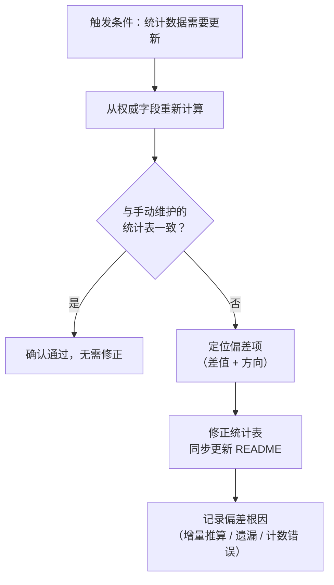

> **来源**：从 `docs/retrospective/reports/retrospective-meta-atomization-full-chain-20260624.md` 三、3.3 发现三 + 四、4.1 元模式二 合并拆分

# 合成统计的权威数据来源（Synthetic Stats Source-of-Truth）

## 模式类型
方法论模式

## 成熟度
L2 已验证（2 个独立案例：①模式成熟度分布 L1/L2 偏差发现与修正；②2026-10-13 入口徽章计数漂移，见「案例二」）

## 适用场景
任何需要跨多文件维护合成统计数据（如模式成熟度分布、文档覆盖率、资产清单）的体系，尤其是数据跨多轮手动更新的场景。

## 问题背景

跨文件汇总的合成统计数据（例如"32 个方法论模式中 L1=15、L2=16、L3=1"）与各文件的原始 metadata 字段存在两层耦合：

1. **时间耦合**：每次新增/修改文件后，统计数据需要同步更新
2. **值耦合**：统计数据的值必须与各文件的 metadata 字段保持一致

当统计数据的维护方式是"增量推算"（`上次值 ± 本次新增`）而非"全量重新计算"（`grep 所有文件的 metadata 字段 → 汇总`）时，偏差会随更新轮次累积。

## 偏差累积公式

```
P(偏差) ≈ 1 - (1 - p)^n

其中：
  p = 单次手动推算出错概率（约 5%）
  n = 连续更新轮次
```

| 更新轮次 (n) | 累积出错概率 |
|-------------|------------|
| 1 次 | ~5% |
| 3 次 | ~14% |
| 5 次 | ~23% |
| 10 次 | ~40% |

本案例中 n=5 轮连续更新后，L1/L2 分布出现了互换偏差（报告 15/13 → grep 实际 12/16）。

## 核心规则

> 合成统计数据 = 从各文件的权威字段 grep → 汇总（全量重算），而非 `上次值 ± 新增`（增量推算）

### 权威字段定义

| 数据类型 | 权威来源 | grep 示例 |
|---------|---------|----------|
| 模式成熟度 | 各模式文件 TOML frontmatter 的 `maturity` 字段 | `grep 'maturity = "L[123]"' *.md` |
| 验证计数 | 各模式文件的 `validation_count` 字段 | `grep 'validation_count = \d+' *.md` |
| 复用计数 | 各模式文件的 `reuse_count` 字段 | `grep 'reuse_count = \d+' *.md` |
| 文档增删 | Git 提交记录的 diff | `git diff --stat` |
| 脚本数 | `.agents/scripts` 下 `.py` 文件（含 lib/tests/mdi） | `(Get-ChildItem .agents/scripts -Recurse -Filter *.py \| Where-Object FullName -notmatch __pycache__).Count` |
| Skill 数 | `.agents/skills` 下含 `SKILL.md` 的一级目录 | `Get-ChildItem .agents/skills -Directory`（逐目录确认含 SKILL.md） |
| 规则数 | `.agents/rules` 下 `.md` 文件 | `(Get-ChildItem .agents/rules -Recurse -Filter *.md).Count` |
| 指令数 | `.agents/commands` 下命令文档（排除 README） | `git ls-files .agents/commands` |
| 模式数 | `docs/retrospective/patterns` 下 `.md` 文件 | `(Get-ChildItem docs/retrospective/patterns -Recurse -Filter *.md).Count` |

> 入口徽章（根 `README.md`、`docs/index.md`）与 `.agents/README.md` 的计数一律取自上表命令的实测值；多处出现时只在一处维护口径、其余引用，禁止各处手写快照。

## 操作流程



## 本案例验证

**偏差发现**：R5 轮次发现 `patterns/README.md` 中 methodology-patterns 的 L1=15/L2=13，但 `grep 'maturity = "L[123]"' *.md` 的汇总结果为 L1=12/L2=16。

**根因**：连续 5 轮原子化采用"上次值 ± 新增"的增量推算——某轮将 L1/L2 各记为了 13/13，后续几轮在此基础上加减，导致偏差累积。

**修正**：`grep maturity` 全部 32 个模式文件的 `maturity` 字段后重新计数，修正为 L1=12/L2=16。

## 案例二：入口徽章计数漂移（2026-10-13）

**偏差发现**：同一组计数在三个入口出现三套互相矛盾的快照——

| 入口 | 脚本 | Skills |
|------|------|--------|
| 根 `README.md` | 419+ | 28 |
| `docs/index.md` | 401+ | 21 |
| `.agents/README.md` | 341 | 19 |

全量重算实测：脚本 657、Skills 169、规则 136、指令 15、模式 946、提交 4219。

**根因**：① 计数为手工快照，2026-09-30 全面复盘虽使用准确数字，但结论未回写到各对外入口；② 高频提交（月均上千）使快照在数周内显著偏离；③ 三处入口各自维护、无单一数据源，偏差方向与幅度各不相同。

**修正**：按「权威字段定义」表全量重算，统一三处入口数字，并明确 Skills 口径（169 目录 ≈ 40 自研门面 + 37 IDE 内置/设计库镜像 + 其余技能库素材）。

**案例二新增反模式**：

- ❌ **「复盘归复盘、入口归入口」**：复盘报告准确却不回写对外入口，对读者而言等于没有修正
- ❌ **多处手写同一计数**：N 个入口即 N 个独立漂移源
- ❌ **口径混用**：把「在册分类数」与「目录总数」当作同一个徽章数字、又不注明口径

## 失败案例

**"重算一次 ≠ 建立机制"（2026-09-30 → 2026-10-13）**：2026-09-30 全面复盘时，本模式作者已对模式成熟度分布完成一次全量重算并得到准确数字，也在复盘报告中登记了教训。但后续约两周内，同一组计数又在多个入口出现新的漂移（根 README 写 419+，docs/index 写 401+，.agents/README 写 341）。

**为何失败**：① 第一次修正只更新了"报告"与"单处统计表"，未把「单一数据源 + 命令抽取」落到对外入口；② 没有把重算命令接入 CI 或文档生成，下次新增文件后仍靠手写覆盖；③ 每个入口各自持有一份快照，作者在其中一个入口修正，其他入口仍在用旧值。即：**单一权威字段 + 一次全量重算，若不固化为持续执行的校验，偏差会以不同方向与幅度复发**，甚至比初次的偏差更难察觉（数字看起来合理，只是彼此不一致）。

**教训**：模式的可重复性来自"机制"而非"某次纠错动作"——重算后必须同时落地①单一数据源口径说明、②可复跑的命令、③校验门（docgen/CI），否则只能纠正一时的数据，纠正不了漂移的进程。

## 不适用 / 反目标 / 边界场景

以下情况下本模式为过度工程，应回退为"直接手写或简单脚本"，不必引入权威字段表：

1. **一次性生成即冻结的统计**：统计值只在某个节点生成一次、之后不再跨轮维护（如某版本文档目录的一次性快照）——没有"漂移"可言，全量重算流程徒增动作。
2. **单一权威文件、无跨文件汇总的指标**：数据只存在于一个源文件，或仅是一处展示（如单个 script 的版本号）——不存在多点不一致问题，权威字段表无意义。
3. **已由工具自动生成并接入 CI 实时校验**：若统计值本身由 docgen/CI 每个提交自动重算并断言一致，人工全量重算与偏差记录反而冗余。
4. **含外部数据源、无法 grep 的准合成指标**：计数依赖外部服务状态、人工登记表或代码外事实（如"外部 API 数量"），`grep` 命令无法成为可靠权威字段，本模式的"命令可复跑"前提不成立。
5. **小团队低频维护、偏差代价极低**：当入口很少、更新频率低、读错代价可忽略时，建立机制的成本超过了它节省的返工成本——先不做，直到出现一次实际偏差再引入。

**边界前提**：本模式假设统计数据的权威字段位于仓库内、可被 grep/PowerShell 命令稳定枚举；出口数、目录树结构变化等情形需先确认命令仍可复跑才适用。

## 实施建议

| 原则 | 具体做法 |
|------|---------|
| **优先重算** | 每次需要统计数据时，优先从权威字段重新计算，而非信任缓存值 |
| **定期验证** | 每 N 轮更新后（建议 N=3），运行全量 grep 与统计表做对比 |
| **自动化对比** | 将 `check-atomization-duplication.py` 扩展"统计表 vs grep 对比"功能 |
| **记录偏差** | 发现偏差时记录根因（增量推算 / 遗漏 / 计数错误），避免同类问题复发 |

## 实施检查清单

- [ ] 识别项目中所有跨文件合成统计数据
- [ ] 为每类统计数据确定权威字段和 grep 命令
- [ ] 建立定期验证周期（每 3 轮更新或每次发布前）
- [ ] 将验证逻辑脚本化，纳入 CI 检查

## 与现有模式的关系

- `fact-statement-consistency-loop.md`：本模式是其"修正一处→验证同类→统一修正"在统计数据的应用——发现一个统计偏差后，应 grep 全量验证所有统计数据
- `check-atomization-duplication.py`：可扩展统计验证功能，实现本模式的自动化

> **关联模块**：
> - `fact-statement-consistency-loop.md`
> - `.agents/scripts/check-atomization-duplication.py`
