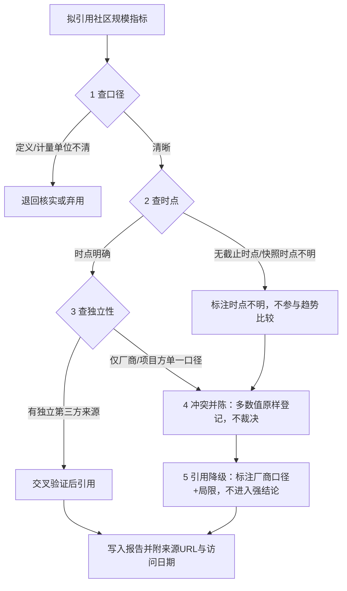

# 社区指标三查法（口径-时点-独立性 Community Metric Triple Check）

## 模式类型

方法论（治理策略 / 尽调证据质量门禁）

## 成熟度

L1-draft 假设级（单案例：openKylin 全面评估，2026-10-14；145 条 CMP/ECO 事实中登记 12 项数据冲突与 12 项未获取项。待第二个非同谱系案例验证后升级 L1.5/L2）

## 问题陈述

开源社区与厂商生态的规模指标（用户数、开发者数、成员单位、SIG 组数、部署量、下载量、覆盖国家数）在公开传播中存在三类系统性失真：

1. **口径漂移（Definition drift）**：「社区用户」「注册用户」「累计部署量（套）」「镜像下载量（次）」「服务用户」被当作同义词引用，但统计边界完全不同；同一个「会员数」还可能分别指企业会员与个人会员。
2. **时点模糊（Timestamp ambiguity）**：官网首页展示的是滚动更新值，搜索引擎索引快照时点不明，不同日期的新闻稿各载一个数；引用者倾向于取「数值最大、时点最新」的版本，却不标截止日期，导致同一报告内数字不自洽。
3. **来源同质（Source homogeneity）**：一条数字表面上有官网、厂商新闻、基金会公告、领导访谈、政府网站转载五个来源，实则全部源自同一厂商口径，不存在独立第二信源；第三方聚合平台（流量排名、收录站）则常给出方向相反的弱信号。

三类失真叠加时，报告会把「营销口径」误当「可审计事实」，并在多源冲突处强行二选一归因（要么采信官宣，要么判定造假），两种处理都超出了证据强度。

## 解决方案

任何社区规模类指标在写入报告/尽调结论前，强制顺序执行三查与两道收口，任一查不通过即触发收口动作，不得跳过。

### 流程

### 第一查：查口径（Definition Check）

| 维度 | 检查内容 | 检查方法 |
|---|---|---|
| 指标定义 | 「用户」是注册数、月活还是累计去重？「部署量（套）」与「下载量（次）」是否被混用？ | 逐字回读来源原文，不按常识补全定义 |
| 计量单位 | 万/W+/套/次/家/个，单位与数量级是否一致？ | 对同一指标建「指标—单位」对照 |
| 包含边界 | 是否含商业版出货量、衍生发行版、政府预装？会员数指单位还是个人？ | 在来源中找统计口径说明；找不到则标「口径未披露」 |

**决策规则**：定义与计量单位无法确认 → 该数字不进入事实清单，或仅以引述方式登记并标注「口径未披露」。

**身份别名归并（统计对象为「人」时）**：计量贡献者集中度、活跃人数、作者数等以「人」为统计对象的指标前，先排查身份别名——同一自然人可能使用多个 `user.name`/`user.email`、多个平台账号或多个署名。未完成排查时，报告只可使用「前 N 位身份合计占比」措辞，不得使用「单人/单一维护者」；完成排查后须并列「身份数」与「归并后人数」两个口径并标注归并证据（邮箱/署名一致性）。

### 第二查：查时点（Timestamp Check）

| 维度 | 检查内容 | 检查方法 |
|---|---|---|
| 截止时点 | 数字对应的确切日期或「截至 YYYY-MM-DD」表述 | 摘录原文时间状语与新闻发布日期 |
| 快照性质 | 官网首页值、搜索引擎索引快照、第三方缓存是否同源同时点 | 区分「本次直接抓取」与「索引快照（时点不明）」 |
| 时序一致性 | 多个数值按时间排列是否单调（增长指标不应回退） | 建时间序列表；回退即标记异常并保留两值 |

**决策规则**：时点不明的数值允许登记，但禁止参与同比/趋势表述，禁止与明确时点数字并列比较后得出「增长/下滑」结论。

### 第三查：查独立性（Independence Check）

| 维度 | 检查内容 | 检查方法 |
|---|---|---|
| 来源谱系 | 多个 URL 是否最终指向同一厂商/项目方通稿？ | 回溯每个数值的最早出处与转载链 |
| 独立审计 | 有无第三方审计、政府统计、学术/行业报告独立给出同指标？ | 检索测评机构、行业协会、第三方数据平台 |
| 反向信号 | 有无第三方平台给出可量化的反向参照（流量排名、收录热度）？ | 记录 Similarweb/os.watch/DistroWatch 类信号，但只作旁证不做等权替代 |

**决策规则**：仅存在单一谱系来源时，该指标在报告中一律标注「厂商/项目方口径，未见独立审计」；第三方旁证与官宣方向不一致时，按「信号不匹配」登记，不得据此判定任一方造假。

### 收口一：冲突并陈（Register, Do Not Adjudicate）

同一指标多个数值全部保留入「数据冲突登记」表（数值＋来源＋时点），不做平均、不取最大、不替来源裁决「哪个才是真的」。疑似统计对象不同（如 ISO 刷新日期 vs 版本发布日期）时，以「可能分别指代不同事件」备注，仍不删值。

### 收口二：引用降级（Caliber Down）

把结论强度与证据等级对齐：单一厂商口径的数字只允许进入「现状描述」并带口径标签；需要独立数据支撑的结论（市场地位、增长趋势、投资判断）若缺独立信源，改写为「公开资料未见可独立审计数据」，并列入待验证清单。

## 适用场景

| 场景 | 适用度 | 说明 |
|---|---|---|
| 开源社区健康度/生态规模评估 | 核心场景 | 用户数、开发者数、SIG 数、贡献集中度核验 |
| 竞品分析与技术选型报告 | 核心场景 | 规模指标是六维评分中「生态」维度的主要证据 |
| 投资/并购/商务尽调 | 核心场景 | 对方 BP 与官网数据需按口径/时点/独立性降级引用 |
| 市场调研与多来源数据汇总 | 适用 | 同一市场规模指标多机构数值并陈 |
| 官方数据直接用于合规申报的场景 | 部分适用 | 有法定统计口径时以官方口径为准，三查退化为时点登记 |

**不适用于**：指标本身具有唯一权威出处且带审计报告的场景（如上市公司经审计财报数据）——此时无需三查，直接引用权威源即可。

## 反模式警示

| # | 错误做法 | 后果 | 正确做法 |
|---|---|---|---|
| 1 | 只取官网首页「最大最新」的一个数字，不查同指标其他时点来源 | 报告被后续页面更新证伪，或与同报告他处数字冲突 | 第一查先穷举同指标全部公开数值，建表登记 |
| 2 | 把搜索引擎索引快照当实测值引用 | 快照时点不明却被当作「某日数据」进入趋势分析 | 标注「快照，时点不明」，不参与趋势比较 |
| 3 | 厂商口径与第三方信号冲突时强行归因（「官宣注水」或「第三方不准」二选一） | 结论超出证据强度，构成对厂商的无据指控或对数据的无据背书 | 按「信号不匹配」并陈，列为待验证项 |
| 4 | 混用「部署量（套）」「用户数（人）」「下载量（次）」 | 计量单位漂移使数量级直接不可比 | 逐字保留原单位与统计对象，不做跨单位折算 |
| 5 | 把多个转载 URL 计为多个独立信源 | 单一通稿被包装成「多源验证」，虚假提升证据等级 | 回溯最早出处，按来源谱系而非 URL 数量计数 |
| 6 | 引用规模数字时不写截止时点与访问日期 | 数字无法被读者复核，失效后无法定位 | 每条事实带来源 URL＋访问日期（或「截至」时点） |
| 7 | 把同一自然人的多个提交身份当作多个贡献者，或把多个自然人当作一个身份 | 贡献集中度与 bus factor 结论方向错误 | 先做身份别名排查（邮箱/署名一致性），并列「身份数」与「归并后人数」 |

## 检验标准

任一规模指标进入报告正文前，必须能一句话回答三问：

1. **口径**：它统计的对象和计量单位是什么？
2. **时点**：数值截止于哪一天？是实测抓取还是时点不明的快照？
3. **独立性**：除厂商/项目方自身外，有没有第二个独立谱系的来源？

三问中任一无法回答 → 该数字只能以「口径未披露/时点不明/厂商口径」标签进入事实登记，禁止进入评分、排名与建议类结论。完成全部指标核验后，报告须附「数据冲突登记表」与「未获取项清单」两张表。

**补充（统计对象为「人」时）**：在上述三问之外追加一问——多个署名或账号是否已排查为同一自然人？未排查者，集中度类结论降级为「前 N 位身份合计占比」，且不得据此陈述 bus factor。

## 跨场景迁移

- **软件性能基准评估**：厂商自测跑分（第一方口径）与 Phoronix/独立第三方横评（独立信源）经常差异显著。三查映射：查口径（测试机型/编译器/workload 是否同配置）→ 查时点（驱动/固件版本日期）→ 查独立性（实验室是否接受厂商赞助）；冲突并陈，不替读者裁决。
- **融资与经营数据尽调**：BP 中用户量/GMV/ARR 与新闻稿、第三方数据库不一致时，按三查降级引用，把未经审计数字全部标「管理层口径」。
- **市场调研多机构数据汇总**：不同咨询机构市场规模数字差异常达数倍，查口径（含/不含细分市场、币种与年份）、查时点（发布季与数据基年）、查独立性（是否资助方定制报告）后并陈区间值，不取单点平均。

## 验证来源

- **验证 1（单案例）：openKylin 全面评估（2026-10-14，session=sc-20261014-openkylin-evaluation）**
  - 查口径：社区用户数存在「社区用户/服务用户/累计部署量（套）」三种统计对象，单位「万/W+/套」并存，全部原样登记；
  - 查时点：同一指标出现 2025-12（200 万）、2026-02（230 万）、2026-07（247 万）、2026-09（250 万）、官网抓取（237 万）及时点不明快照（301 万）六个数值，建时序表后保留全部值；
  - 查独立性：全部数值溯源至麒麟软件/项目方同一谱系，未见独立审计（G-02）；第三方 Similarweb（#843,228，近三月下行）与 os.watch（收录首版 2026-08-31，浏览量 144）按旁证登记，不做等权替代；
  - 收口：登记 12 项数据冲突（CMP C-01~C-05、ECO C-01~C-07）与 12 项未获取项（CMP G-01~G-04、ECO G-01~G-08），报告中相关结论统一降级为「厂商/项目方口径」。
  - 结果：该案例触发并验证了三查+两收口的完整流程，但属单一领域案例，成熟度记 L1-draft。

## 关联资源

- 同类模式：[tech-selection-three-checks.md](tech-selection-three-checks.md)（决策前三查：偏好/惯例/本质）
- 同类模式：[data-validation-four-checks.md](data-validation-four-checks.md)（量化数据验证四查）
- 关联模式：[root-community-commercial-distro-flywheel.md](../product-growth/root-community-commercial-distro-flywheel.md)（根社区—商业发行版双轮：解释单一厂商口径为何高频出现的结构原因）
- 验证报告：[openKylin 全面评估调研报告](../../../reports/competitive-analysis/retrospective-openkylin-evaluation-20261014/README.md)
- 事实附录：[技术选型对比事实 CMP-01~CMP-75](../../../reports/competitive-analysis/retrospective-openkylin-evaluation-20261014/facts-technical-comparison.md)、[生态与商业事实 ECO-01~ECO-70](../../../reports/competitive-analysis/retrospective-openkylin-evaluation-20261014/facts-ecosystem-business.md)
