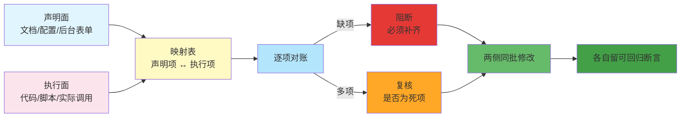

# 声明面与执行面的双侧对账

## 模型概述
凡是存在「向外部声明 X」且「本地实际做 Y」的场合，
声明与执行就分处**两个不同的面**——两者独立演化、各自出错、失败表现还不同。
本模式提供四步双侧对账法，把这组「看起来是一件事、实际是两件事」的要素纳入可回归的门。

## 核心原则
**声明侧与执行侧是两条独立链路，缺一不可，且必须同批修改。**
实证案例：
- 只声明不兜底 → 用户未同意时隐私接口**静默失败**（不抛错、不回调，用户只看到「点了没反应」）；
- 只兜底不声明 → 平台**直接禁用**接口（授权同意也没用）。
两个方向都失败，但现象完全相反——不并列检查就会修错方向。

## 四步对账法

| 步骤 | 名称 | 目标 | 关键产出 |
|---|---|---|---|
| Step 1 | 双面提取 | 分别提取声明面与执行面清单 | 两份清单 |
| Step 2 | 映射建模 | 建立两面的**映射关系**（不是集合包含） | 映射表 |
| Step 3 | 逐项对账 | 缺项即阻断，多项即复核 | 对账结论 |
| Step 4 | 同批修改 | 两侧同批改 + 各自留可回归断言 | 改动 + 断言 |

## 流程图

## 实施步骤详解

### Step 1：双面提取
- **声明面**：向外部公开的承诺——文档、配置文件、后台表单、发布包元数据。
- **执行面**：实际发生的行为——代码调用、脚本动作、真实网络请求。
- **产出**：两份独立清单，各自带定位信息（文件+行号 / 表单字段名）。
- **陷阱**：不要用「看起来相关的文件」冒充声明面。
  实证案例中项目根目录有 `.<appId>.privacy.json`（SDK 生成的云服务侧采集项清单），
  结构测试还断言它存在且格式正确、所有测试全绿——
  但它与平台侧《用户隐私保护指引》**同名不同物**。

### Step 2：映射建模
- **核心手法**：建立**一对多 / 多对一**的映射，不是集合包含判断。
  实证案例：`wx.chooseImage` / `wx.chooseMedia` / `wx.chooseVideo`
  三个接口**都**映射到「收集你选中的照片或视频信息」一个类型；
  反过来「相册（仅写入）」与「选中的照片或视频信息」是**两个不同类型**，
  只声明前者不声明后者仍会被拦。
- **产出**：映射表（执行项 → 声明项）。
- **反模式**：用「声明集合 ⊇ 执行集合」这种朴素包含判断。
  声明项名字写错一个字的场景下，包含判断会误判为通过。

### Step 3：逐项对账
- **缺项**（执行有、声明无）→ **阻断**。这是验收方会直接拦的项。
- **多项**（声明有、执行无）→ **复核**。不阻断，但会被追问；有时是死项，有时是静态分析看不到的路径。
- **分级**：只有结构上必然触发拦截的判 FAIL；
  依赖运行时上下文的判 WARN。
  实证案例中「手机号」「昵称头像」由云服务 SDK 的登录链路取得，
  静态扫描看不到——这类结论必须标 WARN 要求人工确认，而不是判 FAIL。

### Step 4：同批修改
- **动作**：两侧改动放在**同一批**；两侧各自留一条可回归断言。
- **产出**：改动 + 断言。
- **关键细节**：断言要**双向**——
  只断言「声明存在」挡不住「声明与执行错配」；
  只断言「代码调用了某接口」挡不住「声明漏了某类型」。
  实证案例的两条关键断言：
  - 「隐私声明覆盖代码调用的隐私接口」——比对声明文本与扫描结果；
  - 「授权兜底必须**早于**隐私接口调用」——**顺序**断言，只断言存在是抓不住顺序反了的。

## 反模式库

| 反模式 | 表现 | 后果 |
|---|---|---|
| 只改一侧 | 改了声明没改兜底，或反之 | 失败方向与预期相反，越修越困惑 |
| 集合包含代替映射 | 用 ⊇ 判断声明是否覆盖执行 | 类型名有偏差时误判通过 |
| 同名即同物 | 拿同名文件充当声明面 | 断言对象整个换掉，测试依然全绿 |
| 只断言存在 | 断言「有兜底」不验「兜底在前」 | 顺序错了照样静默失败 |
| 把 WARN 当 FAIL | 静态不可判的结论一律判 FAIL | 满屏告警 → 工具被弃用 |

## 迁移验证
- API 文档 vs 实现参数对账；
- SLA 承诺 vs 监控告警对账；
- 安全基线声明 vs 配置实态对账；
- 开源 README 的能力描述 vs 实际功能对账；
- 简历/作品集里的项目描述 vs 实际贡献对账。

## 实证来源
2026-10-26 微信小程序提审被拒（拦截类型「收集你选中的照片或视频信息」），
萃取为 Skill `.agents/skills/platform-review-precheck/` 的 D1~D4 四道门。
详见 [复盘报告](../../../reports/2026-10-26-platform-review-precheck-retro.md)。
