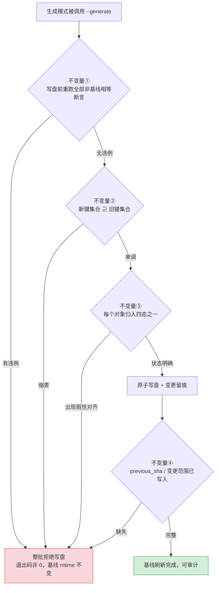

# 基线型门禁的写盘不变量

## 模式类型

方法论模式 → 治理策略（基线型门禁的生成器权限约束、状态模型与留痕设计）

## 成熟度

L1-draft（`maturity_level` = L1-draft；单案例：xuanspace `submodule-alignment-gate` 门禁，2026-10-29 沉淀；
validation_count = 1，reuse_count = 0）。

四条不变量中，唯一案例只完整验证了不变量①的一半（「漂移态拒绝写盘」成立，「先验证后落盘」不成立），
不变量②③④ 是本次对抗审查曝光的**未落地缺口**，属未验证设计意图。案例以「人审后推进指针」收口，
使不变量①的边界（人审能否作为合法旁路）无法在本案例内被检验。**不标 L1，不宣称已验证。**

## 一句话

门禁可不可信，不取决于断言多严，而取决于它**能否拒绝用自己的生成器把违规态写成合格基线**；
把这条要求拆开，就是「先验证后落盘、基线不得缩表、状态必须分档、变更必须留痕」四条可判定的不变量。

## 适用场景

**适用于：**

1. 门禁把一个**可提交的基线文件**（快照 / 清单 / 锁文件 / golden 文件 / 覆盖率基线）与磁盘或运行事实比对；
2. 门禁**同时提供生成模式**（`--generate` / `--fix` / `--update-snapshot`）用于刷新该基线；
3. 门禁断言里存在**豁免或中间态**（未初始化、未检出、待迁移、首次引入、平台差异）；
4. 基线文件被用作**发布资格或提交拦截**的依据（即它有「授权」语义，而不只是提示）。

**不适用于：**

- 基线只读、完全不存在生成通道（无洗白面，风险面不成立）；
- 基线由外部系统单向产出、本地不可写（生成器权限不在你的控制域内）；
- 需要治理的是「谁是权威源、各处声明是否一致」——
  那是 [single-authority-declaration-alignment](single-authority-declaration-alignment.md) 的问题；
- 需要治理的是「迁移期间禁止为让测试变绿而刷新快照」的**一次性纪律**——
  那是 [snapshot-parity-migration](snapshot-parity-migration.md)，本模式把同一原则泛化为**门禁设计的常态不变量**。

## 问题背景

带生成模式的门禁有一个不对称：**断言只能让门禁变红，生成器能让它一次变绿**。

设想一个已经写得相当认真的门禁：它把子模块指针、依赖版本、目录清单、命令表各比一遍，
有六类断言，CI 里跑，失败即阻断。看上去该防的都防了。但它的生成模式只需要一条分支：

```
if 漂移存在: 拒绝生成
否则: 按当前磁盘事实重写基线
```

这条分支有两个隐含假设，一旦不成立，门禁就等于不存在：

- **假设一：写盘前所有断言都跑完了。** 若生成模式只跑「漂移判定」而不跑其余断言，
  那么其余断言在生成路径上从不生效——它们是给「不生成的人」准备的。
- **假设二：键集合只增不减。** 若基线按「当前可枚举到的对象」重写，那么**让对象消失**
  （反初始化、卸载、移出目录）就是合法的缩表方式；缩表之后，被删掉的条目不再参与任何比对。

再叠上状态模型与留痕两个常见疏漏：

- **状态只有「对齐 / 不对齐」两档**时，「尚未开始」只能被塞进「不对齐」；
  文档里写的「未初始化不阻断」这句豁免，在集合相等断言下**物理上无法成立**——
  豁免是断言形状问题，不是措辞问题。
- **「两文件同批提交 = 审计轨迹」**在快照里没有前值、没有变更范围时不成立：
  人审确实发生了，但没有任何字段能被机器读取，事后只能靠翻提交历史猜。

上述四点在实现里是四个彼此独立的洞，在效果上是同一个后果：
**门禁的强度上限由生成器决定，而不是由断言数量决定。**

## 核心规则：四条不变量



### 不变量①：先验证后落盘（verify-before-write）

生成模式在写盘**之前**必须重跑除「基线相等」之外的全部断言——基线相等断言本身就是
本次要改写的对象，天然豁免；其余断言没有理由跳过。失败即整批拒绝，不写半份。

- **可执行判据**：构造任一非基线断言的违例，运行生成模式 → 退出码非 0，且基线文件
  修改时间不变、内容哈希不变。
- **常见破法**：先写盘再跑最后一道校验（例如「生成的清单里引用的元数据未登记」检查
  落在写盘之后），失败时基线已被改写，回滚只能靠人。

> **为什么？** 生成路径与被检路径若共享同一套断言，「基线相等」是唯一必须豁免的一项；
> 把它剔除后仍有断言残留，才说明其余断言真的在守边界。若生成器只跑漂移判定，
> 其余断言就只对「不刷新基线的人」生效——而洗白者恰恰是刷新的人。

### 不变量②：基线不得缩表（no-shrink）

新基线的键集合必须是旧基线的**超集**。删除对象只能走两条显式路径：
对象被正式退役并登记（附理由与替代），或一次性迁移脚本携带授权标记。
**「让对象消失」不是刷新基线的方式。**

- **可执行判据**：反初始化 / 卸载 / 移出目录一个受管对象 → 运行生成模式 → 被拒，
  报错指出缺失条目。
- **常见破法**：反初始化让漂移状态消失，随后生成器按「当前可枚举对象」重写基线，
  被删条目从基线中无声消失；此后它不再被任何断言覆盖。

### 不变量③：状态四档，豁免用子集断言表达（four-state）

受管对象至少分四态：**未开始**（对象尚未拉取/初始化，合法且不阻断）、
**已对齐**（指针=期望、工作区完整）、**已偏离**（指针 ≠ 期望）、
**假性对齐**（指针相等但工作区不完整：无 index、空目录、半检出）。

- 豁免必须是**子集断言**：`已对齐与已偏离的集合 ⊆ 基线键集合`，
  而不是 `基线键集合 == 当前事实键集合`——后者用相等表达豁免，等于取消豁免。
- 假性对齐需要**存在性判据**（index 文件存在、工作区非空），不能只看指针数值。
- **可执行判据**：构造「未开始」「已偏离」「假性对齐」三种状态，分别得到
  放行 / 阻断 / 阻断 三种不同结论；三者若有两种落同一结论，说明分档没做。

> **为什么？** 豁免通常被当作文档措辞问题；实际上豁免是**断言形状**问题——
> 只要用集合相等表达豁免，豁免在实现里就不存在。分档不是为了描述细腻，
> 而是为了让「合法中间态」有独立的断言形状，从而不必靠放宽整条断言来放行它。

### 不变量④：变更可追溯（traceable-baseline-change）

基线变更必须写入**机器可读**字段：前值（`previous_sha`）、上游变更区间、
变更原因、批准者；仅靠 commit message 里的自然语言不算留痕。

- **可执行判据**：读取基线变更记录，能回答「上一个基线是什么、这次为什么变、
  变的是哪个对象」，且这三个答案都来自结构化字段而非提交说明。
- **常见破法**：把「提交说明注明范围」当成审计轨迹——它确实执行了，但没有任何断言
  读取它，机器人无法判定，下一个人只能靠翻历史。

## 反例警示（反模式：看起来对，但会失败）

- ❌ **「生成器重跑同一套断言就安全了」**——生成路径上「基线相等」断言必须豁免，
  因此「同一套」这个说法本身不成立；正确表述是「重跑除基线相等外的全部断言，
  并把豁免项列成显式白名单」。
- ❌ **「让门禁变绿的最快方式是刷新快照」**——这正是洗白通道。刷新基线是**治理动作**，
  不是修 bug 手段；一次未经审查的刷新会把当次所有违例一起合法化。
- ❌ **「豁免写在文档里就够了」**——豁免是断言形状问题。用集合相等表达豁免，
  文档里写一百遍也不会生效。
- ❌ **「两文件同批提交 = 审计轨迹」**——没有前值与变更范围，同批提交只能证明
  「有人同时改了两处」，不能证明「改得对、改得可追溯」。
- ❌ **「CI 检出即证明对齐」**——CI 用递归检出时，工作树与指针必然相等，
  「漂移」断言在该环境下恒真。需把「工作树漂移」与「上游已前进」拆成两个断言，
  后者用 `fetch` + 远程引用比对，才不是同义反复。
- ❌ **「基线越完整越安全，所以我顺手把历史条目删掉」**——基线是授权契约，
  删条目等于缩小被守护的范围；缩表必须显式授权，不能是刷新的副作用。

## 检验标准

| # | 成功信号 | 判定方式 |
|---|---|---|
| 1 | **生成前验证完整** | 构造非基线断言违例 → 生成模式退出码非 0，基线哈希不变 |
| 2 | **基线单调** | 移除一个受管对象后生成 → 被拒并列出缺失条目 |
| 3 | **四态可区分** | 未开始 / 已对齐 / 已偏离 / 假性对齐 四种输入得到三种以上不同结论 |
| 4 | **变更可机读** | 基线变更记录含前值 + 变更范围 + 原因，均来自结构化字段 |
| 5 | **CI 断言不同义反复** | 在递归检出环境下仍存在一条**可失败**的漂移断言（非指针=gitlink 那类恒真断言） |
| 6 | **跨场景形式不变** | 把四条不变量套到 lockfile / golden 测试 / 覆盖率基线 / SBOM 上，判定形式不变 |

## 迁移示例

- **锁文件重生成**：`lock --update` 前先跑完整依赖一致性检查；锁文件键集合只增不减；
  「未安装的可选依赖」是合法中间态而非不一致；每次更新记录前值与解析原因。
- **golden / snapshot 测试**：`--update-snapshots` 前必须先让其余测试通过；
  删除用例时快照键必须显式退役；「新增未录制」与「已录制但不匹配」是不同状态；
  快照更新需记录变体与理由。
- **覆盖率基线**：`--update-baseline` 不得在测试失败时执行；模块移除需显式退役；
  「模块尚未纳入覆盖」与「覆盖下降」分开判定；基线变更记录前值与变更模块。
- **SBOM / 依赖清单**：生成 SBOM 前跑许可证与来源校验；组件不得因扫描不到而消失；
  「未解析组件」是显式状态而非空值；每次刷新记录上游版本区间。
- **自动生成的文档索引**：索引刷新前先跑挂载与链接校验；页面不得因生成器扫描不到
  而从索引消失（这正是自动生成索引最常见的静默丢页）；「草稿未挂载」与「已挂载但断链」
  分档；索引变更记录新增/移除页面与原因。

## 正例与案例证据（xuanspace `submodule-alignment-gate`）

来源沉淀：[2026-10-29-submodule-pointer-gate-sedimentation.md](../../../reports/2026-10-29-submodule-pointer-gate-sedimentation.md)；
门禁实现：[check_declaration_consistency.py](../../../../../projects/xuanspace/scripts/check_declaration_consistency.py)；
对照实现（主仓 vendor 检查）：[vendor.py](../../../../../.agents/scripts/lib/checks/vendor.py)。

| 不变量 | 案例实测 | 结论 |
|---|---|---|
| ① 先验证后落盘 | 生成模式只跑漂移判定，不跑六类断言；且写盘发生在最后一道「元数据未登记」校验之前 | **未落地**：漂移态拒绝写盘成立，但写盘时机错误 |
| ② 基线不得缩表 | 反初始化后对象被判为「未初始化」记 note，按当前可枚举对象重写即缩表 | **未落地**：快照无超集断言 |
| ③ 状态四档 | spec 声明「未初始化不阻断」，实现里快照等式按全键比对判 failure；无假性对齐判据 | **未落地**：豁免在文档成立、在断言被否证 |
| ④ 变更可追溯 | 收口动作靠人审推进指针，留痕仅 commit message；快照无前值字段 | **未落地**：review 以未来时为锚点给满分 |

**正面样本**：漂移态（`+` 前缀）下生成模式拒绝写盘并返回非 0，这一条做对了，
也是本案例唯一被完整验证的半条不变量。

**旁证（主仓对照实现）**：主仓 vendor 检查用 `git ls-tree HEAD` 取期望 gitlink 与
子模块 HEAD 比对，并以「index 文件缺失」判定僵尸态——说明「假性对齐需要存在性判据」
在同类实现中已被独立发现，不变量③不是纯设计臆测。

## 失败案例：裸提交与「人审即留痕」

**事实**（来源沉淀 F-03、F-18、F-19、F-21、F-22）：

- 2026-10-19 提交 `854d12d` 的标题为 `modified: vendor`，未说明推进对象与目标指针；
- 该窗口的治理流程是「门禁拦截 + 人工确认 + 提交说明注明范围」三步，
  但「注明范围」只写在 commit message 里，没有任何断言读取它；
- 独立复核在「裸提交不再出现」这一维度给了满分，锚点却是**未来时命题**
  （「历史中不再出现」），验收当时无法证伪；
- A-04 的收口动作本身正是一次「人审确认后把漂移态正式推进为新基线」。

**后果**：门禁在数值上是对的，审计链在事实上是断的——事后要回答
「上一个基线是什么、为什么变」只能翻提交历史猜。这正是「可审查 ≠ 可判定」：
把约定写进贡献指南，不等于它成为判据；约定要成为判据，必须落在被机器读取的字段里。

**教训**：留痕不是文风问题，而是**字段问题**。不变量④ 若不落地，
前三条不变量再严格，基线变更史依然是一段只能靠人复述的口述史。

## 反目标用户与场景

| # | 反目标场景 | 为什么不适用 | 应改用什么 |
|---|---|---|---|
| 1 | 基线只读、无生成通道 | 无洗白面，四条不变量无事可做 | 不适用；常规断言门禁即可 |
| 2 | 基线由 CI 服务端单向产出，本地不可写 | 生成器权限不在仓库治理域内 | 改为约束服务端流水线与审批 |
| 3 | 一次性迁移期的快速迭代 | 每次刷新都需要审批会拖死迁移 | 迁移期用 [snapshot-parity-migration](snapshot-parity-migration.md) 的临时纪律，迁移结束回到不变量 |
| 4 | 基线对象 <5 且极少变更 | 四条不变量的实现成本高于风险 | 人工审查清单 + 一次前值记录即可 |
| 5 | 基线只用于提示、不参与任何拦截 | 无授权语义，洗白无收益 | 不适用；按普通报告处理 |

## 早期预警信号

| # | 预警信号 | 判定方式 |
|---|---|---|
| 1 | 生成模式只调用了断言集合的一个子集 | 读生成入口，列出它实际调用与跳过的断言 |
| 2 | 写盘语句出现在最后一道校验之前 | 读生成函数的语句顺序，找 `write` 与最后 `return 非0` 的相对位置 |
| 3 | 基线按「当前可枚举对象」重建 | 读生成逻辑，确认是否以旧基线为输入做超集检查 |
| 4 | 豁免只出现在文档，未体现在断言形状 | 搜索「不阻断/豁免/skip」的文档表述，确认对应断言是子集而非相等 |
| 5 | 「对齐」判定只看数值，不看存在性 | 检查是否有 index 文件 / 工作区非空判据 |
| 6 | 基线变更记录只有 commit message | 打开基线文件，找 `previous_*` / `range` / `reason` 字段 |
| 7 | CI 检出方式让某条断言恒真 | 检查 CI checkout 配置（如 `submodules: recursive`）与对应断言 |

第 1、2、3 条是**红旗级**：它们说明洗白通道已经存在，只是尚未被使用。

## 失效条件与演进

- **人审旁路必须显式**：基线推进常常由人审决定（案例正是如此）。若允许人审旁路，
  必须把它写成显式入口（专用命令、批准字段、审批记录），而不是「改完直接提交」。
  本案例无法检验该边界，故不变量①的完整形态仍属未验证。
- **豁免白名单会腐烂**：豁免项必须有到期条件与责任人；无到期的白名单会逐年扩大，
  最终覆盖全部断言——这与 [single-authority-declaration-alignment](single-authority-declaration-alignment.md)
  中「有意差异登记需到期条件」同型。
- **四态需要每档可机判**：「未开始」与「假性对齐」的判据依赖平台细节
  （index 文件、工作区布局），跨平台迁移时判据需重写，但**分档本身不应减少**。
- **首次引入需要引导式放行**：空基线到首次生成是合法缩表反向操作（增表），
  但需引导模式（`--init`）与常规生成分离，避免常规生成被用来绕过超集断言。
- **成熟度演进**：出现第二个非同谱系案例（lockfile / golden 测试 / 覆盖率基线）
  且四条不变量中至少三条被真实落地后，可升 L1；跨场景两次以上验证再议 L2。

### 适用边界与前提条件

| 前提 | 若不成立 | 后果 |
|---|---|---|
| 基线文件在版本控制内、可被生成器重写 | 基线在 CI 服务端或外部系统 | 洗白面不在仓库治理域内，四条不变量无处落地 |
| 断言集合可枚举、可单独调用 | 断言与生成逻辑耦合在一条流程里 | 不变量① 无法实现「重跑子集」，只能整条流程重跑 |
| 受管对象集合可稳定枚举 | 对象由动态发现产生 | 不变量② 的超集断言无法定义「缺失条目」 |
| 中间态可被机判（index 文件、标记字段） | 中间态只能靠人描述 | 不变量③ 退化为措辞约定，分档仍会被绕过 |
| 基线变更允许由人批准 | 基线必须全自动推进 | 人审旁路需改为自动化审批记录，否则不变量④ 无对象 |

## 与现有模式的关系

| 模式 | 关注点 | 与本模式的区别 |
|---|---|---|
| [single-authority-declaration-alignment](single-authority-declaration-alignment.md) | 同一事实多载体声明时的真源指定与对齐 | 它管「谁是权威、是否对齐」；本模式管「对齐基线自身能否被生成器改写」 |
| [snapshot-parity-migration](snapshot-parity-migration.md) | 迁移期禁止为让测试变绿刷新快照 | 它是一次性迁移纪律；本模式把它扩展为常态门禁设计不变量（缩表、写盘原子性、四态、留痕） |
| [convergence-period-triple-track](convergence-period-triple-track.md) | 收口期三线的顺序治理 | 它管跨线**顺序**；本模式管单条线内部**单个门禁的设计** |
| [dual-mode-submodule-governance](dual-mode-submodule-governance.md) | 子模块分类管理与更新流程 | 它给更新流程；本模式约束该流程落盘时的基线与留痕。其工作流仍示范单行裸提交，与本模式不变量④不一致，登记为待对齐项 |
| [fail-loud-over-silent-fallback](fail-loud-over-silent-fallback.md) | 故障显式化优于静默降级 | 它主张显式报错；本模式补充「豁免必须显式且可判定」，否则显式报错会误伤合法中间态 |
| [release-eligibility-invariant-gate](release-eligibility-invariant-gate.md) | 发布资格不变量 | 它判「能不能发」；本模式判「守门的那份基线本身可不可信」 |

## 实施检查清单

- [ ] 读生成入口，列出它实际调用与跳过的断言；跳过项里除「基线相等」外是否还有别的
- [ ] 检查写盘语句与最后一道 `return 非 0` 的相对顺序：校验是否全部先于写盘
- [ ] 检查生成逻辑是否以旧基线为输入做超集判定，还是按「当前可枚举对象」重建
- [ ] 检查「豁免 / 不阻断」在断言里是子集表达还是相等表达
- [ ] 检查「已对齐」判定是否包含存在性判据（index 文件、工作区非空）
- [ ] 检查基线变更记录是否含前值、变更范围、原因、批准者四个机器可读字段
- [ ] 检查 CI 检出方式是否让某条断言恒真（如递归检出后的指针相等）
- [ ] 构造至少一个违例，验证生成模式退出码非 0 且基线哈希不变

## 参考实现与关联

- **来源沉淀**：[A-04 子模块指针对账门禁知识沉淀](../../../reports/2026-10-29-submodule-pointer-gate-sedimentation.md)
  （32 事实 / 3 洞察 / 7 条对抗审查意见，采纳 4 条后模式主张由 4 条收窄为「1 主 3 辅」）；
- **上游复盘**：[xuanspace 十月治理收口里程碑复盘](../../../reports/2026-10-29-xuanspace-october-governance-retro.md)
  （行动项 A-04 的出处）；
- **门禁实现**：[check_declaration_consistency.py](../../../../../projects/xuanspace/scripts/check_declaration_consistency.py)
  （生成入口、快照比对、子模块状态解析的取证对象）；
- **对照实现**：[vendor.py](../../../../../.agents/scripts/lib/checks/vendor.py)
  （主仓 vendor 检查：`git ls-tree HEAD` 期望值比对 + index 缺失僵尸态判据）；
- **纪律先例**：[snapshot-parity-migration](snapshot-parity-migration.md)
  ——迁移期的「禁止刷新快照」纪律，是本模式不变量①的直接先例。
