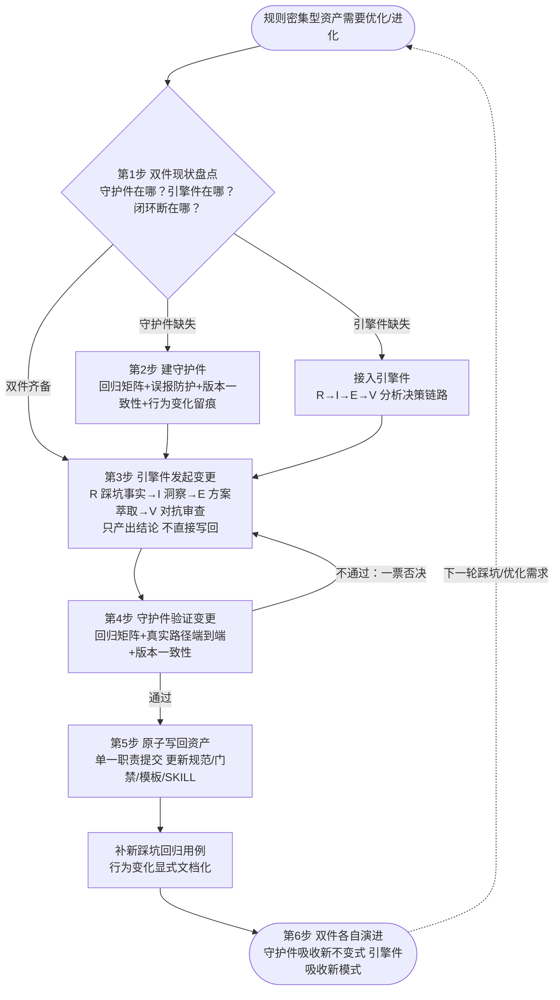

# 治理×引擎双件闭环（Governance × Engine Dual-Component Loop）

## 模式概述

当一个**规则密集型资产**（约定文件、工作区检测器、CI 门禁、装载管道、知识包结构契约等——其行为正确性可被机械判定）需要**持续优化乃至自进化**时，常见失败不是"改不动"，而是两种单件失效：

- **只有引擎没有守护**：变更由分析/决策链路发起并直接写回，未经回归验证——进化即回归风险；
- **只有守护没有引擎**：门禁/约定运转良好，但无任何机制发起改进——资产永不进化，踩坑修复停留在点修复。

本模式要求把优化能力拆为**两个职责正交、可各自演进的工件**：

1. **守护件（Governance Component）**——约定识别/锚点校验/合规路由 + 回归用例矩阵（含误报防护）+ 版本一致性守护 + 行为变化文档化。特征：**进化后仍在**，持续拦截每一次后续变更。
2. **引擎件（Engine Component）**——独立可调用的分析决策方法论（如七概念 R→I→E→V 链路）。特征：**进化前发起**，回答"该不该改、怎么改、学到什么"。

闭环 = **引擎产出 → 守护验证 → 原子写回资产 → 补回归用例 → 行为变化留痕**。

判据只有一句：**这次变更由谁发起、由谁验证、验证不过能不能挡住写回——三个问题都能指认到具体工件，闭环才成立。**

反常识：直觉上"一个工具/技能应端到端全管"；实际上治理工件管流程合规性、不管决策质量，方法论引擎管决策质量、不管回归守护——**单件都不足以构成自进化，组合才闭环**。

### 案例来源（跨案例事实表）

| # | 案例 | 守护件形态 | 引擎件形态 | 闭环转动证据 |
|---|---|---|---|---|
| 1 | **agent-workspace-conventions 技能 × /七概念 组合**（TeleAgent 用户级技能，跨仓库资产；2026-10-21 会话分析） | 工作区约定技能：双信号识别→磁盘强制回读→锚点校验→上下文路由→嵌套就近治理；兼容信号 `roles/`+`skills/` AND 语义；skills-only/roles-only 误报回归用例；行为变化显式文档化要求 | /七概念 元指令：R→I→E→V→C 五链路编排 + G1-G4 质量门 + V 对抗审查门 | 技能内两条**历史进化写回**产物：①通用技能管理器目录误报修复（OR→AND 语义 + 强制回归用例）；②pytest 8.x 连字符目录 importlib 加载器模板（沉淀为 references/testing-nonimportable-packages.md）——均为"踩坑→根因分析→修复→回归用例→模板沉淀"完整链条 |
| 2 | **技能自动装载器 load-flexloop-skills**（SpecWeave，2026-08-07，[复盘报告](../../../reports/feature-development/retrospective-skill-auto-loader-20260807.md)，commit 6fb994c3） | "扫描-解析-验证-缓存-报告"五步管道 + strict/relaxed 双模式验证 + 20 个单元测试 + 单文件错误隔离 + 同名冲突检测——持续守护后续每次技能新增 | 七概念 F→V→I→C 设计链路：第一性原理定义本质五步→对抗审查识别 8 个边界风险（编码错误/frontmatter 缺失/同名冲突/跨平台路径）→洞察复用 `lib/frontmatter.py` 与 `lib/check_skill_quality/`→8 任务原子提交 | vendor/flexloop 技能索引由手动维护转为自动扫描验证注册（31 个技能、20 单测全绿）；I 阶段复用决策使引擎件直接指挥守护件复用既有治理资产 |
| 3 | **awesome-okf-xs UTF-8 损坏治理**（2026-08 下旬） | check-utf8.py 前置完整性门禁（[前置完整性门禁](../preflight-integrity-gate.md)）+ 截断中文字节探针双向验证（[破坏性探针双向验证门禁](../destructive-probe-gate.md)）——CI 持续拦截同类损坏 | 七概念根因分析：12 个 UTF-8 损坏文档于 Sphinx 构建阶段暴露→根因定位→历史基线无损重建（[历史基线文档修复法](../history-based-doc-repair.md)） | 修复→门禁固化→三模式入库沉淀；同类编码损坏从此被 CI 前置拦截，而非等到构建阶段才暴露 |

## 触发场景

**适用于**：

- 资产是**规则密集型**：约定文件（AGENTS.md/CLAUDE.md）、工作区检测器、CI 门禁/lint 规则、装载与验证管道、知识包结构契约——"行为正确"可写成机械判定的不变式。
- 资产需要**持续优化**而非一次性交付：同类踩坑 ≥2 次，存在"修复→防复发"的循环需求。
- 变更发起方（人或 agent）与变更后果之间存在**信任差/时间差**：需要"先验证再写回"，不能裸改。
- 资产由**多个生产者**（多会话/多贡献者）共同演进，回归风险随变更频率上升。

**不适用于**（强行套用只会增加无收益的复杂度）：

1. **一次性交付、无持续迭代需求的资产**——闭环建设成本无法摊薄。
2. **纯创意/探索性资产**（开放式生成、无机械可判定的正确性）——守护件的不变式无从构建。
3. **变更频率极低且变更人即唯一守护人**——双件拆分的管理成本超过收益，单件直改即可。
4. **无任何约定文件的裸仓库**——守护件的治理底座弱化，仅"工程化与误报防护"部分独立成立（见降级路径）。

## 适用前提与边界条件

- 存在**可客观指认的行为不变式**：既有正确行为能写成回归用例、锚点校验或门禁检查——否则守护件空转。
- 存在**可独立调用的引擎件**：七概念或等价的"事实→洞察→萃取→对抗审查"链路；没有引擎件时闭环退化为纯防御，只能防不能进。
- 变更**可原子化提交**：每次写回单一职责、可独立回滚——大变更先拆分（A 原子化）再写回（C 提交）。
- **守护件自身也是规则密集型资产**——优化守护件本身时，本模式递归适用（引擎件分析检测语义为何要改→守护件的既有回归矩阵验证改动不引入误报/漏报）；递归深度通常为一层，再深则收益递减。
- **降级路径**：无约定文件的仓库中，跳过"约定识别/路由"子层，保留"回归矩阵 + 引擎链路 + 原子写回"最小闭环。

## 核心做法（6 步）

### 第 1 步：双件现状盘点

对目标资产回答三问：**守护件在哪**（约定文件？门禁脚本？回归测试矩阵？）、**引擎件在哪**（是否有可调用的分析决策链路？）、**闭环断在哪**（有引擎无守护=进化即回归？有守护无引擎=只守不进？）。多数"优化推不动"的问题，盘点后都能定位到断点。

### 第 2 步：建（或确认）守护件

最小守护件三要素：

| 要素 | 形态 | 检验 |
|---|---|---|
| 行为不变式 | 回归用例矩阵：正例（该判定的必须判定）+ **误报防护用例**（不该判定的必须不判定） | 新踩坑先补用例再修逻辑 |
| 版本一致性 | 资产版本号在多处声明时的一致性守护（plugin.yaml 与常量模块等） | 用测试守护，不靠人工 |
| 行为变化留痕 | README/CHANGELOG 的「行为变化提示」条款 | 语义变化必写，旧语义读者不蒙蔽 |

### 第 3 步：引擎件发起变更

踩坑/优化需求进入引擎链路：R（采集客观事实，剥离因果词）→ I（四元组洞察）→ E（模式/修复方案萃取）→ V（对抗审查，攻击方案与根因）。**引擎件只产出"该怎么改"的结论，不直接写回。**

### 第 4 步：守护件验证变更

变更落地前，守护件全量跑：回归矩阵（含误报防护）+ 真实路径端到端验证（仓库根/嵌套子区/无关目录三类真实环境）+ 版本一致性。**验证不通过则打回引擎件重做**——守护件对引擎件有一票否决权，这是双件正交的关键。

### 第 5 步：原子写回资产

通过验证的变更按单一职责原子提交写回（更新规范/门禁/模板/SKILL 文件），**同时**：新踩坑补进回归矩阵；检测/行为语义变化写入「行为变化提示」；修复类提交标注预防措施。

### 第 6 步：双件各自演进

守护件持续吸收新不变式（每次踩坑=一条新用例）；引擎件持续吸收新分析模式（每次沉淀=方法论资产+1）。两件各自独立演进、在"验证"节点会合——闭环持续转动。

### 核心做法流程图

## 反模式（6 个）

### 反模式 1：只有引擎没有守护——进化即回归

- **来源**：七概念执行原则原文——"V（审查）必须在 C（提交）之前：没有经过对抗的产出，质量门等于虚设"；agent-workspace-conventions 反模式原文——"检测语义变化后不做真实路径回归与文档同步就发布"。
- **后果**：每次"优化"都在赌不破坏既有行为；回归发生后无人能定位是哪次变更引入。
- **正确做法**：变更落地前守护件全量跑（第 4 步），不通过则打回。

### 反模式 2：只有守护没有引擎——只守不进

- **来源**：向日葵系列学习反例（元复盘闭环模式记载）——"没有元复盘环节，写完 Wiki 就结束；改进建议停留在报告中，未执行；同类任务可复用资产积累慢，每次都从零开始"。
- **后果**：门禁良好运转但资产永不进化；踩坑修复停留点修复，同类问题反复出现。
- **正确做法**：踩坑事实进入引擎链路（第 3 步），产出经守护验证后写回（第 5 步）。

### 反模式 3：双件耦合——判断与守护塞进同一工件

- **来源**：agent-workspace-conventions 反模式原文——"把仓库特有细节（特定关键词、锚点）硬编码进检测逻辑而不提取为常量配置"。
- **后果**：任一侧演进都要动另一侧；守护件升级需要"重启"整个工件，回归面不可控。
- **正确做法**：仓库特有细节提取为配置/常量；守护件与引擎件接口化对接（引擎只出结论，守护只出验证结果）。

### 反模式 4：信任内联副本，绕过磁盘回读

- **来源**：agent-workspace-conventions 反模式原文——"信任内联副本/会话摘要而不回读磁盘原文"；SpecWeave 启动协议步骤 1.1 同款强制。
- **后果**：守护件本身被过期副本污染——按过期的约定验证变更，验证形同虚设。
- **正确做法**：守护件执行时强制从磁盘回读权威原文，冲突时以磁盘为准。

### 反模式 5：回归矩阵只测正例，不测误报

- **来源**：agent-workspace-conventions 实测踩坑——通用技能管理器目录 `~/.agents/skills/`（仅含 `skills/`）被 OR 语义判定为工作区，hook 污染所有无关会话；修复为 `roles/` 与 `skills/` AND 语义并**强制补回归用例**（skills-only、roles-only 均不判定）。
- **后果**：守护件自身产生误报，把无关对象拦进来——误报的代价（污染无关会话）可能高于漏报。
- **正确做法**：回归矩阵必须成对建正例与误报防护用例；检测逻辑改动前先补踩坑用例。

### 反模式 6：行为变化不留痕——使用者按旧语义理解新版本

- **来源**：agent-workspace-conventions 设计要点原文——"检测语义变化（如嵌套子工作区由归属外层根改为就近命中）须在 README/ACCESS 写明「行为变化提示」"。
- **后果**：资产语义已变而文档未变，下游使用者（含 agent）按旧语义执行，产生系统性误判。
- **正确做法**：第 5 步写回时行为变化显式文档化，作为原子提交的一部分。

## 早期预警信号

出现以下信号时，应暂停推进回到第 1 步重新盘点双件，而不是继续堆功能：

| 预警信号 | 为什么是信号 | 回到哪一步 |
|---|---|---|
| 优化讨论了多轮但没人说得清"改完怎么验证没改坏" | 守护件缺位 | 第 2 步 |
| 变更清单里混着"判断类改动"与"守护类改动" | 双件耦合 | 第 1 步 |
| 回归测试只覆盖"该报的报了"，没有"不该报的没报" | 误报防护缺位 | 第 2 步 |
| 修复提交后找不到对应新增的回归用例 | 闭环在第 5 步断裂 | 第 5 步 |
| 资产语义变化但 README/CHANGELOG 无记录 | 行为变化留痕缺位 | 第 5 步 |
| 踩坑第二次出现且上次修复没有沉淀任何资产 | 引擎件缺位或未闭环 | 第 3 步 |
| 引擎件产出连续多轮被守护件否决，且否决理由重复 | 守护件不变式本身已过时（过强守护=变相只守不进） | 第 1 步（对守护件本身递归走一轮闭环） |

## 检验标准

- [ ] **Q1 双件可指认**：守护件与引擎件各有明确工件（约定+回归矩阵 / 方法论链路），能回答"这次变更由谁发起、由谁验证"？
- [ ] **Q2 回归前置**：任何写回资产的提交，回归矩阵（含误报防护用例）在提交前全量跑过且全绿？
- [ ] **Q3 否决权真实存在**：守护件验证不通过的变更，历史上确有被打回重做的实例（而非一律放行）？
- [ ] **Q4 原子可回滚**：每次写回单一职责提交，回滚任一提交不破坏闭环其余部分？
- [ ] **Q5 闭环转动证据**：资产提交历史中存在"踩坑→修复→回归用例→沉淀"的完整链条（如 AND 语义修复、pytest 加载器模板）？

## 跨场景迁移示例

### 迁移示例 1：CI 流水线的 lint/门禁体系持续治理（非当前领域）

- **场景**：lint 规则集、CI 校验门禁（格式/编码/依赖合规）随代码库演进需要持续调整。
- **同构点**：守护件=lint 规则集与 CI 门禁（含"合法代码不被误拦"的例外测试用例）；引擎件=违规根因分析链路（为什么违、规则该不该改）。规则变更走"根因分析→规则修改→正例+误报用例双验证→原子提交+变更说明"。
- **可检验差异**：多数团队的 lint 治理止步于守护件（规则加严）而无引擎件（违规根因分析），导致规则越加越多、误报越积越厚——正是本模式反模式 2 与 5 的叠加形态。

### 迁移示例 2：数据库 schema 迁移治理（跨领域）

- **场景**：业务库 schema 需要持续演进（加列/改索引/拆表）。
- **同构点**：守护件=迁移门禁（向后兼容检查、回滚脚本、迁移测试集）；引擎件=变更影响分析（锁表风险、查询计划、数据回填方案）。变更经门禁验证后原子执行，每次事故补进迁移测试集。
- **可检验差异**：缺引擎件的团队"从不改 schema"（只守不进）；缺守护件的团队"改崩生产"（进化即回归）——两个失效形态与本模式预测一致。

### 迁移示例 3：企业合规体系运营（跨出软件领域）

- **场景**：法规更新驱动的企业合规检查表持续修订。
- **同构点**：守护件=合规检查表与审计流程（持续拦截违规行为）；引擎件=法规差异分析与风险评估（决定检查表怎么改）。每次监管处罚/审计发现→根因分析→检查表修订→新旧条款变更通告。
- **可检验差异**：合规体系的"行为变化留痕"对应法规通告（rule change notice），是本模式第 5 步在非软件域的等价物。

## 与现有模式的关系

| 相关模式 | 关系 | 辨析 |
|---|---|---|
| [评测驱动的自进化闭环](../concepts/evaluation-driven-self-evolution.md) | 亲缘·不同轴 | 该模式是**评测数据飞轮**（标注→双 Agent 优化→评测→标注量下降），双 Agent 为两个优化引擎；本模式是**能力职责架构**（守护×引擎两件分工），关注优化能力如何组织而非数据如何回灌 |
| [不确定性探索+确定性校验双引擎](../concepts/dual-engine-uncertainty-certainty.md) | 亲缘·机制不同 | 该模式是**并行双通道 Diff 校验**（两引擎同任务独立处理，一致才通过）；本模式是**串行职责分工**（引擎产出→守护验证→写回），双件处理的是同一变更的不同阶段 |
| [治理外环包裹业务内环](../../architecture-patterns/governance-outer-ring.md) | 上位·静态 vs 动态 | 该模式是**运行时架构分层原则**（治理外环先行设计）；本模式是**演进期变更组织机制**（每轮变更怎么跑），可视为外环原则投影到"变更流程"维度的落地件 |
| [质量资产沉淀闭环](quality-asset-accumulation-loop.md) | 互补·生产线 vs 组织架构 | 该模式定义"问题→六类资产"的**转化生产线**；本模式定义生产线上**两个组织角色**（谁发起、谁验收）与闭环机制 |
| [规范自举性驱动持续演化](bootstrap-driven-self-evolution.md) | 衔接·阶段 vs 执行 | 该模式回答"**何时**进入持续演化"（自举点五维判断）；本模式回答"持续演化中**每轮变更如何组织**"——自举后的执行机制 |
| [元复盘闭环](meta-retrospective-closed-loop.md) | 互补·引擎件自强化 | 该模式是交付后对复盘本身的复盘（语义层审查→纠偏→工具化），属引擎件的自我强化；不涉及双件架构分层 |
| [前置完整性门禁](../preflight-integrity-gate.md) / [破坏性探针双向验证门禁](../destructive-probe-gate.md) / [历史基线文档修复法](../history-based-doc-repair.md) | 案例支撑 | 案例 3（awesome-okf-xs UTF-8 治理）中守护件与引擎件的具体形态 |

## 验证来源

| 证据 | 内容 | 位置 |
|---|---|---|
| 案例 1：技能原文 + 进化写回证据 | 双信号/锚点校验/路由治理定义；AND 语义误报修复（含强制回归用例）；pytest 8.x 加载器模板；行为变化文档化要求 | TeleAgent 用户级技能 `agent-workspace-conventions`（SKILL.md + references/testing-nonimportable-packages.md，跨仓库资产，非本仓库相对路径） |
| 案例 1：组合分析 | 守护件（治理底座）×引擎件（分析决策）职责分层的识别过程，2026-10-21 会话 | 本模式萃取会话（七概念知识沉淀链路 R→I→E→V→C） |
| 案例 2：技能自动装载器 | F→V→I→C 引擎链路产出五步验证管道守护件；20 单测全绿；commit 6fb994c3 | [技能自动装载器复盘报告](../../../reports/feature-development/retrospective-skill-auto-loader-20260807.md) |
| 案例 3：UTF-8 损坏治理 | 12 个损坏文档→根因分析→历史基线修复→check-utf8 前置门禁 + 探针双向验证固化 | [前置完整性门禁](../preflight-integrity-gate.md)、[历史基线文档修复法](../history-based-doc-repair.md)、[破坏性探针双向验证门禁](../destructive-probe-gate.md) |
| 方法论底座 | 七概念编排、G1-G4 质量门、V 对抗审查门、执行原则（V 先于 C 等） | [七概念方法论编排指令集](../../../../../.agents/commands/seven-concepts.md)、[萃取指令集](../../../../../.agents/commands/extraction.md) |

> **反面证据说明**：案例 1 的两条历史进化写回证据来自技能原文的自我记载（"实测踩坑，必须回归"标注），本模式未追溯其原始提交记录独立复核；采用者若需强证据，可按 Q5 检验标准在自有资产上验证闭环转动证据。

## 关联资源

- [七概念方法论编排指令集](../../../../../.agents/commands/seven-concepts.md)——引擎件的标准实现（R/F/I/E/V/A/C 编排 + G1-G4 质量门）
- [萃取指令集](../../../../../.agents/commands/extraction.md)——本模式入库所遵循的萃取规范与模板
- [质量资产沉淀闭环](quality-asset-accumulation-loop.md)——闭环中"沉淀"环节的资产转化生产线
- [规范自举性驱动持续演化](bootstrap-driven-self-evolution.md)——本模式所处"持续演化阶段"的阶段管理上位模式
- [元复盘闭环](meta-retrospective-closed-loop.md)——引擎件交付后自我强化的配套机制
- [方法论模式库索引](../index.md)——本模式的入库位置

> AI生成
