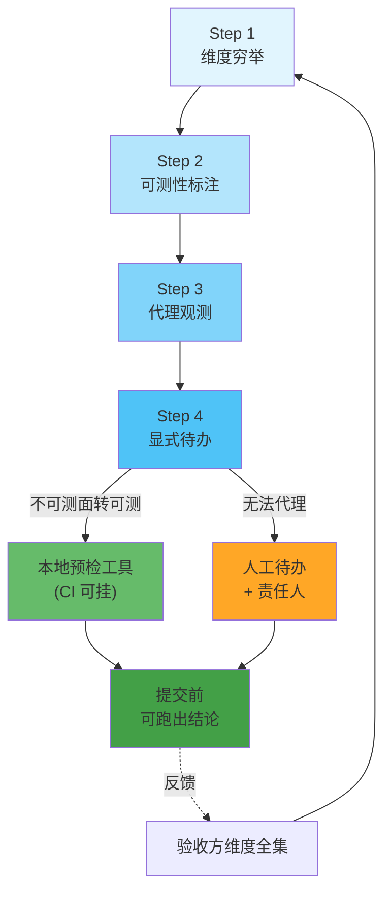

# 本地不可自测面的显式立项

## 模型概述
当交付物需要经过**外部主体**的审核或验收（平台审核、应用市场、监管报送、合作方验收）时，
总有一批验收维度在本地**无法观测**——它们不在代码里、不影响任何本地测试的通过与否。
本模式提供四步立项法，把这批维度从「隐含盲区」变成「显式待办」，避免用一次外部提交去试错。

## 核心原则
**验证范围的边界，比验证深度更决定成败。**
一个不在验证范围内的面，查得再细也是零价值。
上一轮对某微信小程序的复盘做了 46 文件逐行审阅、27 条对抗审查发现、
数据面 HTTP 实测、78 项测试全绿——全部通过，提审仍被拒，
因为拦截项落在「平台侧声明面」，而上一轮所有验证手段都落在「运行时数据面」。

## 四步立项法

| 步骤 | 名称 | 目标 | 关键产出 |
|---|---|---|---|
| Step 1 | 维度穷举 | 列出验收方会检查的**全部**维度 | 验收维度清单 |
| Step 2 | 可测性标注 | 对每个维度标注「可自测 / 不可自测」 | 可测性矩阵 |
| Step 3 | 代理观测 | 为不可自测面寻找**本地代理观测手段** | 代理检查器 / 静态扫描器 |
| Step 4 | 显式待办 | 无法代理的，写进交付清单并指定责任人 | 待办清单 + 责任归属 |

## 流程图

## 实施步骤详解

### Step 1：维度穷举
- **输入**：验收方的规则文本（平台审核条款、市场审核指南、合同验收标准）。
- **动作**：把规则文本**逐条**拆成可检查的维度。不要按「我能不能测」筛——
  筛选发生在 Step 2，不是在这一步。
- **产出**：验收维度清单，每条含「维度名 / 规则出处 / 检查形态」。
- **陷阱**：只列「功能是否符合规则」这类总括项。要拆到
  「声明了哪些信息类型」「接口调用是否与声明一致」这种可判粒度。

### Step 2：可测性标注
- **动作**：对每个维度打标——
  - `可自测`：本地有等价物（写个脚本能验）；
  - `可代理`：本地不可直接观测，但能从代码/配置**推出**验收方会看到什么；
  - `不可测`：既无等价物也无法推出（如平台后台表单内容）。
- **产出**：可测性矩阵。
- **反模式**：把「不可测」直接标成「已覆盖」。
  这会把人工待办伪装成已完成项——比漏做更危险。

### Step 3：代理观测
- **核心手法**：**从代码推出验收方的比对依据**。
  实证案例：平台审核比对的是「本次提审版本的隐私接口调用情况」与
  「已填写的隐私协议所声明的信息类型」的**逐项比对**。
  既然比对的是代码里调了什么，那么**代码就是协议清单的事实来源**——
  由此可写出静态扫描器，把「不可测」转成「可测」。
- **产出**：本地预检工具（只读、可挂 CI、重复执行结果一致）。
- **关键设计**：只对**结构上必然触发拦截**的判 FAIL；
  依赖运行时上下文的判 WARN 要求人工确认。
  **误报比漏报更伤**——满屏告警的工具会被直接弃用。

### Step 4：显式待办
- **动作**：Step 3 无法代理的维度，写进交付清单，**指明责任方与操作入口**。
- **产出**：待办清单。
- **关键细节**：待办要写**操作入口**而不只是「要去填一下」。
  实证案例中最高频的返工是「被拦截后去改了入口1（现网版本）」——
  而官方明确要求「若提审版本时被拦截，请在入口2 更新」。

## 反模式库

| 反模式 | 表现 | 后果 |
|---|---|---|
| 只测能测的 | 全部验证集中在可自测面 | 不可测面永远排在范围外 |
| 伪装成已完成 | 把人工待办写进「已完成」清单 | 交付物自欺，且无人真正执行 |
| 待办不写入口 | 只写「需完善协议」 | 执行方改错入口，返工 |
| 代理观测过度自信 | 把「相关」当「等价」 | 代理工具给出假绿灯 |
| 忽略规则变更 | 映射表硬编码且无失效自检 | 官方改措辞后工具静默失准 |

## 迁移验证
本模式不限于代码。对外文档、投稿材料、报销单据、开源发布的 LICENSE 标注、
跨团队的接口契约交付，都是同构的「外部验收面」。

## 实证来源
2026-10-26 微信小程序提审被拒（拦截类型「收集你选中的照片或视频信息」），
萃取为 Skill `.agents/skills/platform-review-precheck/`。
详见 [复盘报告](../../../reports/2026-10-26-platform-review-precheck-retro.md)。
