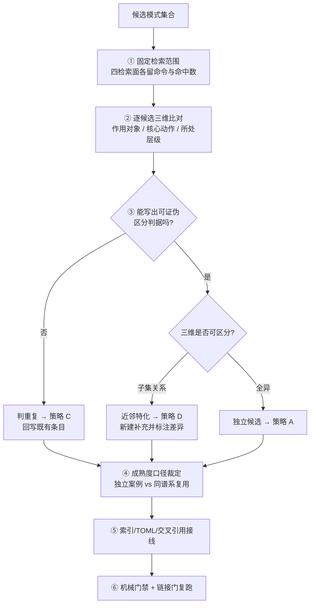

# 模式入库三维去重裁决（Three-Axis Dedup Ruling for Pattern Intake）

## 模式类型

方法论模式（知识治理 / 元层裁决）。作用于**萃取完成（E）之后、正式入库之前**，回答的是「这个候选该不该成为一个新条目」，而不是「这个条目该怎么写」。

> **为什么定位在元层？** 业务层模式回答「怎么做」，本模式回答「这条知识在库里应该以什么形态存在」。二者的作用对象不同：前者是任务，后者是**候选条目与既有模式库的关系**。

## 成熟度

- **等级**：L1-draft（机器字段 `maturity: "L1"` + 语义字段 `maturity_level: "L1-draft"`）
- **验证次数**：`validation_count = 1`，仅表示完成一次方法抽取，**不表示结果已被独立验证**
- **复用次数**：`reuse_count = 0`
- **升级条件**：第二个**非同谱系**案例完整应用（例如 Skill 库或检查清单库的批量入库裁决）并复盘 → L1.5；另需一次独立第三方复核 → L2-validated
- **证据性质**：本次案例含 1 个真实失败侧记录（上一轮漏裁）与 1 次正向应用（本次复核），两者同仓同谱系；迁移示例均为同构推演、未实测

> **为什么同时写两个成熟度字段？** 库内既有惯例以 `maturity` 承担机器可校验的等级阶梯、`maturity_level` 承载细粒度语义。草案态不应污染等级统计，也不应丢失「尚未验证」这一关键信息。

## 适用场景

**适用于**：

- 向已有一定规模（经验阈值约 50 条目，非测量值）的模式库、Skill 库、检查清单库新增条目；
- 一次入库涉及**多个候选**，需要批量判定「重复 / 特化 / 互补 / 独立」；
- 候选来自复盘萃取，其「新颖性」由作者自述而非由库内比对支撑；
- 库内已存在「前置查重」流程，但去重结论仍靠主观相似度判断。

**不适用于**：

- 空库或极小库的首次入库（无既有条目可比，三维表退化为形式）；
- 单个明确全新的主题，且已通过全库检索确认零命中；
- 只做草稿归档、不进入正式索引的临时笔记；
- 需要判定的是「结论能覆盖多大」而非「两个条目是否重复」——那属于 [核验范围限定](verification-scope-bounding.md)。

## 问题背景

2026-11-06 的一次里程碑复盘申报了 1 个新模式 `shared-index-atomic-extension`（L1-draft），并在「去重裁决（G3）」章节比对了 5 项资产后判定不重复。同一会话的下一轮「模式沉淀」在重跑启动协议、重查 Git 状态与全库 `git grep` 后发现：同仓模式库中存在 4 项成熟度更高、主题更贴近的既有资产未被纳入比对集合——其中 `shared-index-count-coupling` 为 L2（3 次验证、3 次复用、1 例跨领域迁移），`bp-nav-co-registration` 为 L1.5（含「存在 ≠ 可达」公理与跨领域迁移表）。

按三维复核，原申报的 4 条洞察中，2 条与既有模式三维全同，1 条是既有「重执行 + 状态审计」的子集，1 条主题不属于该族。最终独立入库声称被撤销，改为既有模式的验证案例回写。

根因不在对抗审查强度：上一轮 V 门有 6 条具体意见、采纳 5 条，仍无法发现检索集合之外的资产。**去重裁决的质量由检索范围决定，而不是由审查强度决定**；而既有「前置查重与分层沉淀工作流」虽给出 A~E 五种处置策略，其 Step 1 清单只问「有没有相同主题 / 部分覆盖 / 质量如何」，未给出「两个候选算不算同一个模式」的可判定标准。

> **为什么把「可证伪判据」设为核心？** 「看起来像」不可复核，第三人无法给出相反结论。只有写成「在情形 X 下，模式 A 与模式 B 会给出不同结论」，去重裁决才可被质疑、被推翻、被复算。

## 核心规则

### 规则 1：先固定检索范围，再谈比对

入库前必须逐项执行并留痕（命令 + 命中数 + 日期）：

| # | 检索面 | 目的 |
|---|---|---|
| 1 | 三个 Skill 根 + 工作区 `.agents/skills` | 排除执行层同名资产 |
| 2 | 目标库各分类子目录的文件名与 toctree | 排除分类错位的同名模式 |
| 3 | 全库 `git grep`（候选名 + 核心概念 + 别名） | 捕获跨目录、跨文档类型的近邻 |
| 4 | 复盘报告与对话记录中**内嵌**但未独立入库的模式段落 | 捕获「报告里有、索引里没有」的隐性资产 |

**裁决表须逐项标注来源与检索命令**；未执行的检索面写「未执行」，不得留空。

### 规则 2：三维比对，逐候选出表

| 维度 | 提问 | 判定要点 |
|---|---|---|
| 作用对象 | 这个模式作用于什么实体？ | 内容产物 / 索引计数 / 结论口径 / 候选条目本身 |
| 核心动作 | 它要求执行者做什么？ | 同步登记 / 并批裁决 / 重跑取证 / 生成判据 |
| 所处层级 | 它在流程的哪一段生效？ | 生成管线 / 提交决策 / 状态审计 / E 之后入库之前 |

三维全同判**重复**；两维同、一维为「子集关系」判**近邻特化**；三维可区分判**独立候选**。

### 规则 3：每条「不重复」裁定必须附可证伪区分判据

句式固定为：「在 <可观察情形> 下，模式 A 与模式 B 会给出不同结论：A 要求 …，B 要求 …」。
**写不出这条判据，即默认判重复**——举证责任在申报方，不在库。

### 规则 4：裁决结果直接映射到 A~E 分层沉淀策略

| 裁决 | 策略 | 动作 |
|---|---|---|
| 重复 | **C 更新已有** | 追加验证/复用案例，不新建条目；`validation_count` 仅在独立案例时增加 |
| 近邻特化 | **D 新增补充** | 新建文档须在开头写明角度差异，并链接上位模式 |
| 三维独立 | **A 新建完整文档** | 按标准模板入库 |
| 主题不同族 | **另案** | 不并入本次主题，登记为待办 |
| 既有条目过时 | **E 重构** | 保留历史版本，changelog 留痕 |

### 规则 5：成熟度按证据计数，不按工作量计数

同仓库、同工具链、同谱系的复用只进 `reuse_count`；`validation_count` 仅在**独立案例**时增加。回写既有条目时写明「改了什么、没改什么、为什么」。

> **为什么把成熟度写进裁决模式？** 误把复用计入独立验证，会让等级阶梯逐步失去区分力，且后续所有基于成熟度的取舍都建立在被稀释的计数上。这是去重裁决的下游后果，必须在同一环节收口。

## 操作流程

## 实施检查清单

- [ ] 四个检索面均已执行，裁决表标注了命令、命中数与取数日期
- [ ] 每个候选都有三维比对行，无空项、无「感觉不同」类表述
- [ ] 每条「不重复」裁定都附有「在情形 X 下给出不同结论」的可证伪判据
- [ ] 写不出判据的候选已默认判重复，未以「换个说法」为由保留
- [ ] 每个候选已映射到 A~E 之一，且动作与裁决一致
- [ ] 回写既有条目时未改写其既有正文与历史案例
- [ ] `validation_count` 只因独立案例增加；同谱系复用仅进 `reuse_count`
- [ ] 新建补充文档已在开头标注角度差异并链接上位模式
- [ ] 索引、toctree、TOML 元数据与交叉引用已同步接线
- [ ] 已声明历史门禁基线，未把「不新增违规」写成「门禁通过」

## 正例

**本次复核（2026-11-06）**：第 1 步重跑启动协议并重查 Git 状态，发现主仓 HEAD 由上一轮记录的 `d609277de` 变为 `523c4cdf7`；第 3 步全库 `git grep` 命中 `shared-index-count-coupling.md` 等 4 项上一轮未纳入的资产；第 2 步对 4 条洞察逐条出三维表，判定 2 条重复、1 条近邻特化、1 条另案；第 4 步按策略 C 回写 3 个既有模式、按策略 D 新建 1 个窄补充；第 5 步统一裁定「同谱系复用只进 `reuse_count`」。全过程未新增与既有模式重叠的独立条目。

**裁决动作本身通过三维检验**：作用对象是「候选条目 × 既有模式库」，核心动作是「生成可证伪判据 → 选策略」，层级是「E 之后入库之前」；与既有分层沉淀工作流（给策略矩阵）可区分。

## 失败案例

**上一轮里程碑复盘的去重漏裁（2026-11-06，同日）**：§3.2「去重裁决（G3）」仅比对 5 项资产，其中 3 项为 Skill、2 项为治理策略模式；未执行「目标库各分类子目录遍历」与「复盘报告内嵌模式检索」两个检索面。对照库内实际资产：

| 漏项 | 成熟度 | 与候选的重叠面 |
|---|---|---|
| `shared-index-count-coupling` | L2（3 验证 / 3 复用） | 五面耦合清单、并批裁决、干净检出、零耦合面案例 |
| `bp-nav-co-registration` | L1.5（2 验证） | 「存在 ≠ 可达」公理、toctree 幂等登记、门禁增量=0 |
| `pre-check-duplication-layered-sedimentation` | L1 | A~E 策略矩阵本身 |
| 道家复盘内嵌模式 1 / 2 | 报告内 | 目录树实测优先、共享索引竞态防护 |

结果：把已被覆盖的洞察申报为「1 个新模式 L1-draft」。该条目随后被写盘为 Skill 包并经质量门 100/100——**说明机械质量门无法替代语义去重**。修正方式为撤销独立入库声称、保留 Skill 作为执行层资产并补来源声明。

## 反例警示

| 反模式 | 表现 | 后果 | 纠正 |
|---|---|---|---|
| 只在 Skill 层查重 | 查三个根就宣布「无同名」 | 漏掉 `docs/` 下的模式库与报告内嵌模式 | 执行四检索面，逐面留痕 |
| 以标题差异判独立 | 「名字不一样，所以是新模式」 | 同一公理在库内多份并存，维护分叉 | 三维比对 + 可证伪判据 |
| 用审查强度替代检索覆盖 | V 门意见很多但候选集合很小 | 盲区被误当作已验证 | 先扩检索范围，再开 V 门 |
| 复用计入独立验证 | 每次用一次就 `validation_count + 1` | 成熟度阶梯失去区分力 | 同谱系复用只进 `reuse_count` |
| 撤销声称时删除已交付资产 | 为「纠正」而删掉用户已确认的 Skill | 破坏交付连续性与可追溯性 | 保留资产、重定位、补勘误与原快照声明 |
| 裁决表只写结论 | 无命令、无命中数、无取数日期 | 第三人无法复算，结论不可审计 | 每面标注命令、命中数与日期 |

## 反目标用户/场景

| 对象 | 为何不适用 | 应改用 |
|---|---|---|
| **空库首次入库者** | 无既有条目可比，三维表全为空，登记成本高于收益 | 直接按模板新建，仅记录一次全库检索为零命中 |
| **单文件草稿归档者** | 草稿不进正式索引，不产生库内重复 | 只留最小版本号，无需裁决表 |
| **需要判定结论覆盖范围者** | 问题域是「这份证据能支持多大的话」，不是「两个条目是否重复」 | [核验范围限定](verification-scope-bounding.md) |
| **只做格式/命名合规检查者** | 检查对象是可机械判定的字段，语义三维无对应物 | 命名审计与格式证据优先流程 |
| **赶工期的单次小改动** | 四维检索 + 三维表成本超过改动本身 | 最小闭环：全库 `git grep` 一次 + 一句「无近邻」留痕 |

## 早期预警信号

以下预警信号累计出现两项及以上时，判定去重裁决高危，须回到第 1 步重做检索：

1. **预警信号**：去重裁决表里的资产全部来自同一目录或同一资产类型（例如全是 Skill）。
2. **预警信号**：「不重复」的理由写成「角度不同」「更完整」「这次是 XX 场景」，没有可证伪句式。
3. **预警信号**：候选模式的成熟度高于库内同主题既有模式。
4. **预警信号**：V 门意见很多，但没有一条攻击「是否与库内既有资产重复」。
5. **预警信号**：一次复盘同时申报多个新模式，而检索命令只有一条关键词。
6. **预警信号**：回写既有条目时顺手把 `validation_count` 也加了 1，却说不出新增的独立案例是什么。

## 适用边界与前提条件

**成立前提（缺一即降级或停用）**：

1. 存在**可被检索的既有条目集合**；集合为空或不可枚举时三维表无意义。
2. 候选来自萃取或自述新颖性，**未经库内比对**；已由生成器独占写入的条目不需要语义去重。
3. 库内存在**处置策略**（至少「新建 / 更新」二选一）；无策略体系时裁决结果无处落地。
4. 检索命令与命中数可留痕；无法复算的场景（无版本控制、无全文检索）只能退化为人工清单。
5. 裁决者能区分「独立案例」与「同谱系复用」；否则成熟度口径不可裁定。

**边界（本模式不做的事）**：不判断候选模式**内容是否正确**（那是 V 门与事实核验）；不生成模式正文（那是萃取与知识沉淀指令集）；不替代机械质量门（质量门查结构，本模式查语义重复）；不提升既有条目的证据质量，只决定它以什么形态入库。

## 检验标准

1. **可复算**：第三人仅凭裁决表的命令与命中数，能重建同一比对集合。
2. **可证伪**：每条「不重复」裁定都能举出一个使两个模式给出不同结论的可观察情形。
3. **无重叠新增**：入库后，库内不存在与既有条目三维全同的独立条目。
4. **成熟度未被稀释**：所有回写的 `validation_count` 增量都能指认一个独立案例。
5. **资产连续**：撤销声称未删除任何已交付资产，原快照陈述与勘误可双向追溯。
6. **门禁诚实**：报告区分「历史基线」「本次新增」「未执行」，未把「不新增违规」写成「通过」。

## 迁移示例

- **Skill 库入库**：候选 Skill 与既有 Skill 比对「触发对象 / 决策树动作 / 生效阶段」三维；若仅触发词不同、决策树相同，判重复并合并触发词而非新建包。**同构推演，未实测。**
- **检查清单库入库**：按「检查对象 / 判定动作 / 所处流水线阶段」三维，区分「同一检查点的表述细化」与「新检查点」。**同构推演，未实测。**
- **代码模式库入库**：按「作用对象 / 重构动作 / 抽象层级」三维，防止同一重构手法以不同语言名义重复入库。**同构推演，未实测。**

## 与现有模式的关系

| 相关模式 | 关系 | 划界 |
|---|---|---|
| [前置查重与分层沉淀工作流](../retrospective-knowledge/pre-check-duplication-layered-sedimentation.md) | **前置环节 vs 策略选择**：上下游，不吞并 | 对方给「查重 → A~E 策略」的流程与分层模型；本模式补 **Step 1 到 Step 2 之间**缺失的「两个候选算不算重复」判据。可证伪判据见「适用边界」：库中全部情形都能靠单条目相似度清单处理时，本模式退化为冗余 |
| [核验范围限定](verification-scope-bounding.md) | **不同问题域** | 对方管「一条结论能覆盖多大」（四要素）；本模式管「两个条目是否重复」（三维）。对方文档中的「去重判定」章节是**单次入库记录**，不是可复用的批量裁决规则；只需为单个条目写一段去重说明时不适用本模式 |
| [生成-登记同步法](../concepts/nav-co-registration.md) | **裁决对象示例** | 本次复核中被判「三维全同」的既有上位模式，作为失败案例的对照资产，不是本模式的组成 |
| [共享索引计数耦合与同批判决](shared-index-count-coupling.md) | **裁决对象示例** | 同上；其 L2 成熟度与三次验证构成「候选成熟度不得高于既有同主题模式」预警信号的实证 |
| [Context 恢复协议重执行](../ai-collaboration/context-recovery-protocol.md) | **上游触发** | 本次复核在收到会话摘要后重跑启动协议与状态审计，才重新打开检索范围；对方管「恢复时重建全局上下文」，本模式管「恢复后如何裁决候选」 |

## 沉淀与校验记录

- **会话**：`sc-20261106-pattern-sedimentation`（2026-11-06，`R→I→E→V→入库`，C 未执行）。
- **来源**：[模式沉淀复核裁定报告](../../../reports/knowledge-content/pattern-sedimentation-dedup-ruling-20261106.md)，34 条事实（PF-01~PF-34）/ 4 条四元组洞察 / 6 条对抗审查（采纳 5、部分采纳 1）。
- **去重裁定**：对 5 个候选逐条三维比对，4 个判重复 / 近邻特化 / 另案，1 个（裁决动作本身）判独立；与本模式「与现有模式的关系」表逐行一致。
- **V 门性质**：沉淀侧自审，**非独立第三方验证**；条目未经独立复算，不宣称任何结论已被外部验证。
- **未验证项**：跨项目迁移示例均为同构推演，未实测；`validation_count = 1` 仅表示完成一次方法抽取。
- **启动协议**：本次按 `AGENTS.md` 步骤 1.1 从磁盘回读并确认三锚点，按步骤 2.0 判定「模式沉淀」不命中 vendor 方法论资产，按步骤 2.3 判定 Public、产出物落根 `docs/`。

## 复用记录（2026-11-06，同日第二次）

**会话**：`sc-20261106-examples-pattern-sedimentation`（`/七概念 ...examples 模式沉淀`）。本模式被完整复用一次：对 `ai-comic-drama-opc-transition/examples/` 的 5 个候选增量执行四检索面留痕、三维比对、4 条可证伪区分判据与 A~E 策略映射，裁定 4 个候选判重复 / 已占用 / 近邻特化 / 标准做法、1 个判独立并按策略 A 新建 [抽象概念落地的假设替换链](../research-knowledge/assumption-substitution-for-abstraction.md)。依据 [examples 模式沉淀裁定报告](../../../reports/knowledge-content/pattern-sedimentation-examples-assumption-substitution-20261106.md) §3。

**本次复用暴露的边界**：规则 3 的「写不出可证伪判据即默认判重复」在候选与并行会话资产重叠时仍需先做「另案结案裁定」——否则会出现两个会话分别申报同一命题却不互相引用。该处置记入裁定报告 §3.1，不改变本模式正文规则。

**成熟度口径**：`reuse_count` 0→1；`validation_count` 保持 1、成熟度保持 L1-draft。本次为同仓、同方法论、同谱系复用（与上一轮相邻日期），且 V 门为沉淀侧自审，**不计为独立验证**，不满足 §成熟度「第二个非同谱系案例」的升级条件。

## 关联资源

- [裁定报告](../../../reports/knowledge-content/pattern-sedimentation-dedup-ruling-20261106.md)
- [examples 模式沉淀裁定报告（复用记录）](../../../reports/knowledge-content/pattern-sedimentation-examples-assumption-substitution-20261106.md)
- [七概念方法论编排](../../../../../.agents/commands/seven-concepts.md)
- [知识沉淀指令集](../../../../../.agents/commands/knowledge-sedimentation.md)
- [萃取指令集](../../../../../.agents/commands/extraction.md)
