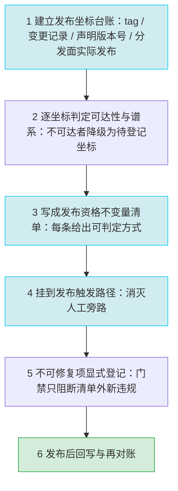

# 发布资格不变量与发布路径对账

## 模式类型

方法论模式 → 治理策略（发布资格判定、版本坐标对账与发布触发路径治理）

## 成熟度

L1（`maturity_level` = L1-draft；单案例：mystx 主题包，2026-10-22 全面复盘；validation_count = 1，reuse_count = 0）。
案例内可对账的载体形态多样（git tag / 变更记录 / 包元数据 / PyPI / GitHub Releases / CI workflow），
但均为同一发布线的同谱系证据；跨生态第二次验证缺失，故不高于 L1。

## 一句话

把「什么可以被发布」写成一份可判定的**发布资格不变量清单**，挂在**发布触发路径**上消灭人工旁路，
并对版本坐标四元组（标签 / 变更记录 / 声明版本号 / 分发面实际发布坐标）逐次发布对账；
不可修复的历史断层改为**显式登记**，登记量随版本单调不增。

## 适用场景

**适用于：**

同时出现以下三类信号时启用（任一单项不足以触发）：

1. **版本坐标彼此不闭合**——版本序列跳号、变更记录只覆盖最后一版、标签有而分发面无或分发面有而标签无；
2. **标签指向不可达历史且分属多条谱系**——部分标签不在当前发布线的祖先集合内，且无任何失效声明；
3. **发布决策与质量关卡不相交**——唯一会失败的高标准关卡不在发布触发路径上，发布由人工事件触发。

**不适用于：**

- 无对外发布物的内部库（无「发布资格」可判定）；
- 发布物由外部平台全权托管、仓库内不保留版本坐标的项目；
- 已建立完整发布流水线且不变量集合已被机器执行、仅需局部参数调整的项目——此时本模式退化为
  「维护不变量清单 + 审计已有流水线」，不新建发布 job。

## 问题背景

「发布」在一个仓库里通常是一个**按钮**：在平台上点一次 Release，包就出现在分发面上。
但「什么可以被发布」本身从未被写成任何可执行的不变量——没有清单、没有判定方式、没有机器执行。
其后果是三处错位可以在同一个公开发布物上长期并存而无人负责：

1. **版本坐标四者互相不闭合**。仓库标签、变更记录、包声明版本号、分发面实际发布坐标是四份独立演化的副本，
   没有任何机制要求它们一致。差集一旦产生就会随版本累积，且不产生任何告警。
2. **标签存在 ≠ 可追溯**。标签若分属多条被「重置」过的谱系，则 `git bisect` 一类依赖单一祖先链的定位手段失效，
   「有标签」的表象掩盖了「无法定位到主线提交」的事实。
3. **质量关卡与发布动作不相交**。项目里可能存在一个标准很高、会因告警而失败的门禁，
   但它不在发布触发路径上；发布路径上的检查回答的是「代码风格是否合规 / 页面能否构建」，
   而不是「这次发布是否满足契约」。发布资格由此被降级为构建可用性。

## 核心做法（6 步）

**① 建立「发布坐标台账」，把四类载体并列成一张可重算的表**

- 列出全部版本标签及其指向提交，并标出版本序列缺号；
- 列出变更记录覆盖的版本集合（区分「已发布条目」与「未发布段」是否存在）；
- 列出声明版本号的推导来源与 fallback 链；
- 列出**分发面实际发布坐标**：包索引的版本集合与 latest、Release 页的条目集合与 prerelease / draft 标记，
  以及「tag 有而分发面无」和「分发面有而 tag 无」两个方向的差集；
- **可执行判据**：任何一次发布评审开始前这张台账必须已存在，且可由脚本重算（不是人工誊抄的表格）。

**② 逐坐标判定「可达性 / 谱系」，把不可达坐标从「有效版本」降级为「待登记的历史坐标」**

- 逐个校验标签是否为发布分支 HEAD 的祖先，并区分「不可达」与「缺号」两类不同性质的缺口；
- **建立谱系映射**：逐标签取谱系根提交并记录其 subject 与日期，把全部标签归入谱系；
  同时确认旧谱系仍是同一项目（读取旧谱系的包元数据自证项目身份），以此区分「谱系分裂」与「同名不同物」；
- 量化当前发布线与最近标签的距离，确认「发布坐标描述」与「实际指针」一致；
- **可执行判据**：每一个不可达坐标都必须给出原因（历史重建 / 脱敏 / 历史替换 / 已被项目重置取代）与影响面；
  没有原因的不可达坐标本身即构成发布资格违规。

**③ 把「什么可以被发布」写成可判定的发布资格不变量清单**

最小不变量集（每条附判定方式与本案例依据）：

| # | 不变量 | 判定方式 | 本案例依据 |
|---|---|---|---|
| I-1 | 标签可达性 | 发布坐标必须是发布分支 HEAD 的祖先 | F-011 |
| I-2 | 版本序列连续性 | 相邻版本号不得跳号，例外须登记 | F-009 |
| I-3 | 变更记录存在性 | 每个 tag 有对应变更记录条目，且保留未发布段 | F-071、F-072 |
| I-4 | 声明版本一致 | 包元数据版本 == tag 版本号 == 变更记录条目版本 | F-019、F-042 |
| I-5 | 成熟度分类一致 | `Development Status` 与版本阶段匹配 | F-018（`3 - Alpha` 与仓库 tag 已达 v0.3.8 并存） |
| I-6 | 行为级关卡在发布路径上 | 发布触发链中存在测试执行步骤，失败即阻断 | F-049、F-054、F-059 |
| I-7 | 发布动作自身可复现 | 发布工作流的 action ref 必须钉版本 | F-058（`@main` / `@unstable/v1`） |
| I-8 | 最新 tag 在分发面可安装且可下载 | 最新 tag 的版本号在 PyPI JSON API 返回 HTTP 200 且 `info.version` 一致；GitHub Releases 侧存在同名 Release 条目 | F-092（latest = 0.3.7）、F-093（`0.3.8` 返回 HTTP 404）、F-094（Releases 无 v0.3.8）、F-097（仓库最新 tag v0.3.8 未出现在任何分发面） |

- **可执行判据**：不变量集合以可执行检查（脚本 / workflow job / 门禁）形式存在，而不是文档里的一串条目；
  每条不变量都能被一条命令判定通过或失败。

**④ 把不变量清单挂到发布触发路径上，消灭人工旁路**

- 发布资格校验与发布动作处于**同一条触发链**：发布触发由「人工点一次 Release」改为「标签推送 + 不变量校验通过」；
- 质量关卡收敛为发布路径上的单一关卡序列（lint + 测试执行 + 覆盖率下限 + 产物校验 + 版本不变量），
  把唯一的高标准关卡降为附加关卡而非唯一关卡；
- **可执行判据**：存在一次「故意让某条不变量失败 → 发布被阻断」的验证证据；
  只测放行不测拦截的门禁等于不存在。

**⑤ 不可修复项显式登记（豁免清单），门禁只对清单外的新违规阻断**

- 豁免项须按**性质**分列，不同性质给不同对策，不可合并为「历史问题」一栏：
  - **已被「项目重置」取代的谱系**——对策：给出谱系映射表，声明每条旧谱系的根提交、覆盖的标签与
    「该谱系已被重置取代」的结论；此类项**不设到期条件**，因其在语义上已被新谱系取代，
    只要求声明存在且可查；
  - **真正不可修复的历史断链**（无「项目重置」根、无法以重置解释的祖先关系断裂）——对策：登记坐标、原因、
    影响面、**到期条件**与对齐方式，到期即回到阻断态；
  - **版本缺号**与**变更记录缺口**——同样登记到期条件与对齐方式；
  - 两类方向相反的发布坐标缺口须分列：①「tag 有而分发面无」——按可发布性违规处理，**不进豁免清单**；
    ②「分发面有而 tag 无」——登记为「补 tag 或撤销发布」的显式决策项，带到期条件；
- 登记字段：坐标、原因、影响面、到期条件、对齐方式；
- **可执行判据**：豁免必须显式列出条目与到期条件；不得以「关闭检查」「调低阈值」实现豁免；
  登记量随版本推进**单调不增**。

**⑥ 发布后回写与再对账**

- 恢复「每次发布更新变更记录 + 保留未发布段」的仪式，发布后重新对账标签集合与变更记录集合；
- 用消费侧坐标交叉验证：用父仓 submodule status 的版本描述与本地标签语义核对，
  确认发布坐标在下游也一致；
- **可执行判据**：发布后重跑步骤 ① 的台账重算，差集必须为空（除已登记豁免项）。

## 反模式（看起来对，但会失败）

- ❌ **「有 tag 就算有可追溯版本」**——标签排列整齐、版本号语义清晰、检索得到，
  但标签可能分属多条独立谱系且多数不在 HEAD 祖先集合内；`git bisect` 依赖单一祖先链，跨谱系历史不可用，
  无法把 issue 定位到主线提交（版本差异仍可用 `git diff <tag> HEAD` 比对，轻量标签更不承载任何说明）。
- ❌ **「变更记录写了最新一版就算有变更记录」**——文件存在、格式规范、含最近一次发布的条目，
  但其余已打标签的版本在变更记录中无对应条目，用户无法判断升级会带来哪些行为变化。
- ❌ **「发布是人工动作，人工自然会记得」**——人工触发天然带审计记录，
  但它是**未校验旁路**，绕过了全部不变量；配合浮动 ref，发布内容本身不可复现。
- ❌ **「高标准关卡存在就有质量保证」**——存在一个会把告警当失败的严格关卡、标准看起来不低，
  但它不在发布路径上、不阻断包分发；发布路径上的工作流无任何测试执行，
  全部测试对发布决策零约束。
- ❌ **「CI 里已有检查就等于发布资格检查」**——CI 每天在跑、每次都绿，
  但风格检查与产物存在性校验回答的是「代码风格是否合规 / 页面能否构建出来」，
  不是「这次发布是否满足契约」。
- ❌ **「版本号自动推导，所以不用对账」**——版本来自 git 推导，天然与提交一致，
  但推导只保证「同一次构建内一致」，不保证「跨载体一致」；非 git 推导环境会落到字符串兜底版本，
  并与包索引上的版本并存且无告警。
- ❌ **「历史问题以后再说，先把新版本发出去」**——断层与缺号是存量问题、与本次发布无关，
  但缺口会被下一轮发布继承并扩大，且因无登记台账，任何一次发布都无法判定「还剩多少欠账」。

## 检验标准

| # | 成功信号 | 判定方式 |
|---|---|---|
| 1 | **坐标四元组零差集** | 一次发布动作后：变更记录条目集合 ⊇ tag 集合，且每个 tag 可达发布分支 HEAD，声明版本号 == tag 版本号，且最新 tag 在分发面可安装（索引 API 返回 200 且版本号一致、Release 存在同名条目） |
| 2 | **发布资格与发布动作同一触发链** | 任意一次发布若绕过不变量清单即失败；不存在人工旁路可跳过校验 |
| 3 | **行为级关卡在发布路径上** | 发布触发链中存在测试执行步骤，且该步骤失败会阻断发布 |
| 4 | **豁免登记量单调不增** | 已登记豁免项逐条可见、带到期条件；每次发布后重算，豁免总数不增加 |
| 5 | **跨生态可迁移（形式不变）** | 把同一不变量清单套到容器镜像标签 / 站点版本号 / 数据库迁移编号上，上述 1~4 的判定形式不变 |

## 迁移示例

- **容器镜像发布**：镜像 tag 与摘要、镜像仓库实际清单、发布清单声明的版本、变更日志四者对账；
  「最新 tag 可拉取」对应 I-8，「镜像构建 workflow 的 base ref 是否钉版本」对应 I-7。
- **站点 / 前端版本发布**：静态站点的版本号声明、部署清单、CD 产物名、发布说明四者对账；
  「构建是否在部署触发链上」对应 I-6。
- **数据库迁移编号**：迁移脚本编号连续性（I-2）与已应用版本登记（I-3）的对账。
- **待验证方向**：多包仓库的单仓多包发布坐标合并治理。

## 案例证据（mystx）

- **坐标不闭合**：13 个 tag 中不存在 `v0.3.5` / `v0.3.6`（F-009）；变更记录仅 `v0.3.8` 一个条目、
  无未发布段，13 个 tag 中 12 个无对应条目（F-071、F-072）；包索引实发 9 个版本、latest 为 0.3.7，
  `0.3.6` 返回 200 而仓库无 `v0.3.6` tag、`0.3.5` 与 `0.3.8` 返回 404（F-092、F-093）；
  Release 页实测 11 条、无 v0.3.5 / v0.3.6 / v0.3.8（F-094）；仓库最新 tag `v0.3.8` 未出现在任何分发面（F-097）。
- **标签不可达且分属多谱系**：13 个 tag 全为轻量 tag（F-010）；`v0.1.1`~`v0.3.4` 共 11 个 tag 均非 HEAD 祖先
  （F-011）；13 个 tag 分属 6 条互相独立的谱系、每条谱系根提交 subject 均为「项目重置」（F-089），
  旧谱系仍是同一 mystx 项目（F-090）；发布线已领先最近标签 6 提交（F-012、F-014）。
- **发布决策与质量关卡不相交**：发布工作流由「Release published」事件触发且 action ref 浮动（F-058）；
  CI 侧只有风格检查与产物存在性校验（F-055、F-056）；三个 workflow 无任何测试执行，
  51 个测试仅以本地 pre-commit hook 形式存在（F-049、F-054、F-059）；
  唯一会因文档告警而失败的高标准关卡不在发布路径上（F-060、F-061）。
- **声明版本推导存在兜底**：版本号由 git 推导，运行时三级 fallback 末级为字符串兜底版本（F-019、F-042）。
- **成熟度分类滞后**：包元数据仍标 `Development Status :: 3 - Alpha`，与已达 v0.3.8 并存（F-018）。

## 失败案例：mystx 发布坐标的四处断裂

本模式来自 mystx 的一次**真实失败**，不是假设：

| 断裂 | 事实依据 | 对消费者的实际后果 |
|---|---|---|
| 最新 tag 不存在于任何分发面 | F-093（`0.3.8` 在包索引返回 404）、F-094（GitHub Releases 无 v0.3.8）、F-097 | 仓库宣告「最新版本 v0.3.8」，用户按 tag 安装却拿不到该版本，只能退到 0.3.7 |
| 分发面存在仓库没有的版本 | F-092（包索引实发 9 个版本、latest 0.3.7）、F-093（`0.3.6` 返回 200 而仓库无 `v0.3.6` tag） | 安装到的版本无法在仓库找到对应源码与变更说明，问题无法定位 |
| 变更记录只覆盖一版 | F-071（仅 `v0.3.8` 一个条目、无 Unreleased 段）、F-072（13 个 tag 中 12 个无条目） | 升级者无法判断行为变化与破坏性改动 |
| 标签不可达且跨 6 条谱系 | F-010（全为轻量 tag）、F-011（11 个非 HEAD 祖先）、F-089（6 条谱系根均为「项目重置」） | `git bisect` 与「从 tag 定位主线提交」失效，缺陷回溯只能靠人工 |

**失败根因**不是「发布时点错按钮」，而是**发布资格从未被写成可执行不变量**：
四个坐标（tag / 变更记录 / 声明版本号 / 分发面）各自演化、无人对账；
发布路径上没有测试执行（F-049、F-054、F-059），唯一会失败的文档关卡又不在发布链上（F-060、F-061）。

## 反目标用户与场景

本模式并非「所有项目都该建发布门禁」。以下 4 类场景**不适用**，套用只会产出高维护成本的空转门禁：

| # | 反目标用户/场景 | 为什么不适用 | 应改用什么 |
|---|---|---|---|
| 1 | 无对外发布物的内部库、一次性脚本 | 没有「发布资格」可判定，四类坐标不存在或无需对账 | 不适用；用常规 CI 即可 |
| 2 | 发布物由外部平台全权托管、仓库内不保留版本坐标 | 无坐标台账可重算，步骤 ① 无法落地 | 不适用；改用平台侧发布审计 |
| 3 | 已建立完整发布流水线、不变量已被机器执行的项目 | 新建清单是重复建设，只会产出第二份手工副本 | 仅做**审计**：核对其不变量是否覆盖 I-1~I-8 |
| 4 | 单人实验仓库、无下游消费者、发布频次极低 | 台账与门禁的维护成本高于断裂代价 | **不推荐**上机器门禁；保留一份人工发布检查单即可 |

此外，若旧谱系因脱敏或重建确实无法追溯，也**不适用**「补齐全部不变量」的目标，
应走步骤 ⑤ 的显式登记出口，而不是强行修复历史。

## 早期预警信号

出现以下任一**预警信号**时，应暂停下一次发布并先重建坐标台账（而不是「先把新版本发出去」）：

| # | 预警信号 | 判定方式 |
|---|---|---|
| 1 | 最新 tag 与分发面 latest 不一致 | 对比 `git describe --tags` 与包索引 JSON 的 `info.version`，不一致即预警 |
| 2 | 分发面出现仓库无对应 tag 的版本 | 包索引版本集合 − 仓库 tag 集合 ≠ ∅ |
| 3 | 变更记录条目数少于 tag 数 | 统计变更记录版本标题数与 tag 数 |
| 4 | 发布工作流使用浮动 action ref | 扫描发布 workflow 的 `uses:` 是否含 `@main` / `@unstable` 等浮动引用 |
| 5 | 发布触发链中无测试执行 | 发布 workflow 的 job 列表中没有 pytest 或测试步骤 |
| 6 | 发布前未做过「故意失败 → 被阻断」验证 | 门禁只有放行记录，没有拦截记录 |

其中第 1、2 条是**红旗级**信号：一旦出现，说明「已发布」与「可追溯」已经脱钩，应按失败案例处置。

## 失效条件与演进

- **登记不是免责**：登记机制只保证「欠账可见且有到期条件」，不保证欠账被偿还；
  若豁免清单无强制到期机制，本模式退化为一份新的登记表。
- **不覆盖「发布物本身正确性」**：本模式只保证「发布资格可判定、坐标可对账」，
  不保证被发布物功能正确——后者属行为级关卡范畴，须与不变量 I-6 一并落地。
- **台账维护成本随发布频次增长**：单次发布频次极高的项目，台账需自动化重算，
  否则本模式自身会变成新的手工重复声明面。
- **对「有意保留不可达历史」的项目不适用**：若旧版本因脱敏 / 重建确实无法追溯，
  正确做法是发布显式声明而非补齐不变量；步骤 ⑤ 提供该出口，但不应被误读为「所有缺口都要修」。
- **前提与失效后果**见下方「适用边界与前提条件」。

### 适用边界与前提条件

| 前提 | 若不成立 | 后果 |
|---|---|---|
| 仓库内保留版本坐标（tag / 变更记录 / 声明版本号） | 无坐标可对账 | 退化为「无发布物的内部库」，应停用 |
| 发布动作可在仓库内被触发或被门禁观察 | 人工旁路不可消除 | 步骤 ④ 失效，模式只剩登记价值 |
| 存在可重算的坐标来源（git / 清单文件） | 台账只能人工誊抄 | 步骤 ① 与步骤 ⑥ 退化为手工仪式，重新产生漂移 |
| 项目已有等效的发布流水线 | — | 模式转为**审计已有流水线**（核对不变量是否齐备），不新建 job |

- **成熟度演进**：出现第二个**非同谱系**案例（如容器镜像发布或站点版本发布）后可升 L2。

## 参考实现与关联

- **来源复盘**：mystx 全面复盘（2026-10-22）E 阶段模式萃取与去重裁决，
  来源洞察为 I-1（发布可追溯性契约缺位）+ I-3（质量门禁与发布流程解耦），
  事实依据为 F-001~F-097；
- **存在性 vs 可达性对照**：[ledger-stock-consistency-audit](ledger-stock-consistency-audit.md)
  ——它判「在不在」（幽灵登记 / 影子资产），本模式判「坐标是否可达发布线、是否可发布」；
- **权威维度对照**：[cross-platform-gate-authority](cross-platform-gate-authority.md)
  ——它的权威对象是**平台**，本模式的权威对象是**发布路径**；
- **门禁分层近邻**：[quality-assurance-three-layer-model](quality-assurance-three-layer-model.md)
  ——质量保证的三层分工，可作为不变量清单落地的分层参照；
- **规则可执行化近邻**：[three-layer-rule-enforcement](three-layer-rule-enforcement.md)
  ——「定义 + 痕迹 + 验证」三层落地，与不变量「每条能被一条命令判定」的要求同源；
- **共享计数同批判决近邻**：[shared-index-count-coupling](shared-index-count-coupling.md)
  ——多位置重复计数时的同批提交裁决，可参考其同批处理纪律。
