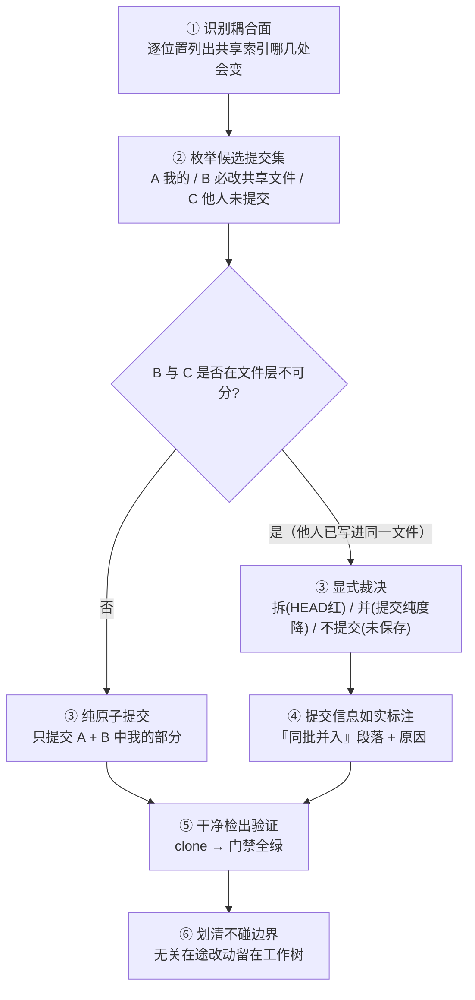

# 共享索引计数耦合与同批判决

## 模式类型

治理模式（L2 领域通用）。适用于「目录树派生型共享索引 + 多会话并行写入」的组合。

## 成熟度

**L2-validated**——3 个独立案例（awesome-okf-xs 子模块的三次提交），另完成 1 例跨领域迁移验证（CI 矩阵文件）。验证次数 3，复用次数 3。

## 问题背景

大多数知识库/文档树都有一个**共享索引**（总览页 + 导航表），其中写着「当前共 N 个条目」「本组 M 个子目录」这类计数，而计数是从**目录树**派生出来的。这带来一个平时不显眼的耦合：

> **新增一个条目，不是改一个地方，而是改共享索引的多个位置**——frontmatter 计数、正文计数行、章节标题、分组表束数列、toctree 条目。漏改任何一处，门禁红。

再叠上「多会话并行写同一仓库」，两个目标就直接冲突：

- **原子提交原则**要求「一次提交只做一件事」；
- **CI 门禁**要求「提交后 HEAD 是绿的」。

当别人的未提交改动与你的必需改动**落在同一批共享文件**里时，这两条无法同时满足：拆开提交 → HEAD 断链；合并提交 → 一次提交承载两件事。

这不是可以靠「更小心」绕过的——它每次都会出现，而每次都要临场拍一次板。

## 适用场景

- 当你新增/移动/删除一个条目，而它必然要改动**一个由目录树派生的共享索引**时，使用这个模式。
- 适用于：
  - 共享索引的条目数/计数在**多个位置**重复出现；
  - 目录树是计数的**唯一地面真值**（门禁从树反推，索引只是投影）；
  - 同一仓库有并行会话的**未提交改动**落在同一批共享文件上。
- **不适用于**：
  - 共享索引的条目由人工维护、与目录树无派生关系（改一条只改一处，无耦合）；
  - 没有并行会话（自己一个人的工作树，拆开提交即可，HEAD 绿不冲突）；
  - 提交历史由 squash/merge 策略统一处理、根本不做原子提交的仓库。

## 核心做法（操作流程）



### 1. 识别耦合面（不要凭直觉）

**逐位置列出**「新增一个条目会让共享索引的哪几处发生变化」。典型知识库索引至少有五面：

| 面 | 位置 | 漏了会怎样 |
|---|---|---|
| ① frontmatter 计数 | `total_bundles:` / `groups:` / `domains:` | 门禁报「计数漂移」 |
| ② 正文计数行 | 「当前共 **N** 个知识包……」 | 门禁报「计数漂移」 |
| ③ 域节标题 | 「### 技术 · N 束 · M 组」 | 门禁报「节标题与树不一致」 |
| ④ 分组表束数列 | 每行一个「N」 | 门禁报「分组表束数列之和 ≠ 树实际」 |
| ⑤ toctree 条目 | 隐藏 toctree 里的索引项 | 新条目不可达，或旧条目成孤儿 |

> **为什么？** 五面里漏任何一面，CI 都会拦，但报错信息指向的是「计数不一致」而不是「你漏改了第 4 面」——**先列清单再动手，比事后读门禁报错快得多**。

### 2. 枚举候选提交集

把三类东西分开列：

| 类别 | 内容 | 归属 |
|---|---|---|
| A 我的产物 | 新增的条目目录、它自己的 index/log | 我 |
| B 我必须改的共享文件 | 上面五面所在的文件 | 我（但可能同时含他人改动） |
| C 他人未提交的产物 | 别的会话新建/修改的条目 | 他人 |

**关键判断**：B 类文件里若含 C 类内容（他人已把他们的注册写进同一个共享文件），则**我的改动与他们的改动在文件层面已经不可分**——此时无论怎么拆分暂存，提交出去的都是混合物。

### 3. 显式裁决（不要静默处理）

这是一个**需要人类裁决**的岔路口，不是技术判断。三个选项及其代价：

| 选项 | 结果 | 代价 |
|---|---|---|
| **拆**：只提交 A + B 中我的部分 | HEAD 断链（toctree 指向不存在的条目 / 计数与树不一致） | CI 红；需后续补一次提交修复 |
| **并**：提交 A + B + C | HEAD 绿 | 一次提交承载两件不相干的事；**必须在提交信息里如实标注** |
| **不提交**：保留工作树 | 工作树绿、HEAD 红 | 未提交状态易丢失；CI 仍红 |

裁决原则：**仓库绿 > 提交纯度**——但**纯度损失必须留痕**。无法当场问人类时，按「并 + 留痕」执行，并在报告中显式声明同批内容与原因。

### 4. 提交信息如实标注同批内容

不要让提交信息与内容不符。标准写法：

```text
<type>(<scope>): <主体变更的 why>

<主体变更的详细说明>

同批提交并入并行会话的未提交 WIP（共享索引的计数相互依赖，
拆分会令 HEAD 出现断链）：
- <他方产物及其内容>
- <他方在共享索引里的注册>
```

> **为什么？** 这段话把「提交纯度损失」变成一条可被 code review 看见、可被 `git log` 检索的显式记录，而不是一个只有作者知道的秘密。**没有这段话，一次并批就是一次历史污染。**

### 5. 干净检出验证（唯一可信的结论）

提交后**必须**在干净检出上跑门禁：

```sh
git clone --no-hardlinks --depth 1 <repo> <tmp> && cd <tmp>
python scripts/check-<gate>.py        # 计数对账
python scripts/check-toctrees.py      # 导航完整性
```

工作树是绿的**不能证明** HEAD 是绿的——工作树里可能还有未提交内容，CI 看不到它们。

### 6. 划清「不要碰」的边界

同批提交**只应包含耦合所必需的内容**。与他事无关的在途改动（例如另一个束的 `log.md` 增补）**留在工作树不提交**。判据：**它是否参与了那几处共享计数/引用？** 不参与就不并入。

## 实施检查清单

- [ ] 动手前已列出共享索引的**全部**耦合位置清单（至少五面），并逐项确认
- [ ] 候选提交集已按「A 我的 / B 必改共享文件 / C 他人未提交」三类列清
- [ ] 已判断 B 与 C 在**文件层面**是否不可分（决定是纯原子提交还是并批）
- [ ] 若并批：提交信息含**「同批并入」段落**，写明他方内容与**为什么必须同批**
- [ ] 若并批：只并入**参与耦合**的内容，无关在途改动留在工作树
- [ ] 目录树与共享索引**同一次变更**落地（不做「先加目录、后改计数」）
- [ ] **干净检出**上的门禁全绿（不是只跑工作树）
- [ ] 提交后工作树与 HEAD 的差异只剩**明确声明过的**无关在途改动

## 正例与反例对照

| 维度 | 正例 | 反例 |
|---|---|---|
| 耦合面 | 动手前列清单，逐面打勾 | 改到哪算哪，门禁报错才回头找漏的那面 |
| 冲突处理 | 显式裁决 + 提交信息留痕 | 默默扫进别人 WIP，提交信息只写自己的 |
| 提交纯度 | 零耦合时（案例 B）保持 100% 纯度 | 无视耦合面，一律并批 |
| 索引与树 | 同一次变更落地 | 先加目录后改计数，中间态留在历史里 |
| 验证对象 | 干净检出 | 工作树 |
| 无关改动 | 留在工作树并在报告里说明 | 一并扫入 |

## 反例警示（反模式）

| # | 反模式 | 表现 | 后果 | 正确做法 |
|---|---|---|---|---|
| 1 | **为保「单一职责」硬拆提交** | 只提交自己的文件，共享文件里别人的注册一并留下 | HEAD 断链：toctree 指向不存在的条目、计数与树不一致，CI 红 | 拆或并都行，但**必须让 HEAD 绿**；选并时如实标注 |
| 2 | **默默把别人 WIP 扫进自己的提交** | 暂存时 `git add <目录>` 顺手带进一堆文件 | 提交信息与内容不符；他人无法知道自己的改动去哪了；历史不可审计 | 显式列出文件；提交信息写「同批并入」段落与原因 |
| 3 | **默默不提交** | 工作树绿着不动 | 未提交状态随时可能丢；CI 在干净检出上红，而本地看不出来 | 要么提交（并 + 留痕），要么明确记为待办并在报告里说明 |
| 4 | **改了共享索引却没改目录树**（或反之） | 只改索引数字，或只加目录 | 计数漂移：门禁报「索引声明 N，树实际 N+1」 | 目录树与索引**同一次变更**落地，且过门禁 |
| 5 | **只改五面中的三四面** | 漏掉 toctree 或漏掉分组表某一行 | 新条目不可达 / 旧条目成孤儿 | 动手前先列五面清单，逐面打勾 |
| 6 | **用工作树的绿替代干净检出的绿** | 在工作树跑一遍门禁就交付 | 竞态下 HEAD 缺一环，CI 拦截而本地无感 | 交付前做一次干净检出门禁 |
| 7 | **把并批当常态而不标注** | 每次都把别人的东西扫进来，提交信息只写自己的 | 历史逐渐不可信，review 失效 | 并批必须是**例外且被标注**的；出现频繁说明共享索引设计需要改（拆分或自动化） |

## 迁移验证

**跨领域场景**：把本模式用到**非文档树**的「共享汇总表 + 并行写入者」场景。

**验证案例**：CI 矩阵配置文件（`ci/matrix.yaml`）集中列出全部任务与依赖，而多个开发分支/智能体分支同时往同一仓库加任务。

- **耦合面**：矩阵文件的任务数、依赖边数、生成的汇总表行数三处；
- **冲突表现**：分支 A 加了任务并更新了矩阵计数，分支 B 也加了任务并更新了同一处计数 → 合并时计数错位，CI 报「任务数与定义不符」或「依赖解析失败」；
- **裁决**：把「矩阵条目 + 任务定义 + 汇总表」作为一个**不可分单元**同批合入，提交信息标注两方来源；
- **验证**：在**合并后的干净检出**上跑矩阵解析 + 一轮最小任务集，确认条目数、依赖闭合与可调度性都成立。

与文档树场景完全同构：**共享汇总表是投影，定义是地面真值，两者必须同批落地**。

## 案例与验证记录

| 案例 | 场景 | 耦合面 | 裁决与结果 |
|---|---|---|---|
| 案例 A | awesome-okf-xs 子模块新增 XERJ 知识包 | 总索引五面 + `frameworks/index.md` + `ai/index.md` + `jishu/index.md` + `practice/index.md`；并行会话另有未提交的 `jishu/iac` 新分组与 `jishu/terminal/opentui` 新束，其注册也落在同一批文件 | 裁决为「并 + 留痕」：一次提交含 84 个文件，提交信息写明同批并入内容与原因；干净检出后 654 束 / 63 组五面一致、toctree 全可达 |
| 案例 B | 同仓第二处：XERJ 束第二轮增量（**仅束内文件**，不触碰任何共享索引） | 零耦合面（束已注册，文档数变化不进入索引计数） | 可纯原子提交：14 个文件全部落在 `frameworks/xerj/` 内，暂存集零外部文件——**证明「零耦合面」时提交纯度可以完全保住** |
| 案例 C | 同仓第三处：新增 XERJ × DeepSeek 对比束 | 同案例 A 的五面 + `practice/index.md`（束数 22→23、目录数 20→21） | 裁决为「并 + 留痕」：29 个文件（含并行会话的 `deepseek-v41-flash-1017` 束 11 文件），提交信息如实标注；干净检出 656 束 / 63 组五面一致 |

## 与现有模式的关系

- [提交质量门与暂存检查](./commit-quality-gate-staging-inspection.md)——提交前的暂存集核验环节
- [会话边界提交](./session-boundary-commit.md)——何时该切一次提交
- [双模式子模块治理](./dual-mode-submodule-governance.md)——子模块内开发与主仓指针的分工
- [子模块 Git 三禁令](../ai-collaboration/subagent-git-three-prohibitions.md)——子模块内的提交禁令
- [不许碰清单](./no-touch-list.md)——显式声明不参与本次变更的文件
- [台账与实物一致性审计](./ledger-stock-consistency-audit.md)——「投影 vs 地面真值」这一族模式的通用形态
