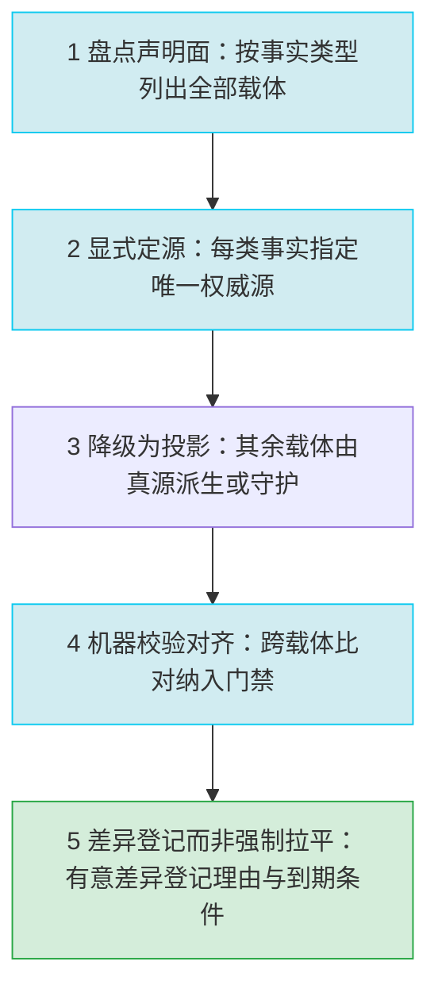

# 单一权威源与多载体声明面对齐

## 模式类型

方法论模式 → 治理策略（声明面真源指定、跨载体一致性对账与差异登记）

## 成熟度

L1（`maturity_level` = L1-draft；单案例：mystx 主题包，2026-10-22 全面复盘；validation_count = 1，reuse_count = 0）。
案例覆盖异构声明面（构建清单 / pre-commit 配置 / README / 变更记录 / 贡献指南 / 环境定义 / 运行时元数据），
但均属同一项目的同一谱系；跨项目验证缺失，故不高于 L1。

## 一句话

同一事实被多个载体手工重复声明时，**冗余不是缺陷，缺少真源才是缺陷**：
先显式指定唯一权威源，其余载体降级为**投影**并由机器校验对齐，
载体间的差异必须**登记理由**而非强制拉平。

## 适用场景

**适用于：**

1. 同一约束在 **≥2 个载体**被声明，且未指定其中任何一个为权威源；
2. 载体之间的同一数值**已经分叉**（依赖集合、工具版本与参数、路径写法、格式规则等）；
3. 门禁集合**只覆盖代码与产物**，不覆盖载体间一致性——即「一致性靠人工记忆维持」。

**不适用于：**

- 事实只有单一载体、无需对齐的场合（无声明面可治）；
- 载体之间的差异是**产品设计意图**（如面向不同消费者的两套依赖组、区域生态差异）——
  此时应显式登记为「有意差异」，而不是强行拉平或把其中一方删除；
- 需要的是「单点变更后的多点同步」而非「先定源再对齐」的场景——
  那属于 [version-ripple-grep-sweep](version-ripple-grep-sweep.md) 的事后清扫范畴。

## 问题背景

一个仓库里，同一条约束往往同时出现在多处：依赖清单与依赖组、构建配置与 pre-commit 配置、
README 与变更记录与贡献指南、包元数据与运行时环境定义。这些载体各自面向不同读者，
**重复声明本身是合理的**（读者不该去翻配置文件才能知道怎么装）。

但重复声明一旦**没有真源**，就退化为 N 份手工副本：任何一次修改都要求 N 处同步，
而门禁只检查代码风格与产物能否构建，不检查副本之间是否一致——于是分叉在无人察觉的情况下累积。
其典型形态有三种：

- **同一机制两套写法**：同一份依赖既声明为可安装附加组、又声明为开发依赖组，两侧逐项重复填写；
- **同一参数两个值**：一处按旧规范写行宽上限，另一处按新规范写，行长判定标准随文件而异；
- **声明与实体不符**：文档声明的依赖 / 路径 / 命令在仓库中并不存在，读者照做即踩空。

根因不是「复制粘贴」，而是**没有裁决机制**：当同一事实被 N 处表达而无一处被指定为真源时，
一致性的维持就退化为记忆问题。

## 核心做法（5 步）

**① 盘点声明面，把「同一事实被声明了几次」列成表**

- 按**事实类型**分组列出全部载体：依赖集合、版本声明、工具链命令与参数、目录布局、成熟度分类、许可与归属；
- 每一类事实登记「在哪些载体被声明、当前各载体的取值是否一致」；
- **可执行判据**：存在一张可重算的声明面台账，能回答「这条约束到底被写了几遍、哪几遍已经不一致」。

**② 显式定源：每一类事实指定唯一权威源，其余载体降级为投影**

- 权威源优先选择**机器可读的构建产物**（构建清单、CI 配置），而非叙述性文档；
- 权威源一经指定即写入可查位置（如贡献指南或声明面台账），**不留成口头共识**；
- 投影载体的合法地位被显式承认——它面向不同读者而存在，不因「是副本」而被判为缺陷；
- **可执行判据**：每一类事实都能指认唯一权威源，且该指认在仓库内可查。

**③ 把投影载体尽量改为派生，或至少纳入守护**

- 能派生的改为由真源生成（文档片段由清单生成、徽章由标签生成）；
- 无法派生的（叙述性段落、面向特定读者的示例）保留手工，但必须进入下一步的校验范围；
- **可执行判据**：新增载体时必须同时回答「我投影的是哪条事实、权威源在哪」。

**④ 机器校验对齐：把跨载体一致性做成门禁项**

- 校验项按「事实类型 × 载体对」组织，逐对给出判定方式（集合相等 / 数值相等 / 路径存在 / 关键词命中）；
- 校验项必须与「故意改一处副本 → 校验失败」一起被验证过，只测放行不测拦截的门禁等于不存在；
- **可执行判据**：存在一条命令可判定「声明面是否自洽」，且该命令在 CI 中执行。

**⑤ 差异登记而非强制拉平**

- 载体间不一致时先分类：**投影滞后**（应修——副本没跟上真源）与**有意差异**（应登记——面向不同消费者的设计差异）；
- 有意差异登记：事实项、涉及的载体对、差异理由、影响面、到期条件；
- 冗余载体本身不作为缺陷处理；**缺真源**才是缺陷；
- **可执行判据**：未登记差异数 = 0，或每一差异均有登记条目与理由；登记量随版本推进单调不增。

## 反模式（看起来对，但会失败）

- ❌ **「重复声明本身就是缺陷，应该合并成一处」**——重复面向不同读者时是合理的；
  真正的问题是缺真源。删掉一份副本只会让该读者失去可读信息。
- ❌ **「强制所有载体完全一致」**——面向不同消费者的载体存在合法差异，
  强行拉平会破坏设计意图；正确做法是登记理由，而不是消灭差异。
- ❌ **「先改了再 Grep 清扫其余副本就行」**——这是**反应式**清扫，默认「改动的那一处是源」；
  真源尚未指定时，清扫只是把「谁碰过谁负责」的偶然顺序固化下来。
- ❌ **「指定了真源就完事了」**——没有机器校验时，一致性仍靠人工记忆维持，
  下一次改动照样会分叉；定源只解决「谁是权威」，不解决「是否还对齐」。
- ❌ **「门禁只检查代码与产物就够了」**——风格检查与构建校验不覆盖「文档声明 vs 仓库实体」，
  漂移恰好在门禁视野之外累积。
- ❌ **「差异被发现就当场改掉，不要留登记」**——登记的是**有意差异**；
  把有意差异当成待修项处理，会在下一次同步时被无声改回。

## 检验标准

| # | 成功信号 | 判定方式 |
|---|---|---|
| 1 | **每类事实恰有权威源** | 声明面台账逐类核对，每条事实可指认唯一权威源，且指认在仓库内可查 |
| 2 | **对齐由机器判定** | 存在跨载体一致性检查项，故意改一处副本 → 检查失败（拦截而非放行） |
| 3 | **未登记差异数 = 0** | 每次对账后，载体间差异要么已修复，要么有登记条目（事实项 / 载体对 / 理由 / 影响面 / 到期条件） |
| 4 | **副本不再增加** | 声明面台账中「同一事实被声明的载体数」不随版本增长；新增载体须说明其投影对象与权威源 |
| 5 | **跨项目可迁移（形式不变）** | 把同一「定源 → 投影 → 校验 → 登记」四段式套到依赖声明、版本声明、工具参数声明等不同事实类型上，判定形式不变 |

## 迁移示例

- **构建清单作为依赖真源**：依赖集在构建清单中声明一次；面向用户的附加组、面向开发工具的依赖组、
  conda 环境定义、README 安装说明均降级为投影；两侧集合差异须登记或由清单派生。
- **标签作为版本真源**：版本号只在标签产生；包元数据、变更记录条目、文档徽章、
  运行时 `__version__` 均为投影，发布时由机器回写并对账。
- **单一工具配置作为格式真源**：行宽上限、目标 Python 版本、格式化工具版本只在配置中声明一次；
  pre-commit / lint / format 三处不再各自复述数值。
- **前端工程**：包清单为依赖真源；脚手架模板、CI 安装脚本、贡献指南为投影。

## 案例证据（mystx）

- **依赖声明双轨**：可安装附加组含 6 组（docs 25 / test 4 / lint 4 / build 2 / tasks 2 / dev 21），
  开发依赖组含 6 组（dev 11 / docs 25 / test 4 / lint 4 / build 2 / tasks 2），
  五个组两侧条目集合逐项完全一致，唯 dev 组不一致（F-025、F-026、F-027、F-028）。
- **dev 组分叉已发生**：附加组侧显式列出 21 个包，依赖组侧为 11 项 = 5 个组引用 + 6 个显式包；
  两侧 dev 组展开并集为 42 项，附加组侧 21 项与之不相等（F-085、F-086、F-087）。
- **构建配置内重复**：`version_file` 与 `write_to` 同时声明并指向同一版本文件路径，
  该文件存在于工作区磁盘但未被 git 跟踪且被 `.gitignore` 显式排除（F-021、F-022）。
- **任务入口重复**：仓库根 `tasks.py` 与包内 `src/mystx/tasks/` 并存（F-041、F-052）。
- **冗余空壳资产**：`src/mystx/tools/__init__.py` 为 0 字节空文件，全仓检索无任何引用（F-039）。
- **工具约束重复且已分叉**：pre-commit 中行宽上限为 100，而项目格式与静态检查配置为 120
  （F-063、F-031、F-033）；pre-commit 中工具版本与目标 Python 版本（3.10）与项目声明（3.14）不一致
  （F-064、F-017）。
- **文档声明与实现不符**：README「核心依赖」5 项与构建清单中空依赖声明矛盾（F-066、F-024）；
  版本下界写法不一致（F-067）；README 示例中的本地化目录路径在仓库全目录检索命中数为 0（F-069、F-073）；
  贡献指南 124 行中工具链与测试命令六关键词命中数为 0（F-082）；
  变更记录 12 个已打标签版本无对应条目（F-071、F-072）。
- **门禁不覆盖载体一致性**：门禁集合只有风格检查与产物存在性校验，
  无任何一项比对两处依赖段或各处工具版本参数（F-035、F-036、F-055、F-056）。

## 失败案例：mystx 声明面分叉

本模式来自 mystx 的一次**真实失败**——分叉已经在仓库中存在，但没有任何门禁或读者在第一时间察觉：

| 分叉 | 事实依据 | 实际后果 |
|---|---|---|
| dev 依赖组两处声明不一致 | 附加组 21 个包 vs 依赖组 11 项（5 组引用 + 6 显式包），并集 42 项（F-085、F-086、F-087） | 按其中一处安装得到的开发环境与另一处不同，测试能否通过取决于读者读了哪一段 |
| README 声明的核心依赖在构建清单中为空 | README「核心依赖」5 项 vs `dependencies = []`（F-066、F-024） | 按 README 使用库的用户缺少运行时依赖；按清单安装的用户会认为 README 过时 |
| 行宽上限两个值 | pre-commit 100 vs 项目格式与静态检查 120（F-063、F-031、F-033） | 同一份代码可能通过一个门禁、被另一个门禁拒绝，格式化与检查互相打架 |
| 工具链 Python 版本两个值 | pre-commit 3.10 vs 项目声明 3.14（F-064、F-017） | 本地钩子校验的解释器与项目实际运行环境不同，语法与类型差异被掩盖 |
| 文档声明的路径与命令不存在 | README 示例目录全仓检索命中 0（F-069、F-073）；贡献指南工具链与测试命令六关键词命中 0（F-082） | 读者照做即踩空，且没有任何门禁会报错 |

**失败根因**不是「复制粘贴」，而是**没有任何一处被指定为真源，也没有机器校验投影是否对齐**：
门禁只覆盖风格与产物（F-035、F-036、F-055、F-056），不比对两处依赖段或各处工具版本参数。

**同类失败的第二例（本仓实测，2026-10-23）**：[artifact-form-collapse.md](artifact-form-collapse.md)
的 `x-toml-ref` 指向 `.meta/toml/.../artifact-form-collapse.toml`，该文件并不存在；
在链接检查（`--check-frontmatter-paths`）运行之前，没有任何门禁发现「投影指向了一个不存在的真源」。
这说明失败不是某个项目的偶发问题，而是「缺真源 + 门禁不覆盖声明面」的结构性后果。

## 反目标用户与场景

以下 5 类场景**不适用**本模式；强行套用会把合理的冗余当成债务：

| # | 反目标用户/场景 | 为什么不适用 | 应改用什么 |
|---|---|---|---|
| 1 | 事实只有单一载体的项目 | 无声明面可治，定源 / 投影 / 校验三段都无事可做 | 不适用；直接维护该载体 |
| 2 | 差异属于产品设计意图（面向不同消费者的依赖组、区域生态差异） | 强制拉平会破坏设计，差异本身不是缺陷 | 只登记「有意差异」，不适用范围化改造 |
| 3 | 需要的是单点变更后的事后多点同步 | 本模式是**事前定源**，不解决「已经改了一处、其余待扫」 | 改用 [version-ripple-grep-sweep](version-ripple-grep-sweep.md) |
| 4 | 载体只有 2~3 处且变更频次很低 | 机器校验的维护成本高于人工对账 | **不推荐**上机器门禁；用一份人工对账清单 |
| 5 | 真源位于外部 SaaS 控制台、本地不可读 | 无法机器校验，只能人工抄录 | 不适用；退化为定期人工对账 |

另需注意：把「所有载体必须完全一致」当作目标是**反目标**——
面向不同读者的重复声明是合理的，本模式治理的是「缺真源」与「未登记差异」，不是「存在副本」。

## 早期预警信号

出现以下任一**预警信号**时，应暂停新增声明载体，先完成定源与对齐校验：

| # | 预警信号 | 判定方式 |
|---|---|---|
| 1 | 同一数值在 ≥3 处出现 | 对关键参数（行宽、Python 版本、依赖名）做全仓检索，命中 ≥3 即预警 |
| 2 | 两处声明集合不相等 | 对依赖组 / 附加组做集合差运算，差集非空 |
| 3 | 文档声明的路径或命令在仓库中不存在 | 抽取 README / 贡献指南中的路径与命令，逐条 Glob 或执行验证 |
| 4 | 门禁只覆盖代码与产物 | 检查 CI 与 pre-commit 的检查项清单，无「声明 vs 实体」比对项 |
| 5 | 同一约束的修改需要改 N 处 | 回顾最近 3 次相关变更，统计每次触碰的载体数 |
| 6 | 差异靠人记得而不是靠登记表 | 找不到声明面台账或差异登记条目 |

其中第 1、2 条是**红旗级**信号：它们说明分叉已经发生，只是尚未被消费者撞到。

## 失效条件与演进

- **真源迁移即校验迁移**：权威源载体被替换或重构（如构建清单格式换代）时，
  投影载体的派生方式与校验项必须同步迁移，否则校验项会指向已废弃的字段而长期假绿。
- **载体数很小时不必机器化**：载体只有两三处时，人工对账清单即可；
  机器校验的收益随载体数与变更频次上升，盲目上机器会产出高维护成本的门禁。
- **有意差异的登记需有到期条件**：登记若无到期条件与责任人，退化为第二份需要同步的手工副本，
  与本模式要消除的债务同型。

### 适用边界与前提条件

| 前提 | 若不成立 | 后果 |
|---|---|---|
| 同一事实确实在 ≥2 个载体被声明 | 无冗余可治理 | 不适用；维护单一载体即可 |
| 存在机器可读的权威源候选（构建清单 / CI 配置 / 标签） | 真源只能落在叙述性文档 | 校验项退化为人工对账，长期仍会漂移 |
| 载体差异可被机器判定（集合 / 数值 / 路径） | 差异属语义表述 | 只能登记理由，无法自动拦截 |
| 有意差异有登记位置与到期条件 | 登记本身成为新副本 | 与要消除的债务同型 |

- **与既有模式的边界**：
  | 模式 | 关注点 | 与本模式的区别 |
  |---|---|---|
  | [version-ripple-grep-sweep](version-ripple-grep-sweep.md) | 单点更新后的**事后**多点同步 | 本模式是**事前定源**（变更前），并允许「有理由的差异」而非强制全等 |
  | [dual-track-metadata-consistency](dual-track-metadata-consistency.md) | 文档元数据三轨（frontmatter / 正文 / 外部 TOML）漂移 | 本模式对象是**异构声明面**，跨类型跨格式，真源可能不在文档侧 |
  | [ledger-stock-consistency-audit](ledger-stock-consistency-audit.md) | 登记台账与磁盘存量的**存在性**双向差集 | 存在性 ≠ 值一致性；本模式判「值是否一致」与「谁是权威」 |
  | [dual-env-drift-reconciliation](dual-env-drift-reconciliation.md) | 双实例资产的**三态**对账 | 两者都允许「基线外差异登记理由」；本模式额外要求**先定源再校验** |
- **成熟度演进**：出现第二个非同谱系案例（如多包仓库、跨语言工程）后可升 L2；
  随既有模式升级，本模式的差异点可能收敛，届时应重新评估。

## 参考实现与关联

- **来源复盘**：mystx 全面复盘（2026-10-22）E 阶段模式萃取与去重裁决，
  来源洞察为 I-4（文档与实现无单一事实源）+ I-5（声明面冗余且无权威源），
  事实依据为 F-001~F-097；
- **反应式清扫近邻**：[version-ripple-grep-sweep](version-ripple-grep-sweep.md)
  ——单点更新后的 Grep 清扫四步法，是本模式的**事后**对应物；
- **元数据双轨近邻**：[dual-track-metadata-consistency](dual-track-metadata-consistency.md)
  ——文档元数据三轨的一致性治理，是本模式在「同类型声明面」上的特化；
- **存在性对账近邻**：[ledger-stock-consistency-audit](ledger-stock-consistency-audit.md)
  ——判「在不在」；本模式判「是否一致、谁是权威」，两者互补；
- **共享计数同批近邻**：[shared-index-count-coupling](shared-index-count-coupling.md)
  ——多位置重复计数时的同批提交裁决，其真源固定为目录树，可对照本模式「真源可落在任一载体」；
- **规范落地近邻**：[spec-triple-sync](spec-triple-sync.md)
  ——规范发布后的三同步动作清单，不含真源指定、机器校验与差异登记三项；
- **差异登记近邻**：[dual-env-drift-reconciliation](dual-env-drift-reconciliation.md)
  ——三态对账与「基线外差异登记归属理由」，是本模式第 ⑤ 步的直接先例。
