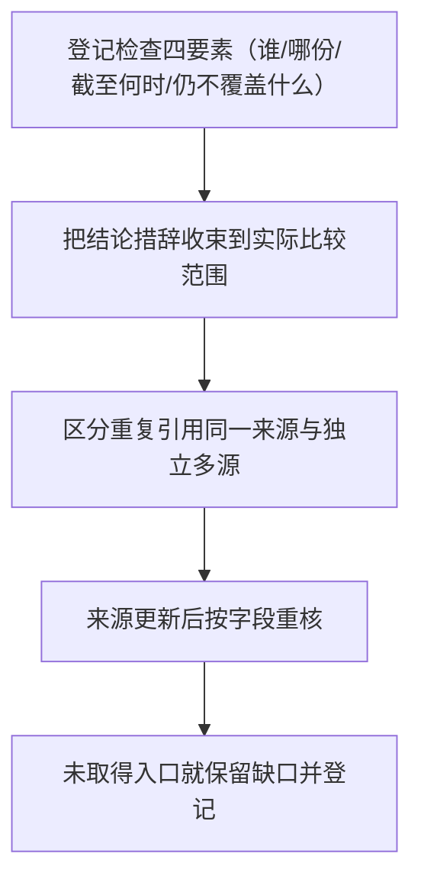

# 核验范围限定（Verification Scope Bounding）

## 模式类型

跨领域迁移型方法论模式 → 治理策略（结论口径限定与证据边界登记）。把"证据管理"从"证据有没有"推进到"这份证据能支持多大的话"，适用于任何需要把检查结果写进结论、报告或对外声明的场景。

## 成熟度

- **等级**：L1-draft（机器字段 `maturity: "L1"` + 语义字段 `maturity_level: "L1-draft"`）
- **验证次数**：validation_count = 1（仅表示完成一次方法抽取，不表示已有真实交付结果被验证）
- **复用次数**：reuse_count = 0
- **理由**：仅单案例（三入口参赛与写作指南知识包，83 条事实族支撑），且该案例为规则结构整合，未经历真实跨域交付；本条目中的跨域迁移示例均为同构推演、未实测。
- **升级条件**：第二个**非同谱系**案例完整应用（如审计留痕或合规审查场景）→ L1.5；另需本团队一次真实任务的结果回填与复盘 → L2-validated。无此证据就维持 L1-draft。

> **为什么拆成两个字段**：`maturity` 承担机器可校验的等级阶梯，`maturity_level` 承载库内细粒度语义（L1-draft = 假设性、单案例、待验证）；两者并存，既不让"草案态"污染等级统计，也不丢失"结论尚未验证"这一关键信息。

## 模式概述

核验结论最常见的膨胀方式，是把**来源身份、读取完整度、比较对象、适用范围**四个互相独立的属性，合成一个"已核验"标签：只要某处出现过一次成功比对（两个版本的字符串一致、某份材料已读全文、某次构建通过），整条链路就顺带被写成"已确认"。这不是判断失误，而是语言习惯——"核验过了"在口语里天然不加限定语，而边界恰恰丢在这个限定语里。

**核心转向（一句话定义）**：一项检查成功只能支持它**实际比较过的字段与对象**；每条结论必须写明四项——**谁检查、检查哪份材料、截至何时、仍不覆盖什么**。

四项互相不可替代：检查主体决定谁可为结论负责；检查材料决定证据的载体边界；截止时点决定结论的有效期；未覆盖范围决定结论不能延伸到何处。任何一项缺失，结论都可被合法地追问到它支撑不住的地方。本模式由一次三入口参赛与写作指南知识包沉淀萃取（83 条事实 / 3 条洞察 / 2 项候选方法，见[源页](../../../../../projects/awesome-okf-xs/doc/bundles/sheke/industry/ai-project-submission-and-content-publishing-guide/concepts/07-insights-and-reusable-methods.md)），案例细节不在本库复述，仅以事实编号作证据。

支撑本模式的直接证据：

- **同一材料的两个比较面可以不同步**：当前版本与旧版本的活动细则字符串机械比对完全一致，但同一材料的链接填写提示已更新（F-043；C-002 / E-002）——比对只覆盖了字符串这一面，未覆盖表单提示与实际入口。
- **未读正文不能被"规则没变"替代**：关联的服务协议与隐私正文在本次范围内未被读取（G-019），字符串一致不构成对协议正文的覆盖。
- **片段不能充当全文**：某入口的规则材料为片段而非全文（C-001），另一入口的百科全文虽已取得但实际入口仍未确认、协议材料亦为片段（C-007 / G-020 / G-022）——"已读到"与"已读全"是两个不同的事实。

## 适用场景

**适用于**：

- 结论要写进报告、验收记录、合规声明或对外材料，且会被他人据此决策；
- 检查手段天然只能覆盖**部分面**：字符串比对、扫描、构建、抽样、单份材料通读、单一入口确认；
- 存在"未取得的材料"（未读正文、未确认入口、未跑的分支）而结论容易被顺势写成"整体已确认"；
- 同一来源被多个页面、多个转载或多次引用，容易被误当作独立多源。

**不适用于**：

- **整数计数类机械判定**：如"字段数 = 13""条目数 = 83"这类比对对象与比较对象同一的判定，扩展风险不存在，四要素退化为一句"截至某时点核对，全部匹配"即可（判据：结论所依赖的每个对象都已被完整枚举，不存在未被枚举的相邻面）；
- 无第三方阅读的私人草稿：无人会据结论决策时，登记成本高于收益，只需保留最小版本号即可；
- 需要的是"证据是否存在"而非"结论能覆盖多大"的场景——那属于 [证据链工程化](evidence-chain-engineering.md) 的事前范畴（先有证据，才谈口径）。

## 问题背景

当一项检查很容易成功时，"成功"这个事实会反向拉宽结论——因为检查结论与结论范围在自然语言里往往共用同一个词（"核验""确认""一致"）。三类现象并存：

1. **字符串比对一致，但表单提示已更新**：两版细则文本逐字符相同，据此写成"流程未变"；实际上同一材料面向用户填写的提示面已经改变（F-043；C-002 / E-002）。比对成功地覆盖了"这些字段的文本"，却没有覆盖"表单与实际入口"。
2. **官方规则未变 ≠ 全流程未变**：规则正文可比对，但其关联的服务协议与隐私正文并未读取（G-019）。"规则没变"这句完全可能为真，同时"全流程没变"为假——两个命题的检查材料根本不是同一份。
3. **构建通过只证明构建范围**：某次范围检查通过只说明该次检查所覆盖的文件与包通过，不代表全库或跨包全面验收（见[源报告实施状态](../../../../../projects/awesome-okf-xs/doc/bundles/sheke/industry/ai-project-submission-and-content-publishing-guide/index.md)）。"绿灯"是检查范围的属性，不是被检查对象的属性。

三者的共同点是：**检查本身没有错，错在把检查的覆盖范围当成了被检查对象的属性**。

> **反常识**："官方规则没变，所以所有流程都没变"是错的——细则比对与表单更新可以同时成立，协议是否适用于本方场景还必须单独取证。"我核验过了"这句陈述，恰恰最缺限定语。

## 核心做法与操作流程（5 步）

### 第 1 步：为每项结论登记检查四要素

- **动作**：每条结论旁附四项——**谁检查**（执行主体或工具）、**检查哪份材料**（具体到文件/页面/字段范围）、**截至何时**（检查时点或材料版本）、**仍不覆盖什么**（未比较的字段、未读取的材料、未取得的入口）。
- **主手段**：结构化记录（结论登记表，四要素各占一列），使四要素可被逐行核对。
- **替代手段**：无结构化载体时，把四要素直接嵌入结论句（"截至某时点，就公开细则文本与两版比较，未覆盖表单提示与协议正文"）。
- **可执行判据**：任取一条结论，**脱离上下文即可答出四要素**；缺任一项，该结论降级为"待补检查范围"，不得进入决策材料。

### 第 2 步：把结论措辞收束到实际比较的范围

- **动作**：把结论从"是否合规/是否没变"改写为"**就 <材料/字段> 而言**一致/成立"。例如"两版本文本在这些字段上一致"可成立，"平台流程未变"不可成立——后者引入了未被比较的对象。
- **主手段**：固定结论句式"就 <材料/字段> 而言 <判定>"，强制主语落在材料上。
- **替代手段**：结论句末附"本结论不覆盖"清单，逐项列出被排除的比较面。
- **可执行判据**：结论句中不出现"整体""全面""所有""已完全"这类全称量词，**除非**后接范围清单并逐项指明各自的检查手段；出现而无清单即判为越界表述。

### 第 3 步：区分"重复引用同一来源"与"独立多源"

- **动作**：多源主张必须先回溯**来源谱系**（每个数值/条款的最早出处及其转载链），而不是数链接条数；同一平台内两页互引、同一通稿的多次转载，均只算一个谱系。
- **主手段**：回溯最早出处，按谱系计数。
- **替代手段**：无法回溯来源时，一律按**单一来源**登记并标注"谱系未明"，不得计入多源互证。
- **可执行判据**：多源主张能给出**至少两条互不派生的出处**；同平台互引一律不计（案例中某入口的百科与公告同平台互引即属此列，见[源报告边界与缺口](../../../../../projects/awesome-okf-xs/doc/bundles/sheke/industry/ai-project-submission-and-content-publishing-guide/index.md)）。

### 第 4 步：来源更新后按字段重核，不做全量重验也不假定全部失效

- **动作**：来源变更后，先求差异（版本 diff 或变更说明），据此生成**受影响字段清单**，只重核这些字段；未受影响的结论原样保留并注明其原检查时点。
- **主手段**：以差异为输入生成受影响清单，逐项重核。
- **替代手段**：拿不到差异时，按"该结论所依赖的字段"逐项重核——这仍不是全量重验，因为依赖字段是结论级的可枚举集合。
- **可执行判据**：能同时列出"受影响字段 / 未受影响字段"两张清单；未受影响结论保留且标注原检查时点（案例中字符串比对一致与表单提示更新同时成立，正是按字段重核的适用形态，F-043；C-002 / E-002）。

### 第 5 步：未取得入口就保留缺口，不用相关材料补成"适用协议"

- **动作**：未取得的一手材料（未读正文、未确认入口、未取得的协议）登记为**缺口项**，并写明"为什么相关材料不能替代它"；结论只写到已读材料的范围内。
- **主手段**：缺口登记（缺口项 / 为何未取得 / 可用何种方式取得 / 相关材料为何不可替代）。
- **替代手段**：暂时无法取得时，把结论停留在"关联研究"层级，明确不作为"适用协议/资格已确认"的依据（案例中某入口只能作关联规则研究，G-020 / G-022）。
- **可执行判据**：每条"未覆盖"都能指认它是**缺口**而非已核验项；结论记录中缺口数与已核验项数同样可见，**不用"其余未发现问题"式表述收纳缺口**。

## 反模式

| 反模式 | 为什么失效 | 替代动作 |
|---|---|---|
| 某项检查通过 → 宣称整体合规 | 检查只覆盖被比较的字段与对象；"整体合规"把未比较的字段、未读取的材料、未取得的入口一并默认通过 | 把结论收束为"截至 <时点>，就 <材料> 中的 <字段> 而言一致"，并逐项列出未覆盖范围 |
| 同一来源的两个页面互引当作独立多源 | 两页同属一个谱系，互引不产生第二个独立证据，虚假提升证据等级 | 回溯最早出处，按来源谱系（而非链接条数）计数；单一谱系一律标注"单一来源口径" |
| 用未取得的材料填补已核验字段 | 未读取的正文不能由"相关材料存在"替代，写成"已核验"即伪造覆盖 | 保留缺口并显式登记为未覆盖项，结论只写到已读材料范围内 |
| 把适用范围（是否适用于我方场景）默认成立 | 规则比对成功只说明"两版本文本一致"，不说明它适用于本方身份与实际入口 | 适用性单独取证（取得本方实际入口与协议中的适用条款）；未取得则记为待确认分支 |
| 来源更新后全量重验，或反之全量作废 | 全量重验浪费且掩盖真正差异；全量作废把未受影响的存续证据一并丢弃，等于二次损失 | 按字段列出受影响清单，只重核受影响字段，其余保留原结论与原检查时点 |
| 只留结论、不留检查记录 | 第三人无法复算覆盖范围，结论不可审计，也无法在来源变更时定位影响面 | 每项结论同时保存四要素，使检查覆盖可被独立复算 |

## 失败案例

以下为上游知识包已登记的**真实核验越界情形**（均已由该包记录在案，非假设推演）：

| 失败情形（上游已登记） | 越界之处 | 本模式的对应纠正 |
|---|---|---|
| 两版细则 `ruleHTML()` 字符串机械比对完全一致，据此写成"流程未变"；而同一材料的表单链接提示已更新（F-043；C-002 / E-002） | 比对只覆盖"这些字段的文本"，却被用来支持"平台流程未变"这一更大的命题 | 第 2 步：把结论收束为"就 <材料/字段> 而言一致"，并在同一记录中列出未覆盖面（表单提示、实际入口） |
| 依据"规则字符串一致"推及"服务协议与隐私正文亦已核验"；实际关联协议正文本轮未读（G-019） | 未取得的材料被"相关材料一致"顶替，形成伪造覆盖 | 第 5 步：未读正文登记为**缺口**，并写明"为什么相关材料不能替代它" |
| 把"可见核心部分一致"当作全文更新检测的完成结论；实际该比较非全文检测、非独立多源、不覆盖 G-001 至 G-007（C-001） | 覆盖范围（可见部分）被写成对象属性（材料已整体核验） | 第 1 步：登记四要素，其中"检查哪份材料"必须写明是片段还是全文 |
| 把"已取得某入口的百科全文"当成"该入口已确认"；实际 T-C 3.9–9.3 为片段且 T-ENTRY 入口仍未确认（C-007 / G-020 / G-022） | "已读到"与"已读全"、"读到材料"与"确认入口"被合并为同一事实 | 第 5 步：未确认的入口保留为缺口，结论停留在"关联研究"层级 |
| 旧包曾称已确认 exclusive 入口与首发百科关系，本轮未复现（E-006 / G-020） | 历史结论被直接沿用为"当前已确认"，未经当前材料复核 | 第 4 步：来源更新后按字段重核，仅保留确已被当前材料支持的部分 |

失败案例的共性是：**检查本身都没做错，错在把"检查的覆盖范围"当成了"被检查对象的属性"**——一次成功的比对被提升为一个更大的命题，而两者依赖的材料根本不是同一份。

## 反目标用户/场景

本模式**不适用**于以下人群与场景；强加四要素只会把简单核验拖成形式主义登记：

| 反目标用户/场景 | 为何不适用 | 应改用 |
|---|---|---|
| 整数计数类机械判定（"字段数 = N""条目数 = N"） | 比对对象与比较对象同一，不存在未被枚举的相邻面，四要素退化为一句时点标注 | 一句"截至某时点核对，全部匹配"即可 |
| 无第三方阅读的私人草稿 | 无人会据结论决策，登记成本高于收益 | 只保留最小版本号 |
| 只需回答"证据是否存在"而非"结论能覆盖多大"者 | 那属于 [证据链工程化](evidence-chain-engineering.md) 的事前范畴，**不适合**用本模式代替取证 | 先按证据链工程化把证据生产出来 |
| 想让本模式提升证据质量者 | 本模式只限定**结论口径**，**不适合**、也不能提升证据本身的可靠性 | 先解决来源可靠性，再谈口径 |
| 只想要一份"整体合规"结论者 | 本模式的第一效果恰是**收窄**结论范围与暴露缺口，与该诉求方向相反，**不适合** | 逐字段列出覆盖范围与缺口清单 |

## 早期预警信号

出现以下**预警信号**之一，说明结论已开始膨胀，应立即回到四要素登记、把结论收窄到实际比较范围：

1. **结论句里出现"整体 / 全面 / 所有 / 已完全"，而没有随附范围清单**。
2. **一次比对通过后，被问到"那其它地方呢"答不上来**——覆盖范围从未被写出。
3. **把同一平台内两个互引页面当作两个独立来源**——按链接条数计多源，未回溯来源谱系。
4. **说不清某结论"截至什么时点、依据哪一版材料"**——检查时点与材料版本缺项。
5. **未读的正文被"相关材料存在或一致"顶替**——缺口被顺势写成已核验。
6. **来源更新后要么全量重验、要么全量作废**——没有生成受影响字段清单。
7. **缺口被"其余未见异常"一句话收走**——缺口数与已核验项数不再同样可见。

**预警信号**累计出现两项及以上时判定为高危：该结论不得进入决策材料，须补齐四要素并重写措辞。

## 检验标准

模式被正确执行后，应满足以下**对准决策结果**的标准（而非"流程是否走完"）：

1. **结论可定位**：每条结论都能指到具体的检查对象（哪份材料、哪些字段）与检查时点，不需要回溯作者本人。
2. **边界在案**：未覆盖范围与缺口**与结论写在同一记录中**，不在别处；缺口不被"其余未见异常"式表述收纳。
3. **变更可定位影响面**：来源更新后，能直接给出受影响字段清单，并据此判断哪些结论需要重核、哪些仍然成立。
4. **覆盖可复算**：第三人仅凭记录即可复算"这次检查实际覆盖了多少"；复算结果与结论宣称的范围一致。
5. **引用强度与独立性对齐**：多源主张能给出互不派生的出处；重复引用同一来源不被计为多源互证。
6. **适用性无默认**：不存在"未取证即视为适用"的结论；适用性要么已取证，要么显式记为待确认分支。

## 迁移示例

- **依赖与许可证合规审查**：一次 SBOM 扫描通过只覆盖其扫描范围内的组件与已知许可证声明，不得推及运行时动态加载、间接依赖、构建期下载与外部服务的许可状况。四要素对应物：谁（扫描执行方与工具规则库版本）、哪份（被扫描的清单，是否仅直接依赖）、截至何时（扫描时点与漏洞/许可证库版本）、仍不覆盖什么（动态加载、间接依赖、构建期拉取）。**同构推演，未实测。**
- **CI 门禁通过**：某个 job 绿灯只覆盖该 job 的检查面，不覆盖未运行的分支、被跳过的步骤、`continue-on-error` 抑制的步骤与未纳入门禁的维度。四要素对应物：谁（该 job 及其触发条件）、哪份（被检查的文件范围与路径过滤）、截至何时（该次提交与使用的检查器版本）、仍不覆盖什么（未跑的分支/被抑制步骤/门禁未覆盖维度）。**同构推演，未实测。**
- **已知边界（不可外推）**：整数计数类机械判定（"字段数 = N""条目数 = N"）无需四要素展开——比对对象与比较对象同一、不存在未被枚举的相邻面，此时四要素退化为一句时点标注；若把本模式强加到此类判定上，只会把简单核验拖成形式主义登记。另，本模式只限定**结论口径**，不提升证据本身的质量：证据来源本身不可靠时，缩小口径也救不回结论。

## 与现有模式的关系

| 相关模式 | 关系 | 说明 |
|---|---|---|
| [证据链工程化](evidence-chain-engineering.md) | 流水线上下游（**生产 vs 口径**） | 对方管证据的**生产过程**：把条款翻译为可观察证据动作、随做随存、版本化命名，过程本身即证据；本模式管结论的**口径限定**：一项检查成功后结论能覆盖多大范围。前者产证据，后者定边界；无证据则本模式无从限定，仅有证据而不限定口径则结论仍会越界。 |
| [社区指标三查法](community-metric-triple-check.md) | **本模式是其通用型，对方是指标域特化**（保留对方独立，不吞并） | 对方是社区/生态规模指标引用的三查特化（查口径、查时点、查独立性）并给出冲突并陈、引用降级两道收口；本模式是任意核验结论的通用四要素限定，多出"**检查主体**"与"**未覆盖范围**"两项。核验对象为规模/统计指标时本模式退化为对方；核验对象为二值一致性（字符串比对、构建通过、入口确认）时对方的三查无对应物，只有本模式可用。 |
| [引文回证对账](../ai-collaboration/citation-evidence-reconciliation.md) | 环节不同（**结论产出时 vs 成稿后验收**） | 对方是成稿后的引文回证对账：机械枚举引号、逐条回证存在性/逐字性/跨度，属验收环节；本模式不依赖成稿环节，在每条结论**产出时**就要求写明口径与边界，成稿环节只是它的检验时机之一。 |
| [单一权威源与多载体声明面对齐](single-authority-declaration-alignment.md) | 维度不同（**多载体对齐 vs 单条结论边界**） | 对方管同一事实在多个载体被声明时指定唯一权威源、把其余载体降级为投影并机器校验对齐；本模式管单条结论的适用边界。前者解决"多处声明谁是权威"，后者解决"一条结论能覆盖到哪里"；两者可叠加使用但不互相包含。 |
| [本地不可自测面的显式立项](locally-unobservable-surface-explicit-scoping.md) | 相邻环节（**可测性穷举 vs 结论口径限定**） | 对方作用于**验收维度**：先穷举验收方维度并逐项标注可测性，不可自测面要么指派代理观测手段、要么显式列为待办；本模式不判断"哪些面测得到"，只在**结论**上登记"谁检查·查哪份·截至何时·仍不覆盖什么"。前者管"能不能测得到"，后者管"测到的话能说到多大"；可叠加使用——先按对方确定可测面，再按本模式为每条通过的检查写明覆盖范围。 |

## 适用边界与前提条件

**成立前提（缺一即降级或停用）**：

1. **结论要写进会被他人据以决策的材料**（报告、验收记录、合规声明、对外文档）：无人决策时登记成本高于收益。
2. **检查手段天然只覆盖部分面**（字符串比对、扫描、构建、抽样、单份材料通读、单一入口确认）：若检查已覆盖全对象且可枚举，四要素退化为一句时点标注。
3. **存在未取得的材料或未确认的入口**，而结论容易被顺势写成"整体已确认"。
4. **结论所依赖的对象可被枚举**：若"哪些面该检查"本身尚未确定，应先按 [本地不可自测面的显式立项](locally-unobservable-surface-explicit-scoping.md) 穷举可测性，再回到本模式限定口径。
5. **同一来源可被区分于独立来源**（能回溯来源谱系）：无法回溯时一律按单一来源登记并标注"谱系未明"。

**边界（本模式不做的事）**：

- 只限定**结论口径**，不提升证据本身的质量——来源不可靠时，缩小口径也救不回结论；
- 不判断"哪些面测得到"（那是 [本地不可自测面的显式立项](locally-unobservable-surface-explicit-scoping.md) 的职责）；
- 不替代独立验证：本模式管的是"结论怎么写"，不是"结论是否已经被第三方复算"；
- 对整数计数类机械判定不展开四要素（追加登记只会造成形式主义）。

**例外处理**：无第三方阅读的私人草稿——只保留最小版本号，不做四要素登记。

## 沉淀与校验记录

- **上游会话**：`sc-20261027-contest-task8`（三入口参赛与写作指南知识包，83 条事实 / 24 条缺口 / 7 项比较 / 6 项解读，3 条洞察 / 2 项候选方法），知识包位置见 [ai-project-submission-and-content-publishing-guide/index.md](../../../../../projects/awesome-okf-xs/doc/bundles/sheke/industry/ai-project-submission-and-content-publishing-guide/index.md)；本条目来源于该包的 [I-003 核验范围决定证据能支持多大的话](../../../../../projects/awesome-okf-xs/doc/bundles/sheke/industry/ai-project-submission-and-content-publishing-guide/concepts/07-insights-and-reusable-methods.md)。
- **沉淀会话**：`sc-20261027-contest-writing-guide-pattern`（2026-10-27，R→I→E→V→C 入库）。
- **去重判定**：入库前逐一比对 4 个候选模式（证据链工程化、社区指标三查法、引文回证对账、单一权威源与多载体声明面对齐），按**作用对象 / 核心动作 / 所处层级**三维裁定不重复——
  - 对 **证据链工程化**：作用对象是"证据资产"（对方）与"结论口径"（本模式），核心动作是"生产证据"（对方）与"限定结论范围"（本模式），判定**上下游非重复**；
  - 对 **社区指标三查法**：作用对象交集为"结论引用"，核心动作为"三查特化 + 引用降级"（对方）与"通用四要素限定"（本模式），裁定为**通用型 vs 指标域特化**——保留对方独立，不吞并；区分判据是可证伪的：核验对象是规模/统计指标且需判定时点与独立性时，本模式退化为对方；是二值一致性检查时，对方三查无对应物而本模式仍适用；
  - 对 **引文回证对账**：对方作用对象是"已成稿的引号引用"，本模式是"任一条结论"，所处层级为验收环节 vs 结论产出环节，判定**环节不同非重复**；
  - 对 **单一权威源与多载体声明面对齐**：对方作用于"多个载体之间的声明面"，本模式作用于"单条结论的边界"，判定**维度不同非重复**。
  划界已逐行写入上方关系表；另有同目录相邻模式 [本地不可自测面的显式立项](locally-unobservable-surface-explicit-scoping.md) 经裁定不构成重复（对方管验收维度可测性穷举、本模式管结论口径四要素），未列入入库前去重候选，其边界已补入关系表。
- **成熟度重裁**：源页两项候选方法自标为 L1-draft，但本条目并非源页候选方法的改名，而是由 I-003 洞察新萃取的独立模式，源页自标等级不直接继承；对照库内等级表按"首次单案例入库"重裁为 **L1-draft**，`validation_count = 1`（仅表示完成一次方法抽取，不表示结果已验证）、`reuse_count = 0`；落盘按库内双字段惯例表示——`maturity: "L1"` + `maturity_level: "L1-draft"`。
- **抽象化纪律**：正文以通用动作表述，未搬入任何平台专有名词、活动名称、条款细节与个案数值；案例仅作证据并挂源页实际存在的事实编号（F-043；C-001；C-002 / E-002；C-007；E-006；G-019；G-020 / G-022），不新造编号；源页的行动建议逐条表述未复制。跨域示例统一标注"同构推演，未实测"。
- **V2 完整性补录（2026-10-27）**：按仓库 pre-commit「模式文档 V2 质量检查」对创新/跨领域类模式的强制要求，补齐四节——「失败案例」（取自上游知识包已登记的核验越界记录：C-001 / C-002 / C-007 / E-002 / E-006 / G-019 / G-020 / G-022 / F-043）、「反目标用户/场景」、「早期预警信号」、「适用边界与前提条件」；四节内容均自本模式既有五步与上游已登记事实推导，未引入新的外部主张。
- **未验证声明**：本条目**未经独立 V 验证**，未观察任何真实交付结果；源页亦明确其洞察与候选方法不代表官方结论、获奖经验或收益验证；本条目不声称任何结论已被独立复算。
- **入库 V 门四视角裁定摘要**：本 V 门为**沉淀侧自审**（非独立第三方 V，不等同于"通过独立验证"），6 条意见，采纳 5 条 / 部分采纳 1 条，逐条如下。

### 入库 V 门四视角裁定摘要

| # | 视角 | 意见 | 裁定与回归确认 |
|---|------|------|---------------|
| V-01 | 魔鬼代言人 | 本模式与 [社区指标三查法](community-metric-triple-check.md) 是否重复？两者都围绕"口径"展开 | **部分采纳**：不合并，改为显式确立"通用型 vs 指标域特化"关系。回归确认：给出**可证伪区分判据**——核验对象是规模/统计指标且需判定时点与独立性时，本模式退化为对方；核验对象是二值一致性（字符串比对、构建通过、入口确认）时，对方三查无对应物而本模式仍适用。已写入「与现有模式的关系」表社区指标三查法行与「去重判定」小节 |
| V-02 | 魔鬼代言人 | 本模式与 [证据链工程化](evidence-chain-engineering.md) 是否重复？两者都在谈"证据边界" | **采纳**：新增"生产 vs 口径"的上下游划界。回归确认：给出可证伪判据——证据链完整（全部证据当场留存并版本化）而结论仍写成"整体合规"时，对方判通过、本模式独立判失败。已写入「与现有模式的关系」表证据链工程化行 |
| V-03 | 新人视角 | 四要素会不会沦为口号，用完即忘 | **采纳**：每步补入可执行判据（第 1 步的"脱离上下文即可答出四要素"、第 2 步的"全称量词须附范围清单"、第 5 步的"缺口数与已核验项数同样可见"）。已写入「核心做法」第 1、2、5 步 |
| V-04 | 老板视角 | 检验标准偏流程性，未对准决策结果 | **采纳**：检验标准改以决策结果为准（"第三人可据记录复算覆盖""来源更新后可直接给出受影响字段清单"）。已写入「检验标准」第 3、4 条 |
| V-05 | 未来视角 | 模式何时失效、会不会被无限泛化使用 | **采纳**：在「迁移示例」末条写明已知边界——整数计数类机械判定无需四要素展开，强加只会造成形式主义登记；并说明本模式只限定口径、不提升证据质量 |
| V-06 | 魔鬼代言人 | 本 V 门易被读成"已通过独立验证" | **采纳**：在「沉淀与校验记录」显式声明本 V 门为沉淀侧自审、非独立第三方 V，条目未经独立验证，不声称任何结论被独立复算 |
