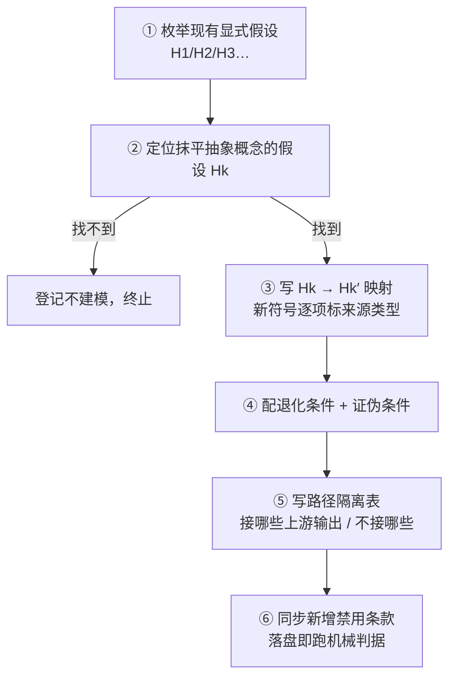

# 抽象概念落地的假设替换链（Assumption Substitution Ladder）

## 模式类型

方法论模式（知识生产 / 推导层）。作用于**已符号化、假设已显式列出的推导模型**，回答的是「一个抽象口号为什么在现有方程里没有位置，以及怎样让它变成可求导、可证伪的命题」，而不是「这个口号是什么意思」。

> **为什么定位在推导层而不是概念层**：概念层负责拆解口号的内涵（例如把「判断力」拆成生产 / 筛选 / 可培训三分）；本模式负责在方程里找到那个**把差异预先抹平的假设**并替换它。概念拆得再细，只要 H3「均匀分配」还成立，任何能力符号的系数都是零。

## 成熟度

- **等级**：L1-draft（机器字段 `maturity: "L1"` + 语义字段 `maturity_level: "L1-draft"`）
- **验证次数**：`validation_count = 1`，仅表示完成一次方法抽取，**不表示结果已被独立验证**
- **复用次数**：`reuse_count = 0`
- **证据性质**：单一知识包、单会话、同一谱系的四篇算例；V 门 6 条意见为沉淀侧自审，非独立第三方复核；跨领域迁移示例为同构推演、未实测
- **升级条件**：第二个**非同谱系**案例（例如计量模型的假设放宽、仿真模型的本构替换）完整应用并复盘 → L1.5；另需一次独立第三方复核 → L2-validated

> **为什么把证据性质写进成熟度**：本案例的四篇算例是同一次任务里连续写出的，彼此之间不是独立验证。把它们数成四个案例会让 L1 直接虚报成 L2。

## 适用场景

**适用于**：

- 材料是单源、`flagged` 或证据等级受限，只能做**符号练习**而不能做实测建模；
- 已有一组显式假设（H1/H2/H3…）与符号方程，且结论以恒等式 / 偏导 / 不等式形式给出；
- 上层概念文档提出一个抽象命题（「X 成为稀缺资产」「X 是护城河」），但方程里找不到对应符号；
- 需要在不引入任何新事实数据的前提下，把口号改写成可证伪命题；
- 一次拓展涉及多条推导路径，需要声明它们之间**能否互相代入数值**。

**不适用于**：

- 多源可交叉验证、可做参数估计的实证建模（此时应做识别策略与估计，不是假设替换登记）；
- 假设尚未显式列出的模型（第一步必须是把隐含假设写出来，否则无从定位）；
- 纯概念辨析、术语定义或价值裁决；
- 需要判定「这条结论能覆盖多大」——那属于 [核验范围限定](../governance-strategy/verification-scope-bounding.md)；
- 需要判定「这个候选该不该成为新条目」——那属于 [模式入库三维去重裁决](../governance-strategy/pattern-dedup-three-axis-ruling.md)。

## 问题背景

`ai-comic-drama-opc-transition` 知识包的 `concepts/02` 提出「内容判断力成为稀缺资产」，而 `examples/03` 的方程组里没有判断力的位置。直觉反应是「给某个符号赋个值」，但 `p = kA/S` 中每个符号都已被占用，`R_i = kA/n` 里连 `Q` 都消失了。

复核发现原因不在符号表，而在 **H3「均匀分配」**：它假定所有作品争夺同一注意力池时无差异，等于在建模之前就把「选得准不准」这件事删掉了。任何后来补进来的能力符号，都会被这条假设乘成零。

`examples/04` 的解法不是加变量，而是把 H3 替换为 H3′（加权份额 `φ_i = θ_i^γ / Σθ^γ`），并把 `θ`、`γ`、权重函数形式全部登记为**编者假设**、给出退化条件（`γ = 0` 或 `θ` 趋同时退回 `examples/03` 模块 E）与证伪条件（平台均匀分发时判据失效）。

> **为什么必须给出退化条件**：替换后的模型若不能退回原模型，读者就无法判断新旧结论哪个在更弱的假设下成立；本案例中 `∂π/∂Q = −c < 0` 与「多产重新有利」之所以不矛盾，正是因为它们分属 H3 与 H3′ 两个假设集。

## 核心规则

| # | 规则 | 判定口径 |
|---|---|---|
| R-1 | **先列假设，再找符号** | 口号无处安放时，第一步是枚举模型的显式假设清单，不是扩充符号表 |
| R-2 | **定位抹平者** | 指出哪一条假设预先消除了该抽象概念所依赖的差异；指不出来即判定「现有模型不覆盖此概念」，登记不建模 |
| R-3 | **替换而非赋值** | 写 `H_k → H_k′` 的映射；新符号须逐项标注「编者假设 / 读者自填 / 定义式 / 原文未给」 |
| R-4 | **新假设必须配退化与证伪两个条件** | 退化：新参数取何值时回到上一步模型；证伪：什么可观测事实成立时本路径整体失效 |
| R-5 | **路径隔离** | 新路径与旧路径共享概念边界但**禁止串联代入数值**；逐路径写明「接上游哪些输出、不接哪些、为什么」 |
| R-6 | **递进的是可判定性，不是数值** | 每一步把上一步的「禁令」改写成「显式假设下的不等式 / 偏导 / 恒等式」，数值仍全部为归一化占位 |
| R-7 | **禁用条款与推导能力同步增长** | 每新增一条路径，同步新增对应的「不得」条款；该配对结构由 [边界成对交付](../governance-strategy/negative-boundary-paired-delivery.md) 覆盖，本模式只要求路径级映射 |

> **为什么 R-6 单列**：本案例里 01 的 `p₁/p₀ = 0.18`、03 的 `α* ∈ [0.325, 0.625]`、04 的 `γ = 2 → φ₁ ≈ 0.692` 全部是无真实数据的归一化示例。若把「拓展」理解成「补进更多实测数字」，就会直接违反单源材料的证据边界。

## 操作流程（6 步）

1. **枚举假设**：从已有推导文档中抄出全部显式假设（含前置假设 H4），逐条写「它把什么当成相同或恒定」。
2. **定位抹平者**：对每个候选假设问「若把它反过来，这个抽象概念是否才有变化空间」。本案例中反过来的是 H3 均匀 → 非均匀。
3. **写替换映射**：保留其它假设不动，只改一条；新符号逐项标注来源类型。`examples/04` 明确「只替换 H3，其余沿用 03 的 H2」。
4. **配双条件**：退化条件写成参数取值（`γ = 0` → `φ = 1/n`）；证伪条件写成带发布主体与时点的可观测事实（平台公开变更分发权重）。
5. **写路径隔离表**：逐路径列出「上游输出 / 不接的输入 / 禁止串联的原因」。本案例禁止用 01 的 `D` 充当 03 的 `c`，也禁止用 03 的 `α` 充当 04 的 `θ`。
6. **同步禁用并落盘即跑**：把每条新增推导能力配一条机械可检的「不得」条款，落盘后一次运行给出布尔结果。

## 实施检查清单

- [ ] 现有模型的显式假设已完整枚举，未停留在「默认显然成立」
- [ ] 已指名抹平目标概念的那一条假设，或已登记「不建模」并说明依据
- [ ] `H_k → H_k′` 映射已写出，且**只改一条假设**
- [ ] 新符号逐项标注「编者假设 / 读者自填 / 定义式 / 原文未给」，无一项被写成实测
- [ ] 退化条件与证伪条件均已给出，前者是参数取值、后者是可观测事实
- [ ] 未引入任何原文未给的新事实数据
- [ ] 路径隔离表逐路径写明接哪些上游输出、不接哪些、为什么
- [ ] 每条新增推导能力都有对应的禁用条款，且判据可机械执行
- [ ] 结论以恒等式 / 偏导 / 不等式给出，而非预测或行动建议
- [ ] 已声明证据等级（`status: flagged` / `stale_after`）与历史门禁基线

## 正例

**本案例（2026-11-06）**：`examples/` 四篇构成一条可判定性递进链。

| 文档 | 产出形态 | 关键假设 | 把上一步的什么改写成了什么 |
|---|---|---|---|
| 01 | 三条禁用 / 口径禁令 | 无 | 「禁止相乘（E-03）」是纯禁令 |
| 03 | 条件性恒等式 + 证伪清单 | H1 同质 + H2 固定 + H3 均匀（+H4） | 把 E-11 从「不能混算」升级为 `h > g` 时 L1 增长、L2 恶化的可判定不等式 |
| 04 | 差异化判据 | H2 固定 + **H3′ 加权** | 把 H3 抹平的差异恢复为 `φ_i`，并给出 `γ = 0` 退化与均匀分发证伪 |
| 02 | 引用前四问 | — | 收口，不参与推导 |

`04` 的结论不是「判断力是一个符号」，而是乘积条件「`θ` 有差异 × `γ > 0`」；任一因子为零即退回口号。这使 `concepts/02` 的抽象命题第一次带上可证伪判据。

## 失败案例

**失败侧记录 1：把「加变量」当参数化（本案例首轮判断被推翻）**。收到「内容判断力该改写哪个符号」这一问题时，第一反应是给 `c` 或 `p` 加一个能力系数。复核 `p = kA/S` 后发现，H3 均匀分配下任何乘性系数都会在所有供给方之间约掉，`∂π_i/∂θ_i = 0`。教训：口号之所以是口号，往往不是缺符号，而是**结构里预先删除了差异**。

**失败侧记录 2：案例计数虚高（同日模式沉淀复核）**。同一次任务里连续写出的 01/03/04 曾被当作三个独立验证案例。按 `pattern-dedup-three-axis-ruling` 规则 5 复核后降为单案例，`validation_count = 1`。教训：同仓、同工具链、同谱系的连续产出只构成一条证据链。

**失败侧记录 3：跨路径串联代入（03 的 V 门编者视角攻击）**。`examples/03` §五 把 `p` 与 `C` 相减，看似违反 `01` 的「禁止跨口径」。处置不是放宽禁令，而是补 H4 前置假设、声明 §四结构法与 §五阈值法**参数化隔离**、只接 01 模块 A/B 的两个比值。教训：递进的是问题层次，不是数据流。

## 反例警示

| 反模式 | 表现 | 后果 | 纠正 |
|---|---|---|---|
| 口号贴符号 | 给抽象概念挑一个现成符号赋值 | 差异仍被 H3 抹平，结论恒为零 | 先定位抹平假设，再替换 |
| 一次改多条假设 | 同时放宽 H1/H2/H3 | 结论变化无法归因于任一条假设 | 单步单假设，只改一条 |
| 隐式新假设 | `φ = θ^γ/Σθ^γ` 写成「显然」 | 函数形式被当成事实 | 登记为编者假设，只用不依赖形式性质的结论 |
| 只给结论不给退化 | 新模型无法退回旧模型 | 两条路径结论冲突时无法裁决 | 必写退化参数取值 |
| 路径串联 | 把 01 的比值代进 04 的份额 | 归一化量纲被二次使用，结论失真 | 路径隔离表 + 禁用条款 |
| 数字替身 | 用「归一化示例」暗示真实量级 | 违反单源材料证据边界 | 数值全部标占位，禁用条款封死估算 |

## 反目标用户/场景

| 对象 | 为何不适用 | 应改用 |
|---|---|---|
| **有面板数据、要做参数估计的建模者** | 假设替换仍不等于识别；需要估计策略与稳健性检验 | 计量识别 / 敏感性分析 |
| **假设未显式写出的模型维护者** | 无假设清单可枚举，「定位抹平者」无对象 | 先做假设显式化，再考虑本模式 |
| **概念辨析、术语定义任务** | 产出是定义而非可证伪命题 | 概念分层与定义法 |
| **只需写「仍不覆盖什么」的验收记录** | 问题域是结论口径，不是模型结构 | [核验范围限定](../governance-strategy/verification-scope-bounding.md) |
| **只新增可操作产出项、不改模型假设者** | 无假设可替换，成对登记即可 | [边界成对交付](../governance-strategy/negative-boundary-paired-delivery.md) |
| **框架扩展点 / 插件系统开发者** | 扩展对象是代码层契约，不是认知层假设 | [扩展四步法模式](../../architecture-patterns/four-step-extension-recipe.md) |

## 早期预警信号

**何时不该继续推进（红旗）**：出现以下任意两项早期预警信号，判定假设替换高危，须退回第 1 步重列假设。

| # | 早期预警信号 | 预警含义 | 应回到哪一步 |
|---|---|---|---|
| 1 | **预警信号**：讨论中出现「给它加个系数就行」，但没人能说出该系数在哪个方程里对哪个变量求导 | 正在把口号贴到符号上，尚未定位抹平假设 | 步骤 2 定位抹平者 |
| 2 | **预警信号**：新符号表里出现「实测 / 行业均值 / 平台数据」字样，而材料是单源访谈 | 编者假设被写成事实数据 | 步骤 3 逐项标来源类型 |
| 3 | **预警信号**：一次拓展同时放宽了两条及以上假设，却只给出一组结论 | 结论变化无法归因 | 步骤 3 单步单假设 |
| 4 | **预警信号**：新路径的结论与旧路径相反，但文档未写「两者分属不同假设集」 | 路径冲突会被读成自相矛盾 | 步骤 5 路径隔离表 |
| 5 | **预警信号**：禁用条款数量未随推导路径数量增长 | 边界退回人工记忆 | 步骤 6 成对登记 |
| 6 | **预警信号**：找不到任何「新参数取何值会退回旧模型」的取值 | 缺退化条件，新旧模型不可比 | 步骤 4 配双条件 |
| 7 | **预警信号**：把连续产出的多篇文档数成多个独立验证案例 | 成熟度被稀释 | §成熟度口径复核 |

> **红旗未解除时不得继续**：以上任一信号出现且复核仍未解除时，停止假设替换、退回概念层辨析；在未被证伪的地基上加楼层，比不建模更危险。

## 适用边界与前提条件

**成立前提（缺一即降级或停用）**：

1. 模型已有**显式写出的假设清单**；全隐式时本模式退化为假设显式化工作。
2. 抽象概念与某条假设之间存在可指名的「抹平关系」；指不出时应登记不建模，不得硬造符号。
3. 允许把新假设登记为**待证伪**并与事实数据分栏；若项目要求所有参数必须有实测来源，本模式不可用。
4. 存在多条推导路径且可枚举；单路径时 R-5 退化为一句路径声明。
5. 存在机械可执行的禁用判据与证据等级标记；否则 R-7 退回人工记忆。

**边界（本模式不做的事）**：不判断替换后的函数形式是否正确（那是 V 门与领域知识）；不提供参数估计方法；不替代 [符号之争与变量之争分离法](symbol-vs-variable-decomposition.md) 的因果前提检验（后者作用于二元争议、明确禁止引入新假设，本模式作用于符号化模型、允许替换但强制登记）；不生成概念层定义；不决定候选模式以什么形态入库。

## 检验标准

1. **可定位**：能指名被替换的假设编号，并写出 `H_k → H_k′` 映射。
2. **可退化**：给出至少一组参数取值使新模型回到上一步模型。
3. **可证伪**：给出至少一条带发布主体与时点的可观测事实，使新路径整体失效。
4. **可隔离**：路径隔离表覆盖全部推导路径，无「可串联」的隐含默认。
5. **无数据越界**：全文不含原文未给的新事实数据；所有数值均为归一化占位并显式标注。
6. **成对完整**：新增推导能力数 = 新增禁用条款数（或逐条登记例外依据）。
7. **成熟度诚实**：连续产出不被计为多个独立验证案例。

## 迁移示例（G3 可迁移性）

- **计量模型**：Cox 比例风险模型的 PH 假设把「协变量效应随时间变化」抹平。要让「留存能力随时间衰减」进入模型，不是给 `β` 赋值，而是把 PH 替换为时变系数 `β(t)`，并登记 `β(t) ≡ β` 时退回原模型、Schoenfeld 残差检验显著时原模型失效。**同构推演，未实测。**
- **物理仿真**：理想气体状态方程把分子自身体积与分子间作用力抹平。范德瓦尔斯方程替换的是这两条假设本身，并在 `a = b = 0` 时退回理想气体。**同构推演，未实测。**
- **排队论 / 容量规划**：M/M/1 的泊松到达假设把「突发性」抹平；引入批量到达或重尾分布是替换到达过程假设，并需给出退化为 Poisson 的参数条件。**同构推演，未实测。**

> 三个示例均为结构类比，不是数据类比；本条目的 `validation_count` 不因它们增加。

## 与现有模式的关系（三维去重裁决）

按 [模式入库三维去重裁决](../governance-strategy/pattern-dedup-three-axis-ruling.md) 的四检索面逐面留痕后，对 5 个近邻逐条出表。完整命令、命中数与裁定见 [裁定报告 §3](../../../reports/knowledge-content/pattern-sedimentation-examples-assumption-substitution-20261106.md)。

| 对比对象 | 作用对象 | 核心动作 | 所处层级 | 裁定 |
|---|---|---|---|---|
| [边界成对交付](../governance-strategy/negative-boundary-paired-delivery.md) | 单源材料的**产出项** | 产出项 ↔ 不覆盖声明 ↔ 判据成对登记 | 产出决策层 | **重复（已占用）**：其案例 B 已明确承接本次 `examples` 另案，不重复申报 |
| [符号之争与变量之争分离法](symbol-vs-variable-decomposition.md) | 二元道德争议的**形式符号** | 因果检验 → 重述为机制变量 → 功能分级 | 议题分析 F 阶段 | **三维全异**：见下方可证伪判据 1 |
| [核验范围限定](../governance-strategy/verification-scope-bounding.md) | 结论口径 | 写清「谁检查 / 查什么 / 截至何时 / 仍不覆盖什么」 | 结论层 | **不重复**：不干预模型结构，不要求路径隔离表 |
| [能力栈渐进构建](../governance-strategy/capability-stack-progressive-building.md) | 系统的**能力维度** | 按依赖分层逐轮添加 + 闭环验证 + 可回退 | 构建迭代层 | **近邻特化**：本模式的「逐篇单一职责」是其子集，但缺退化条件与路径隔离要求 |
| [模式入库三维去重裁决](../governance-strategy/pattern-dedup-three-axis-ruling.md) | **候选条目 × 既有模式库** | 生成可证伪判据 → 选 A~E 策略 | E 之后入库之前 | **不同问题域**：本模式不产出入库结论 |

**四条可证伪区分判据**（写不出即默认判重复）：

1. 对 `symbol-vs-variable-decomposition`：在「抽象概念 S 在已符号化、假设已显式列出的模型里没有位置」的情形下，其 R-4 要求「变量替换不得用一个未证伪假设替换另一个」，判**先证伪原前提、否则不得引入新假设**；本模式判**允许替换 H_k → H_k′，但必须登记新假设、退化条件与证伪条件**。两者给出相反处置。
2. 对 `negative-boundary-paired-delivery`：在「只替换了一条假设、未新增任何可操作产出项或结论档位」的情形下，其成对表行数 = 0，判**无需成对登记、合格**；本模式仍要求提交假设映射表与退化条件，判**缺映射表即不合格**。
3. 对 `verification-scope-bounding`：在「同一概念在两条不同假设集下分别推导」的情形下，其只要求每条结论写四要素，判**口径写全即合格**；本模式额外要求路径隔离表，判**只写四要素不合格**。
4. 对 `capability-stack-progressive-building`：在「新文档与旧文档共享符号但结论方向相反」的情形下，其只要求「单一维度 + 闭环验证 + 可回退」，判**合格**；本模式要求写出「上一步哪条禁令被改写成显式假设下的不等式」及「失效时退回哪一步」，判**缺此二项不合格**。

**裁决结果**：本模式三维独立 → 策略 A 新建完整文档；其余 4 个候选按策略 C 登记为「重复 / 已占用 / 近邻特化 / 标准做法」，不新建条目。

## 沉淀与校验记录

- **会话**：`sc-20261106-examples-pattern-sedimentation`（2026-11-06，`R→I→E→V→入库`，C 未执行）。
- **来源**：[examples 模式沉淀裁定报告](../../../reports/knowledge-content/pattern-sedimentation-examples-assumption-substitution-20261106.md)，20 条事实（EF-01~EF-20）/ 4 条四元组洞察 / 5 个候选裁决 / 6 条对抗审查。
- **「另案」处置**：上一轮 [模式沉淀复核裁定报告](../../../reports/knowledge-content/pattern-sedimentation-dedup-ruling-20261106.md) §3.1 挂起的「能力扩展配等强度禁用条款」，已由并行会话 `negative-boundary-paired-delivery` 案例 B 承接；本轮不重复申报，仅登记其未覆盖的**假设替换链**增量。
- **V 门性质**：沉淀侧自审，**非独立第三方验证**；`validation_count = 1` 仅表示完成一次方法抽取。
- **未验证项**：三个跨领域迁移示例均为同构推演，未实测；未做第二个非同谱系案例的完整应用。
- **启动协议**：本次按 `AGENTS.md` 步骤 1.1 从磁盘回读并确认三锚点；步骤 2.0 判定「模式沉淀」不命中 vendor 方法论资产；步骤 2.1 因对象位于 `projects/` 读取三层路由；步骤 2.3 判定 Public，产出物落根 `docs/retrospective/`，**不写回子项目 `examples/`**。

## 关联资源

- [examples 模式沉淀裁定报告](../../../reports/knowledge-content/pattern-sedimentation-examples-assumption-substitution-20261106.md)
- [七概念方法论编排](../../../../../.agents/commands/seven-concepts.md)
- [知识沉淀指令集](../../../../../.agents/commands/knowledge-sedimentation.md)
- [萃取指令集](../../../../../.agents/commands/extraction.md)
