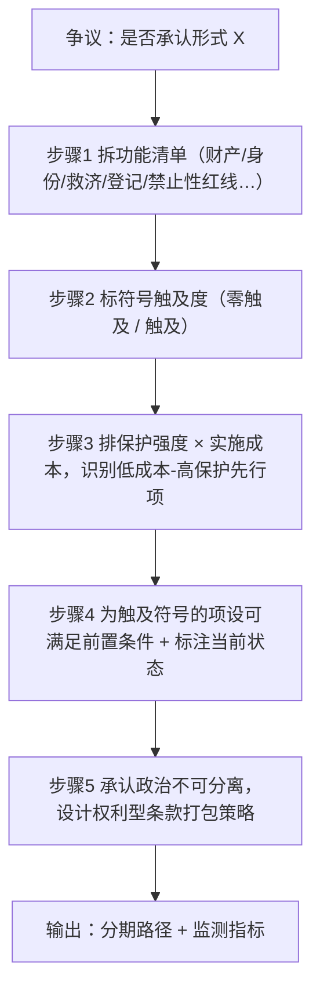

> **提炼自**：一夫多妻议题七概念方法论分析（2026-10-22）——从"承认/禁止"这一全有全无的开关式争议中，萃取出"把承认拆成按符号触及度与保护强度双轴排序的阶梯"的通用设计手法
> **验证案例**：一夫多妻（polygyny）制度分析（单案例：L0–L4 五级阶梯 + 无为选项三方案评估，L1 待验证）

# 可分离承认阶梯法（Decomposable Recognition Ladder）

## 一句话

当"承认某形式"被当作全有全无的开关时，把该形式承载的功能拆成按**符号触及度**与**保护强度**双轴排序的阶梯——让"零符号成本的功能保障"可以先行落地，而"符号型承认"被显式置于证据前置条件之后。

## 模式类型

方法论模式（制度设计 / 政策分期 / 权利保障）

## 成熟度

L1（单案例验证，待非同谱系第二案例验证升 L1.5）

## 问题背景

承认具有**符号溢出**性质：一旦承认某种形式作为法律资格，就很难只承认其功能而不承认其身份——因为资格是符号，符号会外溢到舆论、动员与文化。于是形成两难：

- **承认** → 符号外溢 → 舆论分裂、身份政治动员 → 保护增量小而政治成本高；且可能把"形式同意"合法化；
- **不承认** → 弱势方继续无救济 → 伤害持续且不可见，因而不产生改革压力。

> **为什么"法理可分离"不等于"政治可分离"**：多数方案错误地假设二者等价，于是在设计阶段就作出了无法兑现的分期承诺——承诺"先做功能层、再做资格层"，但立法是一揽子投票，资格层被否决时功能层往往一同搁浅。阶梯法必须显式处理这一落差，否则阶梯只是纸面结构。

## 适用场景

| 场景 | 是否适用 | 说明 |
|------|---------|------|
| "承认/禁止某形式"之争，且存在"承认会污染符号、不承认则弱势方无救济"的两难 | ✅ 核心场景 | 两难的两侧都有真实成本，穷举选项不可行 |
| 需要给决策者提供**可分期推进**的选项集（而非单一 Yes/No） | ✅ 核心场景 | 决策者常需区分"现在能做的"与"需等证据的" |
| 形式本身承载多项可独立实施的功能（财产、身份、救济、登记……） | ✅ 核心场景 | 可分离性是阶梯成立的前提 |
| 功能与符号强绑定、无法拆分的形式 | ❌ 不适用 | 只能二选一，直接做权衡 |
| 司法能力与救济可及性极低的环境 | ⚠️ 降级使用 | 只保留"零符号成本"层，符号型层必须降级 |

## 核心规则

| # | 规则 | 判定口径 |
|---|------|----------|
| R-1 | **功能项 = 独立制度接口**：一项功能必须能指出对应的法律部门或制度接口 | 无法定位接口的项不可拆 |
| R-2 | **符号触及度二分**：零触及 / 触及，逐项标注 | 触及符号的项必须另设前置条件 |
| R-3 | **前置条件必须可满足**：须是能被经验证据满足的有限命题 | "证明形式绝对无害"这类不可满足条件一律驳回 |
| R-4 | **法理可分离 ≠ 政治可分离**：分期承诺须以打包策略兑现 | 方案须给出单次立法包内的条款分层方案 |
| R-5 | **无为是一等方案**：不作为须被正式评估并给出结论 | 不得默认省略 |
| R-6 | **阶梯须设失效监测**：形态漂移后框架可能空转 | 每层须配至少一个可测指标 |

## 操作流程（5 步）

1. **拆功能**
   列出被争议形式承载的全部功能项（本案：财产分割 / 遗产继承 / 子女身份认定 / 扶养责任 / 同意程序 / 登记资格 / 禁止性红线）。原则：**一项功能 = 一个可独立实施的制度接口**。

2. **标符号触及度**
   逐项标注"实施该项是否必然赋予争议形式的法律资格"。零触及项（如本案的事实伴侣财产与子女身份保障、退出即生效、禁止性红线）可在不触碰符号的前提下推进；触及项（如司法审查型承认）必须另设条件。

3. **排保护强度与实施成本**
   按"保护强度 × 实施成本"排序，识别**低成本-高保护**的先行项。多数制度争论的失败源于直接从最贵、最具象征性的项开始。

4. **为符号型项设可满足的前置条件**
   前置条件必须是**能被经验证据满足**的形式（如"同意真实性可被独立验证"），并标注当前状态（已满足 / 未满足 / 证据不可得）。证据不可得时，符号型项默认不推进——这同时防御了"证据不足即默许"与"证据不足即永久否决"两种偏差。

5. **显式承认政治不可分离性**
   立法打包不可避免，因此分期目标从"逐级立法"转为"**以权利型条款打包、避免资格型条款打包**"——即在单次立法包中把零符号成本的项与触及符号的项分离打包，使触及符号的项被单独否决时，其余项仍能落地。

## 实施检查清单

- [ ] 功能清单完整，且每项能指出具体的法律部门或制度接口
- [ ] 每项已标注符号触及度（零触及 / 触及）
- [ ] 已按"保护强度 × 实施成本"排序并确定先行项
- [ ] 触及符号的项已设前置条件，且条件可被经验证据满足
- [ ] 每个前置条件的当前状态已标注（已满足 / 未满足 / 证据不可得）
- [ ] 已给出单次立法包内的条款分层打包方案
- [ ] 无为选项已被正式评估并给出结论
- [ ] 每层已配至少一个可测的失效监测指标

## 反例警示

| 反模式 | 后果 | 正确做法 |
|---|---|---|
| **伪分离** | 把形式拆得很细，但实际立法仍是一揽子，事后才发现无法选择性推进 | 承认政治不可分离性，提前设计打包策略 |
| **前置条件不可满足** | 设定"证明形式绝对有害/绝对无害"这类无法被任何证据满足的前置条件，实质等于永久否决 | 前置条件必须是可满足的有限命题 |
| **符号回避式欺骗** | 全部选低符号触及度的项，回避核心保护缺口，制造"已推进"的错觉 | 必须显式点名被绕开的核心缺口并设前置条件 |
| **成本低估** | 忽略司法能力与可及性差异，把形式上可分当作实质上可分 | 阶梯设计须附实施成本与可及性评估 |
| **未设失效条件** | 阶梯默认永久有效，家庭/市场形态漂移后框架空转 | 每层设监测指标与复核触发点 |
| **法理/政治混同** | 在设计阶段宣称"可逐级通过"，把法理推论当作制度现实 | 分栏标注"法理可分离"与"政治可分离" |
| **以分级掩盖不作为** | 用五级阶梯的完整外观掩盖实际只推进了最弱的一级 | 每一级须标注已推进/未推进状态与原因 |

## 正例

- **一夫多妻议题（2026-10-22）**：L0 事实伴侣财产与子女身份保障（零触及）→ L1 书面协议前置（零触及）→ L2 退出即生效（零触及）→ L3 司法审查（触及，前置条件为"同意真实性可独立验证"）→ L4 禁止性红线（零触及）。路径判定为"先推进 L0/L1/L2/L4，L3 待证据补齐"。
- **员工持股"是否承认"**：估值（零触及）→ 表决权（触及）→ 退出流动性（零触及）；表决权为符号型项。
- **开源传染性许可证"是否接受"**：使用（零触及）→ 修改（零触及）→ 分发（触及）→ 商用（触及）。

## 失败案例

**失败案例：把"承认"当作单开关（2026-10-22，一夫多妻议题分析过程中）**

分析初稿曾提出"承认 + 程序约束"的二分方案。对抗审查（魔鬼代言人视角）指出：一旦把"多配偶婚姻"作为法律资格承认，舆论分裂与身份动员会立即触发（F-069 显示认可约三成、反对过半），而**零符号成本**的功能保障——事实伴侣的财产分割、子女身份认定、退出即生效——并不需要该资格即可实施；且在同意真实性不可独立验证的情况下，司法审查型承认可能把"形式同意"合法化，反而损害弱势方。**根因**：把"承认"当作原子概念，混淆了法理可分离与政治可分离。**修正**：改为五级阶梯，并把 L3 置于"同意真实性可独立验证"这一前置条件之后，同时明确"以权利型条款打包、避免资格型条款打包"。**教训**：在争议性制度设计中，先问"哪一项功能不需要触碰争议符号"，往往能拿回被符号绑死的大半改革空间。

## 早期预警信号

出现以下任一信号，应暂停推进并回到设计：

| # | 预警信号 | 为何是预警 | 应回到哪一步 |
|---|---------|-----------|-------------|
| 1 | 每一轮讨论都在争论"承不承认"，却无人能列出"不承认情况下哪些弱势方得不到救济" | 讨论停留在符号层，功能清单未落地 | 步骤 1 拆功能 |
| 2 | 前置条件被反复改写以适配已有结论 | 典型的不可满足条件伪装，实质等于永久否决 | 步骤 4 前置条件设定 |
| 3 | 方案图景完整，但没有任何一项标注了"已推进/未推进" | 触发"以分级掩盖不作为"反模式 | 步骤 3 排保护强度与成本 |
| 4 | 对方阵营开始把该议题作为身份标签动员 | 符号成本骤升，阶梯排序前提失效 | 步骤 2 标符号触及度 |
| 5 | 核心受益方被从方案图中省略 | 等价于把成本转嫁给看不见的人 | 步骤 1 拆功能（完整性复核） |
| 6 | 同一议题的讨论重心从"功能"滑向"措辞与名称" | 议题正在退化为符号之争 | 步骤 1 拆功能 |

> **何时不该继续使用本模式**：以上任一信号出现且经复核仍未解除时，应停止阶梯设计、退回直接二元权衡或价值定向流程——红旗已亮仍继续分级，是在没有可观测救济对象的地基上排楼层。

## 边界条件

| # | 前提 | 不满足时 |
|---|------|----------|
| 1 | 形式承载的功能可被逐项识别 | 功能不可分时阶梯失效，直接二元权衡 |
| 2 | 各项功能确实可独立实施（互不依赖） | 存在强依赖时须合并层级 |
| 3 | 存在可行的制度实施接口 | 无接口（如纯习俗领域）时输出仅为分析框架 |
| 4 | 决策者接受分期而非一次性决议 | 强制一次性通过时只能给两套完整方案 |
| 5 | 弱势方的救济现状可被观测 | 无法观测时监测指标无从埋点，阶梯只能静态设计 |
| 6 | 符号动员成本可被评估 | 无法评估时"零符号成本"分级失去依据 |
| 7 | 前置条件的证据在合理期限内可得 | 长期不可得时须改用其他推进机制而非无限等待 |
| 8 | 各功能项的实施成本可估算 | 成本不可估时排序失效，退回二维表列出全部选项 |

## 反目标用户/场景

以下用户/场景**不适用**本模式，强行套用会产生误导：

| 反目标用户/场景 | 为何不适用 | 应使用的替代方法 |
|---|---|---|
| 功能与符号强绑定、无法拆分的形式 | 阶梯无级可分，构造失效 | 直接二元权衡 + 成本收益分析 |
| 纯技术配置（无身份符号） | 不存在符号触及度问题 | 常规权衡分析 |
| 需一次性全票通过的紧急立法 | 分期前提不成立 | 直接权衡 + 强制通过条款设计 |
| 无任何救济渠道记录、无法追踪效果的环境 | 阶梯的监测指标无法埋点 | 先建数据基础设施，再谈阶梯 |
| 纯象征性议题（无实际救济对象） | 阶梯会制造虚假进展感 | 直接做立场表达，不使用本模式 |

## 与现有模式的关系

- **[symbol-vs-variable-decomposition](symbol-vs-variable-decomposition.md)**（符号之争与变量之争分离法）：本模式是前者的下游落地——前者产出"变量之争"的重述结果，本模式把重述结果落成可分期推进的方案阶梯。
- **[cross-domain-semantic-drift](cross-domain-semantic-drift.md)**（跨领域语义漂移防御）：该模式防御概念错配；本模式防御"功能与符号的错配"（用符号层级代替功能层级排优先级）。
- **[core-scenario-dual-layer](core-scenario-dual-layer.md)**（核心场景双层解耦）：二者共享"把耦合结构解耦成可独立处置的层"的思路，本模式额外引入符号触及度这一排序轴与政治不可分离性的现实约束。

## 关键洞察总结

1. **承认有符号溢出**：功能可分不等于符号可分，设计阶段必须分别论证
2. **零符号成本的功能应先行**：多数制度争论的收益被符号绑架而未被评估
3. **前置条件必须可满足**：既防"证据不足即默许"，也防"证据不足即永久否决"
4. **打包策略是分期承诺的兑现方式**：分期不靠逐次立法，靠单次立法包内的条款分层

## Changelog

- **v1.0.0** (2026-10-22): 初始版本，基于一夫多妻议题七概念分析（R→F→V→I→E→A 链路）萃取，成熟度 L1（单案例），经四视角对抗审查后修正（新增"法理/政治混同""以分级掩盖不作为"两条反模式与打包策略兑现要求）
