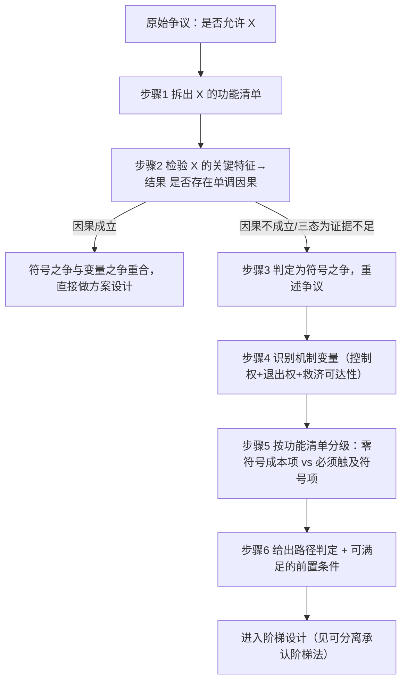

> **提炼自**：一夫多妻议题七概念方法论分析（2026-10-22）——从"一夫一妻 vs 一夫多妻"这一长期僵持的二元道德之争中，萃取出"符号之争与变量之争分离"的通用重构手法
> **验证案例**：一夫多妻（polygyny）制度分析（单案例：74 条编号事实 + 四视角对抗审查，L1 待验证）

# 符号之争与变量之争分离法（Symbol-vs-Variable Decomposition）

## 一句话

当一个议题被渲染成"是否应当承认/允许某种形式"的二元道德之争时，先检验该形式与目标结果之间是否存在因果关系；若不存在，则该之争是**符号之争**，而真正待解的是**变量之争**——把"要不要 X"重写为"哪个变量通过什么机制影响结果"。

## 模式类型

方法论模式（争议分析 / 制度设计 / 议题研究）

## 成熟度

L1（单案例验证，待非同谱系第二案例验证升 L1.5）

## 问题背景

二元之争之所以能长期僵持，是因为它把**符号选择**与**功能保障**人为绑定：

- **符号**有身份动员力：它能唤起身份认同、引发舆论分裂、构成政治动员的燃料；
- **功能**有实际效用：它决定弱势方是否获得救济、子女是否被保护；
- 一旦绑定，**符号的阻力会阻断功能的推进**——于是产生"承认 vs 不承认"的伪僵局，而双方其实在争夺一个不产生救济增量的象征物。

> **为什么必须先做因果检验**：绝大多数"形式之争"背后都是**未经检验的因果假设**（"形式 X 会导致结果 Y"）。该假设一旦被证伪，争论的落点就会自动从"选哪个形式"迁移到"调哪个变量"。跳过这一步直接给结论，等于在未经检验的前提上做推演——这是最常见的分析失败路径。

## 适用场景

| 场景 | 是否适用 | 说明 |
|------|---------|------|
| "是否应当承认/允许某形式"的二元道德之争 | ✅ 核心场景 | 争论双方均未提供"形式→结果"的因果证据时优先使用 |
| 立场高度分裂、双方各执一词且争论长期无进展 | ✅ 核心场景 | 僵持往往源于符号绑定，而非证据不足 |
| 评估某项政策的净效果（成本/收益/风险） | ⚠️ 部分适用 | 需先确认"形式"确实是有效变量，否则落入"口号化重构"反模式 |
| 纯技术选型（无身份符号、无价值分歧） | ❌ 不适用 | 用 [falsifiable-claim-evaluation](falsifiable-claim-evaluation.md) 与常规权衡分析 |
| 明确的价值/伦理裁决（无事实基础可检验） | ❌ 不适用 | 属规范裁决，须走价值定向，不得用变量重构代替 |

## 核心规则

| # | 规则 | 判定口径 |
|---|------|----------|
| R-1 | **形式 ≠ 变量**：争议形式的显著特征未必是影响结果的有效变量 | 需三型证据分别检验，见"操作流程"步骤 2 |
| R-2 | **三态判定**：结论只能是"成立 / 证伪 / 证据不足" | "证据不足"必须单列，不得折叠进"证伪"或"成立" |
| R-3 | **重述须落到可测变量**：重述后读者能说出"要测什么、怎么测" | 无法说出测量对象 = 重述未完成 |
| R-4 | **不引入新假设**：变量替换不得用一个未证伪假设替换另一个 | 替换后的变量同样需过 R-1 |
| R-5 | **层级不混用**：市场层统计不得直接用作权利层论证 | 先做层级分类，声明"异类不比"的边界 |

## 操作流程（6 步）

1. **写出争议的精确形式**
   把口语化的争论写成可检验句式："是否允许 X"。随即拆出 X 实际承载的**功能清单**（法律资格 / 财产 / 身份 / 救济 / 登记 / 责任……）。争议往往不在"要不要 X"，而在"要不要 X 的第 k 项功能"。

2. **检验因果前提（不得跳过）**
   问：X 的关键特征与目标结果之间是否存在**单调因果关系**？取三类证据分别检验：横截面（同一时点不同群体，易受混淆变量污染）、纵向/队列（能剔除选择效应）、实验/准实验（最强，但制度议题通常不存在）。**判定标准**：若效应呈非线性、或不同证据类型结论不一致、或现有研究测量的根本不是该特征本身，则判定"因果前提不成立"。

3. **判定为符号之争，并重述争议**
   把"是否允许 X"改写为"哪些结果变量受影响、通过什么机制影响"。读者必须能说出"要测什么、怎么测"。

4. **识别机制变量**
   在本案中，配偶数量（形式特征）被证伪为弱变量，真正变量是**议价能力 + 退出成本 + 救济可达性**。一般形式：**控制权 + 退出权 + 救济可达性**三件套。

5. **重排方案：按功能清单逐项分级**
   区分两类功能项：**不触及争议符号即可实现的功能**（可先行）与**必须触及符号的功能**（设前置条件）。这一步把"要不要 X"的死结拆成若干可独立推进的活结。

6. **给出路径判定与前置条件**
   功能项可先行推进者先行；必须触及符号者设**可被经验证据满足**的前置条件，并明确其当前状态（已满足 / 未满足 / 证据不可得）。

## 实施检查清单

- [ ] 争议已写成可检验句式，并已拆出完整功能清单
- [ ] 因果前提检验覆盖 ≥2 类证据（横截面 / 纵向 / 实验）
- [ ] 三态判定已显式给出，"证据不足"未被折叠
- [ ] 机制变量已命名，且不是原形式的同义改写
- [ ] 重述后能说出"要测什么、怎么测"
- [ ] 方案中至少有一项功能被识别为"不触及争议符号"
- [ ] 前置条件可被经验证据满足，且当前状态已标注
- [ ] 已检查是否引入新的未证伪假设（R-4）
- [ ] 已检查层级混用（R-5）

## 反例警示

| 反模式 | 后果 | 正确做法 |
|---|---|---|
| **口号化重构** | 把"多配偶"改述为"多元家庭"等更易接受的词，内容一字未改 | 措辞替换不产生信息增量；重述必须改变要测的变量 |
| **因果缺失的变量替换** | 直接宣称"真正的问题是 X"，却从未检验原前提 | 先证伪原前提，再引入新变量 |
| **符号侧胜利** | 以"方案不触及争议符号"为荣，掩盖该方案绕开了最关键的救济缺口 | 必须同时点名"被绕开的核心缺口"并设为前置条件 |
| **中立伪装** | 以"技术性、功能性"话语包装规范性立场 | 价值定向须显式前置并声明，不得伪装为纯技术分析 |
| **跨层级类比** | 把市场层统计（如多配偶率）直接用作权利层论证 | 先做层级分类，声明"异类不比"的边界 |
| **证据不足当否证** | 把"缺乏支持某主张的证据"当作"该主张已被证伪"，或反之 | 三态判定：成立 / 证伪 / 证据不足，第三态不可省略 |

## 正例

- **一夫多妻议题（2026-10-22）**：原始争议"是否允许一夫多妻" → 因果检验显示配偶数量与弱势程度无单调关系（F-053 非线性、F-054 反向、F-056 结论张力）→ 重述为"事实多配偶关系中的弱势方如何获得救济" → 机制变量为议价能力与退出成本 → 方案分级为 L0–L4 阶梯。
- **"是否承认 AI 人格"**：争议的符号是"人格/权利"；功能清单为合同、责任、财产、代理；变量之争为责任归属与救济可达性。
- **"是否允许数据用于训练"**：变量之争为同意的可撤回性与退出后的数据处置，而非"数据能否用"。

## 失败案例

**失败案例：把符号当变量（2026-10-22，一夫多妻议题分析过程中）**

分析初稿曾试图在 F 阶段直接给出"是否承认多配偶婚姻"的结论。审查阶段发现：支撑"多配偶必然伤害女性"的关键研究（F-049 横截面与系统综述）与反向证据（F-051 二十年纵向无一致关联、F-054 尼日利亚随机实验未见效率损失）存在结论张力，且现有研究测量的多是"多配偶身份的经济/亲属/规范后果复合体"而非配偶数量本身。**根因**：未检验"配偶数量→弱势程度"的因果前提，就已在争夺符号。**修正**：改为先做因果前提检验，识别出机制变量为"议价能力 + 退出成本"，最终结论从"承认/不承认"迁移为"哪些功能项可在不触及符号的前提下先行"。**教训**：在符号之争中，先问"形式是不是变量"，能省掉整场无解的争论。

## 早期预警信号

出现以下任一信号，应暂停推进并回到因果检验：

| # | 预警信号 | 为何是预警 | 应回到哪一步 |
|---|---------|-----------|-------------|
| 1 | 讨论中出现"我们都知道""显而易见""不言而喻"等表述，却无人给出机制说明 | 未证伪的因果假设正在被当作前提使用 | 步骤 2 因果前提检验 |
| 2 | 双方论点完全对称且长期僵持，无任何新证据进入 | 争论已进入身份符号层，证据不再流动 | 步骤 1 功能清单拆解 |
| 3 | 争论热度集中在"称呼/标签是否得体"，而非可测量的结果变量 | 符号之争正在吞噬变量之争 | 步骤 3 争议重述 |
| 4 | 提出的方案只能整体接受或整体拒绝，无法拆分 | 方案未做功能项分级，阶梯法失效 | 步骤 5 功能清单分级 |
| 5 | 结论必须以"支持/反对某形式"的句式才能表达 | 重述未落到可测变量 | 步骤 3 争议重述 |
| 6 | 机制变量被写成原形式的同义改写（如"多配偶"→"多形式家庭"） | 触发 R-4 违规，构成口号化重构 | 步骤 4 机制变量识别 |

> **何时不该继续使用本模式**：以上任一信号出现且经复核仍未解除时，应停止变量重构、退回常规争议分析或价值定向流程——红旗已亮却继续推演，是在未证伪的地基上加楼层。

## 边界条件

| # | 前提 | 不满足时 |
|---|------|----------|
| 1 | 争议确实呈现为"是否允许某形式"的二元结构 | 若是连续参数之争（如"税率定多少"），直接做最优化，不适用本模式 |
| 2 | 存在可区分的"形式特征"与"结果变量" | 若形式与结果不可分离测量，则无法做因果检验，退回常规争议分析 |
| 3 | 能取到至少一类经验证据 | 全无证据时只能输出"证据不足"结论，不得强行重构 |
| 4 | 争议涉及利益权衡而非纯事实 | 纯价值裁决不适用本模式 |
| 5 | 形式承载的功能可被逐项识别 | 功能不可分时阶梯法失效，直接二元权衡 |
| 6 | 机制变量落在可被制度干预的范围内 | 若真实机制完全不可干预，则分析止于诊断，不产生改革建议 |
| 7 | 重述不违反"决策者关心的问题" | 决策者只关心立场表态时，本模式的产出可能被视为回避问题 |
| 8 | 符号的社会动员成本可被评估 | 无法评估时，"零符号成本"的分级失去依据 |

## 反目标用户/场景

以下用户/场景**不适用**本模式，强行套用会产生误导：

| 反目标用户/场景 | 为何不适用 | 应使用的替代方法 |
|---|---|---|
| 纯技术选型（无身份符号、无价值分歧） | 不存在符号之争，变量检验属多余步骤 | 常规权衡分析 / 可证伪主张检验 |
| 明确的价值裁决诉求（"哪种更道德"） | 无事实前提可检验，属规范层 | 价值定向 + 三表法；本模式只能重述争议，不能裁决价值 |
| 因果前提成立且证据一致的情形 | 变量之争与符号之争重合，本模式的增量仅在"方案分级" | 直接做方案设计 + 阶梯分级 |
| 危机响应/紧急决策 | 无时间做前提检验 | 直觉决策 + 事后复盘 |
| 需要在两天内给出立场的公共表达 | 本模式输出的是诊断与方案分级，不是口号 | 立场表达 + 本模式作为内部依据 |

## 与现有模式的关系

- **[cross-domain-semantic-drift](cross-domain-semantic-drift.md)**（跨领域语义漂移防御）：该模式防御"用 A 领域框架切割 B 领域"；本模式防御"用形式符号遮蔽机制变量"，两者都是防止概念错位。
- **[falsifiable-claim-evaluation](falsifiable-claim-evaluation.md)**（可证伪主张检验）：该模式判定"主张是否可被证伪"；本模式在判定成立后进一步检验"该主张是否成立"，并据此重述争议。
- **[decomposable-recognition-ladder](decomposable-recognition-ladder.md)**（可分离承认阶梯法）：本模式产出"变量之争"的重述结果，该模式把重述结果落成可分期推进的方案阶梯，二者构成前后步。

## 关键洞察总结

1. **符号与功能绑定是伪僵局的成因**：符号的动员力会阻断功能的推进
2. **因果前提检验是分水岭**：形式特征与结果若无单调因果关系，二元之争即失效
3. **三态判定不可省**：成立 / 证伪 / 证据不足，"证据不足"必须单列，否则会被误用为论据
4. **重述必须落到可测变量**：读完能说出"要测什么"，才算完成重构

## Changelog

- **v1.0.0** (2026-10-22): 初始版本，基于一夫多妻议题七概念分析（R→F→V→I→E→A 链路）萃取，成熟度 L1（单案例），经四视角对抗审查后修正（新增"证据不足当否证"与"符号侧胜利"两条反模式）
