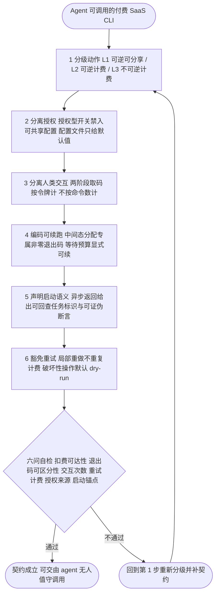

# Agent 原生 CLI 扣费-授权-续跑三元契约

## 模式概述

当一个 CLI 会被 **AI 智能体**（而非人）批量调用，且其动作背后存在**真实计费**、**不可逆副作用**与**需要人类授权**的环节时，常规的"人用 CLI"设计习惯会集中失效：人靠"看清楚再按回车"来兜底，agent 靠"读参数"来兜底；人不会把别人发来的配置文件直接执行，agent 会。

本模式给出三条必须**同时显式化**的契约：

1. **扣费契约**——把动作按「可逆可分享 / 可逆但计费 / 不可逆且计费」三级分级，**收费点只落在不可逆级**；失败重试与局部重做不重复计费。
2. **授权契约**——把「会花钱 / 会产生不可逆后果」的开关从**可共享配置文件**里摘出去；配置文件只提供默认值，命令行显式参数优先。人类交互按**令牌**计，不按**命令数**计。
3. **续跑契约**——把「我还没等够」这类**可恢复中间态**从"失败"里分出来，用**专属非零退出码**编码；异步返回必须留下**可验证的启动锚点**。

三条契约的共同判据只有一句：**agent 在无人盯着的情况下执行这套命令，会不会做出人不愿意承担后果的事。**

### 案例来源

VibeKnow 官方 CLI（`vibeknow/cli`，Go，MIT，npm `vibeknow-cli` v0.9.2，0 依赖）：

| 契约要素 | 案例中的具体形态 | 事实编号 |
|---|---|---|
| 扣费分级 | 流水线默认停在 preview 并输出 `share_url`；导出 MP4 是**另行触发、需数分钟、额外消耗积分**的独立动作 | TEC-15 / PRO-11 |
| 积分时效 | 积分分三态：活动积分（可能过期）、订阅积分（仅当期有效）、购买积分（长期有效） | COM-08 |
| 重试豁免 | `vk video avatar-retry` 仅重生成失败的数字人页，标注**不额外扣积分**；`vk video edit --script-only` 仅重做配音，标注更省积分 | TEC-21 / TEC-24 |
| 授权分离 | preset（YAML 默认值集）**不得携带** `--export` / `--yes` / `--confirm`；README 写明该约束的目的是「打开他人 preset 永远不会批准一笔扣费」 | TEC-30 / TEC-31 |
| 交互按令牌计 | 两阶段 Device Flow：`--no-wait` 先输出 JSON，人工在浏览器批准后 `--device-code` 续轮询；README 声明交互次数为**每个 token 一次**而非每个命令一次 | TEC-07 / TEC-10 |
| 可续跑编码 | `video wait --for 90s` 等待预算耗尽时以 **exit 6** 返回，理由 `wait_budget_expired`，语义为「继续等待」；**exit 7** 为渲染失败（终态） | TEC-12 |
| 启动锚点 | `--async` 在后端确认 run 已 live 后秒级返回，README 声明「**打印出 task_id 即代表 run 确已启动**」 | TEC-13 |
| 破坏性操作兜底 | `vk kb prune` 默认为 dry-run，须追加 `--yes` 才实际删除 | TEC-23 |
| 机器可读输出 | 非 TTY 管道环境自动切换 JSON，显式 `--output json` 可覆盖 | TEC-29 |

## 触发场景

**适用于**：

- CLI 会被智能体、脚本、CI 流水线**无人值守**调用，且部分命令会真实扣费或产生不可逆副作用（资源删除、付费渲染、账号操作、对外发布）。
- 产品同时存在**分享态**与**导出态**两套交付形态（预览页 / 可下载文件），且二者计费不同。
- 认证需要**人类参与**（浏览器授权、短信、审批），而调用方是 agent。
- 长任务需要**跨进程/跨时段续跑**（异步、轮询、等待预算），调用方需要区分"失败"与"没等够"。
- 存在**可共享的预设/配置文件**（preset、profile、模板）需要跨用户或跨项目分发。

**不适用**（强行套用只会增加无收益的复杂度）：

1. **完全免费且无不可逆副作用的纯读取 CLI**（如 `ls`、`cat`）——扣费与授权两轴无对象可建模，套用只会凭空引入配置约束。
2. **纯人用交互式 CLI**——人有"看清楚再回车"的天然兜底，按令牌计交互、按退出码编码中间态的收益不抵认知成本。
3. **已有外层计费与授权网关的 SDK**——若计费在 SDK 之外的网关层完成，CLI 内部再分一次级会与网关口径冲突。
4. **一次性脚本 / 无重试场景**——续跑契约的三要素（等待预算、异步锚点、中间态退出码）全都用不上。

## 适用前提与边界条件

- 存在**可被客观指认的"不可逆动作"**（花钱、删除、发布、占用他人配额）——否则三级分级无从划分。
- 计费是**可感知的**（有余额、有额度、有账单）——不可感知的计费无法在 CLI 层表达分级。
- 调用方**可能是 agent**，且调用方与人类之间存在**异步间隙**（不是同一进程同一秒）。
- 存在**至少一个**"可共享配置文件"或"可传递的命令串"这一信任边界载体；若所有输入都来自本地可信路径，授权分离的收益下降。

## 核心做法（6 步）

### 第 1 步：把动作按「可逆性 × 计费性」分三级

穷举全部会产生费用或副作用的命令，标注为三级之一：

| 级别 | 定义 | 典型形态 | 契约要求 |
|---|---|---|---|
| L1 可逆可分享 | 产物可在线查看、可分享，**不产生不可逆后果** | 生成预览页、输出分享链接、列目录、读状态 | 必须是流水线的**默认终点**，不得自动向下游推进 |
| L2 可逆但计费 | 消耗额度，但结果可被丢弃/重做 | 生成渲染任务、调用 TTS、生成配音 | 计费点在此级；须提供"局部重做不重复计费"的等价路径 |
| L3 不可逆且计费 | 消耗额度**且**产出落地为不可撤销的文件/对外发布/资源占用 | 导出 MP4、发布上线、删除资源、创建付费实例 | **收费点只落在本级**；必须由命令行显式开关触发；禁入任何可共享配置 |

> 判据落到一句话：**如果这个动作被误触发，agent 事后无法向用户解释或撤销，那就属于 L3。**

### 第 2 步：分离授权——把授权型开关从可共享配置里摘出去

配置文件（preset / profile / 模板）**只提供默认值**，且在实现层**硬性拒绝**承载授权型开关（`--export` / `--yes` / `--confirm` / `--force` / 任何"确认扣费"语义的开关），而非仅靠文档提醒。命令行显式参数优先级高于 preset。

- 反向设计（不可取）：把 `--export` 写进 preset，`vk create` 就直接导出了——用户只是"打开了一个别人分享的配置文件"。
- 正向设计：`vk create` 读到带 `--export` 的 preset 时**拒绝加载并说明原因**，用户须显式在命令行再敲一次。

### 第 3 步：分离人类交互——按令牌计，不按命令数计

agent 会连续发多条命令，人类交互不能随命令数线性放大。做法是**两阶段授权**：

1. agent 侧命令**只取码不阻塞**（输出 `device_code` / `user_code` / `verification_uri` / 过期秒数），立即返回；
2. 人类在浏览器或任意渠道完成批准；
3. agent 侧用取回的码**续轮询**，换取令牌。

关键在于**交互次数与令牌生命周期绑定**（"每个 token 一次"），而不是与命令绑定；同时必须暴露 `pending_authorization` 之类的状态标记，让宿主能判断"该等人类"还是"该催人类"。

### 第 4 步：编码可续跑——为中间态分配专属非零退出码

主流约定是「0 成功 / 非 0 失败」，非零即终止。本模式把它扩展一层：**非零退出码是"状态码"而非仅"结果码"**。

| 退出码 | 语义 | 调用方动作 |
|---|---|---|
| 0 | 终态成功 | 继续 |
| 1–5 | 终态失败（按错误类型细分） | 放弃或按错误类型降级 |
| 6 | **可续跑中间态**（如等待预算耗尽） | **继续等待/续跑**，不是失败 |
| 7 | 终态失败（渲染类） | 放弃或走局部重做 |

配套要求：等待预算必须是**显式参数**（`--for 90s`）而不是隐式超时；续跑必须**幂等**（重复 `wait` 不得产生副作用）。

### 第 5 步：声明启动语义——异步返回必须留下可验证锚点

异步命令（`--async`）返回后，调用方必须能判断"任务到底起没起"。锚点要求：

- 返回体中含**可回查的任务标识**（task_id / run_id）；
- 文档用**可证伪的断言**写明该标识的含义（"打印出 task_id 即代表 run 确已启动"），而非"已提交，请稍后查询"；
- 锚点与**计费触发点**的关系写明：锚点出现是否意味着已经扣费（本案例中为"是"）。

### 第 6 步：豁免重试与降级动作——局部重做不重复计费，破坏性操作默认 dry-run

- **失败重试豁免**：只重做失败的那一部分，且不重复计费（`avatar-retry`）；只重做成本更低的那一层（`--script-only` 只重做配音）。
- **破坏性操作默认 dry-run**：删除类命令默认只打印将要发生什么，追加显式确认开关才真执行（`kb prune` 默认 dry-run，需 `--yes`）。
- **不可撤销动作显式标注**：如 `edit --scene N` 标注"不可撤销"，让调用方在发起前就把它归入 L3。

### 核心做法思维导图

## 反模式（6 个）

### 反模式 1：把付费动作写进可共享配置

- **来源**：本案例的**反面设计**——若 preset 允许携带 `--export`，则任何"打开别人分享的 preset 再跑一条命令"的流程都会静默产生一笔费用。
- **正确做法**：实现层硬性拒绝 preset 携带授权型开关；preset 只承载 style 类默认值（mode / aspect / theme / voice / language / bgm / avatar 位置），命令行显式参数优先。

### 反模式 2：用同一个非零退出码表达"失败"与"还没好"

- **来源**：本案例的反面若 `wait` 预算耗尽与渲染失败共用一个码，agent 无法区分"该续跑"与"该放弃"，只能盲目重试——而重试本身在计费产品里等于二次扣费。
- **正确做法**：为可续跑中间态分配**专属**非零退出码（案例中 exit 6 = `wait_budget_expired`），终态失败另编码（exit 7）；并在文档中给出码表。

### 反模式 3：人类授权按命令数重复索取

- **来源**：本案例的 README 明确写交互次数为"每个 token 一次"而非"每个命令一次"——因为 agent 连续发命令时，逐命令索取会把人变成瓶颈。
- **正确做法**：授权与**令牌生命周期**绑定；提供"只取码不阻塞"的两阶段流程；暴露 `pending_authorization` 状态供宿主决策。

### 反模式 4：异步返回不留可验证启动锚点

- **来源**：本案例把"打印出 task_id 即代表 run 确已启动"写成显式断言，正是为了消除"提交成功 ≠ 开始生成"的灰区（该灰区在真实 issue 中确实发生过）。
- **正确做法**：返回体含可回查任务标识；文档用可证伪断言写明其含义；写明该锚点出现时是否已扣费。

### 反模式 5：失败重试与降级动作全额计费

- **来源**：本案例为失败数字人页提供**免费**的 `avatar-retry`，并提供更省的 `--script-only`，把"重试"设计成不重复计费的动作。
- **正确做法**：把重试与局部重做作为 L2 的等价路径显式提供；不提供时，调用方只能选择"整单重来 = 再付一次"。

### 反模式 6：破坏性操作默认执行、不需要确认开关

- **来源**：本案例的 `kb prune` 默认为 dry-run、须追加 `--yes` 才实际删除；且 `--yes` 属被禁入 preset 的三个开关之一。
- **正确做法**：破坏性操作默认 dry-run；确认开关必须显式出现在命令行；确认开关不得来自配置文件。

## 早期预警信号

出现以下**预警信号**时，应暂停推进并回到第 1 步复查分级，而不是继续加功能：

| 预警信号 | 为什么是信号 | 回到哪一步 |
|---|---|---|
| 同一命令的"预览"与"导出"计费相同且不可区分 | 分级缺失，等级被压平 | 第 1 步 |
| 文档里出现"请确认后运行"这类依赖人工阅读的措辞 | 确认被推给了 agent 的"判断力" | 第 2 步 |
| 出现"该命令会扣除额度"但未出现在扣费说明里 | 计费点不可见 | 第 1 步 + 第 5 步 |
| 失败后官方建议"重新运行一次" | 重试即二次扣费 | 第 6 步 |
| 退出码只有 0 与 1 | 中间态被塞进了失败分支 | 第 4 步 |
| 每次调用都要人点一次浏览器 | 交互按命令计 | 第 3 步 |
| preset / profile 能携带 `--yes` / `--force` | 信任边界被穿透 | 第 2 步 |
| 异步命令返回"已提交"但无可回查标识 | 无启动锚点 | 第 5 步 |

## 检验标准

- [ ] **Q1 扣费可达性**：任何一个会产生费用或不可逆副作用的命令，能否在**不开命令行显式开关**的情况下被触发？（能 → 不合格）
- [ ] **Q2 退出码可区分性**：非零退出码能否被下游**无歧义**区分「终态失败」与「可续跑中间态」？是否有码表？（不能 → 不合格）
- [ ] **Q3 交互次数**：一个人类令牌最多需要几次交互？是否与命令数解耦？（随命令数线性增长 → 不合格）
- [ ] **Q4 重试计费**：失败重试与局部重做是否计费？破坏性操作是否有 dry-run 兜底？（重试全额计费 → 不合格）
- [ ] **Q5 授权来源**：授权型开关是否**只可能**来自命令行？可共享配置文件能否携带它们？（能 → 不合格）
- [ ] **Q6 启动锚点**：异步命令的返回体是否含可回查标识，且文档给出可证伪断言？（无 → 不合格）

## 跨场景迁移示例

### 迁移示例 1：云资源 CLI（`aws` / `kubectl` / `terraform`）

- **场景**：`kubectl delete namespace`（L3 不可逆）、`aws ec2 terminate-instances`（L3 不可逆计费）、`kubectl get pods`（L1 纯读取）、`terraform apply`（L2/L3 混合，plan 与 apply 分级）。
- **同构点**：terraform 的 `plan` / `apply` 分离正是 L1/L3 分级；`apply` 必须显式触发正是授权分离；`terraform plan -out` 的产物可被他人复用，正是"可共享配置不等于授权"。
- **可检验差异**：主流云 CLI 的**等待类命令**（`aws waiter`）通常以退出码 255 / 统一失败码表达超时，未必区分"可续跑中间态"——若属实，则本模式第 4 步在云 CLI 域有真实的**未落地空间**，可作为第二案例候选。

### 迁移示例 2：代码托管平台 CI 触发与部署

- **场景**：触发一次 CI 运行（L2 计费，构建分钟数）、部署到生产（L3 不可逆）、查看构建日志（L1）。
- **同构点**：CI 触发在多数平台上确实是显式命令而非配置文件字段（授权分离的弱形式）；部署的"确认"通常是网页 UI 的一步——一旦被 agent 化，就必须回到命令行显式开关。
- **可检验差异**：平台的"重跑失败 job"通常**不重复计费**，这与本模式第 6 步的重试豁免同构；可作为跨域佐证。

### 迁移示例 3：SaaS 平台的公开 MCP 工具集

- **场景**：把付费 SaaS 暴露为 MCP 工具后，**任何客户端的模型**都可发起调用，而配置文件也可能来自他人。
- **同构点**：MCP 工具的入参天然等价于"命令行显式参数"，因此第 2 步的授权分离**退化为工具白名单**（只暴露 L1/L2 工具，L3 工具不进入公开工具集，或单独要求人工确认通道）。
- **可检验差异**：MCP 生态目前缺少"中间态退出码"的等价物（工具调用通常只有成功/异常二分）——这既是缺口，也是本模式第 4 步在 MCP 域的**潜在落点**（用结构化错误码而非异常消息承载"可续跑"语义）。

## 验证来源

| 证据 | 内容 | 位置 |
|---|---|---|
| 31 条技术事实 | CLI 的发布形态、Agent Skills、认证、流水线与退出码、模式引擎、Profile 与安全、preset 约束 | [事实附录 A：技术与 CLI](../../../reports/competitive-analysis/retrospective-vibeknow-video-expert-20261021/facts-technical-cli.md) |
| 25 条产品事实 | 交付形态两阶段、编辑能力、重试与计费豁免 | [事实附录 B：产品功能](../../../reports/competitive-analysis/retrospective-vibeknow-video-expert-20261021/facts-product-features.md) |
| 25 条商业化事实 | 积分三态、档位与附加计费 | [事实附录 C：商业化与竞品](../../../reports/competitive-analysis/retrospective-vibeknow-video-expert-20261021/facts-commercialization-competitors.md) |
| 3 条反面 issue | #10 async 任务永不开始 + wait 静默退出 0、#11 复用文档缺 knowledge_id 被拒、#12 数字 voice ID 致 TTS 40401（三条均自 2026-06-10 创建、至 2026-10-21 仍 open） | [事实附录 D：口碑与风险 RP-15](../../../reports/competitive-analysis/retrospective-vibeknow-video-expert-20261021/facts-reputation-risk.md) |
| 主报告洞察 | 洞察 2（收费点落在不可逆动作 + preset 授权边界）、洞察 3（可续跑中间态一等化） | [调研报告 第五、六章](../../../reports/competitive-analysis/retrospective-vibeknow-video-expert-20261021/README.md) |

> **反面证据说明**：本模式的第 4 步（退出码语义化）在案例中存在**未闭环的观测缺口**——官方文档定义 exit 6 为 `wait_budget_expired`（TEC-12），而 RP-15 的 #10 记录调用方观测到 `wait` "静默退出 0"。两条记录并存，本模式不裁决，读者采用前应按报告 Q-6 实测核验。

## 关联资源

- [调研报告：VibeKnow 视频专家全面调研报告](../../../reports/competitive-analysis/retrospective-vibeknow-video-expert-20261021/README.md)——本模式的主案例来源
- [CLI 即 API 设计](../../code-patterns/cli-as-api-design.md)——本模式的**前置模式**（多格式输出 ⊕ 结构化错误 ⊕ 退出码约定 ⊕ 会话持久化），本模式只在其上增扣费-授权维度
- [CLI 与 Skill 配对同步](../../code-patterns/cli-skill-pair-sync.md)——CLI 能力向 Skill 门面同步的配套规范
- [dry-run 优先](dry-run-first.md)——第 6 步"破坏性操作默认 dry-run"的方法论来源
- [能力前提配对搬运](capability-precondition-pairing.md)——同层相邻模式：资产的运行前提随行问题
- [工具故障三级降级策略](tool-failure-three-tier-degradation.md)——同层相邻模式：工具层故障的降级与禁用重试
- [社区指标三查法](../governance-strategy/community-metric-triple-check.md)——引用案例中厂商自述体量时的降级纪律
