# 复盘报告：mystx 主题包全面复盘

> 复盘日期：2026-10-22 | 复盘对象：`projects/xuanspace/libs/mystx`（Sphinx HTML 主题包） | 事实基线：HEAD `45bd1e4`（`v0.3.8-6-g45bd1e4`） | 提交总数：32 次 | 方法论：七概念（R→I→E→V→A→C）

> 本报告为 `mystx` 的**首次独立全面复盘**。`mystx` 是 `projects/xuanspace` monorepo 下的 git submodule（SpecWeave 主仓 → xuanspace → mystx 两级只读边界），此前仅被父项目 [retrospective-xuanspace-comprehensive-20261010](../retrospective-xuanspace-comprehensive-20261010/README.md) 以 F-056 / F-057 / F-059 三条事实间接覆盖，未对 mystx 自身的工程质量做系统扫描。本轮按七概念方法论完成 R（97 条事实）→ I（5 条洞察）→ E（3 个模式候选）→ V（11 条对抗审查意见）四个阶段，本任务（A 阶段）负责把已固化的洞察与审查结论转化为**带可判定验收标准的原子行动项**，并归档本报告四件套。

## S1. 事实收集

> 完整事实清单（F-001 ~ F-097，含 27 条抽样回溯对照，命中率 27/27 = 100%）见 [insight-extraction.md](insight-extraction.md) 附录。以下为按八个维度的关键事实摘要，F 编号与事实清单完全一致。

### 维度一：仓库与发布状态

| 项 | 数值 / 事实 | 来源 |
|---|---|---|
| 提交总数 / 日期区间 | 32 次 / 2026-08-21 ~ 2026-10-15 | F-001 |
| 活跃日历日 / 月度分布 | 7 天；08 月 4 次、09 月 12 次、10 月 16 次 | F-005、F-006 |
| 作者分布 | `xinetzone` 25 次、`xinzo` 7 次 | F-007 |
| git tag 总数 / 序列缺号 | 13 个；缺 `v0.3.5`、`v0.3.6` | F-008、F-009 |
| tag 类型 | 13 个**全部为轻量 tag**（`git cat-file -t` 返回 `commit`） | F-010 |
| 谱系结构 | 13 个 tag 分属 **6 条互相独立的谱系**，各谱系根提交 subject 均为「项目重置」；11 个早期 tag（v0.1.1 ~ v0.3.4）**非 HEAD 祖先**，creatordate 落在 2025-02-05 ~ 2025-11-17 | F-011、F-089 |
| 旧谱系归属 | `git show v0.3.4:pyproject.toml` → `name = "mystx"`、`version = "0.3.4"`、`requires-python = ">=3.10"`、`dependencies = []`，旧谱系仍是同一项目 | F-090 |
| HEAD / 领先量 | `45bd1e4`（2026-10-15）；相对 `v0.3.8` 领先 **6 次提交** | F-003、F-012 |
| 子模块指针 | 父仓 `submodule status` 描述 `v0.3.8-6-g45bd1e4`，前缀为空格（指针一致） | F-014 |
| 跟踪文件数 | 81 | F-015 |
| 成熟度分类 | `Development Status :: 3 - Alpha` 与仓库已发布至 v0.3.8 并存 | F-018 |

### 维度二：构建与打包配置

| 项 | 数值 / 事实 | 来源 |
|---|---|---|
| 构建后端 | `requires = ["scikit-build-core>=0.10", "setuptools-scm>=8.0"]`，后端 `scikit_build_core.build` | F-016 |
| 项目元数据 | `name = "mystx"`、`dynamic = ["version"]`、`requires-python = ">=3.14"`、license 以文件引用方式声明 | F-017 |
| 版本推导 | `metadata.version.provider = scikit_build_core.metadata.setuptools_scm`；`wheel.cmake = false`、`wheel.packages = ["src/mystx"]` | F-019 |
| sdist 配置 | `include = ["README.md", "LICENSE", "pyproject.toml", "src/mystx"]`，3 条 `__pycache__` / `*.pyc` / `*.pyo` 排除规则 | F-020 |
| 版本文件重复声明 | `version_file` 与 `write_to` **同指 `src/mystx/_version.py`**；该文件存在于磁盘但未被 git 跟踪，且被 `.gitignore` 显式排除 | F-021、F-022 |
| 入口点 | `[project.entry-points."sphinx.html_themes"]` 声明 `mystx = "mystx"` | F-023 |

### 维度三：依赖声明三层比对

| 项 | 数值 / 事实 | 来源 |
|---|---|---|
| 运行时依赖 | `dependencies = []`，runtime 声明 **0 项** | F-024 |
| `[project.optional-dependencies]` | 6 组：docs 25 / test 4 / lint 4 / build 2 / tasks 2 / dev 21 | F-025 |
| `[dependency-groups]` | 6 组：dev 11 / docs 25 / test 4 / lint 4 / build 2 / tasks 2 | F-026 |
| 两侧一致性 | docs / test / lint / build / tasks **五组逐项完全一致**；dev 组分叉（21 项 vs 11 项 = 5 个 `include-group` 引用 + 6 个显式包） | F-027、F-028、F-085 |
| dev 组差集（双向） | group 侧展开并集 42 项；并集独有 23 项 = docs 组 22 项 + tasks 组 `invocations>=3.0`；docs 组另有 `myst-nb` / `myst-parser>=4.0` / `sphinx>=8.0` 3 项缺席；optional 侧独有 `docutils>=0.20` / `myst-docutils>=4.0` 2 项 | F-086 |
| `invoke` / `invocations` 归属 | optional 侧 dev 组 21 项**含** `invoke>=2.0`、**不含** `invocations>=3.0`；后者仅出现在 tasks 组 | F-087、F-030 |
| 分发面佐证 | PyPI 0.3.7 的 `requires_dist` 共 58 项，runtime 侧（无 `extra` 标记）**计数为 0**；docs extra 中匹配 `invoke` 的行计数为 0 | F-095 |

### 维度四：源码结构与模块职责

| 项 | 数值 / 事实 | 来源 |
|---|---|---|
| Python 文件规模 | `src/mystx/` 下 20 个 `.py`；`tasks/docs.py` 311 非空行 / 363 物理行为最大 | F-037 |
| 模块职责分布 | `config.py`（配置管理）/ `configs.py`（常量与基配置）/ `extensions.py`（扩展解析）/ `themes.py`（主题选择与注册）/ `utils.py`（`deep_merge` + `has_module`）/ `myst_compat.py`（双钩子兼容）/ `version_switcher.py`（版本切换） | F-038 |
| 空壳资产 | `src/mystx/tools/__init__.py` 0 字节，全仓 `src/` + `tests/` 检索三种引用模式命中数为 0 | F-039 |
| 导出清单 | `src/mystx/__init__.py:34` 的 `__all__` 为单行列表，长度 **472 字符**（E501 已被 ruff `ignore` 关闭） | F-040 |
| 导入链 | `src/mystx/__init__.py:19` → `from . import presets, tasks`；`src/mystx/tasks/__init__.py:24` → `from invoke import Collection`（无保护）；`src/mystx/tasks/docs.py:34` → `from invoke import Collection, Exit, task`（无保护）；`:37` → `from invocations import docs as _inv_docs`（**有 try/except 保护**） | F-041、F-084 |
| 版本 fallback | `__version__` 三级 fallback，末级为字符串 `"0.0.0.dev0"` | F-042 |
| 并行安全 | `setup()` 返回 `parallel_read_safe` / `parallel_write_safe` 均为 True；Markdown/Notebook 链采用互斥注入 | F-043、F-044 |
| 主题资产 | `src/mystx/theme/mystx/` 共 6 个文件（custom.css 4791 B、tippy.css 607 B、try_examples.css 1825 B、custom-icon.js 2936 B、layout.html 47 B、theme.toml 2879 B） | F-046 |
| 对外扩展 | `ext/github_readme_stats/` 由 6 个文件构成，注册 **4 条 Sphinx 指令**（`github-stats` / `github-top-langs` / `github-pinned-repo` / `github-wakatime`） | F-047 |

### 维度五：测试资产与门禁

| 项 | 数值 / 事实 | 来源 |
|---|---|---|
| 测试规模 | `tests/unit/` 下 9 个测试文件、合计 **51 个 test 函数**（`ast` 脚本独立复核同值；无 `parametrize`、无 `async def test_`） | F-049 |
| 测试脚手架 | `tests/conftest.py` 5 非空行（仅把 `<repo>/src` 插入 `sys.path`）；两个 `__init__.py` 均 0 字节 | F-050 |
| 覆盖缺口 | `configs.py`、`ext/` 与 `ext/github_readme_stats/` 全部 7 个文件、`tools/__init__.py`、`_version.py` **无对应测试文件** | F-051 |
| 静态对账测试 | `test_repo_tasks_entry.py` 4 个用例（根 `tasks.py` 可加载 / doc 布局 / pages.yml 任务名可解析 / build 任务命令指向 `doc → doc/_build/html`），以 `pytest.importorskip("invoke")` 为守卫 | F-052 |
| 并行测试 | `test_doc_parallel_extensions_p1.py` 以 20 项扩展启动 `parallel=4` 的最小 Sphinx app | F-053 |
| 覆盖率门禁 | **无**：`[tool.coverage]` 段不存在、pytest `addopts` 不含 `--cov`、全仓无 `fail_under` / `--cov` | F-054、F-035、F-036 |

### 维度六：CI/CD 与托管平台配置

| 项 | 数值 / 事实 | 来源 |
|---|---|---|
| lint 工作流 | `lint.yml` 只含 1 个 job（`ruff check`），ruff 以 `==0.16.3` 精确固定 | F-055 |
| pages 工作流 | 安装 `pip install .[docs,dev]`；构建 `invoke build`；产物校验仅判 `doc/_build/html/index.html` 是否存在 | F-056 |
| 网络隔离 | `pages.yml` 首个 step 为 `step-security/harden-runner@v2`，`egress-policy: block` + 4 条端点白名单 | F-057 |
| 发布工作流 | `python-publish.yml` 使用**浮动 ref**（`actions/checkout@main`、`actions/setup-python@main`、`pypa/gh-action-pypi-publish@unstable/v1`），触发条件为 `release: types: [published]` | F-058 |
| 测试执行位置 | 三个 workflow **无任何 pytest 步骤**；pytest 仅以本地 pre-commit hook 形式存在（`entry: pytest`、`stages: [push]`） | F-059 |
| RTD 门禁 | `.readthedocs.yml` 声明 `sphinx.fail_on_warning: true`、`formats: [htmlzip, epub, pdf]`、pip method + path `.` + extras `[docs]` | F-060 |
| RTD 自述定位 | 配置注释自述该行是把 CI 侧 `invoke build`（不带 `-W`）抬高到一致水平的额外关卡 | F-061 |
| pre-commit 结构 | 9 个 `repo:` 块、13 个 `- id:` 条目 | F-062 |
| 工具链分叉① | pre-commit flake8 `--max-line-length=100` vs 项目 ruff / black 的 `line-length = 120` | F-063 |
| 工具链分叉② | pre-commit black rev 23.10.1 + `language_version: python3.10` vs 项目 `requires-python >=3.14`；mypy rev v1.5.1 | F-064 |
| 开发环境 | `dev-environment.yml` 为 conda 定义（`name: mystx-dev`），pip 段仅 `- .[docs]` | F-065 |

### 维度七：文档与主题资产

| 项 | 数值 / 事实 | 来源 |
|---|---|---|
| README 依赖声明 | 「核心依赖」段逐条列出 5 项（`sphinx-book-theme>=1.1.4`、`sphinx>=8.0.0`、`myst-nb`、`myst-parser`、Python 3.14+），**在 `dependencies = []` 中均无对应声明** | F-066 |
| 版本下界写法差异 | README `>=1.1.4` / `>=8.0.0` vs pyproject 两侧 `>=1.1` / `>=8.0` | F-067 |
| 安装命令 | `pip install "mystx[docs]"`、`pip install -ve .[dev]` | F-068 |
| README 路径示例失效 | 示例含 `locale_dirs = ['../locales/']`，全仓递归检索 `locales` 目录命中数为 **0**；`doc/conf.py:48` 使用同一取值 | F-069、F-073 |
| 主题配置方式 | README 提供 `html_theme_options` 字典形式与 `_config.toml` 形式两种，仓库确有 `doc/_config.toml` 含 `[html_theme_options]` 段 | F-070、F-074 |
| 变更记录 | `CHANGELOG.md` 18 物理行，**仅 `## [v0.3.8] - 2026-10-15` 一个条目**（修复 2 条 / 测试 1 条），无 Unreleased 段；13 个 tag 中 **12 个无对应条目** | F-071、F-072 |
| 变更记录历史 | 旧谱系不存在版本级变更记录：`git show v0.3.4:CHANGELOG.md` 仅 2 行模板头（标题为「xyzstyle 项目变更日志」），`git show v0.1.1:CHANGELOG.md` 报路径不存在 | F-091 |
| 文档构建配置 | `doc/conf.py` 283 非空行 / 320 物理行；`extensions` 基础列表含 mystx，`:253` 追加 `mystx.ext.github_readme_stats` | F-073 |
| 内嵌第三方实现 | `doc/_ext/sphinx_docx/writer.py` 901 非空行 / 1133 物理行，**首行即 `import logging`、无模块级 docstring、无许可证头与上游归属声明** | F-075、F-076 |
| 其他内嵌资产 | `doc/_ext/gallery_directive.py` docstring 自述「目前为 pydata-sphinx-theme 维护者存在」；`doc/_ext/sphinx_docx/builder.py` 115 行；`doc/ext/live-preview/live_preview.py` 170 行 | F-077、F-078、F-079 |
| 许可 | 仓库根 `LICENSE` 为 Apache-2.0 全文，**仓库内仅此一个 LICENSE 文件** | F-080 |
| 对外链接 | README 169 物理行，含 GitHub / PyPI / Read the Docs 三条对外链接 | F-081 |
| 贡献指南 | `CONTRIBUTING.md` 124 行，检索 `pytest` / `coverage` / `ruff` / `black` / `pre-commit` / `invoke` 六关键词**命中数为 0** | F-082 |

### 维度八：补充取证（H 段，F-083 ~ F-097）

| 项 | 数值 / 事实 | 来源 |
|---|---|---|
| `invocations` 包名 | PyPI 存在，当前版本 4.0.2（**包名有效，非笔误**） | F-083 |
| 失败语义分级 | `invoke` 缺失 = `import mystx` **硬失败**；`invocations` 缺失 = browse / tree / doctest 功能**软失败** | F-084 |
| 跨谱系可比性 | `git diff --stat v0.3.4 HEAD` → `69 files changed, 2892 insertions(+), 533 deletions(-)`，对象完好、内容可比 | F-088 |
| 分发面实发版本 | PyPI 实发 **9 个版本**（0.2.1 / 0.2.2 / 0.3.0 / 0.3.1 / 0.3.2 / 0.3.3 / 0.3.4 / **0.3.6** / 0.3.7），latest = 0.3.7 | F-092、F-093 |
| GitHub Releases | 实测 **11 条**，其中 `prerelease=true` 7 条、`draft=true` 0 条；无 v0.3.5 / v0.3.6 / v0.3.8 条目 | F-094 |
| 分发面反向缺口 | 仓库最新 tag `v0.3.8` **未出现在任何分发面**；反向地，PyPI 上的 0.3.6 在仓库中无对应 tag | F-097 |
| `requires_python` 分代 | 0.2.1 / 0.2.2 / 0.3.0 = `>=3.12`；0.3.1 ~ 0.3.4 = `>=3.10`；0.3.6 / 0.3.7 = `>=3.14` | F-096 |

## S2. 过程分析（发布与重构阶段流）

```mermaid
flowchart LR
    subgraph OLD ["旧谱系 2024-12 至 2025-11"]
        A1["v0.1.1 至 v0.3.4 六条独立谱系"]
        A2["v0.3.4 提交 41b6483 依赖为空"]
    end
    subgraph NEW ["当前主线 2026-08-21 起"]
        B1["项目重置 提交 88e2ff2"]
        B2["v0.3.7 提交 aa9277e"]
        B3["v0.3.8 提交 0b0b204"]
        B4["HEAD 提交 45bd1e4 领先 v0.3.8 六次提交"]
    end
    subgraph GATE ["CI 与发布链路"]
        C1["lint 工作流 仅 ruff check"]
        C2["pages 工作流 invoke build 产物存在性校验"]
        C3["python-publish 工作流 人工 Release 事件触发"]
    end
    subgraph DIST ["分发面"]
        D1["PyPI 实发 9 个版本 最新 0.3.7"]
        D2["GitHub Releases 11 条 无 v0.3.8"]
    end
    A1 --> A2
    A2 -->|"历史重建未声明"| B1
    B1 --> B2 --> B3 --> B4
    B4 --> C1
    B4 --> C2
    C1 --> C3
    C2 --> C3
    C3 --> D1
    C3 --> D2
    D1 -.->|"v0.3.8 未发布 坐标双向不闭合"| D2
```

- **旧谱系段（2024-12-25 ~ 2025-11-17）**：6 条独立谱系的根提交 subject 均为「项目重置」，共承载 v0.1.1 ~ v0.3.4 共 11 个 tag；其 creatordate 不落在当前主线区间内，11 个 tag 均非 HEAD 祖先（F-011、F-089）。旧谱系仍是同一 mystx 项目（F-090），但**未留下任何版本级变更记录**（F-091），因此历史断层无法用回填方式弥补。
- **主线起点（2026-08-21）**：`88e2ff2` 是一次「项目重置」，其后 32 次提交、7 个活跃日（F-001、F-002、F-005）；v0.3.7 / v0.3.8 是仅有的两个 HEAD 祖先 tag（F-011）。
- **HEAD 领先期**：HEAD 相对 `v0.3.8` 领先 6 次提交，父仓指针描述为 `v0.3.8-6-g45bd1e4`（F-012、F-014）——即**发布坐标落后于代码坐标**。
- **门禁段**：CI 侧只有 ruff（F-055）与「产物存在性」（F-056）两道检查，三个 workflow 无 pytest（F-059）；发布由**人工点一次 Release**触发，且使用浮动 ref（F-058）。唯一会因告警而失败的高标准关卡 RTD（F-060、F-061）不在发布路径上。
- **分发面段**：PyPI 实发 9 个版本、latest 仍为 0.3.7（F-092、F-093），GitHub Releases 11 条（F-094）；仓库最新 tag v0.3.8 从未到达任一分发面（F-097）——版本坐标在两个方向上都不闭合。

## S3. 洞察提炼

> 五条洞察的**完整四元组**（现象 / 5-Whys 根因 / 影响 / 建议）见 [insight-extraction.md](insight-extraction.md) 第一节。本节为摘要。

| # | 一句话陈述 | 根因（5-Whys 第 5 层） | 关键 F 编号引用 |
|---|---|---|---|
| I-1 | **发布可追溯性契约缺位**：13 个 tag 分属 6 条独立谱系、11 个不在当前主线祖先链上，版本序列与变更记录同时失真，且最新 tag 未发布到任何分发面 | 发布治理缺位——「什么可以被发布」从未被写成可执行的不变量，发布资格实质由「是否有人在平台上点了一次 Release」决定 | F-008、F-009、F-010、F-011、F-018、F-071、F-072、F-089、F-092、F-093、F-097 |
| I-2 | **运行时依赖契约缺位**：包声明零运行时依赖，而 `import mystx` 的导入链硬依赖 invoke（invocations 为软依赖） | 依赖契约与验证环境耦合——「最小可安装单元」从未被验证；门禁只回答「开发全集下能否构建」，从不回答「最小依赖集下能否 import」 | F-023、F-024、F-025、F-030、F-041、F-054、F-059、F-066、F-084、F-095 |
| I-3 | **质量门禁与发布流程解耦**：51 个测试存在但对发布决策零约束，唯一真正会失败的环节不在发布路径上 | 测试门禁与发布流程解耦，叠加工具链版本固定策略不一致——质量契约未被落成发布路径上的可判定关卡 | F-035、F-036、F-049、F-054、F-055、F-056、F-058、F-059、F-060、F-063、F-064 |
| I-4 | **文档与实现无单一事实源**：依赖、版本、工具链、目录布局四类事实被手工复制到多个载体并持续漂移 | 文档与实现缺乏单一事实源与机器校验，发布仪式被降级为可选习惯——漂移呈现「最近一版贴近实现、历史全缺」的不对称形态 | F-018、F-066、F-067、F-069、F-071、F-072、F-075、F-076、F-082、F-091 |
| I-5 | **声明面冗余且无权威源**：同一约束在多处重复表达，重复即分叉 | 声明面冗余且无权威源——「同一约束只在一处声明、其余由校验对齐」的纪律缺失；冗余本身不是缺陷，缺少真源才是 | F-021、F-022、F-025、F-026、F-027、F-028、F-030、F-039、F-052、F-063、F-064、F-086、F-087 |

### 与父项目 xuanspace 基线的差异分析

> 基线：[retrospective-xuanspace-comprehensive-20261010](../retrospective-xuanspace-comprehensive-20261010/insight-extraction.md)（父项目 xuanspace 全面复盘，主洞察 4 条 + §2 交叉基线 5 行）。mystx 侧与父项目 mystx 相关的基线事实仅 F-056 / F-057 / F-059 三条，属间接覆盖，本报告不重复其结论，仅作对照。

| 基线项 | 差异类型 | mystx 侧依据 | 说明 |
|---|---|---|---|
| 基线 I-1：增量节奏从「单峰冲刺」细化为「多段事件脉冲」 | 强化 | F-001、F-002、F-005、F-006、F-011 | 32 次提交跨 7 个日历日、08/09/10 分别 4/12/16，同为事件脉冲形态；且叠加了基线完全未覆盖的谱系断层 |
| 基线 I-2：治理重心迁移为结构治理，「迁入即治理」是内在规律 | **反转** | F-016、F-019、F-024、F-027、F-028、F-063、F-066、F-069、F-071、F-082 | mystx 侧迁入窗口完成了构建后端对齐，但依赖契约、文档契约、门禁契约三类均未闭环 → 规律并非自动发生，必须由强制关卡承载 |
| 基线 I-3：上游依赖策略升级为「对外部行为分级建模锁定」 | 新增 | F-029、F-047、F-066、F-075、F-076、F-078、F-080 | mystx 侧同类问题域机制缺位：依赖外部 sphinx-book-theme 却无行为契约；反向证据是自身内嵌 `doc/_ext/` 第三方实现而归属与许可声明缺位 |
| 基线 I-4：结构由单包极化迁移为多库扩张的结构性张力 | 强化 | F-001、F-012、F-015、F-024、F-063、F-066、F-069 | 以 81 个跟踪文件的单包形态复现同一张力：局部持续提交与分散在 pyproject / pre-commit / README / CONTRIBUTING 四处的约束声明并存且互不一致 |
| 交叉基线 · 节奏形态 | 强化 | F-005、F-006、F-011、F-012 | 脉冲形态与父仓同构，差异在于脉冲之间叠加了谱系断裂 |
| 交叉基线 · 质量投入 | 强化 | F-047、F-049、F-051、F-054、F-059、F-060、F-061 | 父仓的「质量内嵌」在 mystx 侧退化为「测试资产与发布决策不相交」 |
| 交叉基线 · 结构重心 | 无变化 | F-015、F-046、F-037 | mystx 侧为单包 + 内部模块结构，无极化也无扩张议题 |
| 交叉基线 · 依赖治理视角 | 新增 | F-024、F-030、F-035、F-036、F-041、F-027、F-028 | 把依赖治理从「上游行为锁定」扩展到「自身声明面的自洽」 |
| 交叉基线 · 开发主体 | 无变化 | F-007 | 作者分布未出现「Trae Agent」署名，本轮未取证提交者身份，基线结论在 mystx 侧既不能加强也不能反驳 |

**差异类型分布**：强化 4 条 / 反转 1 条 / 新增 2 条 / 无变化 2 条，合计 9 行，覆盖基线主洞察 4 条 + 交叉基线 5 条，无跳过。

### mystx 独有问题域（基线未覆盖）

| # | 问题域 | mystx 侧依据 | 基线为何未覆盖 |
|---|---|---|---|
| D-1 | 发布谱系断层与版本可追溯性 | F-002、F-008 ~ F-012、F-071、F-072 | 基线只讨论提交节奏与仓库结构，从未涉及 tag 可达性、版本连续性、CHANGELOG 与 tag 对账 |
| D-2 | 运行时依赖契约与最小安装环境 | F-023、F-024、F-041、F-066、F-068 | 基线的依赖议题是「上游行为对等性」，不是自身包的依赖声明与导入面 |
| D-3 | 质量门禁与发布流程的耦合形态 | F-049、F-051、F-054、F-059、F-060、F-061 | 基线以「质量活动内嵌于重构提交」解释质量面，mystx 侧形态未在基线中出现 |
| D-4 | 文档-实现单一事实源缺位 | F-066、F-067、F-069、F-071、F-082 | 基线有文档原子化与目录改名结论，但无「同一事实跨载体手工复制」的漂移机制分析 |
| D-5 | 第三方实现的归属与许可登记 | F-075、F-076、F-078、F-080 | 基线无许可合规维度 |
| D-6 | 单包内部配置冗余与冗余分叉 | F-021、F-022、F-027、F-028、F-039、F-052、F-063、F-064 | 基线覆盖「跨 20 个 `pyproject.toml` 的一致性」，未覆盖「单包内部多载体重复」 |

## S4. 行动项（G4 原子化）

> 10 条原子行动项的完整定义（描述 / 优先级 / Owner / 触发条件 / 验收标准 / 来源）见 [actionable-items.md](actionable-items.md)。全部条目单一职责、可独立验证，验收标准均为 rule（二元可验的规则句）或 rubric（维度 / 量表 / 锚点 / 阈值）二选一。其中 `ACT-01` ~ `ACT-09` 为面向 mystx 工程侧的可执行改进项，`ACT-10` 为 V 阶段对抗审查得出的方法论侧守门动作（Owner 为复盘方法论维护者，非 mystx 维护者）。

| ID | 行动项 | 优先级 | Owner |
|----|--------|:------:|-------|
| ACT-01 | 发布资格不变量清单落盘为可执行检查（8 条不变量 + 豁免登记） | 高 | mystx 维护者 |
| ACT-02 | 发布触发链改造：去人工旁路、action ref 钉版本、挂载不变量校验 | 高 | 发布流程负责人 |
| ACT-03 | 历史版本坐标显式登记：谱系映射表 + 豁免清单（含到期条件） | 高 | mystx 维护者 |
| ACT-04 | 最小可安装单元验收 job + `import mystx` 导入面解耦 | 高 | mystx 维护者 |
| ACT-05 | 运行时依赖契约单一真源化（`dependencies` 与 README 核心依赖段对齐） | 高 | mystx 维护者 |
| ACT-06 | 测试与覆盖率门禁进入发布路径（`pytest --cov` + `fail_under` + 产物校验合并） | 高 | mystx 维护者 |
| ACT-07 | 工具链约束与依赖声明的单一权威源（PEP 735 为真源 + 行长 / Python 目标对齐） | 中 | mystx 维护者 |
| ACT-08 | 文档-实现一致性检查 job + CHANGELOG 仪式门禁 | 中 | mystx 维护者 |
| ACT-09 | `doc/_ext/` 第三方实现的归属与许可登记 | 中 | mystx 维护者 |
| ACT-10 | R→I 转译的结论强度守门（前置检查） | 中 | 复盘方法论维护者 |

## 可优化点问题清单

> 本节直接回应「可以优化的点」这一诉求：把主观感受还原为**可观察事实 → 证据位置 → 优化方向**三要素。每条均给出 F 编号与文件路径行号，覆盖 I-1 ~ I-5 全部五条洞察暴露的可优化点。

### Q-01 发布动作绕过全部质量与坐标校验（I-1 / I-3 / D-1 / D-3）

- **问题描述**：发布由 `release: types: [published]` 这一**人工平台事件**触发，工作流内只有 checkout / setup-python / pypa-publish 三步，**没有任何一步校验 tag 可达性、版本号连续性、CHANGELOG 条目存在性或测试执行结果**；且三个 action 全部使用浮动 ref（`@main` / `@unstable/v1`），发布内容本身不可复现。这是「未校验旁路」，使得谱系断层、版本缺号、变更记录缺口可以在同一个公开发布的包上同时长期并存。
- **证据位置**：F-058（`.github/workflows/python-publish.yml:10-33`）、F-055（`.github/workflows/lint.yml:1-25`）、F-056（`.github/workflows/pages.yml:74-91`）、F-059、F-011、F-009、F-072
- **优化方向**：→ **ACT-01**（先写出可判定的发布资格不变量清单）+ **ACT-02**（把校验挂到发布触发链上，消灭人工旁路并钉版本 ref）

### Q-02 最新 tag 从未到达任何分发面，版本坐标双向不闭合（I-1 / D-1）

- **问题描述**：仓库最新 tag `v0.3.8` 在 PyPI 的 JSON 接口返回 HTTP 404、GitHub Releases 无同名条目，PyPI `info.version` 仍为 0.3.7；反向地，PyPI 上**已发布** `mystx==0.3.6`（2026-09-03），而仓库 13 个 tag 中**没有** `v0.3.6`。即「打 tag ≠ 已发布」，两个方向的坐标差集都非空。
- **证据位置**：F-097、F-093（`https://pypi.org/pypi/mystx/0.3.8/json` → 404 / `.../0.3.6/json` → 200）、F-092、F-094、F-009（`git tag --list` 无 v0.3.6）
- **优化方向**：→ **ACT-01**（新增「最新 tag 必须在分发面可安装且可下载」不变量 I-8）+ **ACT-03**（把两类方向相反的缺口分列登记）

### Q-03 13 个 tag 分属 6 条「项目重置」谱系，回归定位工具在跨谱系历史上不可用（I-1 / D-1）

- **问题描述**：13 个 tag 全为**轻量 tag**（`git cat-file -t` 返回 `commit`），不携带说明与签名；它们分属 6 条互相独立的谱系，每条谱系的根提交 subject 均为「项目重置」，其中 11 个 tag 指向的提交不是 HEAD 祖先。后果是：`git bisect` 这类依赖单一祖先链的回归定位不可用；用户难以把 issue 复现到主线上的某一次提交。需注意**内容仍可比对**（`git diff --stat v0.3.4 HEAD` → 69 files changed），故问题不是「历史不可达」而是「主线复现链路断裂」。
- **证据位置**：F-010、F-011、F-089、F-088、F-090（`git show v0.3.4:pyproject.toml` → `name = "mystx"`）、F-002
- **优化方向**：→ **ACT-03**（生成 tag → 谱系根 → 是否已被取代 的映射表并显式登记）+ **ACT-01**（把「标签可达性」固化为不变量 I-1）

### Q-04 变更记录只覆盖最新一版，且历史版本无变更记录可回填（I-4 / D-4）

- **问题描述**：`CHANGELOG.md` 仅含 `## [v0.3.8] - 2026-10-15` 一个条目（修复 2 条、测试 1 条），无 Unreleased 段；13 个 tag 中 **12 个无对应条目**。更关键的是旧谱系**根本没有版本级变更记录**（`git show v0.3.4:CHANGELOG.md` 只有 2 行「xyzstyle 项目」模板头，`git show v0.1.1:CHANGELOG.md` 报路径不存在），因此「补齐 12 条历史记录」**不是可执行行动项**——正确方向是「从下一个版本起不再产生新空洞」。
- **证据位置**：F-071（`CHANGELOG.md:1-18`）、F-072、F-091
- **优化方向**：→ **ACT-08**（CHANGELOG 仪式门禁：每个 tag 必须有对应条目 + 保留 Unreleased 段）+ **ACT-03**（历史缺口登记为豁免项并标注「不可回填」）

### Q-05 运行时依赖声明为空，而 README 称 5 项为「核心依赖」（I-2 / I-4 / D-2 / D-4）

- **问题描述**：`pyproject.toml` 的 `dependencies = []`，runtime 声明 0 项；而 README「核心依赖」段逐条列出 `sphinx-book-theme>=1.1.4`、`sphinx>=8.0.0`、`myst-nb`、`myst-parser`、Python 3.14+ 共 5 项，且版本下界写法与 pyproject 两侧不同（`>=1.1.4` vs `>=1.1`、`>=8.0.0` vs `>=8.0`）。PyPI 侧独立佐证：0.3.7 的 `requires_dist` 共 58 项，runtime 侧计数为 0。同一份「真实契约」存在两套口径且无人负责消除。
- **证据位置**：F-024（`pyproject.toml:37`）、F-066（`README.md:70-78`）、F-067（`README.md:74-75` vs `pyproject.toml:49,51,134,136`）、F-095
- **优化方向**：→ **ACT-05**（以 `pyproject.toml` 为真源写入真实运行时依赖，README 段改为派生或由校验脚本守护）

### Q-06 `import mystx` 的导入链硬依赖 invoke，只装 `mystx[docs]` 必然失败（I-2 / D-2）

- **问题描述**：包入口 `__init__.py` 直接 `from . import presets, tasks`，导入链因此硬依赖 invoke；`src/mystx/tasks/__init__.py:24` 与 `src/mystx/tasks/docs.py:34` 的 `from invoke import ...` **无 ImportError 保护**，缺失即 `import mystx` 抛错。docs 组 25 项**不含 invoke**（也不含 invocations），因此 README 给出的 `pip install "mystx[docs]"` 路径下必然失败。对照之下 `invocations` 有 try/except 保护，缺失仅使 browse / tree / doctest 降级——两者失败语义相反，不应并列处理。
- **证据位置**：F-041（`src/mystx/__init__.py:19`、`src/mystx/tasks/__init__.py:24`、`src/mystx/tasks/docs.py:34`）、F-084（`src/mystx/tasks/docs.py:37,39`）、F-025、F-030、F-068（`README.md:59`）、F-095
- **优化方向**：→ **ACT-04**（入口解耦 + 最小安装环境验收 job，区分硬失败 / 软失败依赖）

### Q-07 51 个测试对发布决策零约束，且唯一高标准关卡不在发布路径上（I-3 / D-3）

- **问题描述**：`tests/unit/` 下 9 个文件 51 个 test 函数，但三个 workflow **无任何 pytest 步骤**，pytest 仅以本地 pre-commit hook 形式存在；覆盖率配置**完全缺失**（`[tool.coverage]` 段不存在、`addopts` 不含 `--cov`、全仓无 `fail_under`），故覆盖率基线不可复现测量。结构性反直觉在于：唯一会因文档告警而失败的 RTD（`sphinx.fail_on_warning: true`）**不在发布路径上**，而发布路径完全不看测试。未覆盖的 `ext/` 7 个文件中含 **4 条对外注册的 Sphinx 指令**（且该扩展已在项目自身 `doc/conf.py:253` 启用）。
- **证据位置**：F-049、F-054、F-059（`.pre-commit-config.yaml:64-72`）、F-035、F-036、F-060、F-061、F-051、F-047、F-073（`doc/conf.py:253`）
- **优化方向**：→ **ACT-06**（把 lint + `pytest --cov --cov-fail-under` + 产物校验 + 版本不变量合并为发布路径上的单一关卡序列，RTD 降为附加关卡）

### Q-08 依赖声明双轨且 dev 组已经分叉（I-5 / D-6）

- **问题描述**：`[project.optional-dependencies]` 与 `[dependency-groups]` 各含 6 组，docs / test / lint / build / tasks 五组两侧逐项完全一致，但 **dev 组分叉**：optional 侧 21 个显式包 vs group 侧 11 项（5 个 `include-group` 引用 + 6 个显式包）；group 侧展开并集为 42 项，与 optional 侧 21 项**双向不相等**——并集独有 23 项（docs 组 22 项 + tasks 组 `invocations>=3.0`），docs 组另有 `myst-nb` / `myst-parser>=4.0` / `sphinx>=8.0` 3 项缺席。安装 `mystx[dev]` 与走 PEP 735 dev group 得到**不同工具集**。
- **证据位置**：F-025、F-026、F-027、F-028、F-085、F-086（`pyproject.toml:95-117` vs `pyproject.toml:120-132`）、F-087（`pyproject.toml:91-94,95-117,176-179`）
- **优化方向**：→ **ACT-07**（以 PEP 735 `dependency-groups` 为开发侧真源，extras 由其派生或逐处登记差异理由）

### Q-09 同一工具约束在多个载体表达且数值已经分叉（I-3 / I-5 / D-6）

- **问题描述**：pre-commit 的 flake8 传 `--max-line-length=100`，与项目 `[tool.ruff]` / `[tool.black]` 的 `line-length = 120` 不同；pre-commit 的 black 块 rev 为 23.10.1 且声明 `language_version: python3.10`，而项目 `requires-python` 为 `>=3.14`；pre-commit 的 mypy 块 rev 为 v1.5.1 且附加依赖 `types-all`。同类分叉还有：`version_file` 与 `write_to` 同指 `src/mystx/_version.py`（且该生成物被 `.gitignore` 排除，失败时仓库内不留可诊断证据）；仓库根 `tasks.py` 与包内 `src/mystx/tasks/` 双入口并存；`src/mystx/tools/__init__.py` 为 0 字节空壳且全仓零引用。
- **证据位置**：F-063（`.pre-commit-config.yaml:37-39` vs `pyproject.toml:211,241,246`）、F-064（`.pre-commit-config.yaml:28-32,41-46` vs `pyproject.toml:11`）、F-021（`pyproject.toml:195-197`）、F-022（`.gitignore:161`）、F-052、F-039、F-040
- **优化方向**：→ **ACT-07**（工具链参数与 Python 目标向项目实际配置对齐；配置重复逐项收敛到单一真源）

### Q-10 README 的路径示例指向不存在的目录，贡献指南无任何可执行上手路径（I-4 / D-4）

- **问题描述**：README 示例含 `locale_dirs = ['../locales/']`，对仓库全目录递归检索 `locales` 目录**命中数为 0**（仓库根与 `doc/` 下均不存在），照抄会得到一份没有翻译资源的文档；`doc/conf.py:48` 使用同一取值。同时 `CONTRIBUTING.md` 124 行中检索 `pytest` / `coverage` / `ruff` / `black` / `pre-commit` / `invoke` 六关键词**命中数为 0**，而仓库实际存在 ruff / pytest / invoke 三套入口——新人没有可执行的上手路径。
- **证据位置**：F-069（`README.md:90`）、F-073（`doc/conf.py:48`）、F-082（`CONTRIBUTING.md`）
- **优化方向**：→ **ACT-08**（文档-实现一致性检查 job：校验 README 中出现的依赖名、版本下界、目录路径在仓库中真实存在）

### Q-11 内嵌第三方实现无归属与许可声明，而仓库仅有单一 Apache-2.0 LICENSE（I-4 / D-5）

- **问题描述**：`doc/_ext/sphinx_docx/writer.py` 为 901 非空行 / 1133 物理行，首行即 `import logging`、无模块级 docstring，检索归属关键词仅命中 docutils 的 `visit_attribution` / `depart_attribution` 函数名，**无许可证头与上游归属声明**；`doc/_ext/gallery_directive.py` 的 docstring 自述「目前为 pydata-sphinx-theme 维护者存在」，但同样未做正式登记。仓库根 `LICENSE` 为 Apache-2.0 全文，且**仅此一个 LICENSE 文件**。而 RTD 发布格式含 htmlzip / epub / pdf，该段实现会进入对外产物。
- **证据位置**：F-075（`doc/_ext/sphinx_docx/writer.py:1-13,65,109,127`）、F-076（`:1,261,266,488`）、F-078（`doc/_ext/gallery_directive.py:1-12`）、F-080（`LICENSE:1-3`）、F-060（`.readthedocs.yml:36-39`）
- **优化方向**：→ **ACT-09**（对 `doc/_ext/` 建立逐目录归属登记：上游来源、许可、修改点，缺登记即阻断对外构建）

### Q-12 成熟度分类与实际发布阶段不符（I-1 / I-4 / D-1）

- **问题描述**：`classifiers` 中 `Development Status :: 3 - Alpha` 与仓库 tag 已达 `v0.3.8`、PyPI 已实发 9 个版本（含 `0.3.6` / `0.3.7`）的状态并存，该分类直接出现在 PyPI 页面上，给下游错误的成熟度信号并抑制采用。
- **证据位置**：F-018（`pyproject.toml:25-36`，第 26 行为 `Development Status :: 3 - Alpha`）、F-092、F-008
- **优化方向**：→ **ACT-01**（不变量 I-5「成熟度分类一致」纳入发布资格校验）+ **ACT-05**（与依赖 / 版本契约一并以清单为真源）

## 附：质量门记录

| 质量门 | 结果 | 说明 |
|--------|:----:|------|
| G1 事实无因果词 | PASS | 97 条事实（F-001 ~ F-097），编号连续无跳号；因果词检索命中 0；抽样回溯 27 条、命中率 27/27 = 100%（覆盖 A~H 全部 8 个维度） |
| G2 洞察四元组 | PASS | 5 条洞察（I-1 ~ I-5），四元组齐备；各条引用 F 编号 26 / 21 / 25 / 24 / 25 个（均 ≥2，且引用清单已穷举正文实引）；深度自评 5 / 5 / 5 / 4 / 4，全部 ≥4（阈值 ≥4） |
| G3 模式可迁移 | PASS | 3 个候选：C1「发布资格不变量与发布路径对账」→ **新建 L1** [release-eligibility-invariant-gate](../../../patterns/methodology-patterns/governance-strategy/release-eligibility-invariant-gate.md)；C2「声明面单一权威源与多载体事实对齐」→ **新建 L1**（[single-authority-declaration-alignment](../../../patterns/methodology-patterns/governance-strategy/single-authority-declaration-alignment.md)）；C3「最小可安装单元验收」→ **不入库**（理由见 insight-extraction 第三节） |
| V 对抗审查 | PASS | 四视角全覆盖（魔鬼代言人 3 / 新人 2 / 老板 3 / 未来 3），共 11 条意见（V-1 ~ V-11），**采纳 6 条**（V-1 / V-2 / V-4 / V-6 / V-8 / V-11，含 3 条 P0）并留下可定位修正痕迹，不采纳 5 条各附理由；其中 3 条指向事实证据强度不足 |
| G4 行动项原子化 | PASS | 10 条行动项（ACT-01 ~ ACT-10），ACT-01 ~ ACT-09 覆盖 I-1 ~ I-5 全部五条洞察与 D-1 ~ D-6 全部六个独有问题域，ACT-10 承接 V 阶段「结论强度不越证据强度」的系统性结论；每条含优先级 / Owner / 触发条件 / 可判定验收标准（rule 或 rubric），无「加强沟通」式空话；自评最低 4 分、全部 ≥4 |
| 交付与链接门禁 | PASS | 报告四件套落于根 `docs/retrospective/reports/project-reports/retrospective-mystx-comprehensive-20261022/`，未创建 `.agents/docs/`；无绝对 URI 形式的本地路径引用、无临时目录引用；`check-links.py` 对新建目录校验 **23 个本地引用全部有效、0 断链**（其中 2 条指向并行 Task 6 已落盘的模式文档，链接可达） |

## 附录：限定说明与证据强度

本节落实 V 阶段意见与 I 阶段 §6，对报告中结论做显式限定，避免过度断言。

1. **竞争假设未穷尽，主结论为「与现有事实一致的一种解释」**（依据：`insight-extraction.md` §2 竞争假设全表，10 条 H1-A ~ H5-B；insights.md §6 第 1 条）：五条洞察的根因表述均非唯一断言。10 条竞争假设中有 **6 条**（H1-B、H2-B、H3-B、H4-B、H5-A、H5-B）需要 `facts.md` 之外的新证据方可裁决，其中 H2-B（「`dependencies = []` 是有意的零依赖设计」）的裁决直接决定 E 阶段 C3 候选的入库判断。因此本报告的 I-2 / I-4 / I-5 根因**不得表述为必然产物**；若后续证据推翻某一采纳解释，相应根因须随之修订，而非仅在附录追加限定。
2. **自报口径仅作规模量级参考，且覆盖率不作任何量化陈述**（依据：insights.md §6 第 2 条；e-stage-pattern.md §7 第 1 条；V 阶段 §7 第 1 条）：涉及自报口径的两处——`CHANGELOG.md` 的条目计数（F-071、F-072）与覆盖率相关表述——前者为本次**实读文件实体**（非项目自述），仅作规模量级参考；后者因仓库内不存在 `[tool.coverage]` 段、`fail_under` 与 `--cov`（F-034、F-035、F-036），**无任何可复现的覆盖率数值**，故本报告不对覆盖率作任何量化陈述，只引用「不可复现」这一事实本身。V 阶段 §4.3 独立抽验 18 条事实的判定为「可回溯 15 / 需降级 3 / 不可回溯 0」，其中需降级 3 条（F-011、F-086、F-041）已被 V-1 / V-4 / V-6 采纳并修正，本报告沿用修正后表述。
3. **工作区事实采双时点标注，只读归因**（依据：insights.md §6 第 3 条；F-013；V 阶段 §7 第 3 条）：本报告全部事实引自 `facts.md`，采集基线为 mystx HEAD `45bd1e4`（2026-10-15），**采集时点为 2026-10-22**。mystx 与 xuanspace 两级工作区在采集时点均无未提交变更（F-013），但若在复核时点存在并行会话的在途改动，则 F-013 一类工作区事实不再成立。本复盘全程**未对 `projects/xuanspace` 及其子模块执行任何写入、修改、删除或 git 写操作**，唯一写入为本目录四件套；任何工作区差异一律归因于并行会话，不计入本报告结论。
4. **版本坐标类事实时效性最强**（依据：e-stage-pattern.md §7 第 3 条；F-008 ~ F-012、F-014；F-092 ~ F-097）：PyPI 与 GitHub API 数据取自 2026-10-22 的实时响应，**分发面状态会随时间变化**（例如 v0.3.8 若在归档后被发布，I-1 的相关结论需重检）。任何新发布或新打标签都会改变 F-008 ~ F-012、F-014 的真值，本报告的 I-1 触发场景判定须以复核时点重新取证。
5. **本次未做运行时验证**（依据：spec.md Non-Goals 第 65 行；V 阶段 §7 第 5 条）：未运行 mystx 测试套件、未执行 Sphinx 构建、未做 `pip install` 隔离环境验证、未做主题渲染视觉评估。因此凡涉及「运行时是否真的失败」的结论（如 I-2 的 `import mystx` 失败路径），均以源码与分发产物元数据为据，未做运行时复现。
6. **R 阶段事实分两批采集**（依据：insights.md §6 第 4 条；F-083 ~ F-097）：A~G 节为首次采集，F-083 ~ F-087 为 I 阶段 §5 待补事实的回填，F-088 ~ F-091 为 V 阶段审查后的仓库侧补充取证，F-092 ~ F-097 为发布面外部权威取证；采集时点同为 2026-10-22。I-1 / I-2 / I-4 / I-5 的表述已按 V 阶段意见补引 F-088 ~ F-097。

---

> **只读边界声明**：本复盘全程未对 `projects/xuanspace` 及其子模块 `projects/xuanspace/libs/mystx` 执行任何写入、修改、删除或 git 写操作，未执行任何 git 提交；本次落盘的唯一产物为本目录四件套（`README.md` / `insight-extraction.md` / `actionable-items.md` / `index.md`）。
