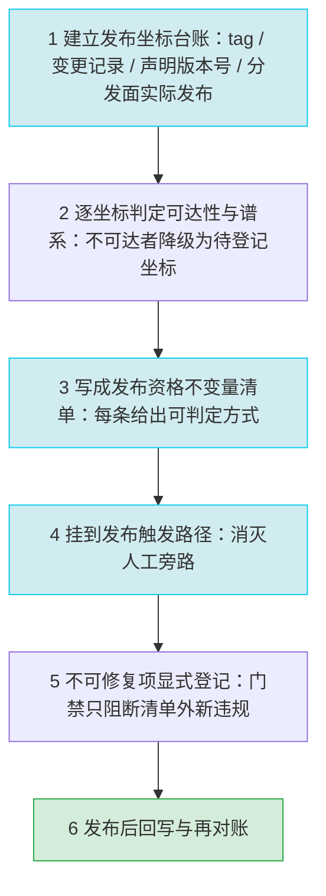

# 洞察与模式萃取：mystx 主题包全面复盘

> 本文件承载本轮复盘的核心中间产出：第一节为五条洞察的**完整四元组**（G2 PASS），第二节为竞争假设全表，第三节为与父项目基线的差异分析与 mystx 独有问题域，第四节为洞察深度自评，第五节为待补事实及其解决状态，第六节为限定说明，第七节为 E 阶段模式萃取全文（C1 主模式 + C2 要点 + C3 不入库理由），第八节为 V 阶段 11 条对抗审查意见摘要，附录为事实清单 F-001 ~ F-097 的编号索引。主报告见 [README.md](README.md)，行动项见 [actionable-items.md](actionable-items.md)。
>
> **权威来源**：本文件全部内容来自 Spec `mystx-comprehensive-retrospective-export` 的四份阶段中间产物——[facts.md](../../../../../.trae/specs/retrospectives-insights/mystx-comprehensive-retrospective-export/facts.md)（F-001 ~ F-097）、[insights.md](../../../../../.trae/specs/retrospectives-insights/mystx-comprehensive-retrospective-export/insights.md)（I-1 ~ I-5）、[e-stage-pattern.md](../../../../../.trae/specs/retrospectives-insights/mystx-comprehensive-retrospective-export/e-stage-pattern.md)（C1 / C2 / C3）、[v-adversarial-review.md](../../../../../.trae/specs/retrospectives-insights/mystx-comprehensive-retrospective-export/v-adversarial-review.md)（V-1 ~ V-11）。除结构重排与表述收束外，未引入任何清单外新事实。

## 第一节：五条洞察完整四元组（G2 PASS）

> 每条洞察按「现象 → 5-Whys 根因 → 影响 → 建议」四元组给出，根因表述统一为「**与现有事实一致的一种解释**」，不作唯一断言；竞争假设见第二节。方法说明：以 R 阶段 F 编号为唯一证据来源，逐层 Why 均挂接支撑 F 编号。

### I-1 发布可追溯性契约缺位：13 个 tag 分属 6 条独立谱系、11 个不在当前主线祖先链上，版本序列与变更记录同时失真

#### 现象

- mystx 当前分支历史共 32 次提交，日期区间 2026-08-21 ~ 2026-10-15，首个提交 subject 为「项目重置」（F-001、F-002）。
- 仓库含 13 个 tag（v0.1.1、v0.1.2、v0.1.3、v0.2.0、v0.2.1、v0.2.2、v0.3.0、v0.3.1、v0.3.2、v0.3.3、v0.3.4、v0.3.7、v0.3.8），版本序列中不存在 v0.3.5 与 v0.3.6（F-008、F-009）。
- 13 个 tag 全部为轻量 tag（`git cat-file -t` 返回 `commit` 而非 `tag` 对象）（F-010）。
- 13 个 tag 分属 6 条互相独立的谱系，每条谱系的根提交（`git rev-list --max-parents=0 <tag>`）subject 均为「项目重置」：`3dcd9f5` → v0.1.1（根提交日期 2024-12-25）、`9b61b35` → v0.1.2（2025-09-08）、`bed5041` → v0.1.3（2025-09-10）、`96fbfa9` → v0.2.0 / v0.2.1（2025-09-15）、`fb76d06` → v0.2.2 ~ v0.3.4 共 6 个 tag（2025-09-18）、`88e2ff2` → v0.3.7 / v0.3.8（当前主线谱系，2026-08-21）（F-089）。
- 落在当前主线谱系之外的 11 个早期 tag（v0.1.1 ~ v0.3.4）指向的提交均不是 HEAD 的祖先，其 creatordate 落在 2025-02-05 ~ 2025-11-17；仅 v0.3.7（aa9277e）与 v0.3.8（0b0b204）是 HEAD 的祖先（F-011、F-089）。
- 旧谱系仍是同一个 mystx 项目：`git show v0.3.4:pyproject.toml` 显示 `name = "mystx"`、`version = "0.3.4"`、`requires-python = ">=3.10"`、`dependencies = []`（F-090）。
- 旧谱系与 HEAD 之间的内容差异可直接比对：`git diff --stat v0.3.4 HEAD` → `69 files changed, 2892 insertions(+), 533 deletions(-)`；`git cat-file -t v0.3.4` → `commit`（F-088）。
- HEAD 相对 v0.3.8 领先 6 次提交；父仓 submodule status 描述为 `v0.3.8-6-g45bd1e4`，前缀为空格即指针一致（F-012、F-014）。
- `CHANGELOG.md` 仅含 `## [v0.3.8] - 2026-10-15` 一个条目（修复 2 条、测试 1 条），无 Unreleased 段；13 个 tag 中 12 个在 CHANGELOG 无对应条目（F-071、F-072）。
- 版本号来自 setuptools_scm 动态推导（`metadata.version.provider = scikit_build_core.metadata.setuptools_scm`），`__version__` 另有三级 fallback，末级为字符串 `"0.0.0.dev0"`（F-019、F-042）。
- 发布侧配置：`python-publish.yml` 由 GitHub `release: published` 事件触发，action ref 为 `actions/checkout@main`、`actions/setup-python@main`、`pypa/gh-action-pypi-publish@unstable/v1`；`lint.yml` 只有一个 `ruff check` job；`pages.yml` 的产物校验是「`doc/_build/html/index.html` 不存在则退出码 1」（F-055、F-056、F-058）。
- `classifiers` 中 `Development Status :: 3 - Alpha` 与仓库 tag 已达 v0.3.8 的状态并存（F-018）。
- 发布面实际发布坐标与仓库 tag 不闭合：PyPI 实际发布 9 个版本（0.2.1、0.2.2、0.3.0、0.3.1、0.3.2、0.3.3、0.3.4、0.3.6、0.3.7，latest 为 0.3.7），GitHub Releases 实测 11 条（`prerelease=true` 7 条、`draft=true` 0 条）；`mystx==0.3.6` 在 PyPI 存在（HTTP 200，upload_time 2026-09-03 23:59:43），`mystx==0.3.5` 与 `mystx==0.3.8` 的 JSON 接口均返回 HTTP 404；仓库最新 tag `v0.3.8` 未出现在任何分发面（F-092、F-093、F-094、F-097）。
- PyPI 各版本的 `requires_python` 呈三段分代：0.2.1 / 0.2.2 / 0.3.0 = `>=3.12`，0.3.1 / 0.3.2 / 0.3.3 / 0.3.4 = `>=3.10`，0.3.6 / 0.3.7 = `>=3.14`；0.3.7 的 `requires_dist` 共 58 项，其中 runtime 侧（无 `extra` 标记的顶层项）计数为 0（F-095、F-096）。

#### 5-Whys 根因

1. **Why 1**：13 个 tag 分属 6 条独立谱系，其中 4 条已被「项目重置」取代、其上的 tag 不在当前主线祖先集合内 —— 因为这 6 条谱系各自以一次「项目重置」为根提交，6 个根提交日期跨越 2024-12-25 ~ 2026-08-21，而当前主线的起点是 2026-08-21 的那条「项目重置」（F-089、F-011、F-002）。
2. **Why 2**：主线起点是一次重置而非连续演进 —— 因为当前仓库历史只有 32 次提交、跨 7 个日历日，被重置掉的那段历史只以「tag 引用」的形式残留在引用命名空间里；旧谱系未随重置做失效声明或迁移动作，6 条谱系并存至今（F-001、F-005、F-010、F-011、F-089）。
3. **Why 3**：残留 tag 未随重置处理 —— 因为 tag 在本仓库被当作「发布侧记账」而非「版本与历史的契约」来维护：13 个 tag 全是轻量 tag（F-010），既不携带说明与签名，也没有迁移动作或失效声明，重置后留下一批「指向不可达提交」的公开版本坐标。
4. **Why 4**：版本序列的完整性无人校验 —— 因为版本号缺号（F-009）、CHANGELOG 覆盖缺口（F-072）这类不一致在发布路径上没有任何检查点：发布由 GitHub Release 事件触发（F-058），CI 侧只有 ruff（F-055）与产物存在性检查（F-056），三者都不读版本序列、不比对 tag 与 CHANGELOG、不校验 tag 是否可达 HEAD。
5. **Why 5（系统性）**：**发布治理缺位 —— 「什么可以被发布」从未被写成可执行的不变量**。当前发布资格实质上由「是否有人在 GitHub 上点了一次 Release」决定（F-058），而版本可追溯性这一族契约——tag 可达性（F-011）、版本号连续性（F-009）、变更记录齐备（F-071、F-072）、成熟度分类与版本阶段匹配（F-018）——没有任何自动校验载体。因此谱系断层、版本缺号、变更记录缺口能够在同一个公开发布的包上同时长期并存。

#### 影响

- **对使用者**：PyPI 上可安装的历史版本（v0.2.1 ~ v0.3.4 共 7 个版本，F-092）对应的提交不在当前主线祖先链上（F-011）；版本差异可通过 `git diff <tag> HEAD` 直接比对（如 `git diff --stat v0.3.4 HEAD` → `69 files changed, 2892 insertions(+), 533 deletions(-)`，F-088），但 `git bisect` 这类依赖单一祖先链的回归定位工具在跨谱系历史中不可用，用户难以把 issue 复现到主线上的某一次提交（F-089）；版本坐标在两个方向上不闭合：仓库缺 v0.3.5 / v0.3.6 两个 tag，而 PyPI 实际发布了 0.3.6（2026-09-03）却没有对应的仓库 tag；反向地，最新的仓库 tag v0.3.8 从未发布到 PyPI 与 GitHub Release（PyPI latest 仍为 0.3.7）（F-009、F-093、F-094、F-097）；CHANGELOG 只覆盖最新一版（F-071、F-072），用户无从判断升级到 v0.3.8 会带来哪些行为变化——对每一次升级都只能靠读 diff 自行还原。
- **对维护者**：HEAD 已领先任何已发布版本 6 个提交（F-012、F-014），而「是否需要先打 tag、tag 是否必须打在 HEAD 上」没有任何约束（F-058）；`__version__` 的 fallback 链（F-042）意味着「非从 git 推导」的环境会报出 `0.0.0.dev0`，与 PyPI 上的 0.3.7（latest，F-092）并存却不产生任何告警，故障排查缺少版本判据。
- **风险叠加**：发布链路使用浮动 ref（F-058），上游 action 行为变化时发布内容本身不再可复现；与 I-1 的 tag 谱系断层叠加后，「这个 PyPI 版本对应仓库里的哪次提交」这一问题对 v0.1.1 ~ v0.3.4 已经没有答案——PyPI 上 v0.2.1 ~ v0.3.4 共 7 个版本确实可安装，但其对应提交不在当前主线祖先链上（F-092、F-011）；v0.1.1 ~ v0.1.3、v0.2.0 四个 tag 则从未发布到 PyPI（F-092、F-094）。

#### 建议

1. 建立**发布不变量清单**并固化为发布前置 job：tag 必须为 HEAD 祖先、版本号连续、CHANGELOG 存在对应条目、classifiers 与版本阶段匹配（F-018）、sdist/wheel 可复现构建（F-019）。
2. tag 改由 CI 在推送后创建为**注释型 tag**（现状为轻量 tag，F-010），使 tag 自身承载说明与可追溯性。
3. 为历史断层建立**显式声明**：在 README / CHANGELOG 中标注 v0.1.1 ~ v0.3.4 与当前主线的谱系断裂点、以及 v0.3.5 / v0.3.6 的缺号原因，避免下游误引用（F-009、F-011）。
4. 发布触发从「人工点 Release」改为「tag 推送 + 不变量校验通过」，消除人工发布这一未校验旁路（F-058）。
5. 恢复「每次发布更新 CHANGELOG + 保留 Unreleased 段」的仪式（F-071、F-072），并用自动化检查把仪式变成门禁而非纪律。

#### F 编号引用清单

F-001、F-002、F-005、F-008、F-009、F-010、F-011、F-012、F-014、F-018、F-019、F-042、F-055、F-056、F-058、F-071、F-072、F-088、F-089、F-090、F-092、F-093、F-094、F-095、F-096、F-097（26 个）

---

### I-2 运行时依赖契约缺位：包声明零运行时依赖，而 `import mystx` 的导入链硬依赖 invoke（invocations 为软依赖）

#### 现象

- `[project]` 的 `dependencies` 为空列表，运行时依赖声明为 0 项（F-024）。
- README「核心依赖」段逐条列出 5 项：`sphinx-book-theme>=1.1.4`、`sphinx>=8.0.0`、`myst-nb`、`myst-parser`、Python 3.14+，这 5 项在 `dependencies = []` 中均无对应声明（F-066）；README 与 pyproject 两侧的版本下界写法亦不同（`>=1.1.4` vs `>=1.1`、`>=8.0.0` vs `>=8.0`）（F-067）。
- 导入链：`src/mystx/__init__.py:19` 为 `from . import presets, tasks`；`src/mystx/tasks/__init__.py:24` 为 `from invoke import Collection`；`src/mystx/tasks/docs.py:34` 为 `from invoke import Collection, Exit, task`，`:37` 为 `from invocations import docs as _inv_docs`（该行带 `try/except ImportError` 包裹，由 `_HAVE_INVOCATIONS` 标志位控制，`:39` 为 `except ImportError:  # pragma: no cover - invocations 为可选依赖`）；F-041 据此判定 `import mystx` 的导入链包含 `invoke` 与 `invocations`，而 `[project] dependencies` 为空（F-041、F-084）。
- 两个依赖的失败语义不同：`invoke`（`src/mystx/tasks/__init__.py:24`、`src/mystx/tasks/docs.py:34`）**无 ImportError 保护，缺失即导致 `import mystx` 硬失败**；`invocations`（`src/mystx/tasks/docs.py:37`）**有 try/except 保护，缺失仅使 browse / tree / doctest 功能降级**（F-041、F-084）。
- `invoke>=2.0` 与 `invocations>=3.0` 只出现在 `tasks` 组，`test` 组含 pytest、pytest-cov、pytest-xdist、invoke（F-030）。
- 安装面：README 给出 `pip install "mystx[docs]"` 与 `pip install -ve .[dev]` 两条命令（F-068）；CI 安装 `pip install .[docs,dev]`（F-056）；RTD 以 pip method 安装 `.` 并附加 extras `[docs]`（F-060）；`dev-environment.yml` 的 pip 段为 `- .[docs]`（F-065）。
- 入口点声明为 `mystx = "mystx"`（F-023）；`__version__` 三级 fallback 至 `"0.0.0.dev0"`（F-042）。

#### 5-Whys 根因

1. **Why 1**：`import mystx` 的导入链需要 invoke / invocations，而运行时依赖为空 —— 因为包的导入图把「运行时扩展 API」与「开发者任务工具」放在同一条导入链上：`__init__.py` 直接 `from . import presets, tasks`（F-041），任务子包随包入口一起被加载。其中 invoke 无 ImportError 保护，缺失即 `import mystx` 硬失败；invocations 有 try/except 保护，缺失仅使 browse / tree / doctest 功能降级（F-084）。
2. **Why 2**：这两类职责没有被拆开 —— 因为打包时的隐含前提是「mystx 不会被裸安装」，于是全部真实依赖被放进可选组（docs 25 / test 4 / lint 4 / build 2 / tasks 2 / dev 21，F-025、F-026），运行时依赖段被留空（F-024），invoke / invocations 只落在 `tasks` 与 `test` 组（F-030）。
3. **Why 3**：该前提从未被检验 —— 因为已知的所有安装场景都带 extras：`.[docs,dev]`（F-056）、extras `[docs]`（F-060）、`.[docs]`（F-065）、`mystx[docs]` 与 `.[dev]`（F-068）；没有任何一个环境安装裸 wheel，最容易暴露「运行时依赖缺失」的入口不存在。
4. **Why 4**：不存在裸安装场景 —— 因为验证环境与消费环境被当作同一个环境：测试只以本地 pre-commit hook 形式存在（F-059、F-062），三个 workflow 无任何 pytest 执行（F-054、F-059），CI 与 RTD 的安装都携带最宽 extras（F-056、F-060）。验证矩阵覆盖的是「开发全集下能否构建」，而不是「用户声明的依赖集下能否 import 并渲染」。
5. **Why 5（系统性）**：**依赖契约与验证环境耦合 —— 「最小可安装单元」从未被验证**。包的对外契约由 `dependencies` 段与入口点（F-023、F-024）表达，但没有与之对应的最小环境验收：门禁只回答「在开发全集下能不能构建」（F-055、F-056），从不回答「在最小依赖集下能不能 import」。README 把 5 项称作「核心依赖」（F-066）正是这一耦合的外部表征——文档描述了真实契约，清单却不表达它，二者的差异无人负责消除。

#### 影响

- **对使用者**：按 README 安装（`pip install mystx` 或 `mystx[docs]`，F-068）后，在未预装 invoke / invocations 的环境中 `import mystx` 会落到 invoke 缺失的失败路径（F-041、F-030）；实测 docs 组 25 项不含 `invoke`（也不含 `invocations`），因此只装 `mystx[docs]` 的安装路径下 `import mystx` 必然失败（F-025、F-095）；PyPI 上 0.3.7 的 `requires_dist` 共 58 项、runtime 侧（无 `extra` 标记）计数为 0、docs extra 中匹配 `invoke` 的行计数为 0，构成同一结论的独立佐证（F-095）。
- 主题的真实使用前提（Sphinx + myst-parser + sphinx-book-theme，F-066）没有被任何安装路径自动满足，用户必须手工拼装依赖集，且拼装口径只能从 README 叙述（F-066、F-067）中推断。
- `__version__` fallback 到 `0.0.0.dev0`（F-042）会让「从源码目录直接使用」的环境报出与 PyPI 不同的版本号；叠加空依赖清单（F-024）与下界不一致（F-067），「mystx 支持哪个 Sphinx 主版本」这一最常被问的问题没有机器可读答案。
- 对下游集成者：入口点 `mystx = "mystx"`（F-023）在裸安装环境下能否被 Sphinx 成功加载，取决于运行环境恰好是否装了 invoke——失败会以「主题加载异常」的形式出现，而非清晰的依赖缺失提示。

#### 建议

1. **【P0 · 硬失败】消除 invoke 缺失导致的 `import mystx` 失败**：`mystx/__init__.py` 不再 eager import tasks 子包（改惰性 / 按需暴露），或把 `invoke>=2.0` 写入 `dependencies`，二选一即可使 `import mystx` 的导入面与用户运行所需一致（F-041、F-084）。
2. **【P0 · 硬失败】把真实运行时依赖写入 `dependencies`**（F-024），README 的「核心依赖」段改为从清单派生而非手写，消除 F-066 / F-067 的双份口径。
3. **【P1 · 软失败】保持 `invocations` 的可选语义**：`invocations` 的导入已有 try/except 保护，缺失仅使 browse / tree / doctest 功能降级（F-084），保留为可选依赖即可，不与 invoke 同级硬绑定。
4. **【P1 · 验收】增加「最小安装环境」验收 job**：仅 `pip install <wheel>` + `python -c "import mystx"` + 一次最小 Sphinx 构建，作为与现有 `pip install .[docs,dev]`（F-056）并列的独立关卡。
5. **【P2 · 治理】建立依赖声明的单一权威源**：在 `optional-dependencies` 与 `dependency-groups` 之间定一条规则（PEP 735 组为真源，extras 由其派生或显式登记差异），消除 F-027 的逐项重复与 F-028 的 dev 组分叉。

#### F 编号引用清单

F-023、F-024、F-025、F-026、F-027、F-028、F-030、F-041、F-042、F-054、F-055、F-056、F-059、F-060、F-062、F-065、F-066、F-067、F-068、F-084、F-095（21 个）

---

### I-3 质量门禁与发布流程解耦：51 个测试存在但对发布决策零约束，唯一真正会失败的环节不在发布路径上

#### 现象

- 测试资产：`tests/unit/` 下 9 个测试文件、合计 51 个 test 函数（经 `ast` 复核一致，无 `parametrize`、无 `async def test_`）；`tests/conftest.py` 仅 5 非空行，作用是把 `<repo>/src` 插入 `sys.path`；`tests/__init__.py` 与 `tests/unit/__init__.py` 均为 0 字节（F-049、F-050）。
- CI：三个 workflow（lint.yml / pages.yml / python-publish.yml）中无任何一个执行 pytest；pytest 仅以本地 pre-commit hook 形式存在（`entry: pytest`、`language: system`、`pass_filenames: false`、`stages: [push]`）（F-054、F-059、F-062）。
- 覆盖率：`pyproject.toml` 中不存在 `[tool.coverage]` 段（检索 `coverage` / `fail_under` 命中 0）；pytest `addopts` 为 `["-ra", "--strict-markers", "--strict-config"]`，不含 `--cov`；全仓构建与门禁配置中不存在 `fail_under` / `fail-under` / `--cov` 任一字符串（F-034、F-035、F-036）。
- CI 实际门禁：`lint.yml` 只跑 `ruff check .`（ruff 以 `==0.16.3` 精确固定，文件内注释写明固定意图）；`pages.yml` 跑 `invoke build` 并校验 `doc/_build/html/index.html` 存在（F-055、F-056）。
- 托管平台门禁：`.readthedocs.yml` 声明 `sphinx.fail_on_warning: true`（注释标注等价 `-W --keep-going`）；同一文件注释自述其意图为「把 CI 侧 `invoke build` 默认不带 `-W` 的门禁抬高到与 RTD 一致」（F-060、F-061）。
- 覆盖缺口：`configs.py`、`ext/` 与 `ext/github_readme_stats/` 全部 7 个文件、`tools/__init__.py`、`_version.py` 无对应测试文件；而 `ext/github_readme_stats/` 注册了 4 条对外 Sphinx 指令（`github-stats` / `github-top-langs` / `github-pinned-repo` / `github-wakatime`），该扩展在 `doc/conf.py:253` 被追加启用（F-051、F-047、F-073）。另有 `test_doc_parallel_extensions_p1.py` 以 20 项扩展的 `TARGET_EXTS` 启动 `parallel=4` 的最小 Sphinx app 并校验并行元数据（F-053）；包入口 `setup()` 亦返回 `parallel_read_safe` / `parallel_write_safe` 均为 True，Markdown/Notebook 链采用互斥注入（F-043、F-044）。
- 工具链固定策略不一致：pre-commit 的 flake8 传 `--max-line-length=100`，与 `[tool.ruff]` / `[tool.black]` 的 `line-length = 120` 数值不同；pre-commit 的 black 块 rev 为 23.10.1 且声明 `language_version: python3.10`，而项目 `requires-python` 为 `>=3.14`；pre-commit 的 mypy 块 rev 为 v1.5.1、附加依赖 `types-all`（F-062、F-063、F-064）；ruff `ignore = ["E501"]` 使 `__init__.py` 中 472 字符的单行 `__all__` 不被 lint 拦下（F-031、F-040）。

#### 5-Whys 根因

1. **Why 1**：CI 不跑测试 —— 因为 CI 的 job 集合只有 lint（F-055）与 pages 构建（F-056），测试执行被放在 pre-commit 的本地 hook 里（F-059）。
2. **Why 2**：测试执行被放在本地 hook —— 因为 CI 的质量目标被定义为「代码能过 lint、产物能构建出来」（F-055、F-056）；`pages.yml` 的产物检查回答的是「能否部署页面」，而不是「行为是否正确」。
3. **Why 3**：门禁目标被定义为构建可用性 —— 因为唯一的自动化门禁是从部署需求反推的，而仓库内没有被 CI 读取的「发布质量契约」（覆盖率下限、必过测试集、零告警要求之类），所以质量门的高度等于部署链路的最低要求（F-056、F-060）。
4. **Why 4**：缺口能长期存在 —— 因为工具链约束被分散在四个载体：`pyproject.toml` 的 ruff / black / mypy / pytest 段（F-031 ~ F-034）、`.pre-commit-config.yaml` 的 9 个 `repo` 块与 13 个 `- id:`（F-062）、三个 workflow（F-055 ~ F-058）、`.readthedocs.yml`（F-060、F-061）。载体之间没有对齐机制，同一约束在多处重复表达时数值可以不一致——行长 100 vs 120（F-063 vs F-031、F-033）、Python 目标 3.10 vs 3.14（F-064 vs F-017）。
5. **Why 5（系统性）**：**测试门禁与发布流程解耦，叠加工具链版本固定策略不一致**。质量契约没有被落成「发布路径上的一个可判定关卡」，测试资产与发布决策之间没有任何连线；同时「同一工具约束只在一处声明、其余对齐」的纪律缺失，使本地 pre-commit、CI、RTD 三套环境产出三种结论。反直觉之处在于：三套环境里唯一会因文档告警而失败的 RTD（F-060、F-061）不在发布路径上，而发布路径（lint + build + 产物存在，F-055、F-056、F-058）完全不看测试。

#### 影响

- **对使用者**：回归可静默发布——51 个测试对发布决策零约束（F-049、F-059），未覆盖的 7 个 ext 文件（F-051）中包含 4 条对外注册的 Sphinx 指令（F-047），且该扩展已在项目自身文档构建中启用（`doc/conf.py:253`，F-073），其行为变更不会被任何自动检查拦下；覆盖率基线不可复现（F-035、F-036），任何「覆盖率达标」的口头结论都无法被第三方复核。
- **对维护者**：同一份代码在本地 pre-commit、CI、RTD 三处可能得出不同结论（三套行长标准 F-063 / F-031 / F-033、三套 Python 版本目标 F-064 / F-017），「本地过了」不等于「发布能过」；pre-commit 的 black 23.10.1 在 `python3.10` 下运行（F-064），与目标版本 py314 的语法面存在落差。RTD 是唯一的高标准关卡（F-060），但它不阻断 PyPI 发布（发布由独立的 GitHub Release 事件触发，F-058），高标准与发布事实脱钩。
- 治理侧后果：ruff 显式关闭 E501（F-031）后，472 字符的单行 `__all__`（F-040）长期合法化——门禁为了迁就存量而放宽规则，进一步说明「规则与门禁的取舍没有统一裁量点」。

#### 建议

1. **把质量门收敛到发布路径上的单一关卡**：lint + `pytest --cov --cov-fail-under=<阈值>` + 构建产物校验 + 版本不变量校验，合并为一个 workflow job 序列；RTD 降为附加关卡而非唯一高标准关卡（F-055、F-056、F-060）。
2. **显式设立覆盖率配置**（`[tool.coverage]` + `fail_under`，F-035、F-036）与必过测试集，把覆盖率从「不可测」变为「可复现」。
3. **工具链单一化**：pre-commit 的工具版本与参数向项目实际配置对齐（ruff 0.16.3 / line-length 120 / py314，F-031、F-033、F-064），或直接以 ruff 取代 flake8 / black / isort 的重复表达，消除 F-063 的数值分叉。
4. **为 ext/ 的 4 条指令补最小行为测试**（F-047、F-051），或把「ext/ 未覆盖」显式登记为已知风险并配一条防回归用例。
5. 把 `ruff ignore = ["E501"]`（F-031）与 472 字符 `__all__`（F-040）作为一个独立小项处理：要么拆行、要么把该 ignore 收窄到具名例外。

#### F 编号引用清单

F-017、F-031、F-033、F-034、F-035、F-036、F-040、F-043、F-044、F-047、F-049、F-050、F-051、F-053、F-054、F-055、F-056、F-058、F-059、F-060、F-061、F-062、F-063、F-064、F-073（25 个）

---

### I-4 文档与实现无单一事实源：依赖、版本、工具链、目录布局四类事实被手工复制到多个载体并持续漂移

#### 现象

- README「核心依赖」5 项与 `dependencies = []` 矛盾（F-066、F-024）；版本下界写法 `>=1.1.4` / `>=1.1`、`>=8.0.0` / `>=8.0` 不一致（F-067）。
- README 示例含 `locale_dirs = ['../locales/']`，对仓库全目录递归检索 `locales` 目录命中数为 0；`doc/conf.py:48` 使用同一取值（F-069、F-073）。
- README 提供两种主题配置方式：`html_theme_options` 字典形式与 `_config.toml` 形式；仓库确有 `doc/_config.toml` 含 `[html_theme_options]` 段（F-070、F-074）。
- `CHANGELOG.md` 18 物理行、仅 v0.3.8 一个条目、无 Unreleased 段；12 个 tag 无对应条目（F-071、F-072）。
- `CONTRIBUTING.md` 124 行，检索 `pytest` / `coverage` / `ruff` / `black` / `pre-commit` / `invoke` 六关键词命中数为 0（F-082）。
- `classifiers` 仍为 `Development Status :: 3 - Alpha`，与 v0.3.8 并存（F-018）。
- 仓库根 `LICENSE` 为 Apache License 2.0 全文，且仓库内仅此一个 LICENSE 文件（F-080）；而 `doc/_ext/sphinx_docx/writer.py` 为 901 非空行 / 1133 物理行，文件首行即 `import logging`、无模块级 docstring、检索归属关键词仅命中 docutils 的 `visit_attribution` / `depart_attribution` 函数名，无许可证头与上游归属声明（F-075、F-076）；`doc/_ext/gallery_directive.py` 的模块 docstring 自述「目前为 pydata-sphinx-theme 维护者存在」（F-078）。
- README 同时承载 GitHub / PyPI / Read the Docs 三条对外链接（F-081）。

#### 5-Whys 根因

1. **Why 1**：文档与实现不一致 —— 因为依赖集（F-066）、版本成熟度（F-018）、工具链命令（F-082）、目录布局（F-069、F-073）四类事实同时存在于 README / CHANGELOG / CONTRIBUTING / `pyproject.toml` 四个手工维护的载体中，任何一处更新都需人工同步其余多处。
2. **Why 2**：四份手工副本需要长期同步 —— 因为这些事实没有被单一源派生：文档是叙述产物而非构建产物，仓库内没有任何生成器或校验脚本把文档声明与清单实体做 diff（F-035、F-036 显示连纯配置项都尚无机器校验）。
3. **Why 3**：没有这类校验 —— 因为质量门禁集合只覆盖代码与产物（ruff F-055、build + 产物存在 F-056），没有一项覆盖「文档声明 vs 仓库实体」；而 RTD 的 `fail_on_warning`（F-060）只对 Sphinx 文档告警生效，对 README 中的依赖声明与目录路径无感（F-069）。
4. **Why 4**：漂移能跨版本累积 —— 因为发布仪式未制度化：13 个 tag 只产出 1 条 CHANGELOG 条目（F-071、F-072），而该仪式在历史上从未真正建立（旧谱系的 `CHANGELOG.md` 或不存在、或仅含「xyzstyle 项目」模板头而无任何版本条目，F-091），而不是先建立再漏做 12 次；仪式既无起点也无载体，其余载体也就失去了更新的触发点。
5. **Why 5（系统性）**：**文档与实现缺乏单一事实源与机器校验，发布仪式被降级为可选习惯**。文档质量从未进入发布路径的判据，于是漂移呈现「最近一版贴近实现、历史全缺」的不对称形态——F-066（依赖）与 F-069（路径）指向当下失准，F-071 与 F-072 指向历史全缺，二者同时成立。许可侧是同一机制的另一面：内嵌的第三方实现（F-075、F-076、F-078）在缺少「逐目录归属登记」这一仪式的前提下，也无法获得许可声明，而仓库内只有一份 Apache-2.0 LICENSE（F-080）。

#### 影响

- **对使用者**：照 README 行动会踩空——`pip install "mystx[docs]"`（F-068）不会自动安装被称作「核心依赖」的 4 个包（F-066、F-024）；照抄 `locale_dirs = ['../locales/']`（F-069、F-073）会得到一份没有翻译资源的文档；升级决策缺依据——CHANGELOG 只有 v0.3.8（F-071、F-072），用户无从判断 v0.1.1 ~ v0.3.7 各自带来什么行为变化，且 12 个 tag 的变更信息在源头即未被保留（旧谱系无该文件或仅有模板头，F-091），补录不可行。
- **对维护者与贡献者**：`CONTRIBUTING.md` 124 行不含任何工具链或测试命令（F-082），而实际存在 ruff / pytest / invoke 三套入口（F-055、F-056、F-059），新人没有可执行的上手路径；`classifiers` 标 `3 - Alpha`（F-018）在 PyPI 页面上给出错误的成熟度信号，抑制下游采用。
- **许可与合规**：RTD 的发布格式包含 htmlzip / epub / pdf（F-060），这些产物会包含 `doc/_ext/sphinx_docx/writer.py` 贡献的 docx 输出能力；而该文件 1133 行、无许可证头与上游归属声明（F-075、F-076、F-078），在对外产物中该段落的许可状态未被声明，仓库内唯一可援引的 LICENSE 是 Apache-2.0（F-080）。

#### 建议

1. **指定单一事实源**：依赖集、版本、工具链命令以 `pyproject.toml` 与 CI 配置为准，README 相关段落改为派生或由校验脚本守护（覆盖 F-066、F-067、F-082 的漂移面）。
2. **建立「文档-实现一致性检查」**：校验 README 中出现的依赖名、版本下界、目录路径在仓库中真实存在（覆盖 F-069 类的路径断言），并纳入 CI。
3. **恢复每版本 CHANGELOG 条目并增加 Unreleased 段**，与 tag 集合对账（F-071、F-072）；历史侧改为在 README / CHANGELOG 中显式声明「旧谱系无变更记录、不可追补」（F-091），不做逐版本回填。
4. **修正 `classifiers`**，使其与 0.3.x 阶段一致（F-018）。
5. **对 `doc/_ext/` 建立逐目录归属登记**：`gallery_directive.py` 已自述来自 pydata-sphinx-theme（F-078），`sphinx_docx/writer.py` 需补上游来源与许可声明（F-075、F-076、F-080）。

#### F 编号引用清单

F-018、F-024、F-035、F-036、F-055、F-056、F-059、F-060、F-066、F-067、F-068、F-069、F-070、F-071、F-072、F-073、F-074、F-075、F-076、F-078、F-080、F-081、F-082、F-091（24 个）

---

### I-5 声明面冗余且无权威源：同一约束在多处重复表达，重复即分叉

#### 现象

- 依赖声明双轨：`[project.optional-dependencies]` 含 6 组（docs 25 / test 4 / lint 4 / build 2 / tasks 2 / dev 21），`[dependency-groups]` 含 6 组（dev 11 / docs 25 / test 4 / lint 4 / build 2 / tasks 2）（F-025、F-026）。
- docs / test / lint / build / tasks 五组在两侧的条目集合逐项完全一致（集合差为空）；dev 组两侧不一致——optional 侧显式列出 21 个包，dependency-groups 侧为 11 项 = 5 个 `{include-group = ...}` 引用 + 6 个显式包（F-027、F-028）。
- optional 侧 dev 组的 21 项与 group 侧 dev 组的展开并集（42 项）不相等：并集独有 23 项 = docs 组 22 项 + tasks 组的 `invocations>=3.0`；同时 docs 组另有 `myst-nb` / `myst-parser>=4.0` / `sphinx>=8.0` 3 项不在并集内；optional 侧独有 2 项（`docutils>=0.20`、`myst-docutils>=4.0`）（F-086）。
- `tasks` 组在两侧均含 `invoke>=2.0` 与 `invocations>=3.0`；`test` 组含 pytest / pytest-cov / pytest-xdist / invoke（F-030）。optional 侧 `dev` 组 21 项**含** `invoke>=2.0` 但**不含** `invocations>=3.0`——后者仅出现在 `tasks` 组（F-087），同一约束在两侧落点不同。
- 构建配置内重复：`[tool.setuptools_scm]` 同时声明 `version_file` 与 `write_to`，两者指向同一路径 `src/mystx/_version.py`；该文件存在于工作区磁盘但未被 git 跟踪，且 `.gitignore` 显式排除该路径（F-021、F-022）。
- 任务入口重复：仓库根 `tasks.py` 存在且可加载（`test_repo_tasks_entry.py` 对其做静态对账），与包内 `src/mystx/tasks/` 并存（F-052、F-041）。
- 冗余资产：`src/mystx/tools/__init__.py` 为 0 字节空文件，对全仓 `src/` 与 `tests/` 检索 `mystx.tools` / `from .tools` / `import tools` 三种模式命中数为 0（F-039）。
- 工具约束重复且已分叉：pre-commit flake8 `--max-line-length=100` vs 项目 ruff / black 的 120（F-063、F-031、F-033）；pre-commit black rev 23.10.1 + `language_version: python3.10` vs `requires-python >=3.14`（F-064、F-017）；pre-commit 共 9 个 `repo` 块 / 13 个 `- id:` 条目（F-062）。
- 环境定义分散：`dev-environment.yml` 为 conda 环境定义（`name: mystx-dev`、`channels: [conda-forge]`），pip 段仅 `- .[docs]`（F-065）。

#### 5-Whys 根因

1. **Why 1**：依赖清单在两处重复且已不一致 —— 因为 PEP 621 extras 与 PEP 735 dependency-groups 面向不同消费者（终端用户可安装 extras / 开发工具 group），作者按「两边都写全」的方式填充，却未指定哪一边是权威（F-025、F-026、F-027、F-028）。
2. **Why 2**：未指定权威源 —— 因为缺少一份被所有消费方共同引用的「依赖契约」：CI 读 `.[docs,dev]`（F-056）、RTD 读 extras `[docs]`（F-060）、conda 环境读 `.[docs]`（F-065）、README 读 `mystx[docs]` 与 `.[dev]`（F-068），四处各读一份副本，彼此一致性只靠人工记忆维持。
3. **Why 3**：一致性无核验机制 —— 因为构建与门禁配置集合中没有任何一项比对两个依赖段（F-035、F-036 显示连纯配置项的校验都缺），也没有任何一项比对各处声明的工具版本与参数（F-063、F-064 已是既成事实）。
4. **Why 4**：重复开始分叉 —— 因为同一约束被多处重复表达：版本文件路径被 `version_file` 与 `write_to` 同时指定（F-021、F-022）、行长有 100 与 120 两套（F-063、F-031、F-033）、Python 目标有 3.10 与 3.14 两套（F-064、F-017）、任务入口有仓库根与包内两处（F-052、F-041）、依赖组有两套机制（F-025、F-026）。
5. **Why 5（系统性）**：**声明面冗余且无权威源 —— 「同一约束只在一处声明、其余由校验对齐」的纪律缺失**。冗余本身不构成缺陷，缺陷在于没有裁决机制：当同一事实被 N 处表达而无一处被指定为真源时，任何一次修改都要求 N 处同步，而 CI 只验证 ruff 与构建（F-055、F-056），不验证副本间一致性，分叉便在无人察觉的情况下累积（F-028、F-021、F-063、F-064）。

#### 影响

- **对使用者**：安装面污染——`invocations>=3.0`（F-030）若非预期包名，安装 `mystx[tasks]` 的用户会直接安装失败；由于 tasks 组同时出现在 extras 与 group 两侧（F-027），污染面被复制到两条安装路径。
- **对维护者**：环境不可等价——走 `pip install -e .[dev]`（F-068，optional 侧 21 项）与走 PEP 735 dev group（11 项，F-028）得到的工具集不同；conda 环境（F-065）只带 docs 组、不含 test / lint 组，「我这儿能跑」与「CI 能跑」不可互推。
- 构建稳定性隐患：`version_file` 与 `write_to` 同时指向同一路径（F-021）在 setuptools_scm 版本演进下行为不确定，而生成物恰被 `.gitignore` 排除（F-022），失败时不会在仓库内留下可诊断的证据。
- 维护成本被放大：每个新约束都要在多个副本中重复声明，而门禁不覆盖副本间一致性，修正遗漏难以被发现——这正是 I-4 文档漂移在配置层的同构表现（两处分叉机制，共享同一个根因：无权威源）。

#### 建议

1. **指定依赖契约的单一真源**：PEP 735 `dependency-groups` 为开发侧真源，`optional-dependencies` 由其派生或对每一处差异显式登记理由（消解 F-027 的逐项重复与 F-028 的分叉）。
2. **核实并修正 `invocations>=3.0`**（F-030）；若确为笔误且已造成安装失败，作为独立的发布阻塞项处理，而非并入打包一致性条目。
3. **清理配置重复**：`version_file` / `write_to` 择一（F-021）；任务入口择一收敛（F-052、F-041）；`src/mystx/tools/` 空壳删除或补齐（F-039）。
4. **引入配置一致性检查 job**（同一约束跨载体比对），与 I-3 的工具链单一化合并落地。
5. **统一环境定义**：conda 环境（F-065）与 extras / group 的关系写明，避免第三套独立口径。

#### F 编号引用清单

F-017、F-021、F-022、F-025、F-026、F-027、F-028、F-030、F-031、F-033、F-035、F-036、F-039、F-041、F-052、F-055、F-056、F-060、F-062、F-063、F-064、F-065、F-068、F-086、F-087（25 个）

---

## 第二节：竞争假设全表

> 每条洞察的根因均为「与现有事实一致的一种解释」，以下列出可解释同一现象的竞争性解释，并给出区分判据。**本报告采纳的解释与现有事实一致，但竞争假设未穷尽**（见第六节限定说明第 1 条）。

| 洞察 | 竞争假设 | 内容 | 与本报告采纳解释的关系 | 区分判据（所需证据） |
|---|---|---|---|---|
| I-1 | H1-A | 历史断层源于一次有意且已声明的仓库重建（如私有转公开、历史脱敏或代码库重组），旧 tag 因无害而保留 | 若属实，根因从「发布治理缺位」收窄为「重建后的清理动作未完成」，问题面从制度层降为一次性清理事项 | 仓库内是否存在重建 / 脱敏声明；`git config` 中是否存在历史替换痕迹（facts.md 未取证） |
| I-1 | H1-B | 版本缺号与 CHANGELOG 缺条源于发布由外部自动化（CI 流水线 / PyPI 自动化发布）代劳，仓库内不保留发布记录 | 若属实，问题落在「发布记录未回流仓库」而非「无人校验」，F-009 与 F-072 的性质从契约违规变为记录缺失 | GitHub Actions runs 与 PyPI 发布记录中是否能看到与 13 个 tag 对应的发布条目（facts.md 未取证） |
| I-2 | H2-A | `invoke` / `invocations` 出现在导入链是单点疏漏，真实意图是 tasks 仅供文档构建使用 | 若属实，根因偏「疏漏」而非「依赖契约与验证环境耦合」；但由于 `import mystx` 即触发该导入（F-041），修复面仍是导入面 | 包的发布说明或代码注释中是否声明过「仅开发期使用 tasks」；本次 facts.md 未取证 |
| I-2 | H2-B | `dependencies = []` 是有意的「零依赖」设计（依赖由 Sphinx 宿主环境提供），README 的「核心依赖」只是叙述性建议 | 若属实，问题从「依赖契约缺位」转为「文档表述与设计意图不一致」，I-2 的第 5 层根因需改写 | 需要「裸安装可在无 invoke 环境成功 import」的证据（facts.md 未取证，列入第五节） |
| I-3 | H3-A | CI 不跑 pytest 是刻意的「本地开发即门禁」策略，以节省 CI 时间 | 若属实，根因是成本权衡而非解耦；但 pre-commit 的工具版本严重滞后（F-064）、且该 hook 仅在 push 阶段运行（F-059），不足以支撑「等价门禁」 | pre-commit hook 的实际触发条件与失败行为；CI 时长配额与跳过 pytest 的决策记录（facts.md 未取证） |
| I-3 | H3-B | 测试不进入 CI 是因为测试自身依赖 invoke，而 `test_repo_tasks_entry.py` 以 `pytest.importorskip("invoke")` 作守卫（F-052），缺失的执行路径被守卫掩盖 | 若属实，根因是「测试守卫掩盖了缺失的执行路径」，仍属门禁缺位，但责任落点从「制度」移至「测试设计」 | CI 是否具备安装 invoke 的条件（F-030 中 invoke 位于 test 组）；importorskip 在无 invoke 环境下的实际行为（facts.md 未取证） |
| I-4 | H4-A | README 的依赖段面向「从源码克隆开发」的读者，而面向 PyPI 用户的真实契约在别处（如 RTD 文档）——即两者本就服务不同受众 | 若属实，漂移面小于表面观察，I-4 的根因应弱化为「README 段落归属不清」；但 F-081 显示同一份 README 同时承载 PyPI 与 RTD 两条对外链接，F-068 给出面向最终用户的安装命令，跨受众假设解释力有限 | 是否存在独立的「面向 PyPI 用户的依赖说明」载体（facts.md 未取证） |
| I-4 | H4-B | CHANGELOG 只有一条是因为历史版本从未在公开渠道发布（仅本地打 tag），而非仪式被跳过 | 若属实，F-072 的性质从「变更记录缺口」变为「历史版本从未发布」，I-4 的第 4 层根因需改写 | PyPI 上 mystx 的实际发布版本列表（facts.md 未取证，列入第五节） |
| I-5 | H5-A | `optional-dependencies` 与 `dependency-groups` 的重复是刻意的生态兼容（pip 用 extras、PEP 735 用 groups），dev 组的差异只是「表达方式不同」（include-group 引用 vs 展开） | 若属实，F-028 的差异是表达差异而非内容差异，根因从「无权威源」收窄为「需明确两者语义分工」；注意 F-027 已证明五组两侧集合完全一致，F-028 的 dev 组为 21 项 vs 11 项 | optional 侧 dev 组 21 项是否等于 group 侧 5 个 include-group 的展开并集（facts.md 未取证，列入第五节） |
| I-5 | H5-B | 配置重复源自模板复用（如 pydata-sphinx-theme 模板带入）而非主动设计 | 若属实，根因是「模板继承未清理」，与 F-078 中 `gallery_directive.py` 自述来自 pydata-sphinx-theme 的线索方向一致；但该线索涉及 `doc/_ext/` 而非构建配置，关联为间接 | `pyproject.toml` / `.pre-commit-config.yaml` 是否可追溯到某公开模板（facts.md 未取证） |

**竞争假设统计**：共 10 条（I-1 两条、I-2 两条、I-3 两条、I-4 两条、I-5 两条），其中 6 条（I-1 H1-B、I-2 H2-B、I-3 H3-B、I-4 H4-B、I-5 H5-A、I-5 H5-B）需要 facts.md 之外的新证据才能裁决，对应线索已全部进入第五节待补事实。

---

## 第三节：与父项目基线的差异分析

> 基线：[retrospective-xuanspace-comprehensive-20261010](../retrospective-xuanspace-comprehensive-20261010/insight-extraction.md)（父项目 xuanspace 全面复盘）。基线主洞察 4 条（I-1 ~ I-4）逐条覆盖；基线 §2 的 5 行交叉基线对照项亦逐条覆盖，无跳过。mystx 侧与父项目 mystx 相关的基线事实仅 F-056（纯 Python 打包门禁双轨化）/ F-057（子模块指针新增 libs/mystx）/ F-059（文档与配置治理）三条，属间接覆盖，本报告不重复其结论，仅作对照。

| 基线洞察 | 差异类型 | mystx 侧依据（F 编号） | 说明 |
|---|---|---|---|
| 基线 I-1：增量节奏从「单峰冲刺」细化为「多段事件脉冲」，根因指向协作模型缺常驻待办池 | 强化 | F-001、F-002、F-005、F-006、F-011 | mystx 32 次提交跨 7 个日历日、2026-08/09/10 分别 4/12/16（F-001、F-005、F-006），同为事件脉冲形态，基线规律在子模块尺度成立；且在脉冲之上叠加了基线完全未覆盖的历史断层（F-002、F-011），即同规律 + 更严重后果 |
| 基线 I-2：治理重心迁移为结构治理，「迁入即治理」是内在规律（外部单体迁入 → 私有约定升级为公共约束） | 反转 | F-016、F-019、F-024、F-027、F-028、F-063、F-066、F-069、F-071、F-082 | 父项目把「迁入即治理」表述为会自然发生的规律；mystx 侧的迁入窗口确实完成了构建后端对齐（F-016、F-019），但依赖契约（F-024、F-027、F-028）、文档契约（F-066、F-069、F-071）、门禁契约（F-082）三类均未在同一窗口闭环 → 规律并非自动发生，必须由强制关卡承载，这正是父项目 ACT-02（迁入即治理检查单纳入 `xs doctor`）尚未落到子模块的缺口 |
| 基线 I-3：上游依赖策略从「依赖外部」升级为「对外部行为分级建模锁定」（L0-L3 + 怪癖台账） | 新增 | F-029、F-047、F-066、F-075、F-076、F-078、F-080 | mystx 侧存在同类问题域但机制缺位：依赖外部 sphinx-book-theme（F-029、F-066）却无任何行为契约或怪癖台账；反向证据是 mystx 自身内嵌了 `doc/_ext/` 第三方实现（F-075、F-076），其中 `gallery_directive.py` 自述来自 pydata-sphinx-theme（F-078），而归属与许可声明缺位（F-080）。该主题由「父仓独有」扩展为「父仓 + 子模块共性且未制度化」 |
| 基线 I-4：结构由单包极化迁移为多库扩张，暴露「分布式增量变更 vs 集中式全局约束」的结构性张力 | 强化 | F-001、F-012、F-015、F-024、F-063、F-066、F-069 | mystx 以 81 个跟踪文件的单包形态（F-015）复现同一张力：局部会话持续提交（F-001、F-012）与分散在 `pyproject.toml`、pre-commit、README、CONTRIBUTING 四处的约束声明并存且互不一致（F-024 pyproject 依赖清单、F-063 pre-commit 行长、F-066 README 依赖段、F-069 locale 路径）；规模更小，但一致性债的形态与父仓一致 |
| 交叉基线 · 节奏形态（基线 §2 对照项：全量单峰 → 增量多段脉冲） | 强化 | F-005、F-006、F-011、F-012 | 活跃日 7 个、月度 4/12/16 的脉冲形态与父仓同构（F-005、F-006）；差异在于 mystx 的脉冲之间还叠加了谱系断裂（F-011、F-012），即同形态 + 额外的可追溯性缺口 |
| 交叉基线 · 质量投入（基线 §2 对照项：增量期质量活动内嵌于重构提交，反转「质量前置」结论） | 强化 | F-047、F-049、F-051、F-054、F-059、F-060、F-061 | 父仓的「质量内嵌」在 mystx 侧退化为「测试资产存在但与发布决策零耦合」：51 个测试函数（F-049）无一进入三个 workflow（F-054、F-059），未覆盖的 ext 7 文件中含 4 条对外注册指令（F-047、F-051），唯一高标准关卡 RTD（F-060、F-061）不在发布路径上 —— 父仓的「内嵌」在子模块退化为「不相交」 |
| 交叉基线 · 结构重心（基线 §2 对照项：单点极化 → 多库扩张） | 无变化 | F-015、F-046、F-037 | 基线结论描述的是父仓多包结构演进（libs 由 6 增至 8）；mystx 侧为单包 + 内部模块结构（81 个跟踪文件 F-015、20 个 Python 文件 F-037、主题资产 6 文件 F-046），既无极化也无扩张议题，无对照事实可供加强或反驳，标注为无变化而非新增 |
| 交叉基线 · 依赖治理视角（基线 §2 对照项：20260826 基线未涉及，20261010 判为新增） | 新增 | F-024、F-030、F-035、F-036、F-041、F-027、F-028 | mystx 侧把「依赖治理」从基线的「上游行为锁定」扩展到「自身声明面的自洽」：invoke / invocations 的导入链与空 runtime 依赖（F-024、F-041、F-030）、双轨依赖组（F-027、F-028）、无依赖一致性校验（F-035、F-036）构成基线未覆盖的自洽性维度 |
| 交叉基线 · 开发主体（基线 §2 对照项：Trae Agent 占比 70.3% 且稳定） | 无变化 | F-007 | mystx 作者分布为 `xinetzone <735613050@qq.com>` 25 次、`xinzo <xinzo@trae.cn>` 7 次（F-007），未出现 "Trae Agent" 署名；本次未取证提交者身份，基线结论在 mystx 侧既不能加强也不能反驳，标注为无变化并列入第五节待补事实 #2 |

**差异类型分布**：强化 4 条（基线 I-1、基线 I-4、交叉·节奏形态、交叉·质量投入）、反转 1 条（基线 I-2）、新增 2 条（基线 I-3、交叉·依赖治理视角）、无变化 2 条（交叉·结构重心、交叉·开发主体）—— 合计 9 行，覆盖基线主洞察 4 条 + 交叉基线对照项 5 条，无跳过。

### mystx 独有、基线未覆盖的问题域

| # | 问题域 | mystx 侧依据（F 编号） | 基线为何未覆盖 |
|---|---|---|---|
| D-1 | 发布谱系断层与版本可追溯性 | F-002、F-008、F-009、F-010、F-011、F-012、F-071、F-072 | 基线只讨论提交节奏与仓库结构，从未涉及 tag 可达性、版本号连续性、CHANGELOG 与 tag 对账 |
| D-2 | 运行时依赖契约与最小安装环境 | F-023、F-024、F-041、F-066、F-068 | 基线的依赖议题是「上游行为对等性」，不是自身包的依赖声明与导入面 |
| D-3 | 质量门禁与发布流程的耦合形态 | F-049、F-051、F-054、F-059、F-060、F-061 | 基线以「质量活动内嵌于重构提交」解释质量面，mystx 侧表现为「测试与发布路径完全不相交」，形态未在基线中出现 |
| D-4 | 文档-实现单一事实源缺位 | F-066、F-067、F-069、F-071、F-082 | 基线有文档原子化与目录改名的结论，但无「同一事实跨载体手工复制」的漂移机制分析 |
| D-5 | 第三方实现的归属与许可登记 | F-075、F-076、F-078、F-080 | 基线无许可合规维度 |
| D-6 | 单包内部配置冗余与冗余分叉 | F-021、F-022、F-027、F-028、F-039、F-052、F-063、F-064 | 基线覆盖「跨 20 个 `pyproject.toml` 的一致性」，未覆盖「单包内部多载体重复」 |

---

## 第四节：洞察深度自评

> 评分锚点：1 = 现象复述、3 = 部分触及系统性、5 = 触及系统性根因；threshold ≥ 4。

| 洞察编号 | 评分(1-5) | 评分理由 |
|---|:---:|---|
| I-1 | 5 | 根因落在「发布资格无可执行不变量、发布由人工 Release 触发」这一制度层，而不是「tag 打错了」。5 层追问逐环挂接 F 编号：重置起点（F-002、F-011）→ 轻量 tag 无迁移动作（F-010）→ 版本序列与 CHANGELOG 无校验点（F-009、F-072）→ CI 只看 ruff 与产物存在（F-055、F-056）→ 制度缺位（F-058）。同时用 F-014（`v0.3.8-6-g45bd1e4`）说明该制度缺位已在真实发布坐标上留痕，已越过现象复述层 |
| I-2 | 5 | 根因落在「依赖契约与验证环境耦合、最小可安装单元从未被验证」，而不是「忘了加依赖」。证据链横跨依赖三层（F-024、F-025、F-026）、导入链（F-041）、四个安装面（F-056、F-060、F-065、F-068）与两个验证面（F-054、F-059），并指出失效恰好发生在唯一未被验证的维度上——属于系统性层 |
| I-3 | 5 | 根因落在「质量门禁未落进发布路径 + 工具链约束多载体重复无对齐」，把「51 个测试不跑」重构为「测试与发布决策之间没有连线」；并给出反直觉结构：唯一会因告警失败的 RTD（F-060、F-061）不在发布路径上，发布路径完全不看测试（F-055、F-056、F-058）。已触达制度层 |
| I-4 | 4 | 根因落在「文档无单一事实源 + 机器校验缺失 + 发布仪式被降级为习惯」，属系统性层。扣 1 分：F-067 的版本下界写法差异（`>=1.1.4` vs `>=1.1`）本身可由单点修正解释，本条在「四类事实跨载体漂移」与「个别笔误」之间的归因权重未获独立证据，故未给 5 分 |
| I-5 | 4 | 根因落在「声明面冗余且无权威源、无副本一致性校验」，属系统性层。扣 1 分：F-028 的 dev 组差异究竟是「真分叉」还是「include-group 展开的表达差异」尚需一条未取证事实（第五节 #3）才能定论；在该证据到位前，本条的普遍性不宜按 5 分计 |

**自评分布**：5 分 3 条（I-1、I-2、I-3）、4 分 2 条（I-4、I-5），最低 4 分，全部满足 threshold ≥ 4（AC-12 / TR-2.4）。

> **交叉核验说明**：V 阶段 §5.1 的 AC-12 核对采用统一 4 分基线复核，判定「5 条均 ≥4，PASS」——两种评分口径的**判定结论一致**（全部 ≥ 阈值），差异仅在于 I-1 / I-2 / I-3 是否各给 5 分。本文件保留 I 阶段逐条评分的可审计细节。

---

## 第五节：待补事实与解决状态

> 以下为 I 阶段发现、但 R 阶段未取证、且对结论有实质影响的线索。本报告不以任何方式就这些线索作断言；对应竞争假设的裁决亦因此保持开放。H 段回填与 V 阶段补充取证已解决其中 5 条。

| # | 线索 | 为什么重要 | 需要什么证据 | 解决状态 |
|---|---|---|---|---|
| 1 | `invocations>=3.0`（F-030）是否为有效 PyPI 包名、是否曾造成实际安装失败 | 决定 I-5 的影响面是「安装面污染」还是「无害的冗余条目」，并决定该项是否应独立成为发布阻塞项（对应 spec Open Question Q4） | PyPI 包名存在性与版本查询；`pip install "mystx[tasks]"` 的安装日志或 issue 记录 | **包名有效性已由 facts.md H 段 F-083 回答**（`invocations` 真实存在，当前版本 4.0.2）；实际安装失败记录仍未取证 |
| 2 | 提交者身份：`xinzo <xinzo@trae.cn>` 的 7 次提交（F-007）是否为 AI Agent 执行 | 决定第三节中「交叉基线 · 开发主体」一行能否由「无变化」升级为「强化」或「反转」，直接影响父项目基线结论在子模块的可迁移性 | git commit 元数据（committer 与 author 差异）、签名信息、同期会话记录 | 未取证，维持「无变化」判定 |
| 3 | `[project.optional-dependencies].dev` 的 21 项是否等于 `[dependency-groups].dev` 的 5 个 `include-group` 展开并集（F-028、F-027） | 决定 I-5 第 1 层是「真分叉」还是「表达差异」，进而决定根因是「无权威源」还是「语义分工未声明」 | 两组的逐项展开清单与双向集合差比对结果 | **已由 facts.md H 段 F-085 / F-086 回答**：两侧 dev 组展开并集为 42 项，optional 侧 21 项与之不相等（F-086）—— 属真分叉 |
| 4 | `invoke` / `invocations` 是否包含在 optional 侧的 `dev` 组 21 项中（F-025、F-030） | 决定 I-2 的实际失败面：`pip install -ve .[dev]`（F-068）后的环境能否满足 `import mystx` 的导入链（F-041） | optional dev 组的逐项条目清单 | **已由 facts.md H 段 F-087 回答**：optional 侧 dev 组 21 项含 `invoke>=2.0`、不含 `invocations>=3.0` |
| 5 | v0.1.1 ~ v0.3.4 对应版本在 PyPI 上的实际发布记录与可安装状态（F-008、F-011、F-072） | 决定 I-1 的谱系断层对使用者的真实后果（历史版本是否可装、是否与当前主线行为可比），以及 H1-B / H4-B 两条竞争假设的裁决 | PyPI JSON API 的 releases 列表与各版本依赖元数据 | **已由 facts.md H 段 F-092 ~ F-094 回答**：PyPI 实发 9 个版本（0.2.1 ~ 0.3.7，含 0.3.6）、GitHub Releases 11 条；v0.1.1 ~ v0.1.3、v0.2.0 四个 tag 从未发布到 PyPI |
| 6 | PyPI 上 mystx 实际发布版本的依赖元数据（`dependencies` 字段实际值） | 验证「空 runtime 依赖」（F-024）是否已传导到分发产物，形成可被用户观测的安装失败；同时可裁决 H2-B | PyPI JSON API 的 `requires_dist` 字段 | **已由 facts.md H 段 F-095 回答**：0.3.7 的 `requires_dist` 共 58 项，runtime 侧计数为 0、docs extra 中匹配 `invoke` 的行计数为 0 —— 独立佐证 I-2 核心主张 |
| 7 | `doc/_ext/sphinx_docx/writer.py`（F-075、F-076）的上游来源与许可状况 | 决定该文件在报告中的定级是「工程债」还是「合规风险」，并影响行动项优先级（对应 spec Open Question Q2） | 与 pydata-sphinx-theme / 其他上游仓库的文件级 diff 与来源声明比对 | 未取证，维持开放（对应 ACT-09） |
| 8 | 三个 workflow 的实际运行历史（GitHub Actions runs） | 判断「CI 无 pytest」（F-054、F-059）是配置遗漏还是长期如此，并核实 CI 实际执行的门禁集合 | GitHub Actions 运行记录与工作流日志 | 未取证，维持开放 |
| 9 | `doc/conf.py` 的 `locale_dirs`（F-073）在 RTD 环境下是否引发告警 | 关系到 I-4 中 README 路径示例（F-069）的实际后果是「文档无翻译」还是「构建告警」 | RTD 构建日志（build 35084329 已在 F-061 中被引用）中的告警条目 | 未取证，维持开放 |

**待补事实条数**：9 条；其中 **5 条已由 H 段回填回答**（#1 包名部分、#3、#4、#5、#6），4 条维持开放（#2、#7、#8、#9）。6 条竞争假设（H1-B、H2-B、H3-B、H4-B、H5-A、H5-B）因这 5 条回填证据的到位，其中 H5-A 已被证伪（dev 组为真分叉），其余 5 条维持开放。

---

## 第六节：限定说明

1. **竞争假设未穷尽**：本文件第一节的五条根因均为「与现有事实一致的一种解释」，不是唯一断言。第二节已显式列出 10 条竞争性假设，其中 6 条需要 facts.md 之外的新证据方可裁决（对应第五节待补事实）。存在本报告未列举的其他解释（例如仓库外部的托管策略、组织流程或工具可用性因素）；若后续证据推翻某一采纳解释，相应洞察的根因表述须随之修订，而非仅在附录中追加限定。
2. **自报数据仅为规模量级参考**：本文件未使用任何未重跑的自报数值作为结论证据。已知涉及自报口径的两处——`CHANGELOG.md` 的条目计数（F-071、F-072）与覆盖率相关表述——前者为本次实读文件实体（作为事实引用），后者因仓库内不存在 `[tool.coverage]` 段、`fail_under` 与 `--cov`（F-034、F-035、F-036）而无任何可复现的覆盖率数值，因此本文件不对覆盖率作任何量化陈述，仅在 I-3 中指出其「不可复现」这一事实本身。CHANGELOG 计数在本次为文件实读，不依赖项目自述口径。
3. **工作区事实的采集时点为 2026-10-22，与复核时点可能不一致**：本文件全部事实引自 facts.md，其采集基线为 mystx HEAD `45bd1e4`（2026-10-15），采集时点为 2026-10-22。mystx 与 xuanspace 两级工作区在采集时点均无未提交变更（F-013），但若在复核时点存在并行会话的在途改动，则 F-013 一类工作区事实不再成立，需按双时点标注重新解读；本文件不将任一单一时点的工作区状态当作当前状态的确定性结论。
4. **R 阶段事实分两批采集：A~G（首次）+ H（F-083~F-097）**：H 段中 F-083~F-087 为 I 阶段第五节待补事实的回填，F-088~F-091 为 V 阶段对抗审查后的仓库侧补充取证，F-092~F-097 为发布面外部权威取证（PyPI / GitHub API 实时响应）；采集时点同为 2026-10-22，A~G 节事实采集时点未变。因此本文件第一节各洞察的原始引用集合仍以 F-001~F-082 为准，H 段条目在 V 阶段审查修正批次中按审查意见被首次引入 I-1 / I-2 / I-4 / I-5 的表述。
5. **版本坐标类事实时效性最强**（E 阶段第七节限定说明第 3 条）：任何一次新发布或新打标签都会改变 F-008 ~ F-012、F-014 的真值；PyPI 与 GitHub API 的分发面状态亦会随时间变化（例如 v0.3.8 若在归档后被发布，I-1 的相关结论须重检）。本文件的 I-1 触发场景判定须以复核时点重新取证。

---

## 第七节：E 阶段模式萃取全文

> E 阶段共产生 3 个候选：主模式 1 + 次级候选 1 + 不入库候选 1；裁决分布为**新建 L1 ×2、不入库 ×1**。候选按「根因层面」而非「洞察条数」切分：I-1 与 I-3 的根因在证据链上收敛于同一处（发布资格无可执行不变量、发布决策与质量关卡不相交），合并为一个模式才不重复；I-4 与 I-5 的根因是同一机制在「文档层」与「配置层」的两个投影，合并后覆盖「跨载体声明面」这一完整类；I-2 根因独立，但不入库（理由见本节第三节）。

### 第一节：C1 主模式全文——发布资格不变量与发布路径对账

> **模式 id（建议）**：`release-eligibility-invariant-gate`
> **入库路径**：[release-eligibility-invariant-gate.md](../../../patterns/methodology-patterns/governance-strategy/release-eligibility-invariant-gate.md)（由并行 Task 6 落盘，域目录 `governance-strategy`）
> **一句话主张**：把「什么可以被发布」写成可判定的发布资格不变量清单，挂在发布触发路径上，并对版本坐标四元组（tag / 变更记录 / 声明版本号 / 分发面实际发布坐标）逐次发布对账；不可修复项显式登记，登记量随版本单调不增。
> **来源洞察**：I-1（发布可追溯性契约缺位）+ I-3（质量门禁与发布流程解耦）

#### 7.1 触发场景

同时出现以下三类信号时启用本模式（任一单项不足以触发）：

1. **版本坐标彼此不闭合**：版本序列出现缺号（F-009：`v0.1.1`~`v0.3.8` 共 13 个 tag 中不存在 `v0.3.5` / `v0.3.6`）；变更记录只覆盖最后一版（F-071：`CHANGELOG.md` 仅 `## [v0.3.8] - 2026-10-15` 一个条目、无 Unreleased 段；F-072：13 个 tag 中 12 个在变更记录中无对应条目）；**分发面实际发布坐标与仓库坐标双向不闭合**（F-092：PyPI 实发 9 个版本、latest 为 0.3.7；F-093：`mystx==0.3.6` 在 PyPI 存在（HTTP 200）而仓库无 `v0.3.6` tag、`0.3.5` 与 `0.3.8` 均返回 HTTP 404；F-094：GitHub Releases 实测 11 条、无 v0.3.5 / v0.3.6 / v0.3.8；F-097：仓库最新 tag `v0.3.8` 未出现在任何分发面）。
2. **标签指向不可达历史且分属多条谱系**：部分 tag 指向的提交不在当前发布线的祖先集合内（F-010：13 个 tag 全为轻量 tag，不携带说明与签名；F-011：`v0.1.1`~`v0.3.4` 共 11 个 tag 均非 HEAD 祖先，其 creatordate 落在 2025-02-05~2025-11-17，仅 `v0.3.7` / `v0.3.8` 是 HEAD 祖先），且 13 个 tag 分属 6 条互相独立的谱系、每条谱系根提交 subject 均为「项目重置」（F-089），旧谱系仍为同一项目（F-090：`git show v0.3.4:pyproject.toml` → name = "mystx" / version = "0.3.4" / requires-python = ">=3.10"）；发布线已领先最近标签（F-012：HEAD 领先 `v0.3.8` 6 提交；F-014：父仓 submodule status 描述为 `v0.3.8-6-g45bd1e4`）。
3. **发布决策与质量关卡不相交**：发布由人工事件触发（F-058：`python-publish.yml` 触发条件为 `release: types: [published]`，且 `actions/checkout@main`、`actions/setup-python@main`、`pypa/gh-action-pypi-publish@unstable/v1` 均为浮动 ref），而 CI 侧只有 lint（F-055：`lint.yml` 仅 1 个 `ruff check` job）与产物存在性校验（F-056：`pages.yml` 校验 `doc/_build/html/index.html` 是否存在）、三个 workflow 无任何 pytest 执行（F-054、F-059：51 个测试仅以本地 pre-commit hook 形式存在，F-049）；唯一会因文档告警而失败的高标准关卡（F-060：`sphinx.fail_on_warning: true`）不在发布路径上（F-061：配置注释自述 RTD 是把 CI 侧不带 `-W` 的构建抬高到一致水平的额外关卡）。

**不适用场景**：无对外发布物的内部库；发布物由外部平台全权托管、仓库内不保留版本坐标的项目（此时无「发布资格」可判定）；已建立完整发布流水线且不变量集合已被机器执行、仅需局部参数调整的项目（本模式此时退化为维护不变量清单）。

#### 7.2 核心步骤

**① 建立「发布坐标台账」，把四类载体并列成一张可重算的表**

- 列出全部版本标签及其指向提交（F-008：13 个 tag 全集）；标出版本序列缺号（F-009）。
- 列出变更记录覆盖的版本集合（F-071：仅 `v0.3.8` 一个条目，修复 2 条 / 测试 1 条，无 Unreleased 段；F-072：与 tag 集合的差集为 12 个）。
- 列出声明版本号的推导来源与 fallback 链（F-019：`metadata.version.provider = scikit_build_core.metadata.setuptools_scm`；F-042：`__version__` 三级 fallback，末级为字符串 `"0.0.0.dev0"`）。
- 列出**分发面实际发布坐标**：PyPI 的版本集合与 latest（F-092：实发 9 个版本、latest 为 0.3.7；F-093：`0.3.6` 返回 200、`0.3.5` 与 `0.3.8` 返回 404）、GitHub Releases 的 tag 集合与 prerelease / draft 标记（F-094：11 条、prerelease 7 条、draft 0 条）、以及「tag 有而分发面无」与「分发面有而 tag 无」两个方向的差集（F-097）。
- **可执行判据**：任何一次发布评审开始前，这张台账必须已存在，且可由脚本重算（不是人工誊抄的表格）。

**② 逐坐标判定「可达性 / 谱系」，把不可达坐标从「有效版本」降级为「待登记的历史坐标」**

- 逐个校验 tag 是否为发布分支 HEAD 的祖先（F-011：11 / 13 不满足），并区分「不可达」与「缺号」两类不同性质的缺口（F-009）。
- **建立谱系映射**：逐 tag 取谱系根提交（`git rev-list --max-parents=0 <tag>`）并记录其 subject 与日期，把全部 tag 归入谱系（F-089：13 个 tag 分属 6 条独立谱系、6 个根提交 subject 均为「项目重置」）；同时确认旧谱系仍是同一项目（F-090：`git show v0.3.4:pyproject.toml` → name = "mystx" / version = "0.3.4" / requires-python = ">=3.10"），以此区分「谱系分裂」与「同名不同物」。
- 量化当前发布线与最近标签的距离（F-012、F-014），确认发布坐标描述与实际指针一致。
- **可执行判据**：每一个不可达坐标都必须给出原因（历史重建 / 脱敏 / 历史替换 / 已被「项目重置」取代）与影响面；没有原因的不可达坐标本身即构成发布资格违规。

**③ 把「什么可以被发布」写成可判定的发布资格不变量清单**

最小不变量集（每条附判定方式与本案例依据）：

| # | 不变量 | 判定方式 | 本案例依据 |
|---|---|---|---|
| I-1 | 标签可达性 | 发布坐标必须是发布分支 HEAD 的祖先 | F-011 |
| I-2 | 版本序列连续性 | 相邻版本号不得跳号，例外须登记 | F-009 |
| I-3 | 变更记录存在性 | 每个 tag 有对应变更记录条目，且保留未发布段 | F-071、F-072 |
| I-4 | 声明版本一致 | 包元数据版本 == tag 版本号 == 变更记录条目版本 | F-019、F-042 |
| I-5 | 成熟度分类一致 | `Development Status` 与版本阶段匹配 | F-018（`3 - Alpha` 与仓库 tag 已达 v0.3.8 并存） |
| I-6 | 行为级关卡在发布路径上 | 发布触发链中存在测试执行步骤，失败即阻断 | F-049、F-054、F-059 |
| I-7 | 发布动作自身可复现 | 发布工作流的 action ref 必须钉版本 | F-058（`@main` / `@unstable/v1`） |
| I-8 | 最新 tag 在分发面可安装且可下载 | 最新 tag 的版本号在 PyPI JSON API 返回 HTTP 200 且 `info.version` 一致；GitHub Releases 侧存在同名 Release 条目 | F-092（latest = 0.3.7）、F-093（`0.3.8` 返回 HTTP 404）、F-094（Releases 无 v0.3.8）、F-097（仓库最新 tag v0.3.8 未出现在任何分发面） |

- **可执行判据**：不变量集合以可执行检查（脚本 / workflow job / 门禁）形式存在，而不是文档里的一串条目；每条不变量都能被一条命令判定通过或失败。

**④ 把不变量清单挂到发布触发路径上，消灭人工旁路**

- 发布资格校验与发布动作处于**同一条触发链**：发布触发由「人工点一次 Release」（F-058）改为「标签推送 + 不变量校验通过」。
- 质量关卡收敛为发布路径上的单一关卡序列（lint + 测试执行 + 覆盖率下限 + 产物校验 + 版本不变量），把唯一的高标准关卡降为附加关卡而非唯一关卡（F-055、F-056 为现状；F-060、F-061 为「唯一高标准关卡不在发布路径上」的证据）。
- **可执行判据**：存在一次「故意让某条不变量失败 → 发布被阻断」的验证证据；只测放行不测拦截的门禁等于不存在。

**⑤ 不可修复项显式登记（豁免清单），门禁只对清单外的新违规阻断**

- 豁免项须按**性质**分列，不同性质给不同对策，不可合并为「历史问题」一栏：
  - **已被「项目重置」取代的谱系**（F-089：13 个 tag 分属 6 条独立谱系，其中 4 条的根提交 subject 为「项目重置」）——对策：给出**谱系映射表**，声明每条旧谱系的根提交、覆盖的 tag 与「该谱系已被重置取代」的结论（F-090 佐证旧谱系仍是同一 mystx 项目）；此类项**不设到期条件**，因其在语义上已被新谱系取代，只要求声明存在且可查。
  - **真正不可修复的历史断链**（无「项目重置」根、无法以重置解释的祖先关系断裂）——对策：登记坐标、原因、影响面、**到期条件**与对齐方式（例如在文档中显式声明断点原因），到期即回到阻断态。
  - **版本缺号**（F-009）与**变更记录缺口**（F-072）——同样登记到期条件与对齐方式。
  - **两类方向相反的发布坐标缺口**须分列：① 「tag 有而分发面无」（F-097：仓库最新 tag v0.3.8 从未发布到 PyPI 与 GitHub Releases）——按可发布性违规处理，**不进豁免清单**；② 「分发面有而 tag 无」（F-093：PyPI 已发布 0.3.6 而仓库无 `v0.3.6` tag）——登记为「补 tag 或撤销发布」的显式决策项，带到期条件。
- 登记字段：坐标、原因、影响面、到期条件、对齐方式（例如在文档中显式声明断点与缺号原因）。
- **可执行判据**：豁免必须显式列出条目与到期条件；不得以「关闭检查」「调低阈值」实现豁免；登记量随版本推进**单调不增**。

**⑥ 发布后回写与再对账**

- 恢复「每次发布更新变更记录 + 保留未发布段」的仪式（F-071：当前无 Unreleased 段），发布后重新对账 tag 集合与变更记录集合（F-072）。
- 用消费侧坐标交叉验证：用父仓 submodule status 的版本描述与本地标签语义核对（F-014：`v0.3.8-6-g45bd1e4`），确认发布坐标在下游也一致。
- **可执行判据**：发布后重跑步骤 ① 的台账重算，差集必须为空（除已登记豁免项）。

#### 7.3 反模式（看起来对，但会失败）

| # | 反模式 | 看起来对在哪 | 实际为什么会失败 | 依据 |
|---|---|---|---|---|
| 1 | **「有 tag 就算有可追溯版本」** | 13 个 tag 排列整齐、版本号语义清晰，检索得到 | 13 个 tag 分属 6 条独立谱系（F-089），其中 11 个不在 HEAD 祖先集合内（F-011），`git bisect` 在跨谱系历史上不可用（bisect 依赖单一祖先链），无法把 issue 定位到主线提交；版本差异本身仍可用 `git diff <tag> HEAD` 比对（F-088），轻量 tag（F-010）更不承载任何说明 | F-010、F-011、F-088、F-089 |
| 2 | **「变更记录写了最新一版就算有变更记录」** | 文件存在、格式规范、含最近一次发布的条目 | 12 个已打标签的版本在变更记录中无对应条目（F-072），用户无法判断升级到当前版会带来哪些行为变化 | F-071、F-072 |
| 3 | **「发布是人工动作，人工自然会记得」** | 发布由平台内置动作触发，天然带审计记录 | 人工点一次 Release（F-058）是**未校验旁路**，它绕过了全部不变量；配合浮动 ref（`@main` / `@unstable/v1`），发布内容本身不可复现 | F-058 |
| 4 | **「高标准关卡存在就有质量保证」** | 存在一个会把告警当失败的严格关卡，标准看起来不低 | 该关卡（RTD，F-060、F-061）不在发布路径上，不阻断包分发；而发布路径上的三 workflow 无任何 pytest（F-054、F-059），51 个测试对发布决策零约束（F-049） | F-049、F-054、F-059、F-060、F-061 |
| 5 | **「CI 里已有检查就等于发布资格检查」** | CI 每天在跑、每次都绿 | `ruff check`（F-055）与产物存在性校验（F-056）回答的是「代码风格是否合规 / 页面能否构建出来」，不是「这次发布是否满足契约」——发布资格被降级为构建可用性 | F-055、F-056 |
| 6 | **「版本号自动推导，所以不用对账」** | 版本来自 git 推导，天然与提交一致 | 非 git 推导环境会报出 `"0.0.0.dev0"`（F-042），与包索引上的版本并存且无告警；推导只保证「同一次构建内一致」，不保证「跨载体一致」 | F-019、F-042 |
| 7 | **「历史问题以后再说，先把新版本发出去」** | 断层与缺号是存量问题，与本次发布无关 | 缺口被下一轮发布继承并扩大（缺号 F-009、断层 F-011、缺条目 F-072 三类同时存在），且因无登记台账，任何一次发布都无法判定「还剩多少欠账」 | F-009、F-011、F-072 |

#### 7.4 迁移验证（可判定的成功信号）

| # | 成功信号 | 判定方式 | mystx 当前状态（迁移前基线） |
|---|---|---|---|
| 1 | **坐标四元组零差集** | 一次发布动作后：变更记录条目集合 ⊇ tag 集合，且每个 tag 可达发布分支 HEAD，声明版本号 == tag 版本号，且最新 tag 在分发面可安装（PyPI JSON API 返回 200 且版本号一致、GitHub Releases 存在同名条目） | 变更记录 1 个条目 vs tag 13 个（F-071、F-072）；11 / 13 不可达（F-011）；最新 tag v0.3.8 在分发面不存在（F-093、F-094、F-097）；PyPI 有 0.3.6 而仓库无对应 tag（F-093、F-097） |
| 2 | **发布资格与发布动作同一触发链** | 任意一次发布若绕过不变量清单即失败；不存在人工旁路可跳过校验 | 发布由人工 Release 事件触发（F-058） |
| 3 | **行为级关卡在发布路径上** | 发布触发链中存在测试执行步骤，且该步骤失败会阻断发布 | 三 workflow 无 pytest（F-054、F-059） |
| 4 | **豁免登记量单调不增** | 已登记豁免项逐条可见、带到期条件；每次发布后重算，豁免总数不增加 | 三类缺口当前登记量为 0（F-009、F-011、F-072） |
| 5 | **跨生态可迁移（形式不变）** | 把同一不变量清单套到容器镜像标签 / 站点版本号 / 数据库迁移编号上，信号 1~4 的判定形式不变 | 尚未在第二生态验证，属 L1 升 L2 的前置条件 |

#### 7.5 G3 门自检（模式可迁移性）

| 门 | 判据 | 本模式对照 | 结论 |
|---|---|---|---|
| G3-1 触发场景 | 是否描述「可复用的信号组合」而非「某项目的具体症状」 | 触发场景写成三条**信号组合**（坐标不闭合 / 标签不可达 / 决策与关卡不相交），每条均给 F 编号作为实例证据，但不点名 mystx 为唯一适用对象 | **通过** |
| G3-2 核心步骤 | 步骤是否可执行、是否含项目专有细节 | 6 个步骤全部为「建台账 → 判可达 → 写不变量 → 挂触发链 → 登记豁免 → 发布后对账」，不含任何 mystx 专有路径、命令或包名；不变量集以**判定方式**表述而非以 mystx 的具体数值表述 | **通过** |
| G3-3 反模式 | 是否为「看起来对但会失败」，而非明显错误 | 7 条反模式全部采用「看起来对在哪 → 实际为什么失败」结构，句式上均不是显然错误（如「有 tag 就算可追溯」「自动推导就不用对账」） | **通过** |
| G3-4 迁移验证 | 是否给出可判定信号而非主观评价 | 5 条信号全部给出判定方式，并以「迁移前基线」形式与当前事实对照，可被第三方重算 | **通过** |
| G3-5 领域中立性 | 是否可脱离 mystx / Python / Sphinx 场景成立 | 模式对象是「发布坐标 + 质量关卡 + 发布触发路径」三者的关系，与语言、包生态、文档系统无关；迁移示例覆盖容器镜像 / 站点版本号 | **通过** |

**G3 门结论**：主模式通过 G3 门，可作为 L1 候选入库（跨项目验证仍缺失，故不高于 L1）。

### 第二节：C2 候选模式要点——声明面单一权威源与多载体事实对齐

> **模式 id（建议）**：`single-authority-declaration-alignment`
> **入库路径**：[single-authority-declaration-alignment.md](../../../patterns/methodology-patterns/governance-strategy/single-authority-declaration-alignment.md)（由并行 Task 6 落盘，域目录 `governance-strategy`）
> **来源洞察**：I-4（文档与实现无单一事实源）+ I-5（声明面冗余且无权威源）
> **核心主张**：同一事实被 N 个载体手工重复声明时，**冗余不是缺陷，缺少真源才是缺陷**：先显式指定权威源，其余载体降级为投影，由机器校验对齐，差异必须登记理由而非强制全等。

**要点摘录**：

- **触发场景**：① 同一事实跨载体重复声明（I-5：extras / groups 双轨 6 组、版本文件路径双声明、任务入口双份、空壳模块，F-021、F-022、F-025 ~ F-028、F-039、F-052）；② 载体间数值已分叉（I-3 + I-5：行长 100 vs 120、Python 目标 3.10 vs 3.14，F-031、F-033、F-063、F-064、F-017）；③ 文档声明与实现不符（I-4：README 依赖段 / 版本下界 / `locale_dirs` 路径 / CONTRIBUTING 无命令，F-066、F-067、F-069、F-073、F-082）。
- **与既有模式的边界**：与 [version-ripple-grep-sweep](../../../patterns/methodology-patterns/governance-strategy/version-ripple-grep-sweep.md)（事后多点同步清扫）相比，本模式是**变更前的设计式定源**，并允许「有理由的差异」；与 [dual-track-metadata-consistency](../../../patterns/methodology-patterns/governance-strategy/dual-track-metadata-consistency.md)（文档元数据三轨）相比，本模式对象是**异构声明面**（构建清单 / pre-commit / README / CHANGELOG / CONTRIBUTING / 环境定义 / 运行时元数据）；与 [ledger-stock-consistency-audit](../../../patterns/methodology-patterns/governance-strategy/ledger-stock-consistency-audit.md)（存在性对账）相比，本模式判「**值是否一致**」与「谁是权威」；与 [shared-index-count-coupling](../../../patterns/methodology-patterns/governance-strategy/shared-index-count-coupling.md)（目录树派生计数）相比，本模式真源可迁移到任一载体；与 [spec-triple-sync](../../../patterns/methodology-patterns/governance-strategy/spec-triple-sync.md)（规范落地三动作）相比，本模式含「校验自动化」与「差异登记」两项。**差异点合计 5 条，全部超出既有覆盖范围**。
- **裁决**：新建 L1，id `single-authority-declaration-alignment`，域归属 `governance-strategy`（与 C1 同域）。
- **附带证据**：F-086 经 V-4 修正后，双向投影错位（并集独有 23 项 = docs 组 22 项 + tasks 组 `invocations>=3.0`；docs 组另有 3 项缺席）反而**更强地**支撑「冗余不是缺陷，缺真源才是」这一主张，故 C2 的核心主张经复核仍成立。

### 第三节：C3 候选模式——最小可安装单元验收（不入库）

> **来源洞察**：I-2（运行时依赖契约缺位）
> **裁决**：**不入库**（既不新建 L1，也不并入既有单一模式）。理由三条，按权重排列：

1. **方法核心已被既有模式族覆盖**，不必另立模式。
   - `hermetic-isolated-verification`（L2-validated）的核心主张是「把验证范围收到**最小可判定集**，并显式声明未覆盖的部分」（其第 1 步即要求把「构建配置依赖」逐项列全）；I-2 的「最小可安装单元」正是同一原则在**依赖契约维度**上的实例化——把「声明的依赖集」纳入被测边界即可，无需新方法。
   - `docker-canonical-build-environment`（L2-validated）已提供「受控环境验证受控契约」的环境层做法；I-2 所需的「最小安装档位」是该环境分档的一个实例。
2. **I-2 的另一半已被候选 C2 覆盖**：「`dependencies = []` 与 README『核心依赖』5 项矛盾」（F-024、F-066）、「版本下界写法不一致」（F-067）、「extras 与 groups 双轨且 dev 组分叉」（F-027、F-028、F-085、F-086）本质是**声明面无权威源**，属 C2 的适用范围，不构成独立模式。
3. **根因尚未裁决，事实依据不足以支撑独立 L1**：竞争假设 H2-B（`dependencies = []` 是有意的零依赖设计，依赖由 Sphinx 宿主环境提供）未被排除：F-095 实测 PyPI 0.3.7 的 `requires_dist` 中 runtime 侧（无 `extra` 标记）计数确为 0，说明「零运行时依赖」在分发产物中成立；但同一事实同时证明 docs extra 不含 `invoke`，即「宿主环境提供依赖」这一子命题尚无任何证据，区分判据「裸安装可在无 invoke 环境成功 import」仍未取证。H2-A（单点疏漏）同样开放。在根因未裁决前立独立 L1，等于把一个可能仅需单点修正的问题（I-2 建议第 1 条：入口不 eager import tasks）上升为方法论模式。

**若后续取得裁决证据**，I-2 应拆为两个动作项处理：入口解耦（单点修复，属 C 阶段行动项）与最小安装验收 job（并入 C1 的不变量 I-6「行为级关卡在发布路径上」与 C2 的真源指定），而不新立模式。本轮据此把 I-2 拆入 **ACT-04**（入口解耦 + 最小安装验收）与 **ACT-05**（依赖契约单一真源化）。

### 第四节：去重裁决记录与检索口径

| 检索 | 范围 | 结果 |
|---|---|---|
| 模式 id 关键词检索 | `docs/retrospective/patterns/methodology-patterns/` 全目录，模式 `release-eligibility\|single-authority\|declaration-surface\|release-traceability\|publish-invariant\|release-path\|release-gate` | **No matches found** |
| 主索引「模式清单」总表逐行核对 | `methodology-patterns/index.md`（**49 行**登记；口径为表体数据行数，不含表头与分隔行） | 无 `release-eligibility-invariant-gate` / `single-authority-declaration-alignment` |
| 域 toctree 逐行核对 | `methodology-patterns/governance-strategy/index.md`（10 个域 toctree 之一，**170 个** kebab-case 模式名条目；另有 2 个非模式条目） | 同上，零命中 |
| 既有模式文件名单核对 | 10 个域目录全部 `.md` 文件名（全库共 **552 个**模式 `.md`） | 同上，零命中 |
| 伴生 TOML 落点核对 | `.meta/toml/docs/retrospective/patterns/methodology-patterns/governance-strategy/`（**146 个** `.toml`） | 同上，零命中 |

**结论**：两个建议 id 在**全库 552 个模式文件名**与**主索引 49 条登记**中均无重复，可安全用于后续 Task 6 入库。入库时 toctree 插入位置按实测 170 条列表的字母序：前者落在 `reference-as-trigger` 与 `responsibility-transfer-governance` 之间，后者落在 `simple-task-high-risk` 与 `snapshot-parity-migration` 之间；插入后该域 toctree 条目数应为 172。

> **口径说明（V 阶段遗留项）**：V-7 指出 E 阶段初稿中的三处计数（50 / 169 / 140）与实测（49 / 170 / 146）不符。本表采用 V 阶段独立机械计数的实测值，并补齐了被检索对象总数，以使「零重复」的覆盖面可被第三方复核。

### 第五节：模式的局限与失效条件

1. **不可修复项登记不是免责**：登记机制只保证「欠账可见且有到期条件」，不保证欠账被偿还。若豁免清单无强制到期机制，本模式退化为一份新的登记表——失效条件与 [exemption-mechanism-legalization](../../../patterns/methodology-patterns/governance-strategy/exemption-mechanism-legalization.md) 所述一致。
2. **不覆盖「发布物本身正确性」**：本模式只保证「发布资格可判定、坐标可对账」，不保证被发布物功能正确。后者属行为级关卡（测试 / 覆盖率）范畴，需与步骤 ③ 的 I-6 一并落地。
3. **发布坐标台账的维护成本随发布频次增长**：单次发布频次极高的项目，台账需自动化重算，否则本模式自身变成新的手工重复声明面（与 C2 冲突）。
4. **对「有意保留不可达历史」的项目不适用**：若旧版本因脱敏 / 重建确实无法追溯（对应竞争假设 H1-A、H4-B），正确做法是发布显式声明而非补齐不变量；本模式的步骤 ⑤ 提供该出口，但不应被误读为「所有缺口都要修」。

| 前提 | 若不成立 | 后果 |
|---|---|---|
| 仓库内保留版本坐标（tag / 变更记录 / 声明版本号） | 无坐标可对账 | 模式退化为「无发布物的内部库」，应停用 |
| 发布动作可在仓库内被触发或被门禁观察 | 人工旁路不可消除 | 步骤 ④ 失效，模式只剩登记价值 |
| 存在可重算的坐标来源（git / 清单文件） | 台账只能人工誊抄 | 步骤 ① 与步骤 ⑥ 退化为手工仪式，重新产生漂移 |
| 发布频次低到台账可人工维护 | — | 步骤 ① 可暂不自动化；但步骤 ④ 仍应执行 |
| 项目已有等效的发布流水线 | — | 模式转为**审计已有流水线**（核对不变量是否齐备），不新建 job |

**成熟度说明**：主模式目前仅有 mystx 一个案例（validation_count = 1），成熟度按 L1-draft 记；升 L2 需第二个**非同谱系**案例（例如容器镜像发布或站点版本发布）。C2 的差异化判定基于 5 个既有模式的覆盖范围阅读，均为 L1~L2 级单 / 双案例模式；随着既有模式升级，C2 的差异点可能收敛，届时应重新评估。C3 不入库的判断依赖竞争假设 H2-B 未裁决；若后续取证推翻该假设，C3 的裁决应重开。

---

## 第八节：V 阶段对抗审查意见摘要

> 四视角（魔鬼代言人 / 新人 / 老板 / 未来）全覆盖，共 11 条意见（V-1 ~ V-11），**采纳 6 条**（V-1、V-2、V-4、V-6、V-8、V-11；含 P0 × 3、P1 × 3）、不采纳 5 条（V-3、V-5、V-7、V-9、V-10；均为 P2，各附理由）。审查方式为 fresh-context 只读回源核验，全部命令重新执行，未采信 `tasks.md` 自述。

### 8.1 已采纳意见（6 条）

| 编号 | 视角 | 严重度 | 一句话摘要 | 修正落点 |
|---|---|:---:|---|---|
| V-1 | 魔鬼代言人 | P0 | 把「非 HEAD 祖先」放大为「无法 diff / bisect」，实测 `git diff --stat v0.3.4 HEAD` 完全可用 | `facts.md` §H 新增 F-088；I-1 影响段改为「diff 可用、bisect 与主线复现不可用」；C1 反模式 1 同步改写 |
| V-2 | 魔鬼代言人 | P0 | 未记录 13 tag 实为 6 条因「项目重置」分裂的谱系，旧谱系仍是同一 mystx 项目 | `facts.md` §H 新增 F-089、F-090；I-1 现象段与 Why 1/2 补谱系维度；C1 触发场景信号 2 与步骤 ②/⑤ 同步补谱系映射与豁免分类 |
| V-4 | 新人 | P1 | F-086 括注「即 docs 组的全部条目」与实测矛盾，真实关系是双向投影错位 | `facts.md` §H 修正 F-086 括注；I-5 现象段补「docs 组有 3 项不在 dev 组展开并集内」 |
| V-6 | 老板 | P1 | invoke（硬失败）与 invocations（软失败）被并列，影响分级失真 | I-2 现象段与 Why 1 拆为两句并标注失败语义；I-2 影响段补「docs 组 25 项不含 invoke」量化结论 |
| V-8 | 未来 | P1 | 契约层「59 个 test 函数」已被 F-049 实测 51 推翻，事实层比契约层准确 | `spec.md` 第 40 / 47 / 108 行与 `tasks.md` 第 27 行统一改为 51 并带 F-049 溯源 |
| V-11 | 魔鬼代言人 | P0 | 未取 PyPI / GitHub 外部权威，「v0.3.6 解析失败」被证伪，且漏掉「v0.3.8 从未发布」反向缺口 | `facts.md` §H 新增 F-092~F-097；I-1 现象/影响段改为「坐标双向不闭合」；C1 坐标三元组升级为四元组、不变量新增「最新 tag 在分发面可安装」 |

### 8.2 不采纳意见（5 条，附理由）

| 编号 | 视角 | 严重度 | 一句话摘要 | 不采纳理由 |
|---|---|:---:|---|---|
| V-3 | 未来 | P2 | 「变更记录仪式被跳过 12 次」缺依据，实为仪式从未建立（旧谱系 CHANGELOG 仅模板头，v0.1.1 无该文件） | N-1：归因过强属实，但**不改变 I-4 根因方向与行动项方向**——两种归因下均指向 C1 步骤 ④/⑥「把仪式变成门禁」；且「补齐历史记录不可执行」已登记为豁免，主控处理 V-2 时必然连带触及该行 |
| V-5 | 新人 | P2 | I 阶段元信息块未反映 H 段回填，与 facts.md 实体编号上限脱节 | N-2：机械核验（`insights.md` 全文正则抽取 F 编号 → 73 个唯一编号、最大值 F-082）证明 I 阶段声明**与自身实际引用完全一致**；残余问题仅为表述层滞后，不构成证据链缺陷，严重度由 P1 下调为 P2 |
| V-7 | 老板 | P2 | 去重检索三处计数错（50→49、169→170、140→146），且未给被检索文件总数 | N-3：主控在 Task 6 入库时**必须重新执行一次全库检索**才能确定最终计数，本轮只固化实测基线，避免同一数值被改两次产生漂移（见本文件第七节第四节） |
| V-9 | 未来 | P2 | 「基线 I-4」行引用 F-052（tasks 入口静态对账）与该行主张无关 | N-4：属引用标注瑕疵，该行的**差异类型判定与其余 7 个 F 编号的支撑关系均不依赖 F-052**，删除后判定不变；主控归档前通读差异分析表时顺带清理 |
| V-10 | 老板 | P2 | 附录抽样表实际 27 行，自述 26 条 / 26-26 = 100% | N-5：结论正确、数字标注错误；该行位于 facts.md 尾部自述区，V-1 / V-2 / V-11 三条已采纳意见**均要求主控改写 facts.md**，自述计数将在同一次改写中一并校正 |

**处置原则**：不采纳不等于意见不成立——5 条意见的事实基础均经实测复核成立，不采纳的是「本轮是否作为主控的独立修正项」这一处置判断。判定依据统一为两条：① 该问题是否改变任何一条结论 / 行动项的方向；② 该问题是否已被某条已采纳意见的修正动作覆盖或必然被顺带覆盖。

### 8.3 V 阶段证据强度评估

从 facts.md 中独立抽取 **18 条**事实（覆盖 A~H 全部 8 个维度）逐条回源核验，全部重新执行命令、不采信上游自述：

| 判定 | 条数 | 占比 | 说明 |
|---|:---:|---:|---|
| 可回溯 | 15 | 83.3% | 源证据完整、可重放、与陈述一致 |
| 需降级 | 3 | 16.7% | F-011（结论强于证据，见 V-1/V-2）、F-086（括注错误，见 V-4）、F-041（失败语义未分级，见 V-6） |
| 不可回溯 | 0 | 0% | 本轮抽验未发现事实与源证据直接矛盾的情形 |

**系统性结论**：R 阶段事实层整体可回溯性良好，未发现编造事实；但存在「事实准确、推论过强」的系统性模式——问题不在 R 阶段的取证诚实度，而在 **R→I 的转译环节缺少「结论强度不得超过证据强度」的守门动作**。该结论已转化为行动项 **ACT-10**（结论强度不越证据强度的转译前置检查）。

### 8.4 V 阶段遗留问题（7 条）

1. P0 闭环是 A 阶段的前置硬条件：V-1、V-2、V-11 三条 P0 涉及 facts.md 的 F-088~F-097 补录与 insights.md / e-stage-pattern.md 的表述改写；AC-11 要求「P0 级问题全部修复并完成回归验证」。**本轮已闭环**：facts.md 已含 F-088~F-097，insights.md 已按 V-1 / V-2 / V-4 / V-6 / V-11 修订，e-stage-pattern.md 已采纳谱系维度与四元组坐标。
2. V-3 的补录不可行性需在 A 阶段显式登记：12 个 tag 的变更信息在源头即未被保留，「补齐历史变更记录」不是可执行行动项 → **已落为 ACT-03 / ACT-08**。
3. 竞争假设 H2-B 尚未裁决：裁决判据应改为「dist-info 的 METADATA 是否声明 sphinx 为必需依赖」这一可在分发产物上直接判定的形式 → 仍开放，见第五节 #6。
4. I-1 的谱系结构需在 A 阶段落成可执行产物：6 条谱系应固化为「tag → 谱系根提交 → 是否已被取代」的映射表 → **已落为 ACT-03**。
5. 模式库检索口径需固化：主索引 49 行仅覆盖全库 552 个模式的 8.9%，入库脚本应把「id 全库唯一性检索」口径显式写为「按文件名全量扫描」→ 移交 Task 6。
6. `doc/_ext/sphinx_docx/writer.py` 的归属与许可（Spec Q2）本阶段未取证，维持开放状态 → **已落为 ACT-09**。
7. 本阶段链接门禁执行结果：V 阶段对 Spec 目录执行 `check-links.py`，6 个 Markdown 文件 / 25 个本地引用全部有效、无断链。

---

## 附录：事实清单 F-编号索引

> 完整事实条目（含来源列：文件路径行号 / 命令输出 / 提交哈希）见 [facts.md](../../../../../.trae/specs/retrospectives-insights/mystx-comprehensive-retrospective-export/facts.md)，本附录仅给出编号索引与维度归属，不复制事实正文。

| 维度 | F 编号区间 | 条数 | 核心主题 | facts.md 章节 |
|---|---|:---:|---|---|
| A 仓库与发布状态 | F-001 ~ F-015 | 15 | 提交史、tag 集合与谱系、工作区状态、子模块指针 | `## A. 仓库与发布状态` |
| B 构建与打包配置 | F-016 ~ F-023 | 8 | 构建后端、版本推导、sdist、版本文件、入口点 | `## B. 构建与打包配置` |
| C 依赖声明三层比对 | F-024 ~ F-030 | 7 | runtime / extras / groups 三层与逐组计数 | `## C. 依赖声明三层比对` |
| D 源码结构 | F-031 ~ F-048 | 18 | 工具配置、模块职责、导入链、并行安全、主题资产 | `## D. 源码结构` |
| E 测试资产 | F-049 ~ F-054 | 6 | 测试规模、脚手架、覆盖缺口、静态对账、覆盖率缺口 | `## E. 测试资产` |
| F CI/CD 与托管平台 | F-055 ~ F-065 | 11 | 三 workflow、RTD、pre-commit、开发环境 | `## F. CI/CD 与托管平台配置` |
| G 文档与主题资产 | F-066 ~ F-082 | 17 | README、CHANGELOG、doc 配置、内嵌第三方实现、许可 | `## G. 文档与主题资产` |
| H 补充取证 | F-083 ~ F-097 | 15 | I 阶段回填（F-083~F-087）、V 阶段仓库侧取证（F-088~F-091）、发布面外部权威（F-092~F-097） | `## H. 补充取证` |

**编号纪律**：F-001 起连续无跳号，共 **97 条**；附录抽样回溯对照表覆盖 **27 条**（要求 ≥12），命中率 27/27 = 100%，覆盖 A~H 全部 8 个维度。R 阶段事实清单的因果词检索命中数为 0（G1 PASS）。

**本文件引用的 F 编号全集**（按首次出现顺序，供回溯）：F-001、F-002、F-003、F-005、F-006、F-007、F-008、F-009、F-010、F-011、F-012、F-013、F-014、F-015、F-016、F-017、F-018、F-019、F-021、F-022、F-023、F-024、F-025、F-026、F-027、F-028、F-029、F-030、F-031、F-033、F-034、F-035、F-036、F-037、F-038、F-039、F-040、F-041、F-042、F-043、F-044、F-046、F-047、F-049、F-050、F-051、F-052、F-053、F-054、F-055、F-056、F-058、F-059、F-060、F-061、F-062、F-063、F-064、F-065、F-066、F-067、F-068、F-069、F-070、F-071、F-072、F-073、F-074、F-075、F-076、F-078、F-080、F-081、F-082、F-083、F-084、F-085、F-086、F-087、F-088、F-089、F-090、F-091、F-092、F-093、F-094、F-095、F-096、F-097。

---

> **只读边界声明**：本文件为 SpecWeave 根 `docs/` 下的复盘产出物。全部内容取自 `.trae/specs/retrospectives-insights/mystx-comprehensive-retrospective-export/` 下的四份阶段中间产物，本轮未修改其中任何一份，未对 `projects/xuanspace` 及其子模块 `projects/xuanspace/libs/mystx` 执行任何写入、修改、删除或 git 写操作，未执行任何 git 提交。
