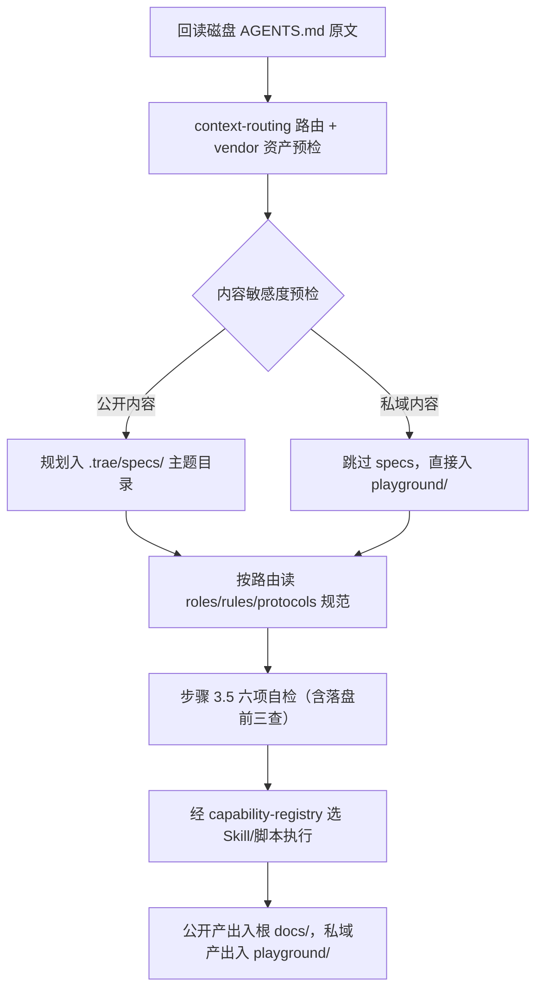

# SpecWeave 工作区勘察地图（P2 只讲不改）

> 面向第一次接手本仓库的人：用一份带**证据路径**的全景地图回答「关键模块在哪、任务从启动到产出经过哪几步、找某类东西该去哪里」。
>
> **证据纪律**：本文每条结构性结论均来自 2026-11-16 的只读勘察并附验证路径；凡引用仓库文件自述的数量（如 650+ 脚本、169 技能）一律标注「自述口径」，未做机械清点。勘察方法与零改动审计记录见文末附录。

## 1. 一句话全景

SpecWeave 不是可安装软件，而是一套以 [AGENTS.md](../../../AGENTS.md) 为统一入口的 **AI 智能体工作区规范体系**，仓库主体是 Markdown 规范文档、Sphinx 文档中心与 Python 验证脚本。

## 2. 顶层区域与权限矩阵

权限差异是本仓库最重要的地图信息：`apps/` 与 `projects/`/`vendor/` 有本质区别——前者是主仓直接管理的普通目录，后两者通过 gitlink 追踪外部仓库引用。

| 区域 | 职责 | 权限属性 | 区域入口 |
|---|---|---|---|
| [.agents/](../../../.agents/README.md) | AI 智能体规范容器：角色/规则/技能/脚本/协议/模板（37 个一级条目） | 主权区，主仓可改 | [.agents/README.md](../../../.agents/README.md) |
| [apps/](../../../apps/AGENTS.md) | 主仓内置应用工作空间（普通目录，**非** submodule） | 主仓可改 | [apps/AGENTS.md](../../../apps/AGENTS.md) |
| [projects/](../../../projects/AGENTS.md) | 第一方子项目（3 个 submodule + monetize/tvm-ffi 等主仓跟踪目录） | submodule 不可直接改，走子项目流程 | [projects/AGENTS.md](../../../projects/AGENTS.md) |
| [vendor/](../../../vendor/AGENTS.md) | 第三方依赖（21 个 submodule；flexloop 属 owned_collab 例外可在子模块内开发，其余 third_party 禁改） | gitlink 只读引用 | [vendor/AGENTS.md](../../../vendor/AGENTS.md) |
| [docs/](../../index.md) | 唯一对外文档中心（OKF v0.2，Sphinx + MyST），公开产出物唯一落盘地 | 主权区可改 | [docs/index.md](../../index.md) |
| [playground/](../../../playground/AGENTS.md) | 私域内容落盘区（实测 15 个条目，含 AGENTS.md/README.md/.agents 三件套） | 私域工作流产出地 | [playground/AGENTS.md](../../../playground/AGENTS.md) |
| `.trae/` | Trae 工作区，实测含 specs/documents/skills 三个子目录 | 公开内容 Spec 规划区 `.trae/specs/<theme>/` | — |

根目录关键工程文件：[.gitmodules](../../../.gitmodules)（submodule 清单）、[CLAUDE.md](../../../CLAUDE.md)（Claude Code 同源指引）、[pytest.ini](../../../pytest.ini)（testpaths 锁定 `.agents/scripts/tests`）、[build.sh](../../../build.sh)（仅服务 apps 下 vta-dev 镜像，**非**仓库主构建入口）、[.readthedocs.yml](../../../.readthedocs.yml)（文档自动构建）。

## 3. Submodule 清单（.gitmodules 实证）

实测 [.gitmodules](../../../.gitmodules) 登记 **24 个** submodule（2026-11-16，Select-String 计数）：

- **projects/ 下 3 个**：`xuanspace`、`awesome-okf-xs`、`daoapps.github.io`；
- **vendor/ 下 21 个**：`flexloop`、`ark-cli`、`knowledge-catalog`、`awesome-okf`、`awesome-okf-bundle`、`awesome-okf-kit`、`okf-bundle-template`、`jira-skill`、`veadk-python`、`podman-compose`、`podman-py`、`toolbox`，`netease-youdao/` 下 6 个（BCEmbedding、Confucius4-TTS、EmotiVoice、LobsterAI、QAnything、ScholarClaw），`WecomTeam/` 下 3 个（wecom-cli、wecom-unified、wecom-aibot-python-sdk）。

两个易踩的边界事实（均已实测）：

- `projects/zhenxuqiu-site` **不是** submodule（.gitmodules 检索无此条目），[projects/AGENTS.md](../../../projects/AGENTS.md) 明确其为无远端的独立仓；
- `projects/tvm-ffi` 目录实测存在，但未登记进 projects 路由表，治理归属**未确认**（见第 8 节）。

## 4. .agents/ 子容器地图

| 子容器 | 装什么 |
|---|---|
| `roles/` | 角色定义：AGENTS.md 口径为 7 个核心角色，磁盘另有 thesis-advisor、token-optimizer 与 loop-engineering-expert 子目录，顶层共 9 个角色/场景文档 |
| `rules/` | 原子化规则（阶段守卫、内容敏感度预检、RACI、AI 编码准则、frontmatter 标准等，136 为自述口径） |
| `skills/` | SKILL.md 技能门面（169 为自述口径，含自研门面与 IDE/设计库镜像） |
| `scripts/` | 验证/生成/CI 脚本（650+ 为自述口径，含 tests/lib/mdi/sg_dashboard 子目录） |
| `commands/` | 标准化指令集（15 为自述口径：复盘、洞察、原子化、Mermaid、对抗评审等） |
| `protocols/` | 协作协议（handoff、messaging、conflict-resolution、three-layer-routing、workspace-discovery、prompt-bootstrap 等 11 个 md） |
| `workflows/` | 3 个标准工作流：feature-development、code-review、testing |
| `templates/` | 任务/交接/CI/复盘模板 |
| `modules/` | 8 个自我演进模块（self-management/iteration/evolution/extraction/insight/retrospective/verification/development） |
| `prompts/` | 各角色 system-prompt.md 与 few-shot 示例 |
| `tools/` | 工具调用**规范层**（file-operations/code-execution/search/communication），非实现 |
| `checklists/` | 标准化检查清单（风险评分、代码审查、安全修复等 24 个） |
| 其余 | `capabilities/`（L0/L1/L2 渐进披露）、`capability-registry/`（01-04 分册）、`teams/`、`worlds/`、`systems/`、`cases/`、`config/`、`vendor-integration/` |

根级原子入口：[ONBOARDING.md](../../../.agents/ONBOARDING.md)（L0 速查）、[context-routing.md](../../../.agents/context-routing.md)（任务→规范路由表）、[global-core-rules.md](../../../.agents/global-core-rules.md)、[capability-registry.md](../../../.agents/capability-registry.md)（L1 能力注册总入口）、[subdirectory-responsibilities.md](../../../.agents/subdirectory-responsibilities.md)。

## 5. 任务链路：从启动到产出

链路要点（证据：[AGENTS.md](../../../AGENTS.md) 启动协议）：

1. **强制回读磁盘原文**，禁止只信系统注入的内联副本，并须锚定三个关键词（「启动协议」「docs/ 为唯一文档中心」「公开产出物入根 docs/」）；
2. **vendor 方法论资产预检**与工作目录无关，命中任务类型即须跨区读 vendor 规范；
3. **敏感度分流**：带 `share?code=`/`token=` 的链接、内部会议、个人笔记按私域处理，不确定时就高不就低；
4. **废止路径禁令**：`.agents/docs/` 随 2026-08-31 整体迁移废止，本次勘察实测该目录**不存在**（定向 Glob 返回硬 NotFound），无残留；
5. **落盘前三查**：查目标是否在根 `docs/` 下、查同类产出物现有位置、查规范是否来自磁盘原文。

## 6. 资产定位表：找东西去哪

| 要找的东西 | 路径 |
|---|---|
| 角色定义 | [.agents/roles/README.md](../../../.agents/roles/README.md) |
| 规则 | `.agents/rules/`（入口 [.agents/README.md](../../../.agents/README.md)） |
| 技能 Skill | `.agents/skills/`（169 为自述口径） |
| 自动化脚本 | `.agents/scripts/`（650+ 为自述口径） |
| 能力注册中心（L1） | [.agents/capability-registry.md](../../../.agents/capability-registry.md)，下挂 01-04 分册 |
| 知识包·最高可信级（只读） | `projects/awesome-okf-xs/doc/bundles/`（submodule 内，10 域/28 组/248 包为自述口径，入口见 [projects/AGENTS.md](../../../projects/AGENTS.md)） |
| 知识包·二级（主仓） | [docs/knowledge/index.md](../../knowledge/index.md) |
| 复盘报告 | [docs/retrospective/index.md](../../retrospective/index.md) |
| 模式库 | `docs/retrospective/patterns/`（方法论模式库入口 `patterns/methodology-patterns/index.md`） |
| Sphinx 配置与首页 | [docs/conf.py](../../conf.py)、[docs/index.md](../../index.md) |
| 区域路由 | [apps/AGENTS.md](../../../apps/AGENTS.md)、[projects/AGENTS.md](../../../projects/AGENTS.md)、[vendor/AGENTS.md](../../../vendor/AGENTS.md) |

索引层级：L0 用 [ONBOARDING.md](../../../.agents/ONBOARDING.md) 速查 → L1 用 capability-registry 与 context-routing 全量索引 → L2 进入各子目录 README；文档侧从 [docs/index.md](../../index.md) 五大板块（tech/knowledge/retrospective/general/topics）进入。

## 7. 与既有《项目结构》文档的关系

[project-structure.md](project-structure.md) 是早期从 README 拆分的静态结构说明，本次勘察发现其中三处口径已过时（附实测证据，本文不代为修改，留待后续治理）：

| project-structure.md 现口径 | 2026-11-16 实测 |
|---|---|
| `vendor/` 已被 .gitignore 排除、不纳入版本控制 | [.gitmodules](../../../.gitmodules) 登记 24 个 submodule，vendor/projects 均以 gitlink 追踪 |
| `.agents/roles/` 为 5 个角色 | 磁盘顶层 9 个角色/场景文档，AGENTS.md 口径为 7 个核心角色 |
| 未提 projects/、playground/ 与敏感度分流 | 二者均为现行核心区域，playground 实测 15 个条目 |

两份文档分工：`project-structure.md` 保留精简目录树定位；本文承担**证据化全景 + 任务链路 + 勘察审计**，并登记已知未确认项。

## 8. 未确认区域（勘察边界，如实登记）

1. 全部 24 个 submodule 内部未深入；248 知识包、169 技能、650+ 脚本等数字均为自述口径，未机械清点；根 README 徽章与注册中心存在新旧两套数字时以注册中心为权威；
2. `projects/tvm-ffi` 路由登记缺失，治理归属未确认；
3. 20+ 个隐藏工具运行时目录（.claude/.workbuddy/.codebuddy 等）仅证实存在，gitignore 跟踪状态未逐一核实；`.env` 按敏感纪律未读；
4. [apps/AGENTS.md](../../../apps/AGENTS.md) 超过 50KB，勘察时仅完整覆盖应用路由表部分，后半边界声明未全读；
5. [context-routing.md](../../../.agents/context-routing.md) 90+ 路由项仅核实结构与关键条目，未逐条核对。

## 9. 附录 A：零改动审计记录

P2 只讲不改的验收条件是「工作区零改动」。本仓为共享工作树，审计采用勘察前后双基线 + 独立复核。

| 时点 | HEAD | 工作树（`--ignore-submodules=all`） |
|---|---|---|
| 勘察前（约 13:16 后） | `05706da2d` | 仅预存 ` M .gitignore` 一项 |
| 勘察后（13:31 取证） | `9ed00f413` | `.gitignore` 外加 3 个修改：`checks_open_standard.py`、`frontmatter.py`、`test_skill_open_standard_severity.py` |

归因取证（reflog + Read 回执交叉验证）：

- 13:21、13:24 落入两个 `fix(skill-quality)` 提交（`2d7d0e0b0`、`9ed00f413`），与当日 12:15 起的技能质量门工作流连续，主题与勘察无关；
- 勘察执行者 Read 回执 11 个文件均为 Markdown/配置，**不包含**上述 3 个 Python 文件；`git status` 无任何未跟踪新文件；
- 结论：高置信度判定 HEAD 移动与 3 个改动来自**并发会话**，非勘察引入；共享工作树下无法机械证明执行者零写入，此为证据边界，不做绝对化断言。

已知盲区：按仓库纪律使用 `--ignore-submodules=all`，24 个 submodule 内部脏状态不在本证明范围内。

## 10. 附录 B：勘察方法与工作量

- **模式**：agent-task-handoff 技能 P2 建地图（只讲不改勘察），任务书含三问、五段回报格式与末尾否定式红线（禁写/禁建/禁删/禁 git 写）；
- **执行者切换排障**：首选 search 型子代理两轮均只能返回检索片段（能力边界，非任务书问题），切换 general_purpose_task 型执行者后一次通过；
- **实际工作量**：LS 1 次 / Glob 16 次 / Read 11 次（限额 25）/ Grep 0 次；
- **独立抽查**：废止目录、playground、.trae、docs/conf.py、submodule 计数与 zhenxuqiu/flexloop 登记状态等 10+ 项主张全部复验命中；
- **后续建议**：submodule 内部地图、数量机械清点、tvm-ffi 归属三项需另行授权深入，不在本次只读范围内。
